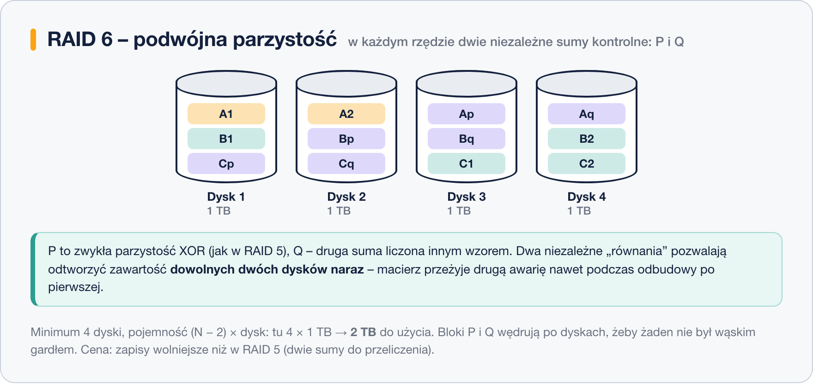

# RAID 6 – podwójna parzystość

> **W tej lekcji:** poznasz RAID 6 – rozwinięcie RAID 5 o drugą, niezależną sumę kontrolną: ile kosztuje, co daje podczas długiej odbudowy i kiedy jest obowiązkowym wyborem.

RAID 6 działa jak RAID 5, ale w każdym rzędzie bloków zapisuje **dwie niezależne sumy kontrolne**: znaną już parzystość **P** (XOR) oraz drugą sumę **Q**, liczoną innym wzorem matematycznym. Dzięki temu macierz potrafi odtworzyć zawartość **dwóch** dysków naraz.

To bezpośrednia odpowiedź na największą słabość RAID 5 – ryzyko drugiej awarii podczas wielogodzinnej odbudowy.

## Jak to działa

Bloki danych idą paskami, a bloki P i Q wędrują po dyskach jak parzystość w RAID 5 – w każdym rzędzie leżą na innych dyskach:

Dlaczego dwie sumy, a nie dwa razy ta sama? Dwie kopie XOR-a nie wystarczyłyby do odtworzenia dwóch różnych dysków – układ równań miałby dwie niewiadome i jedno równanie. Q jest liczona innym wzorem, więc daje **drugie, niezależne równanie**: z P i Q macierz wyliczy zawartość dowolnych dwóch brakujących dysków.

Cena: na sumy kontrolne oddajesz równowartość **dwóch** dysków, a każdy zapis wymaga przeliczenia obu sum – zapisy są wolniejsze niż w RAID 5. Odczyty pozostają szybkie.

| Parametr | RAID 6 |
|---|---|
| Minimalna liczba dysków | 4 |
| Pojemność do użycia | (N − 2) × dysk |
| Ile awarii dysków przeżyje | 2 (jednocześnie) |

Najważniejszy scenariusz w praktyce: pada dysk, rusza odbudowa, a w jej trakcie – pod obciążeniem – pada drugi dysk. RAID 5 w tym momencie traci wszystko; **RAID 6 pracuje dalej** i po wymianie obu dysków wraca do pełnej ochrony.

## Kiedy stosować

- macierze z dużych, pojemnych dysków (8 TB i więcej), gdzie odbudowa trwa dniami,
- archiwa i serwery kopii zapasowych – dużo miejsca, ochrona ważniejsza od szybkości zapisu,
- większa liczba dysków w macierzy (im więcej dysków, tym większe prawdopodobieństwo, że któryś padnie podczas odbudowy).

Przy 4 dyskach RAID 6 daje tyle samo miejsca co RAID 10 (połowę), ale wolniejsze zapisy – wtedy zwykle lepszy jest RAID 10. Przewaga RAID 6 rośnie z liczbą dysków: przy 8 dyskach to już 6 dysków miejsca wobec 4 w RAID 10.

## Podsumowanie

- RAID 6 = paski + dwie niezależne sumy kontrolne (P i Q) w każdym rzędzie.
- Minimum 4 dyski, pojemność (N − 2) × dysk, przeżywa dwie awarie jednocześnie.
- Chroni w najgroźniejszym momencie – podczas odbudowy po pierwszej awarii.
- Standard dla dużych, pojemnych macierzy; cena to wolniejsze zapisy i dwa dyski oddane na sumy.
