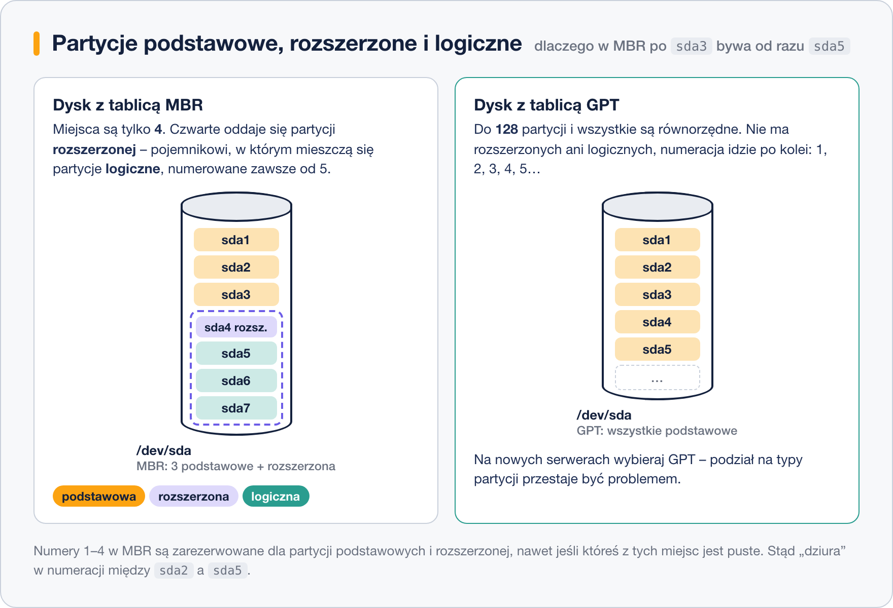

# Typy partycji – podstawowe, rozszerzone, logiczne

> **W tej lekcji:** zrozumiesz, dlaczego na dyskach MBR są trzy rodzaje partycji, skąd biorą się numery `sda5` bez `sda4`, oraz co oznaczają kody typów (Linux, LVM, swap, EFI).

Na dyskach MBR występują trzy rodzaje partycji – podstawowe, rozszerzone i logiczne. To obejście limitu czterech wpisów w tablicy sprzed czterdziestu lat i to stąd biorą się układy w rodzaju `sda1`, `sda2`, `sda5`, `sda6` bez `sda3` i `sda4` albo odmowa `fdisk` przy próbie dodania piątej partycji.

Na dyskach GPT ten podział nie istnieje, ale starsze maszyny, obrazy VM i pendrive'y z MBR będą Ci się trafiać jeszcze długo. Druga część lekcji – kody typów partycji (Linux, LVM, swap, EFI) – dotyczy obu formatów i przydaje się przy każdym partycjonowaniu.

## Jak to działa

### Trzy rodzaje partycji w MBR

Tablica MBR ma miejsce na dokładnie **cztery wpisy**. Gdy w latach 80. okazało się, że to za mało, wymyślono obejście:

- **Partycja podstawowa** (ang. *primary*) – zwykła partycja, jeden z czterech wpisów. Można na niej założyć system plików i z niej uruchamiać system.
- **Partycja rozszerzona** (ang. *extended*) – też zajmuje jeden z czterech wpisów, ale sama nie trzyma danych. Jest **pojemnikiem**, w którym mieści się dowolna liczba kolejnych partycji. Na dysku może być tylko jedna.
- **Partycja logiczna** (ang. *logical*) – partycja wewnątrz rozszerzonej. Działa jak podstawowa (system plików, montowanie), tylko nie da się z niej bezpośrednio uruchamiać starszych systemów.



### Numeracja

Numery **1–4 są zarezerwowane** dla partycji podstawowych i rozszerzonej. Partycje logiczne zaczynają się zawsze od **5**, nawet gdy miejsca 3 i 4 są puste. Stąd typowy układ starego dysku:

| Urządzenie | Rodzaj | Zawartość |
|---|---|---|
| `sda1` | podstawowa | `/boot` |
| `sda2` | rozszerzona | pojemnik – nie montuje się, nie formatuje |
| `sda5` | logiczna | `/` |
| `sda6` | logiczna | swap |

W GPT nie ma rozszerzonych ani logicznych – wszystkie partycje są równorzędne i numerowane po kolei, 1, 2, 3… aż do 128.

### Kody typów partycji

Niezależnie od formatu każda partycja ma **typ** – etykietę, która mówi systemom operacyjnym, do czego służy. Typ **nie formatuje** partycji ani nie zmienia danych; to tylko informacja. Linux w większości przypadków radzi sobie nawet z błędnym typem, ale niektóre narzędzia (instalator, LVM, UEFI) na niego patrzą.

| Przeznaczenie | Kod w MBR | Nazwa w GPT |
|---|---|---|
| Zwykła partycja z systemem plików Linux (XFS, ext4) | `83` Linux | Linux filesystem |
| Partycja oddana pod LVM | `8e` Linux LVM | Linux LVM |
| Pamięć wymiany | `82` Linux swap | Linux swap |
| Partycja systemowa EFI (tylko GPT) | – | EFI System |
| Składnik RAID programowego | `fd` Linux RAID | Linux RAID |
| Partycja rozszerzona (tylko MBR) | `5` lub `f` Extended | – |
| Partycja Windows (NTFS/exFAT) | `7` HPFS/NTFS/exFAT | Microsoft basic data |

Domyślnie `fdisk` nadaje nowej partycji typ „Linux” (`83` / Linux filesystem) – i w większości przypadków to właściwy wybór. Typ zmieniasz, gdy partycja ma trafić pod LVM, być swapem lub partycją EFI.

## W praktyce

```bash
# jaki rodzaj i typ mają partycje istniejącego dysku MBR (przykład ze starszej maszyny)
sudo fdisk -l /dev/sda
```

```text
Disklabel type: dos
Disk identifier: 0x3a7c1e52

Device     Boot   Start      End  Sectors  Size Id Type
/dev/sda1  *       2048  2099199  2097152    1G 83 Linux
/dev/sda2       2099200 83886079 81786880   39G  5 Extended
/dev/sda5       2101248 75497471 73396224   35G 83 Linux
/dev/sda6      75499520 83886079  8386560    4G 82 Linux swap / Solaris
```

Kolumna `Id` to kod typu, `Boot` z gwiazdką oznacza partycję, z której BIOS startuje system. `sda2` to pojemnik – zauważ, że `sda5` zaczyna się 2048 sektorów po nim (ten odstęp zajmuje opis partycji logicznej).

```bash
# w fdisk: lista wszystkich znanych kodów typów (w trybie interaktywnym – litera L)
sudo fdisk /dev/sdb
```

```text
Command (m for help): L

Type of partition table: gpt
   1 EFI System                     C12A7328-F81F-11D2-BA4B-00A0C93EC93B
   …
  19 Linux swap                     0657FD6D-A4AB-43C4-84E5-0933C84B4F4F
  20 Linux filesystem               0FC63DAF-8483-4772-8E79-3D69D8477DE4
  …
  Aliases:
   linux          - 0FC63DAF-8483-4772-8E79-3D69D8477DE4
   swap           - 0657FD6D-A4AB-43C4-84E5-0933C84B4F4F
   home           - 933AC7E1-2EB4-4F13-B844-0E14E2AEF915
   uefi           - C12A7328-F81F-11D2-BA4B-00A0C93EC93B
   raid           - A19D880F-05FC-4D3B-A006-743F0F84911E
   lvm            - E6D6D379-F507-44C2-A23C-238F2A3DF928
```

Na GPT typy to długie identyfikatory GUID. Numery na liście zależą od wersji `fdisk`, więc wygodniej używać **aliasów** (`lvm`, `swap`, `uefi`), które `fdisk` w RHEL 9/10 rozumie przy poleceniu `t`:

```text
Command (m for help): t
Partition number (1,2, default 2): 2
Partition type or alias (type L to list all): lvm

Changed type of partition 'Linux filesystem' to 'Linux LVM'.
```

Na dysku MBR to samo polecenie `t` przyjmuje kod szesnastkowy (`8e`) albo alias.

```bash
# szybki podgląd typów bez wchodzenia w fdisk
lsblk -o NAME,SIZE,PARTTYPENAME /dev/sda
```

```text
NAME   SIZE PARTTYPENAME
sda     40G
├─sda1 600M EFI System
├─sda2   1G Linux filesystem
└─sda3 38,4G Linux LVM
```

## Najczęstsze błędy i pułapki

- **„Nie mogę dodać piątej partycji.”** Na MBR masz 4 podstawowe – skończyły się wpisy. Trzeba było jedną zrobić rozszerzoną. Jeśli dysk jest pusty, po prostu użyj GPT.
- **Formatowanie partycji rozszerzonej.** `mkfs.xfs /dev/sda2` na pojemniku zniszczy opis partycji logicznych w środku. Rozszerzonej nigdy nie formatuje się ani nie montuje.
- **Ustawianie typu zamiast formatowania.** Zmiana typu na `swap` nie tworzy pamięci wymiany – do tego służy `mkswap`. Typ to etykieta, a nie zawartość.
- **Zły typ przy LVM.** Instalator i niektóre skrypty oczekują typu Linux LVM na partycji pod LVM. Samo `pvcreate` zadziała i z typem Linux, ale porządek ułatwia życie następnemu administratorowi.

## Podsumowanie

- MBR: 4 wpisy, więc jedną partycję robi się rozszerzoną (pojemnik), a w niej logiczne numerowane od 5.
- GPT: do 128 równorzędnych partycji, numeracja po kolei, bez typów podstawowy/rozszerzony/logiczny.
- Kod typu to etykieta przeznaczenia: `83`/Linux filesystem, `8e`/Linux LVM, `82`/Linux swap, EFI System. Nie formatuje i nie kasuje danych.
- W `fdisk` typ zmieniasz literą `t`; na RHEL 9/10 działają aliasy `linux`, `lvm`, `swap`, `uefi`.
