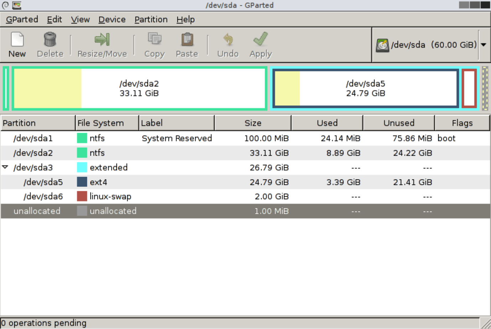

# gparted – partycjonowanie graficzne

> **W tej lekcji:** poznasz GParted – graficzny edytor partycji: co widać na jego ekranie, jakie operacje wykonuje i kiedy ma przewagę nad narzędziami terminalowymi.

## Po co mi to?

Nie każde partycjonowanie odbywa się przez SSH na serwerze. Na stacji roboczej z pulpitem, przy przenoszeniu systemu na większy dysk albo przy ratowaniu komputera, który nie startuje, wygodniej zobaczyć dysk jako kolorową mapę niż tabelę sektorów. Do tego służy **GParted** (GNOME Partition Editor) – nakładka graficzna na znany Ci już mechanizm partycjonowania (korzysta z tej samej biblioteki co `parted`).

GParted potrafi też coś, czego `fdisk` nie umie wcale: **przesuwać i zmieniać rozmiar partycji razem z systemem plików i danymi**.

## Jak to działa



Na zrzucie widać typowy dysk MBR komputera z dwoma systemami: partycje NTFS Windowsa (`sda1`, `sda2`), a dalej partycję rozszerzoną `sda3` z logicznymi `sda5` (ext4, Linux) i `sda6` (swap) – dokładnie układ z lekcji 4, tym razem narysowany.

Elementy okna, od góry:

- **Pasek menu i narzędzi** – nowa partycja, usunięcie, zmiana rozmiaru/przesunięcie, kopiowanie, cofnij oraz zielony „ptaszek” **Apply** (zastosuj).
- **Wybór dysku** (lista rozwijana w prawym górnym rogu) – np. `/dev/sda (40 GiB)`. Zawsze zaczynaj od upewnienia się, który dysk edytujesz.
- **Mapa dysku** – pasek, na którym każda partycja to prostokąt proporcjonalny do rozmiaru. Kolor oznacza system plików (np. ext4, xfs, ntfs), jaśniejsze wypełnienie – zajęte miejsce, szare pole – nieprzydzielone (ang. *unallocated*).
- **Lista partycji** – urządzenie (`/dev/sda1`), system plików, punkt montowania, etykieta, rozmiar, miejsce zajęte i wolne, flagi (`boot`, `esp`, `lvm`). Ikona kłódki przy partycji oznacza, że jest zamontowana – większości operacji nie da się na niej wykonać, dopóki nie wybierzesz „Odmontuj” z menu podręcznego.
- **Kolejka operacji** (dolny pasek) – i to jest kluczowe: każda operacja (utworzenie, usunięcie, zmiana rozmiaru) trafia najpierw **na listę oczekujących**. Dysk pozostaje nietknięty, dopóki nie klikniesz **Apply** i nie potwierdzisz. Do tego momentu wszystko można cofnąć (Ctrl+Z).

### Typowe operacje

| Operacja | Jak | Uwagi |
|---|---|---|
| Nowa tablica partycji | menu Device → Create Partition Table → `gpt` | kasuje spis wszystkich partycji dysku |
| Nowa partycja | zaznacz szare pole → Partition → New | od razu wybierasz system plików – GParted po Apply sam go utworzy |
| Usunięcie | zaznacz → Delete | partycja musi być odmontowana |
| Zmiana rozmiaru / przesunięcie | zaznacz → Resize/Move → przeciągnij krawędź | działa z danymi; na NTFS i ext4 także zmniejszanie |
| Formatowanie | Partition → Format to → xfs/ext4/… | zamienia system plików, kasując dane partycji |
| Etykieta, UUID, flagi | menu podręczne partycji | np. flaga `esp` dla partycji EFI |

Zwróć uwagę na różnicę wobec `fdisk`: GParted operuje na **partycjach razem z systemami plików**. Tworząc partycję, od razu ją formatuje; zmieniając rozmiar, powiększa lub zmniejsza też system plików. W terminalu to zawsze dwa osobne kroki.

### Live CD – GParted bez systemu

Partycji systemowej (zamontowany `/`) nie da się zmieniać z działającego systemu. Dlatego projekt wydaje **GParted Live** – mały obraz ISO, z którego uruchamiasz komputer (z pendrive'a albo jako ISO w maszynie wirtualnej). Wtedy żadna partycja nie jest zamontowana i można bezpiecznie zmieniać wszystko, łącznie z dyskiem systemowym – np. zmniejszyć partycję Windows przed doinstalowaniem Linuksa albo powiększyć `/` po wymianie dysku na większy.

## W praktyce

Na szkoleniowej maszynie z pulpitem GNOME:

```bash
# instalacja i uruchomienie (wymaga środowiska graficznego)
sudo dnf install gparted
sudo gparted
```

GParted wymaga uprawnień administratora – uruchomiony z menu aplikacji sam poprosi o hasło.

Scenariusz ćwiczeniowy na dysku `/dev/sdb`:

1. Wybierz `/dev/sdb` z listy w prawym górnym rogu. Upewnij się po rozmiarze, że to dysk ćwiczeniowy.
2. Device → Create Partition Table → `gpt` → Apply w oknie ostrzeżenia.
3. Kliknij szare pole *unallocated* → New: rozmiar 5120 MiB, system plików `xfs`, etykieta `dane` → Add.
4. Na pasku operacji pojawił się 1 wpis. Kliknij **Apply** → Apply. GParted utworzy partycję i od razu sformatuje ją na XFS.
5. Sprawdź w terminalu: `lsblk -f /dev/sdb` – partycja `sdb1` z FSTYPE `xfs` i etykietą `dane`.

### Ograniczenia na serwerze

Typowy serwer RHEL nie ma środowiska graficznego – i to nie jest problem GParteda, tylko powód, dla którego **musisz** znać `fdisk`/`parted`:

- bez pulpitu GParted się nie uruchomi (to aplikacja okienkowa),
- przez czyste SSH nie zobaczysz okna; obejścia (przekierowanie X11, VNC) bywają niedostępne lub zablokowane,
- w skryptach automatyzacji GParted jest bezużyteczny – tam rządzi `parted -s`.

GParted traktuj więc jako wygodne narzędzie na stację roboczą i do akcji ratunkowych z Live CD, a nie jako podstawowy warsztat administratora serwerów.

## Najczęstsze błędy i pułapki

- **Edycja złego dysku.** Lista dysków w rogu okna to pierwsza rzecz do sprawdzenia – mapa `/dev/sda` i `/dev/sdb` wygląda podobnie, a `Create Partition Table` nie wybacza.
- **Zapominanie o Apply.** Operacje czekają w kolejce; zamknięcie programu bez Apply porzuca je wszystkie. Bywa to zaletą (nic nie zepsułeś) i pułapką („przecież zrobiłem partycję!”).
- **Zmiana rozmiaru zamontowanej partycji.** Kłódka na liście = najpierw odmontuj (albo użyj Live CD, gdy to partycja systemowa).
- **Przerwanie Apply w trakcie.** Przesuwanie partycji z danymi może trwać godzinami – przerwanie (reset, brak zasilania) zwykle oznacza uszkodzony system plików. Przed dużymi operacjami zrób kopię zapasową.
- **Zmniejszanie XFS.** GParted zmniejszy ext4 i NTFS, ale XFS nie obsługuje zmniejszania w ogóle – opcja będzie zablokowana. To ograniczenie XFS, nie programu.

## Podsumowanie

- GParted to graficzny edytor partycji: mapa dysku, lista partycji, kolejka operacji zatwierdzana przyciskiem Apply.
- W odróżnieniu od `fdisk` operuje na partycjach **wraz z systemami plików** – tworzy, formatuje, powiększa i przesuwa z danymi.
- Partycję systemową zmieniaj z GParted Live (rozruch z ISO/pendrive'a).
- Na serwerze bez GUI GParted nie działa – tam używasz `fdisk`, `cfdisk` i `parted`.
