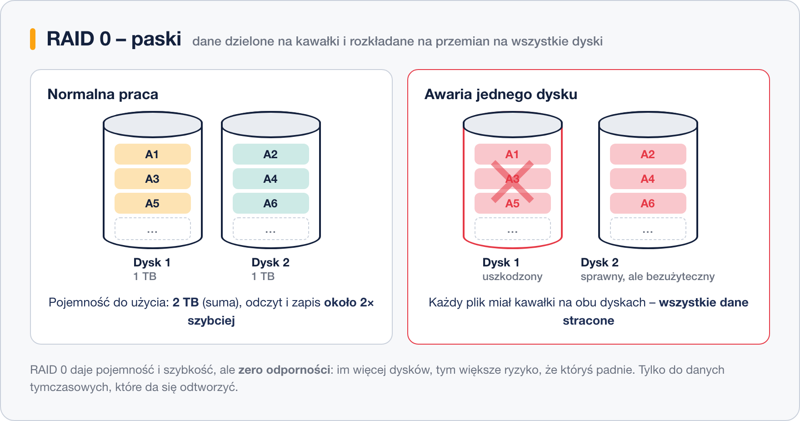
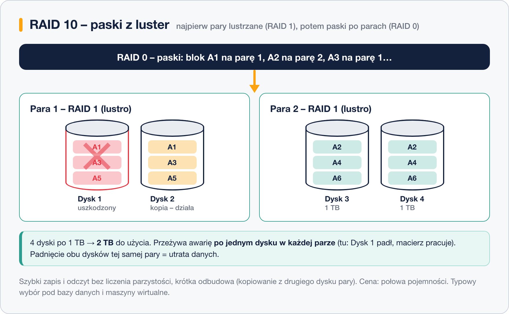

# Poziomy RAID

> **W tej lekcji:** poznasz poziomy RAID używane w praktyce – 0, 1, 5, 6 i 10. Dla każdego: jak działa, ile dysków potrzebuje, ile miejsca zostaje do użycia, ile awarii przeżyje i kiedy go wybrać.

## Po co mi to?

„Zrób RAID” to dopiero połowa decyzji. RAID 0 z dwóch dysków i RAID 1 z tych samych dwóch dysków to skrajnie różne macierze: pierwsza jest dwa razy pojemniejsza, druga przeżyje awarię. Wybór poziomu to wybór kompromisu między pojemnością, szybkością i bezpieczeństwem – a zmiana zdania po fakcie oznacza przebudowę macierzy i przenoszenie danych.

## Jak to działa

Dwa pojęcia wracają we wszystkich poziomach:

- **Paski** (ang. *striping*) – dane cięte na bloki i rozkładane **na przemian** na kolejne dyski. Daje szybkość (dyski pracują równolegle) i pojemność, ale nie chroni danych.
- **Lustro** (ang. *mirroring*) – te same dane zapisywane **jednocześnie** na dwóch (lub więcej) dyskach. Daje ochronę kosztem połowy pojemności.

Trzeci mechanizm – **parzystość** – poznasz przy RAID 5.

### RAID 0 – paski (striping)



Minimum **2 dyski**. Pojemność: **suma wszystkich** (dokładnie: N × najmniejszy dysk). Odczyt i zapis przyspieszają prawie N-krotnie. Odporność: **zero** – każdy plik ma kawałki na wszystkich dyskach, więc awaria dowolnego dysku niszczy całość. Co gorsza, ryzyko rośnie z liczbą dysków: wystarczy, że padnie *którykolwiek*.

Kiedy stosować: tylko tam, gdzie dane są tymczasowe albo łatwe do odtworzenia – przestrzeń robocza obróbki wideo, katalogi tymczasowe, bufory.

### RAID 1 – lustro (mirroring)


Minimum **2 dyski**. Pojemność: **jednego dysku** (50% przy dwóch). Odczyt bywa szybszy (można czytać z obu naraz), zapis – jak na pojedynczym dysku. Odporność: przeżyje awarię **wszystkich dysków poza jednym**.

Kiedy stosować: dyski systemowe serwerów, małe serwery z dwoma dyskami, wszędzie tam, gdzie prostota i pewność są ważniejsze niż pojemność. To najprostsza macierz do zrozumienia i odbudowy – odbudowa to zwykłe kopiowanie z ocalałego dysku.

### RAID 5 – paski z parzystością


Minimum **3 dyski**. Dane idą paskami jak w RAID 0, ale w każdym „rzędzie” bloków jeden blok to **parzystość** (ang. *parity*) – wynik operacji XOR na pozostałych blokach rzędu. Gdy padnie dowolny dysk, brakujące bloki wylicza się z ocalałych i parzystości. Blok parzystości wędruje między dyskami, żeby żaden nie stał się wąskim gardłem.

Pojemność: **(N − 1) × dysk** – na parzystość oddajesz równowartość jednego dysku. Odporność: **1 awaria**. Odczyt szybki; zapis wolniejszy, bo każdy wymaga przeliczenia parzystości.

Kiedy stosować: serwery plików i archiwa, gdzie liczy się pojemność z rozsądną ochroną. Uwaga na współczesne, wielkie dyski: odbudowa po wymianie trwa długo (godziny–dni), obciąża pozostałe dyski, a druga awaria w tym czasie oznacza utratę wszystkiego. Dlatego przy dyskach kilkuterabajtowych zamiast RAID 5 wybiera się dziś zwykle RAID 6.

### RAID 6 – podwójna parzystość

Jak RAID 5, ale w każdym rzędzie są **dwa niezależne bloki parzystości**. Minimum **4 dyski**, pojemność **(N − 2) × dysk**, odporność: **2 awarie jednocześnie** – macierz przeżyje nawet awarię drugiego dysku podczas odbudowy pierwszego. Zapis jeszcze wolniejszy niż w RAID 5 (dwie sumy do policzenia).

Kiedy stosować: duże macierze z pojemnych dysków, archiwa, serwery kopii zapasowych.

### RAID 10 – paski z luster



Minimum **4 dyski** (parzysta liczba). Dyski łączy się najpierw w **pary lustrzane** (RAID 1), a po parach rozkłada paski (RAID 0). Pojemność: **połowa**. Odporność: po **jednym dysku w każdej parze**; padnięcie obu dysków tej samej pary = utrata danych.

Szybki zapis i odczyt bez liczenia parzystości, a odbudowa to tylko skopiowanie zawartości drugiego dysku pary – krótko i bez obciążania całej macierzy. Kiedy stosować: bazy danych, wirtualizacja, obciążenia z dużą liczbą zapisów. Standardowy wybór „wydajność + bezpieczeństwo”, gdy stać Cię na oddanie połowy pojemności.

### Porównanie


### Poziomy historyczne i 0+1 vs 1+0

W numeracji istnieją też poziomy **2, 3 i 4** – wczesne pomysły z parzystością zapisywaną bit po bicie (2), bajt po bajcie (3) albo blokami na jednym dedykowanym dysku (4). Dedykowany dysk parzystości był wąskim gardłem każdego zapisu; RAID 5 rozwiązał to, rozpraszając parzystość – i poziomy 2–4 wyszły z użycia. Spotkasz je już tylko w podręcznikach (oraz ślad RAID 4 w macierzach NetApp).

Różnica **RAID 0+1** i **RAID 1+0 (10)**: 0+1 najpierw skleja dyski paskami w dwie duże połowy, a potem lustrzy te połowy; 1+0 odwrotnie – najpierw lustra, potem paski. Pojemność identyczna, ale odporność nie: w 0+1 awaria jednego dysku psuje całą połowę i macierz traci całą redundancję, a odbudowa wymaga przepisania połowy macierzy. Dlatego w praktyce używa się wyłącznie 1+0 i to on kryje się pod nazwą „RAID 10”.

## W praktyce

Szybka ściąga decyzyjna:

```text
Ile masz dysków i co jest najważniejsze?

2 dyski  ─ bezpieczeństwo        → RAID 1
2 dyski  ─ tylko szybkość/miejsce → RAID 0 (dane do odtworzenia!)
3+ dysków ─ pojemność + ochrona   → RAID 5 (małe dyski) / RAID 6 (duże)
4+ dysków ─ wydajność + ochrona   → RAID 10
```

I rachunek pojemności dla czterech dysków po 4 TB:

| Poziom | Do użycia | Przeżyje awarii |
|---|---|---|
| RAID 0 | 16 TB | 0 |
| RAID 1 (4 kopie) | 4 TB | 3 |
| RAID 5 | 12 TB | 1 |
| RAID 6 | 8 TB | 2 |
| RAID 10 | 8 TB | 1 na parę (max 2) |

## Najczęstsze błędy i pułapki

- **RAID 5 z wielkich dysków „bo więcej miejsca niż w 10”.** Policz czas odbudowy – przy dyskach 8+ TB to dni, w czasie których kolejna awaria kasuje macierz. RAID 6 albo 10.
- **Nieparzysta liczba dysków w RAID 10.** Pary muszą być pełne; piąty dysk zostaje zapasowym (hot-spare) – co zresztą jest dobrym pomysłem.
- **„RAID 1 marnuje połowę miejsca, więc jest zły.”** Ta „strata” to właśnie kupowana ochrona. Pojemność dysków jest tania; odtwarzanie danych i przestój – nie.
- **Mylenie RAID 0 z RAID 1.** Zdarza się nawet doświadczonym: 0 = zero ochrony (paski), 1 = jedna kopia lustrzana. Ustaw sobie w głowie raz na zawsze.

## Podsumowanie

- RAID 0 – pojemność i szybkość, zero ochrony. RAID 1 – lustro, prostota, połowa miejsca.
- RAID 5 – pojemność z ochroną na 1 awarię; ostrożnie przy dużych dyskach. RAID 6 – to samo z zapasem na 2 awarie.
- RAID 10 – lustra połączone paskami: szybkość + ochrona za połowę pojemności; standard pod bazy danych.
- Poziomy 2–4 i RAID 0+1 to historia; „RAID 10” zawsze oznacza 1+0.
- Żaden poziom nie zwalnia z kopii zapasowych.
