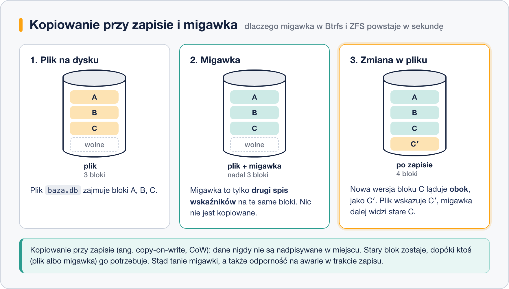

# Btrfs i ZFS

> **W tej lekcji:** zrozumiesz, czym systemy plików nowej generacji różnią się od ext4 i XFS – kopiowanie przy zapisie, migawki, sumy kontrolne danych, pule dysków – oraz gdzie spotkasz Btrfs i ZFS, a gdzie (na RHEL) ich nie ma.

## Po co mi to?

ext4 i XFS odpowiadają na pytanie „gdzie leży plik”. Btrfs i ZFS odpowiadają na więcej: „czy plik nie uległ cichemu uszkodzeniu”, „jak wyglądał system godzinę temu” i „jak połączyć sześć dysków w jedną pulę z nadmiarowością – bez osobnego RAID i LVM”. Jako początkujący administrator spotkasz je szybciej, niż myślisz: Btrfs jest domyślny w Fedorze i openSUSE, ZFS napędza serwery Proxmox i NAS-y na TrueNAS. Na RHEL ich nie zainstalujesz jednym poleceniem – i warto wiedzieć dlaczego.

## Jak to działa

### Kopiowanie przy zapisie

Klasyczny system plików modyfikuje blok w miejscu: zmieniasz jeden bajt w pliku, blok jest nadpisywany. Jeśli prąd zniknie w połowie, blok jest pół stary, pół nowy.

Btrfs i ZFS nigdy nie nadpisują. Nową wersję bloku zapisują **obok**, w wolnym miejscu, a potem jednym atomowym ruchem przestawiają wskaźnik. Stary blok zostaje, dopóki ktoś go potrzebuje. To **kopiowanie przy zapisie** (ang. copy-on-write, CoW).



Z CoW wynikają prawie za darmo trzy rzeczy:

- **Migawki** (ang. snapshots). Migawka to drugi spis wskaźników na te same bloki. Powstaje w ułamku sekundy i na początku zajmuje zero miejsca. Rośnie dopiero o to, co się od tego czasu zmieniło. Typowe użycie: migawka przed `dnf update`, a jeśli coś pójdzie nie tak – powrót w kilka sekund. openSUSE robi to automatycznie (narzędzie Snapper).
- **Spójność bez dziennika.** Skoro stara wersja zawsze istnieje do chwili przestawienia wskaźnika, po awarii system plików jest w stanie sprzed albo po zapisie – nigdy w połowie.
- **Klony i deduplikacja** – kopia pliku poleceniem `cp --reflink` nie kopiuje bloków, tylko wskaźniki.

### Sumy kontrolne danych

ext4 i XFS liczą sumy kontrolne **metadanych**. Btrfs i ZFS liczą je także dla **danych**, dla każdego bloku. Przy odczycie suma jest sprawdzana; jeśli się nie zgadza (uszkodzony sektor, błąd kabla, „bit rot” na starym dysku), system to wykryje, a przy zapisie nadmiarowym (lustro, RAID-Z) odczyta poprawną kopię z drugiego dysku i naprawi uszkodzoną. Proces okresowego sprawdzania wszystkich bloków to `scrub`.

### Pule i podwoluminy

Oba systemy łączą w sobie to, co w klasycznym Linuksie robią trzy warstwy: RAID (mdadm), LVM i system plików. Dyski wrzucasz do **puli** (ZFS: *zpool*; Btrfs: *filesystem* na wielu urządzeniach), określasz nadmiarowość (lustro, RAID-Z1/2/3 ≈ RAID 5/6 bez „dziury zapisu”), a potem w puli tworzysz dowolnie wiele **podwoluminów** (Btrfs: *subvolume*; ZFS: *dataset*). Każdy podwolumin ma własne migawki, limity i opcje (np. kompresję), a wszystkie dzielą jedno wolne miejsce z puli.

### Btrfs a ZFS – gdzie który

| | Btrfs | ZFS (OpenZFS) |
|---|---|---|
| Pochodzenie | Oracle, 2007, w jądrze Linux od 2009 | Sun Microsystems, 2005, Solaris |
| Licencja | GPL – część jądra Linux | CDDL – niezgodna z GPL, moduł poza jądrem |
| Domyślny w | Fedora Workstation (od 33), openSUSE, SUSE Linux Enterprise | FreeBSD, TrueNAS, Proxmox VE (opcja instalatora); Ubuntu – instalator eksperymentalny |
| W RHEL 9/10 | **brak** – usunięty w RHEL 8 (wcześniej „technology preview”) | **brak** w repozytoriach; możliwy z repozytorium OpenZFS na własną odpowiedzialność |
| Słabe punkty | RAID 5/6 nadal oznaczony jako niestabilny | pamięć RAM (zalecane ≥ 8 GB, ARC), nie przyjmuje nowego dysku do RAID-Z bez przebudowy (zmienia się to powoli) |

Dlaczego ZFS nie ma w jądrze Linux? Licencja CDDL, pod którą Sun wydał ZFS, nie pozwala łączyć go z kodem na GPL w jednym pliku binarnym. Projekt OpenZFS utrzymuje więc osobny moduł jądra, który dystrybucje muszą kompilować same. Red Hat tego nie robi; Canonical (Ubuntu) i Proxmox – tak.

## W praktyce

Na maszynie szkoleniowej RHEL nie ma ani Btrfs, ani ZFS, więc poniższe polecenia są do zapamiętania „jak to wygląda”, nie do wykonania. Zobaczysz je w Fedorze (Btrfs) lub Proxmoksie (ZFS).

```bash
# Btrfs (Fedora): lista podwoluminów i migawka katalogu domowego
sudo btrfs subvolume list /
sudo btrfs subvolume snapshot -r /home /home/.snap-2026-03-12
# sprawdzenie sum kontrolnych wszystkich bloków
sudo btrfs scrub start /
sudo btrfs scrub status /
```

```bash
# ZFS (Proxmox): stan puli, migawka, powrót do migawki
zpool status rpool
zfs list
zfs snapshot rpool/data/vm-100-disk-0@przed-aktualizacja
zfs rollback rpool/data/vm-100-disk-0@przed-aktualizacja
```

```text
  pool: rpool
 state: ONLINE
  scan: scrub repaired 0B in 00:12:41 with 0 errors on Sun Mar  8 00:36:42 2026
config:
        NAME        STATE     READ WRITE CKSUM
        rpool       ONLINE       0     0     0
          mirror-0  ONLINE       0     0     0
            sda3    ONLINE       0     0     0
            sdb3    ONLINE       0     0     0
```

Kolumna `CKSUM` to liczba bloków, których suma kontrolna się nie zgadzała – rosnąca wartość przy jednym dysku to wczesne ostrzeżenie przed awarią.

Jeśli na RHEL potrzebujesz migawek, rolę tę pełni **LVM** (migawki woluminów logicznych) oraz **Stratis** – warstwa zarządzania od Red Hata nad XFS, która daje pule i migawki bez zmiany systemu plików.

## Najczęstsze błędy i pułapki

- **Migawka to nie kopia zapasowa.** Leży na tym samym dysku co dane. Awaria dysku zabiera obie. Migawki chronią przed błędem człowieka i złą aktualizacją, nie przed pożarem serwerowni.
- **Pełna pula CoW.** System CoW potrzebuje wolnego miejsca, żeby cokolwiek zapisać – nawet skasować plik. Przy 100% zajętości Btrfs/ZFS potrafią zablokować się tak, że nie da się nic usunąć. Nie zapełniaj puli powyżej ~80–90%.
- **„Zainstaluję ZFS na RHEL z internetu”.** Da się, ale każda aktualizacja jądra może zepsuć moduł, a Red Hat nie udzieli wsparcia. Na szkoleniu i w produkcji na RHEL zostań przy XFS + LVM.
- **Btrfs RAID 5/6.** Mimo lat rozwoju dokumentacja Btrfs nadal odradza te tryby do produkcji. Lustro (RAID 1) jest w porządku.

## Podsumowanie

- Kopiowanie przy zapisie: nowe dane zapisywane obok starych, wskaźnik przestawiany atomowo – stąd tanie migawki i spójność bez dziennika.
- Sumy kontrolne danych wykrywają ciche uszkodzenia, a przy nadmiarowości naprawiają je same (`scrub`).
- Pula zastępuje RAID + LVM; podwoluminy dzielą jedno wolne miejsce.
- Btrfs: w jądrze, domyślny w Fedorze i SUSE. ZFS: licencja CDDL, moduł OpenZFS, Proxmox i TrueNAS. **Żadnego z nich nie ma w RHEL** – tam używasz XFS z LVM lub Stratis.
