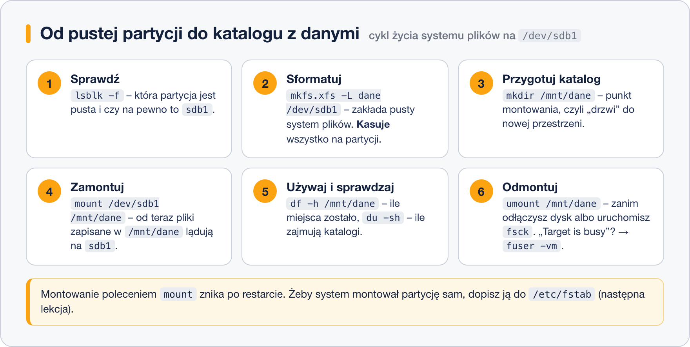

# Zarządzanie systemami plików

> **W tej lekcji:** przejdziesz pełny cykl pracy z dodatkowym dyskiem – od pustej partycji przez `mkfs`, `mount`, sprawdzanie miejsca, po `umount` i `fsck` – oraz nauczysz się rozpoznawać partycje po etykiecie i UUID i montować obrazy ISO i pendrive’y.

## Po co mi to?

Do serwera dokładasz drugi dysk na kopie zapasowe. Baza danych potrzebuje osobnego wolumenu. Pendrive z instalatorem trzeba przejrzeć, a obraz ISO sprawdzić bez wypalania płyty. Każda z tych sytuacji to ten sam zestaw sześciu poleceń. W Windows klikasz „Zarządzanie dyskami → Formatuj → przypisz literę”; w Linuksie robisz to świadomie, krok po kroku, i dzięki temu rozumiesz, co się dzieje, gdy coś nie zadziała.

## Jak to działa

Linux nie ma liter dysków. Jest jedno drzewo katalogów zaczynające się od `/`, a każdy dodatkowy system plików **wpina się** w nie w wybranym katalogu. Ten katalog to **punkt montowania** (ang. mount point). Od chwili zamontowania wszystko, co zapiszesz w `/mnt/dane`, ląduje na `/dev/sdb1`; po odmontowaniu katalog wraca do swojej (zwykle pustej) zawartości.



Montowanie poleceniem `mount` jest **tymczasowe** – znika po restarcie. Trwałe wpisy robi się w `/etc/fstab`, o którym mówi lekcja 7.

## W praktyce

### Krok 1. Rozpoznanie

```bash
# co mamy: dyski, partycje, systemy plików, punkty montowania
lsblk -f
```

```text
NAME   FSTYPE FSVER LABEL UUID                                 MOUNTPOINTS
sda
├─sda1 xfs                7c3b9a1e-…                           /boot
└─sda2 LVM2_…
sdb
└─sdb1
```

`sdb1` istnieje (założyliśmy ją w module o dyskach), ale kolumna `FSTYPE` jest pusta – nie ma na niej systemu plików.

### Krok 2. Utworzenie systemu plików

```bash
# XFS z etykietą (domyślny wybór na RHEL); -L nadaje etykietę
sudo mkfs.xfs -L dane /dev/sdb1
```

```bash
# albo ext4, jeśli dysk ma być czytany także na starszych systemach
sudo mkfs.ext4 -L dane /dev/sdb1
```

`mkfs` to polecenie-rozdzielnia: `mkfs -t xfs` wywołuje `mkfs.xfs`. Każde z nich **kasuje** dotychczasową zawartość partycji. Zanim naciśniesz Enter, sprawdź literę dysku dwa razy.

### Krok 3. Identyfikatory: etykieta i UUID

```bash
# UUID, etykieta i typ każdego systemu plików
sudo blkid /dev/sdb1
```

```text
/dev/sdb1: LABEL="dane" UUID="3f1c7a2e-8b4d-4e21-9f0a-2c6d1b5e9a77" BLOCK_SIZE="512" TYPE="xfs" PARTUUID="a1b2c3d4-01"
```

- **UUID** (ang. universally unique identifier) – losowy identyfikator nadawany przy `mkfs`. Nie zmienia się, gdy dysk przepniesz do innego portu i `sdb` stanie się `sdc`.
- **LABEL** – etykieta nadana przez Ciebie, czytelna dla człowieka. Może się powtarzać między dyskami, więc do konfiguracji systemowej lepszy jest UUID.

Dowiązania do wszystkich identyfikatorów leżą w `/dev/disk/by-uuid/`, `/dev/disk/by-label/` i `/dev/disk/by-id/`.

### Krok 4. Montowanie

```bash
# punkt montowania musi istnieć; -p nie zgłasza błędu, jeśli już jest
sudo mkdir -p /mnt/dane
# montujemy po nazwie urządzenia…
sudo mount /dev/sdb1 /mnt/dane
# …albo po etykiecie lub UUID – to samo, ale odporne na zmianę litery
sudo mount LABEL=dane /mnt/dane
sudo mount UUID=3f1c7a2e-8b4d-4e21-9f0a-2c6d1b5e9a77 /mnt/dane
```

`mount` sam rozpoznaje typ systemu plików. Opcję `-t xfs` podajesz tylko, gdy rozpoznanie zawiedzie.

```bash
# co jest zamontowane i z jakimi opcjami
findmnt /mnt/dane
```

```text
TARGET    SOURCE    FSTYPE OPTIONS
/mnt/dane /dev/sdb1 xfs    rw,relatime,seclabel,attr2,inode64,logbufs=8,logbsize=32k,noquota
```

Samo `findmnt` bez argumentu pokazuje całe drzewo montowań; `mount` bez argumentów też, ale mniej czytelnie.

### Krok 5. Ile miejsca

```bash
# wolne miejsce na każdym zamontowanym systemie plików
df -h
```

```text
System plików       rozm. użyte dost. %uż. zamont. na
/dev/mapper/rl-root   17G  2,1G   15G  13% /
/dev/sda1            960M  260M  701M  28% /boot
/dev/sdb1            5,0G   68M  5,0G   2% /mnt/dane
```

```bash
# ile zajmują katalogi – suma (-s) w czytelnych jednostkach (-h)
sudo du -sh /var/log /home/*
```

```text
48M   /var/log
1,2G  /home/anna
310M  /home/jan
```

`df` pyta system plików o liczniki (szybko, pokazuje całość). `du` chodzi po katalogach i sumuje pliki (wolno, ale wskazuje winowajcę). Różnica między nimi to zwykle skasowane pliki trzymane przez procesy (`lsof +L1`).

```bash
# największe katalogi bezpośrednio pod /var, posortowane
sudo du -h --max-depth=1 /var | sort -h | tail -5
```

### Krok 6. Odmontowanie

```bash
# odmontować można podając punkt montowania albo urządzenie
sudo umount /mnt/dane
```

Uwaga na pisownię: `umount`, nie „unmount”.

```text
umount: /mnt/dane: target is busy.
```

Ktoś używa tego katalogu – ma w nim otwarty plik albo po prostu w nim „stoi” (jest to jego bieżący katalog). Sprawdź kto:

```bash
# -v szczegóły, -m: wszystkie procesy korzystające z systemu plików
sudo fuser -vm /mnt/dane
```

```text
                     UŻYTKOWNIK   PID DOSTĘP POLECENIE
/mnt/dane:           anna        4123 ..c..  bash
                     root        4310 F....  rsync
```

Litera `c` to bieżący katalog, `F` – otwarty plik do zapisu. Alternatywa: `sudo lsof +D /mnt/dane`. Rozwiązanie: poproś użytkownika o `cd ~`, poczekaj na zakończenie `rsync` – albo `sudo fuser -km /mnt/dane`, które **zabija** te procesy (ostrożnie!). Ostatnia deska ratunku to `umount -l` (ang. lazy) – odłącza katalog od drzewa natychmiast, a system plików zwalnia, gdy ostatni proces go zamknie.

### Sprawdzanie spójności

```bash
# fsck TYLKO na odmontowanym systemie plików; ext4:
sudo umount /mnt/dane
sudo fsck /dev/sdb1
# XFS ma własne narzędzie
sudo xfs_repair /dev/sdb1
```

Gdy nie możesz odmontować (np. `/`), ale chcesz zatrzymać zapisy, przełącz system plików w tryb tylko do odczytu bez odmontowania:

```bash
# -o remount zmienia opcje w locie; ro = tylko odczyt, rw = powrót do zapisu
sudo mount -o remount,ro /mnt/dane
sudo mount -o remount,rw /mnt/dane
```

### Obraz ISO i pendrive

```bash
# obraz ISO montujemy jak urządzenie, przez urządzenie pętli (loop); zawsze tylko do odczytu
sudo mkdir -p /mnt/iso
sudo mount -o loop,ro ~/Pobrane/Rocky-9-minimal.iso /mnt/iso
ls /mnt/iso
sudo umount /mnt/iso
```

```bash
# pendrive: najpierw znajdź jego nazwę (pojawi się jako nowy dysk, zwykle sdc)
lsblk -f
# pendrive z Windows ma zwykle FAT32 (vfat) lub exFAT – montowanie jak każde inne
sudo mount /dev/sdc1 /mnt/usb
# przed wyjęciem KONIECZNIE odmontuj – dopiero wtedy dane są fizycznie zapisane
sudo umount /mnt/usb
```

> **Na Ubuntu/Debianie i w środowisku graficznym:** pendrive montuje się sam w `/media/<użytkownik>/<etykieta>` (robi to usługa `udisks2`). Na serwerze bez pulpitu montujesz ręcznie.

## Najczęstsze błędy i pułapki

- **`mkfs` na złej partycji.** Nie ma „cofnij”. Przed formatowaniem: `lsblk -f` i upewnij się, że `FSTYPE` i `MOUNTPOINTS` są puste.
- **Montowanie w niepustym katalogu.** Działa, ale dotychczasowa zawartość katalogu staje się niewidoczna do odmontowania. Jeśli „zniknęły” pliki z `/mnt/dane`, sprawdź `findmnt`, czy nie zamontowałeś czegoś „na nich”.
- **`umount` z własnego katalogu.** Siedząc w `/mnt/dane`, sam jesteś powodem „target is busy”. Wyjdź: `cd`.
- **Wyciągnięcie pendrive’a bez `umount`.** Linux buforuje zapisy w pamięci; bez odmontowania (albo przynajmniej `sync`) plik może nie być na nośniku w całości.
- **`fsck` na zamontowanym systemie plików.** Może uszkodzić dane. Odmontuj albo użyj `remount,ro` i trybu ratunkowego.

## Podsumowanie

- Cykl: `lsblk -f` → `mkfs` → `mkdir` → `mount` → `df`/`du` → `umount`.
- Do identyfikacji partycji używaj UUID lub etykiety, nie `/dev/sdX`.
- `df` – ile zostało; `du` – kto zajął. „target is busy” – `fuser -vm`.
- `fsck`/`xfs_repair` tylko na odmontowanym; `remount,ro` zatrzymuje zapisy bez odmontowania.
- ISO montujesz z `-o loop,ro`; pendrive odmontuj przed wyjęciem.

| Polecenie | Co robi |
|---|---|
| `lsblk -f` | dyski, partycje, systemy plików, punkty montowania |
| `mkfs.xfs -L e /dev/sdb1`, `mkfs.ext4 -L e /dev/sdb1` | tworzy system plików |
| `blkid /dev/sdb1` | UUID, etykieta, typ |
| `mount /dev/sdb1 /mnt/dane` | montuje (także `LABEL=`, `UUID=`) |
| `findmnt [/mnt/dane]` | co i jak jest zamontowane |
| `df -h`, `df -i` | wolne miejsce, wolne i-węzły |
| `du -sh katalog`, `du -h --max-depth=1` | rozmiar katalogów |
| `umount /mnt/dane` | odmontowuje |
| `fuser -vm /mnt/dane`, `lsof +D /mnt/dane` | kto blokuje odmontowanie |
| `mount -o remount,ro /mnt/dane` | przełącza w tryb tylko do odczytu |
| `mount -o loop,ro plik.iso /mnt/iso` | montuje obraz ISO |
| `fsck /dev/sdb1`, `xfs_repair /dev/sdb1` | sprawdza odmontowany system plików |
