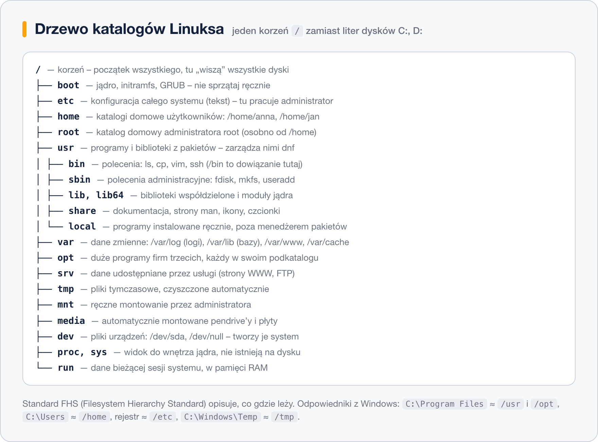

# Drzewo katalogów Linuksa

> **W tej lekcji:** nauczysz się czytać drzewo katalogów Linuksa – gdzie leży konfiguracja, programy, logi, dane użytkowników – i które katalogi wolno Ci dotykać, a które zostawić systemowi.

Układ katalogów Linuksa – gdzie leżą programy, konfiguracja, logi i dane użytkowników – opisuje standard **FHS** (ang. Filesystem Hierarchy Standard); to odpowiednik porządku znanego z Windows (`C:\Program Files`, `C:\Users\anna`, rejestr). Gdy go znasz, w dowolnej dystrybucji – RHEL, Ubuntu, Alpine – znajdziesz plik konfiguracyjny usługi, jej logi i dane bez szukania w internecie; gdy go nie znasz, łatwo skasować coś w `/usr` albo zapisać dane bazy w `/tmp`, skąd znikną po restarcie.

Jedna zasadnicza różnica: Linux **nie ma liter dysków**. Jest jedno drzewo zaczynające się od korzenia `/`, a kolejne dyski, partycje, pendrive’y i udziały sieciowe wpinają się do niego w wybranych katalogach (lekcja 5). Użytkownik nie musi wiedzieć, że `/home` jest na innym dysku niż `/`.

## Jak to działa



### Katalogi, w których pracuje administrator

| Katalog | Co tu jest | Czy ruszać |
|---|---|---|
| `/etc` | Konfiguracja całego systemu w plikach tekstowych: `passwd`, `fstab`, `hosts`, `ssh/sshd_config`, `systemd/`, `dnf/`. Nazwa historycznie od *et cetera*, dziś czyta się ją jako *editable text configuration*. | **Tak** – to Twoje główne miejsce pracy. Kopia przed edycją. |
| `/home` | Katalogi domowe użytkowników: `/home/anna`, `/home/jan`. Skrót `~`. Ukryte pliki `.bashrc`, `.ssh/` to ustawienia osobiste. | Tak, własny; cudze tylko jako root i z powodem. |
| `/root` | Katalog domowy administratora. Osobno od `/home`, żeby był dostępny, nawet gdy `/home` jest na niezamontowanym dysku. | Tak, jako root. |
| `/var` | Dane **zmienne** w czasie pracy: `/var/log` (logi), `/var/lib` (dane usług – bazy danych, pakiety), `/var/cache`, `/var/spool` (kolejki poczty, druku, cron), `/var/www` (strony WWW). Rośnie – często na osobnej partycji. | Tak, ale przez narzędzia: logi przez `journalctl`/`logrotate`, dane przez usługi. |
| `/opt` | Duże programy firm trzecich, każdy w swoim podkatalogu (`/opt/google/chrome`). | Tak – tu instalujesz oprogramowanie spoza repozytoriów. |
| `/srv` | Dane udostępniane przez usługi: `/srv/www`, `/srv/ftp`, `/srv/git`. Na RHEL rzadko używany (serwer WWW używa `/var/www`). | Tak. |
| `/usr/local` | Programy i skrypty zbudowane lub napisane lokalnie: `/usr/local/bin/moj-skrypt.sh`. Menedżer pakietów tu nie zagląda, więc nic nie nadpisze. | Tak – tu lądują Twoje skrypty. |
| `/mnt`, `/media` | Puste punkty montowania: `/mnt` do ręcznego montowania przez administratora, `/media` do automatycznego (pendrive w środowisku graficznym). | Tak – zakładasz podkatalogi. |
| `/tmp` | Pliki tymczasowe, dostępne dla wszystkich (bit „sticky” – usuwasz tylko swoje). Na RHEL czyszczone przez `systemd-tmpfiles` po 10 dniach i przy restarcie. | Tak, ale nic ważnego. |

### Katalogi, które należą do systemu

| Katalog | Co tu jest | Czy ruszać |
|---|---|---|
| `/boot` | Jądro (`vmlinuz-*`), `initramfs-*`, konfiguracja GRUB (`grub2/`), na UEFI także `efi/`. Często osobna, mała partycja. | **Nie ręcznie.** Stare jądra usuwaj przez `dnf remove`. |
| `/usr` | Programy i biblioteki zainstalowane z pakietów (*Unix System Resources*, nie *user*). `/usr/bin` – polecenia, `/usr/sbin` – polecenia administracyjne, `/usr/lib`, `/usr/lib64` – biblioteki i moduły jądra, `/usr/share` – dokumentacja, strony `man`, ikony. | **Nie** – właścicielem jest `dnf`. |
| `/bin`, `/sbin`, `/lib`, `/lib64` | Na RHEL od wersji 7 to tylko **dowiązania symboliczne** do odpowiedników w `/usr`. `ls -l /` pokaże `bin -> usr/bin`. Zostały dla zgodności ze skryptami. | Nie. |
| `/dev` | Pliki urządzeń: `/dev/sda`, `/dev/sdb1`, `/dev/tty1`, `/dev/null` („czarna dziura”), `/dev/urandom`. Tworzy je i usuwa na bieżąco `udev`. | Nie – używasz, nie modyfikujesz. |
| `/proc` | Okno do jądra: `/proc/cpuinfo`, `/proc/meminfo`, `/proc/<PID>/` dla każdego procesu. Nie istnieje na dysku – generowany w locie. | Odczyt tak; zapis tylko świadomie (`/proc/sys` przez `sysctl`). |
| `/sys` | Drugie okno do jądra: urządzenia, sterowniki, parametry sprzętu. | Jak wyżej. |
| `/run` | Dane bieżącej sesji systemu w pamięci RAM: pliki PID usług, gniazda, `/run/user/<UID>`. Pusty po restarcie. Zastąpił dawne `/var/run`. | Nie. |
| `/lost+found` | Tylko na partycjach ext – tu `fsck` odkłada pliki, których katalog zaginął. Normalnie pusty. | Zaglądasz tylko po naprawie dysku. |

### Odpowiedniki z Windows

| Windows | Linux | Uwaga |
|---|---|---|
| `C:\Program Files` | `/usr` (z pakietów), `/opt` (firm trzecich) | w Linuksie program jest rozrzucony: binarium w `/usr/bin`, biblioteki w `/usr/lib64`, konfiguracja w `/etc`, dane w `/var/lib` |
| `C:\Users\anna` | `/home/anna` | |
| `C:\Users\Administrator` | `/root` | |
| Rejestr, `C:\ProgramData` | `/etc` | pliki tekstowe zamiast bazy binarnej |
| `C:\Windows\System32\drivers` | `/usr/lib/modules/<wersja-jądra>` | |
| `C:\Windows\Temp` | `/tmp`, `/var/tmp` | |
| Podgląd zdarzeń | `/var/log`, `journalctl` | |
| `D:`, `E:` | `/mnt/dane`, `/media/anna/USB` | brak liter – punkty montowania |

## W praktyce

```bash
# korzeń drzewa; -l pokaże, że bin, sbin, lib to dowiązania do /usr
ls -l /
```

```text
lrwxrwxrwx.   1 root root    7 05-16  2024 bin -> usr/bin
dr-xr-xr-x.   6 root root 4096 03-12 09:38 boot
drwxr-xr-x.  20 root root 3200 03-12 09:40 dev
drwxr-xr-x.  93 root root 8192 03-12 09:41 etc
drwxr-xr-x.   4 root root   30 03-11 15:02 home
lrwxrwxrwx.   1 root root    7 05-16  2024 lib -> usr/lib
…
```

```bash
# które katalogi leżą na osobnych systemach plików
findmnt -t xfs,ext4,vfat
```

```text
TARGET SOURCE                FSTYPE OPTIONS
/      /dev/mapper/rl-root   xfs    rw,relatime,…
└─/boot /dev/sda1            xfs    rw,relatime,…
```

```bash
# gdzie pakiet rozłożył swoje pliki – na przykładzie serwera SSH
rpm -ql openssh-server | head
```

```text
/etc/ssh/sshd_config
/etc/sysconfig/sshd
/usr/lib/systemd/system/sshd.service
/usr/sbin/sshd
/var/lib/sshd
```

Jeden pakiet, cztery katalogi, każdy zgodnie z FHS: konfiguracja w `/etc`, jednostka systemd i program w `/usr`, dane w `/var/lib`.

```bash
# jak duży jest każdy katalog najwyższego poziomu (bez /proc i /sys, które są wirtualne)
sudo du -shx /* 2>/dev/null | sort -h
```

```bash
# pełny opis standardu w systemie
man hier
```

## Najczęstsze błędy i pułapki

- **Trzymanie danych w `/tmp`.** Znikną. Dane usług – `/var/lib`, dane robocze – `/srv` lub `/home`, pliki tymczasowe, które mają przeżyć restart – `/var/tmp`.
- **Ręczne grzebanie w `/usr`** („podmienię ten plik w `/usr/bin`”). Następna aktualizacja pakietu go nadpisze, a `rpm -V` zgłosi uszkodzony pakiet. Własne wersje kładź w `/usr/local/bin`, które jest w `PATH` **przed** `/usr/bin`.
- **Sprzątanie `/boot` przez `rm`.** Usunięcie jądra bez aktualizacji GRUB kończy się niestartującym systemem. Zawsze `dnf remove kernel-<wersja>`.
- **`du` na `/proc` lub `/sys`.** Pokaże absurdalne rozmiary (np. 128 TB dla `/proc/kcore`) – to pliki wirtualne. Dodaj `-x`, by nie przechodzić do innych systemów plików.
- **Szukanie logów w `/etc`.** Konfiguracja usługi jest w `/etc`, jej logi w `/var/log` albo w `journalctl -u nazwa`.

## Podsumowanie

- Jedno drzewo od `/`, bez liter dysków; dodatkowe dyski wpinają się jako katalogi.
- Twoje katalogi: `/etc` (konfiguracja), `/home` i `/root` (ludzie), `/var` (dane i logi), `/opt` i `/usr/local` (własne programy), `/mnt` (montowanie).
- Katalogi systemu: `/usr` (pakiety), `/boot` (jądro), `/dev`, `/proc`, `/sys`, `/run` (wirtualne lub generowane).
- `/bin`, `/sbin`, `/lib` to dziś tylko dowiązania do `/usr`.
- Jeden program = kilka katalogów według roli pliku. `rpm -ql pakiet` pokaże, gdzie co leży.

| Szukam… | Zaglądam do |
|---|---|
| pliku konfiguracyjnego usługi | `/etc/<usługa>/` |
| logów | `/var/log/`, `journalctl -u <usługa>` |
| danych usługi (baza, repozytorium) | `/var/lib/<usługa>/` |
| programu | `which polecenie` → `/usr/bin` lub `/usr/sbin` |
| strony podręcznika, przykładów | `/usr/share/doc/<pakiet>/`, `man` |
| jądra i GRUB | `/boot/` |
| informacji o sprzęcie | `/proc/cpuinfo`, `/proc/meminfo`, `/sys/` |
