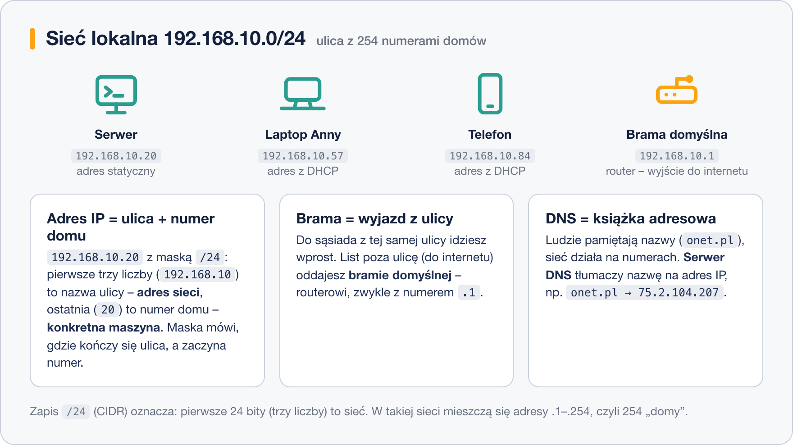

# Podstawy sieci dla administratora

> **W tej lekcji:** uporządkujesz pojęcia, bez których nie da się rozmawiać o sieci: adres IP i maska, brama domyślna, DNS, DHCP, adres MAC, porty. Dowiesz się też, dlaczego karta sieciowa w Linuksie nazywa się `ens192` albo `enp0s3`.

Adres IP, maska, brama i DNS to cztery ustawienia, które opisują miejsce komputera w sieci.
Administrator podaje je przy każdej instalacji serwera i sprawdza przy każdym problemie
z połączeniem, dlatego ta lekcja wyjaśnia, co każde z nich znaczy, zanim w kolejnych lekcjach
zaczniesz je konfigurować i diagnozować.

## Jak to działa

### Adres IP i maska – ulica i numer domu

Każde urządzenie w sieci ma **adres IP** – cztery liczby 0–255 oddzielone kropkami, np.
`192.168.10.20`. Adres składa się z dwóch części, jak adres pocztowy:

- **adres sieci** – „nazwa ulicy”, wspólna dla wszystkich urządzeń w tej samej sieci lokalnej,
- **adres hosta** – „numer domu”, unikalny dla konkretnej maszyny.

Gdzie kończy się ulica, a zaczyna numer, mówi **maska**. Zapis **CIDR** `/24` oznacza: pierwsze
24 bity (czyli trzy pierwsze liczby) to sieć. W sieci `192.168.10.0/24` wszystkie urządzenia
zaczynają się od `192.168.10.`, a numery domów biegną od `.1` do `.254` – razem 254 adresy.
Starszy zapis tej samej maski to `255.255.255.0`; oba spotkasz w konfiguracjach i znaczą
dokładnie to samo.



### Brama domyślna – wyjazd z ulicy

Do urządzenia **na tej samej ulicy** (w tej samej sieci) komputer wysyła dane bezpośrednio.
Wszystko, co jest poza nią – cały internet – oddaje **bramie domyślnej** (ang. *default
gateway*): routerowi, który wie, dokąd przekazać pakiet dalej. Brama ma zwykle pierwszy numer na
ulicy, np. `192.168.10.1`. Bez poprawnej bramy sieć lokalna działa, ale internet nie – to jedna
z najczęstszych usterek.

### DNS – książka adresowa

Sieć działa na liczbach, ludzie wolą nazwy. **DNS** (*Domain Name System*) to usługa, która na
pytanie „jaki adres ma `onet.pl`?” odpowiada liczbą. Twój system musi znać adres przynajmniej
jednego **serwera DNS** – często jest nim ten sam router (`192.168.10.1`) albo serwery publiczne,
np. `8.8.8.8` (Google) czy `1.1.1.1` (Cloudflare). Zepsuty DNS daje charakterystyczny objaw:
`ping 8.8.8.8` działa, a `ping onet.pl` nie.

### DHCP czy adres statyczny

Skąd komputer zna swój adres? Są dwie drogi:

- **DHCP** (*Dynamic Host Configuration Protocol*) – komputer po włączeniu woła „potrzebuję
  adresu!”, a serwer DHCP (zwykle router) przydziela mu wolny adres, maskę, bramę i DNS.
  Zero konfiguracji – tak działają laptopy i telefony.
- **Adres statyczny** – wpisany na stałe przez administratora. Tak konfiguruje się **serwery**:
  ich adres nie może się zmieniać, bo wskazują na niego inni (DNS, zapory, aplikacje).

### Adres MAC

Oprócz adresu IP każda karta sieciowa ma **adres MAC** – fabryczny, „wypalony” identyfikator
sprzętu, np. `00:1c:42:d7:07:01`. Adres IP można zmienić w minutę; MAC identyfikuje samą kartę.
Używa się go m.in. w serwerze DHCP, by ta sama maszyna zawsze dostawała ten sam adres IP
(rezerwacja).

### Porty – drzwi do usług

Adres IP prowadzi do maszyny, ale na jednej maszynie działa wiele usług. Rozróżniają je
**porty** – numery od 1 do 65535. Kilka wartych zapamiętania:

| Port | Usługa |
|---|---|
| 22 | SSH – zdalna administracja ([moduł 08](../../Dzia%C5%82%202%20-%20Podstawy%20pracy%20z%20systemem%20Linux/04.%20Zdalna%20administracja/1.%20Czym%20jest%20SSH.md)) |
| 80 | HTTP – strony WWW bez szyfrowania |
| 443 | HTTPS – strony WWW szyfrowane |

„Połącz się z `192.168.10.20` na port 22” znaczy: zapukaj do tych konkretnych drzwi tej maszyny.

### IPv4 i IPv6 – dwa zdania

Wszystko powyżej dotyczy **IPv4**, którego adresy (4 miliardy) praktycznie się wyczerpały.
Następca, **IPv6**, ma adresy zapisywane szesnastkowo (np. `fdb2:2c26:f4e4::21c`) i jest ich
niewyobrażalnie dużo – ale w sieciach firmowych wciąż królują adresy IPv4, więc na nich się
skupiamy.

### Nazwy interfejsów: ens192, enp0s3, eth0

**Interfejs sieciowy** to systemowa nazwa karty sieciowej. Dawniej wszystkie nazywały się
`eth0`, `eth1`… – problem w tym, że po dołożeniu karty numeracja potrafiła się przetasować.
Dlatego dzisiejsze systemy nadają **nazwy przewidywalne**, budowane z położenia karty
w komputerze:

- `en` – ethernet (przewodowa), `wl` – bezprzewodowa;
- `enp0s3` – karta na szynie PCI, magistrala 0, gniazdo 3 (typowe w VirtualBoksie);
- `ens192` – karta w gnieździe (slocie) 192 (typowe w VMware);
- `eth0` – spotkasz jeszcze w starych instrukcjach i niektórych chmurach.

Nazwa jest inna na różnych maszynach – zawsze najpierw sprawdź swoją (za chwilę: `ip -br a`),
a czytając przykłady, podstawiaj własną.

## W praktyce

Obejrzyj ustawienia swojej maszyny szkoleniowej (szczegóły poleceń – w następnej lekcji):

```bash
# interfejsy i adresy w skróconej formie
ip -br a
```

```text
lo               UNKNOWN        127.0.0.1/8 ::1/128
ens192           UP             192.168.10.20/24 fe80::20c:29ff:fe3a:1b2c/64
```

- `lo` to **pętla zwrotna** (*loopback*) – wirtualny interfejs „do samego siebie”, zawsze
  `127.0.0.1`; to pod nim kryje się nazwa `localhost`.
- `ens192` – właściwa karta: stan `UP`, adres `192.168.10.20` z maską `/24`.

```bash
# brama domyślna
ip route
```

```text
default via 192.168.10.1 dev ens192 proto static metric 100
192.168.10.0/24 dev ens192 proto kernel scope link src 192.168.10.20
```

Pierwsza linia: „wszystko, czego nie znam (`default`), wysyłaj przez `192.168.10.1`”.

```bash
# jakich serwerów DNS używa system
cat /etc/resolv.conf
```

```text
# Generated by NetworkManager
nameserver 192.168.10.1
```

## Najczęstsze błędy i pułapki

- **Mylenie maski z adresem.** `/24` i `255.255.255.0` to maska – granica między „ulicą”
  a „numerem domu”, nie żaden dodatkowy adres.
- **Dwa urządzenia z tym samym IP.** Konflikt adresów objawia się siecią działającą „raz tak,
  raz nie”. Dlatego adresy statyczne nadaje się spoza puli DHCP.
- **Brama z innej sieci.** Brama musi leżeć na tej samej „ulicy” co adres maszyny –
  `192.168.10.20/24` nie skorzysta z bramy `192.168.20.1`.
- **„Internet nie działa”, a to tylko DNS.** Odróżnij: `ping 8.8.8.8` sprawdza łączność,
  `ping onet.pl` dodatkowo DNS.
- **Przepisywanie `eth0` z poradników.** Na Twojej maszynie interfejs prawie na pewno nazywa się
  inaczej – zacznij od `ip -br a`.

## Podsumowanie

- Adres IP = sieć („ulica”) + host („numer domu”); granicę wyznacza maska, np. `/24`.
- Brama domyślna to router – wyjście do innych sieci; DNS tłumaczy nazwy na adresy.
- DHCP przydziela adresy automatycznie (laptopy); serwery dostają adres statyczny.
- MAC to fabryczny adres karty; porty (22, 80, 443) rozróżniają usługi na jednej maszynie.
- Interfejsy mają nazwy przewidywalne (`ens192`, `enp0s3`); `lo`/`127.0.0.1` to zawsze „ja sam”.

| Pojęcie | Przykład |
|---|---|
| adres IP z maską CIDR | `192.168.10.20/24` |
| adres sieci | `192.168.10.0/24` |
| brama domyślna | `192.168.10.1` |
| serwer DNS | `192.168.10.1`, `8.8.8.8` |
| adres MAC | `00:1c:42:d7:07:01` |
| pętla zwrotna | `lo`, `127.0.0.1`, `localhost` |
