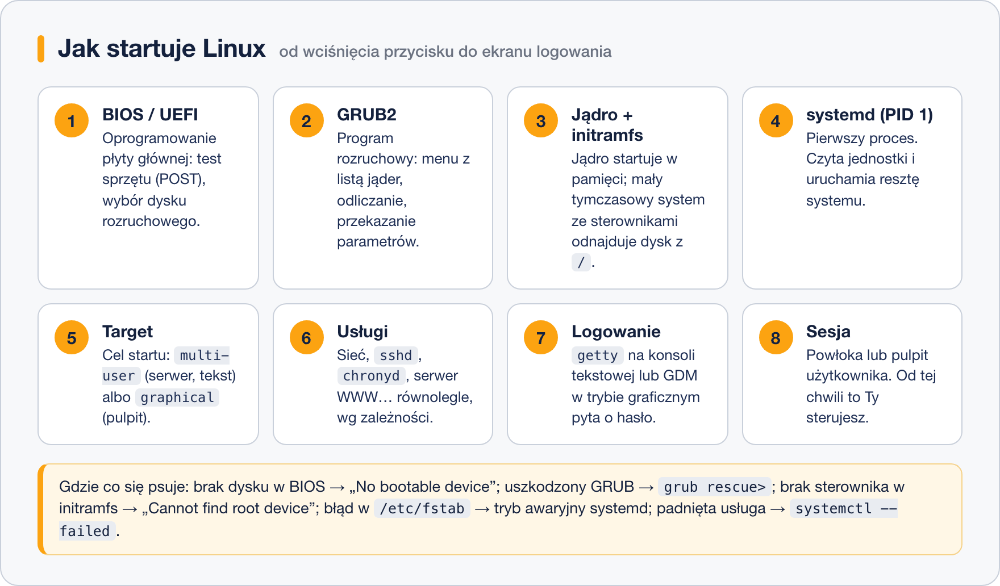

# Etapy startu systemu

> **W tej lekcji:** prześledzisz drogę od wciśnięcia przycisku zasilania do ekranu logowania, poznasz rolę BIOS/UEFI, GRUB-a, jądra, initramfs i systemd oraz nauczysz się rozpoznawać, na którym etapie start się zepsuł.

Start systemu to kilka następujących po sobie etapów – od firmware'u płyty głównej, przez program rozruchowy i jądro, po usługi. Administrator sięga po tę wiedzę, gdy po restarcie zamiast ekranu logowania widzi czarny ekran, napis `grub rescue>` albo prośbę o hasło roota „for maintenance”: każdy z tych komunikatów wskazuje **inny etap** startu, a znajomość etapów mówi od razu, czego szukać – ustawień płyty głównej, konfiguracji GRUB-a, pliku `fstab` czy padniętej usługi.

## Jak to działa



### 1. BIOS lub UEFI

Po włączeniu zasilania procesor wykonuje oprogramowanie wbudowane w płytę główną. Starsze maszyny mają **BIOS** (ang. Basic Input/Output System), nowsze – **UEFI** (ang. Unified Extensible Firmware Interface); potocznie na oba mówi się „BIOS”. Ten program wykonuje **POST** (ang. power-on self-test) – test pamięci i urządzeń – a potem według ustawionej kolejności rozruchu szuka dysku, z którego da się wystartować.

Różnica istotna dla administratora: BIOS czyta pierwszy sektor dysku – **MBR** (ang. Master Boot Record), 512 bajtów, w których musi się zmieścić początek programu rozruchowego. UEFI zamiast tego czyta zwykłe pliki z wydzielonej **partycji EFI** (FAT32, zwykle 200–600 MB, montowanej w `/boot/efi`). Czy Twój system startuje przez UEFI, sprawdzisz poleceniem `ls /sys/firmware/efi` – katalog istnieje tylko na UEFI.

### 2. GRUB2 – program rozruchowy

Program rozruchowy (ang. bootloader) to pośrednik: za mały BIOS nie umie czytać systemów plików Linuksa, więc GRUB2 (ang. GRand Unified Bootloader) robi to za niego. Pokazuje menu z listą zainstalowanych jąder, odlicza kilka sekund i ładuje wybrane jądro oraz initramfs do pamięci, przekazując jądru parametry (np. gdzie jest `/`). GRUB-owi poświęcona jest cała następna lekcja.

### 3. Jądro i initramfs

Jądro Linux rozpakowuje się w pamięci i zaczyna wykrywać sprzęt. Ma jednak problem jajka i kury: żeby zamontować `/`, potrzebuje sterownika dysku (a bywa, że i LVM czy szyfrowania), ale sterowniki leżą… na dysku. Rozwiązaniem jest **initramfs** (ang. initial RAM filesystem) – mały, spakowany system plików załadowany przez GRUB-a razem z jądrem. Zawiera akurat te sterowniki i narzędzia, których trzeba do odnalezienia i zamontowania prawdziwego `/`. Gdy to się uda, initramfs oddaje stery i znika z pamięci. Na RHEL initramfs buduje narzędzie `dracut` – osobny plik dla każdej wersji jądra w `/boot`.

### 4. systemd – pierwszy proces

Po zamontowaniu `/` jądro uruchamia dokładnie jeden program: `/sbin/init`, który na RHEL jest dowiązaniem do **systemd**. Dostaje on numer procesu (PID) 1 i staje się przodkiem wszystkich pozostałych procesów. Od tej chwili to systemd zarządza startem: czyta swoje jednostki (ang. units) i uruchamia je **równolegle**, pilnując zależności.

### 5. Target – cel startu

systemd dąży do osiągnięcia **celu** (ang. target): na serwerze to `multi-user.target` (system wielodostępny, tekstowy), na stacji roboczej `graphical.target` (to samo plus pulpit). Cele i ich związek ze starymi „runlevels” omawia lekcja 3.

### 6. Usługi

Po drodze do celu systemd uruchamia usługi: dziennik (`systemd-journald`), sieć (`NetworkManager`), zegar (`chronyd`), SSH (`sshd`), zaporę (`firewalld`) i wszystko, co włączono poleceniem `systemctl enable`. Jeśli któraś usługa padnie, start idzie dalej – zobaczysz ją potem w `systemctl --failed`.

### 7. Logowanie

Na konsolach tekstowych program `agetty` wyświetla znak zachęty `login:`; przy celu graficznym menedżer logowania **GDM** (GNOME Display Manager) pokazuje ekran logowania. Po podaniu hasła moduły PAM sprawdzają poświadczenia.

### 8. Sesja użytkownika

Ostatni etap: dla zalogowanego użytkownika startuje powłoka (Bash czyta `/etc/profile` i `~/.bashrc`) albo sesja graficzna GNOME. Od tej chwili maszyna jest Twoja.

### Co się psuje na którym etapie

| Objaw | Etap | Gdzie szukać |
|---|---|---|
| czarny ekran, „No bootable device” | BIOS/UEFI | kolejność rozruchu, podpięcie dysku, uszkodzony MBR/partycja EFI |
| `grub rescue>` albo zawieszone menu | GRUB2 | uszkodzony `/boot`, skasowana partycja – lekcja 2 |
| „Cannot find root device”, „Kernel panic – not syncing” | jądro/initramfs | zły parametr `root=`, initramfs bez sterownika (`dracut -f`) |
| „Give root password for maintenance” | systemd montuje dyski | błąd w `/etc/fstab` – [lekcja o fstab](../03.%20System%20plik%C3%B3w/7.%20Plik%20fstab.md) |
| system wstał, ale usługa nie działa | usługi | `systemctl --failed`, `journalctl -u nazwa` – lekcja 4 |
| „login incorrect” mimo dobrego hasła | logowanie | PAM, wygasłe konto, SELinux po `rd.break` bez `autorelabel` |

## W praktyce

```bash
# ile trwał ostatni start, z podziałem na etapy
systemd-analyze
```

```text
Startup finished in 1.214s (kernel) + 2.683s (initrd) + 8.479s (userspace) = 12.377s
multi-user.target reached after 8.401s in userspace
```

Trzy liczby to etapy 3–6: jądro, initramfs i przestrzeń użytkownika (systemd z usługami).

```bash
# które usługi startowały najdłużej
systemd-analyze blame | head -5
```

```text
4.512s dnf-makecache.service
2.303s NetworkManager-wait-online.service
1.201s firewalld.service
 801ms sshd.service
 420ms chronyd.service
```

`blame` pokazuje czas każdej usługi z osobna (startują równolegle, więc suma nie równa się czasowi startu). Do znalezienia „wąskiego gardła” służy `systemd-analyze critical-chain`.

```bash
# komunikaty jądra z bieżącego startu (etapy 3–4)
journalctl -k -b | head
# wszystkie komunikaty z bieżącego startu
journalctl -b
# ...i z poprzedniego startu – bezcenne po awarii
journalctl -b -1 -p err
```

```bash
# czy maszyna startuje przez UEFI
ls /sys/firmware/efi && echo "UEFI" || echo "BIOS"
# wersja uruchomionego jądra i pliki startowe w /boot
uname -r
ls /boot
```

```text
5.14.0-503.14.1.el9_5.x86_64
config-5.14.0-503.14.1.el9_5.x86_64  grub2  initramfs-5.14.0-503.14.1.el9_5.x86_64.img
loader  vmlinuz-5.14.0-503.14.1.el9_5.x86_64 …
```

`vmlinuz-*` to jądro, `initramfs-*.img` – odpowiadający mu initramfs, `grub2/` – konfiguracja GRUB-a.

## Najczęstsze błędy i pułapki

- **Mylenie etapów.** `grub rescue>` nie naprawisz edycją `fstab`, a trybu awaryjnego – reinstalacją GRUB-a. Najpierw ustal etap po objawie (tabela wyżej), potem działaj.
- **Restart „na próbę” po zmianach w `/boot` lub `fstab` bez sprawdzenia.** Po zmianach: `findmnt --verify`, a po ręcznych operacjach na jądrze `ls /boot` i `grubby --default-kernel`. Restart ma potwierdzać, nie testować.
- **Usuwanie starych jąder ręcznie z `/boot`.** Zostaw to `dnf remove` – stare jądro to Twój zapasowy wariant w menu GRUB-a, gdy nowe nie wstaje.
- **Panika przy wolnym starcie.** Zanim obwinisz „Linuksa”, sprawdź `systemd-analyze blame` – zwykle winna jest jedna usługa czekająca na sieć lub DNS.

## Podsumowanie

- Kolejność: BIOS/UEFI → GRUB2 → jądro + initramfs → systemd (PID 1) → target → usługi → logowanie → sesja.
- BIOS czyta MBR, UEFI – pliki z partycji EFI; sprawdzisz to przez `ls /sys/firmware/efi`.
- initramfs to tymczasowy mini-system ze sterownikami potrzebnymi do zamontowania `/`.
- systemd uruchamia usługi równolegle według zależności, dążąc do celu (target).
- Każdy objaw awarii wskazuje etap – od tego zaczyna się diagnoza.

| Polecenie | Co robi |
|---|---|
| `systemd-analyze` | łączny czas ostatniego startu |
| `systemd-analyze blame` | czas startu poszczególnych usług |
| `systemd-analyze critical-chain` | łańcuch jednostek opóźniających start |
| `journalctl -b`, `-b -1` | dziennik bieżącego / poprzedniego startu |
| `journalctl -k` | komunikaty jądra |
| `ls /sys/firmware/efi` | istnieje = UEFI |
| `uname -r`, `ls /boot` | uruchomione jądro i pliki startowe |
