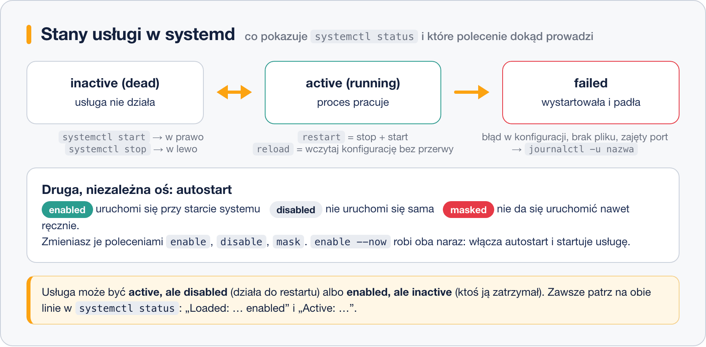

# Demony i usługi – systemctl

> **W tej lekcji:** dowiesz się, czym jest demon, poznasz rodzaje jednostek systemd i opanujesz komplet poleceń `systemctl`: start, stop, restart, przeładowanie, autostart, maskowanie oraz czytanie logów usługi przez `journalctl`.

Prawie wszystko, co serwer robi, robią **usługi**: `sshd` wpuszcza Cię zdalnie, `httpd` serwuje strony, `chronyd` pilnuje zegara, `firewalld` – zapory. Praca administratora to w ogromnej części zarządzanie nimi: uruchomić, zatrzymać, sprawdzić, dlaczego padła, włączyć autostart. W Windows służy do tego `services.msc`; w Linuksie – jedno polecenie `systemctl`, które będziesz wpisywać codziennie.

## Jak to działa

### Demon

**Demon** (ang. daemon) to proces działający w tle, bez terminala i bez interakcji z użytkownikiem, zwykle uruchamiany przy starcie systemu. Nazwa pochodzi z mitologii (duch wykonujący pracę w tle), a po nazwie poznasz go po literze **d** na końcu: `sshd`, `httpd`, `chronyd`, `crond`, `systemd-journald`. Przykłady, które spotkasz najczęściej:

| Demon | Rola |
|---|---|
| `sshd` | zdalny dostęp przez SSH |
| `NetworkManager` | konfiguracja sieci |
| `firewalld` | zapora sieciowa |
| `chronyd` | synchronizacja czasu (NTP) |
| `crond` | zadania cykliczne |
| `rsyslogd`, `systemd-journald` | zbieranie logów |
| `httpd` / `nginx` | serwer WWW |
| `sssd` | integracja z LDAP/Active Directory |

### Jednostki systemd

Dla systemd wszystko, czym zarządza, to **jednostka** (ang. unit) – plik opisujący jeden obiekt. Typ poznajesz po rozszerzeniu:

- **`.service`** – usługa, czyli demon z instrukcją uruchomienia (najczęstszy typ);
- **`.timer`** – harmonogram uruchamiający usługę cyklicznie (nowoczesny odpowiednik crona);
- **`.socket`** – gniazdo sieciowe; systemd nasłuchuje i startuje usługę dopiero przy pierwszym połączeniu;
- **`.target`** – punkt zbiórki jednostek ([poprzednia lekcja](3.%20Poziomy%20startowe%20–%20runlevels%20i%20targety%20systemd.md));
- **`.mount`** – punkt montowania (generowany z `fstab`).

W poleceniach `systemctl` końcówkę `.service` można pomijać: `systemctl status sshd` znaczy `sshd.service`.

### Dwie niezależne osie: stan i autostart



Usługa ma **stan bieżący** (`active` – działa, `inactive` – nie działa, `failed` – wystartowała i padła) oraz **ustawienie autostartu** (`enabled` – wstanie z systemem, `disabled` – nie wstanie, `masked` – zablokowana całkowicie). Te osie są niezależne: usługa może działać, choć jest `disabled`, i nie działać, choć jest `enabled`. W `systemctl status` czytasz obie z dwóch pierwszych linii.

## W praktyce

Ćwiczymy na serwerze WWW nginx (albo `httpd` – polecenia identyczne):

```bash
# instalacja i stan wyjściowy
sudo dnf install nginx
systemctl status nginx
```

```text
○ nginx.service - The nginx HTTP and reverse proxy server
     Loaded: loaded (/usr/lib/systemd/system/nginx.service; disabled; preset: disabled)
     Active: inactive (dead)
```

Linia `Loaded` mówi: plik jednostki istnieje, autostart `disabled`. Linia `Active`: nie działa.

```bash
# uruchomienie, zatrzymanie, restart (stop+start), przeładowanie konfiguracji bez przerwy w działaniu
sudo systemctl start nginx
sudo systemctl stop nginx
sudo systemctl restart nginx
sudo systemctl reload nginx
```

`reload` każe usłudze wczytać konfigurację bez zrywania połączeń – jeśli usługa to umie (nginx tak). `restart` zawsze działa, ale na moment przerywa pracę. Gdy nie wiesz, czy usługa umie reload: `systemctl reload-or-restart nginx`.

```bash
# status po starcie – najważniejsze polecenie diagnostyczne
systemctl status nginx
```

```text
● nginx.service - The nginx HTTP and reverse proxy server
     Loaded: loaded (/usr/lib/systemd/system/nginx.service; disabled; preset: disabled)
     Active: active (running) since Thu 2026-03-12 11:02:31 CET; 15s ago
   Main PID: 5214 (nginx)
      Tasks: 3 (limit: 23434)
     Memory: 4.9M
        CPU: 31ms
     CGroup: /system.slice/nginx.service
             ├─5214 "nginx: master process /usr/sbin/nginx"
             ├─5215 "nginx: worker process"
             └─5216 "nginx: worker process"

mar 12 11:02:31 serwer systemd[1]: Starting The nginx HTTP and reverse proxy server...
mar 12 11:02:31 serwer systemd[1]: Started The nginx HTTP and reverse proxy server.
```

Na dole status pokazuje ostatnie wpisy z dziennika – przy padającej usłudze często od razu widać przyczynę.

```bash
# krótkie odpowiedzi do skryptów i szybkich sprawdzeń
systemctl is-active nginx    # active / inactive / failed
systemctl is-enabled nginx   # enabled / disabled / masked
systemctl is-failed nginx
```

```bash
# autostart; --now dodatkowo od razu startuje (enable --now = enable + start)
sudo systemctl enable --now nginx
```

```text
Created symlink /etc/systemd/system/multi-user.target.wants/nginx.service → /usr/lib/systemd/system/nginx.service.
```

`enable` nie robi magii – tworzy dowiązanie w katalogu `wants` celu, zgodnie z sekcją `[Install]` jednostki. `disable` je usuwa. Analogicznie `disable --now` wyłącza autostart i zatrzymuje usługę.

```bash
# maskowanie: blokada całkowita – nie uruchomi jej ani admin, ani inna usługa jako zależności
sudo systemctl mask nginx
sudo systemctl unmask nginx
```

Maska to dowiązanie jednostki do `/dev/null`. Przydaje się, gdy pakiet instaluje usługę, której świadomie nie chcesz nigdy uruchomić.

### Przeglądy i wyszukiwanie

```bash
# wszystkie usługi, które systemd zna, z bieżącym stanem
systemctl list-units --type=service
# tylko te, które PADŁY – codzienny poranny przegląd administratora
systemctl list-units --type=service --state=failed
# krótsza wersja powyższego
systemctl --failed
# ustawienia autostartu wszystkich plików jednostek
systemctl list-unit-files --type=service
# gdzie leży plik jednostki i co zawiera
systemctl cat nginx
```

Pliki jednostek z pakietów leżą w `/usr/lib/systemd/system/`, Twoje własne i nadpisania – w `/etc/systemd/system/` (ten katalog wygrywa).

### Logi usługi – journalctl

```bash
# cały dziennik usługi
journalctl -u nginx
# od ostatniego startu systemu
journalctl -u nginx -b
# ostatnie 50 wpisów i śledzenie na żywo (jak tail -f)
journalctl -u nginx -n 50 -f
# tylko błędy, z ostatniej godziny
journalctl -u nginx -p err --since "1 hour ago"
```

`--since` i `--until` przyjmują też `today`, `yesterday` i daty `2026-03-12 10:00`.

### Typowa diagnoza padniętej usługi

```bash
sudo systemctl start nginx
```

```text
Job for nginx.service failed because the control process exited with error code.
See "systemctl status nginx.service" and "journalctl -xeu nginx.service" for details.
```

```bash
journalctl -xeu nginx
```

```text
mar 12 11:40:02 serwer nginx[6310]: nginx: [emerg] bind() to 0.0.0.0:80 failed (98: Address already in use)
```

Diagnoza w dwóch poleceniach: port 80 zajęty (sprawdź `ss -tlnp | grep :80` – pewnie działa `httpd`). Najczęstsze przyczyny stanu `failed`: zajęty port, literówka w pliku konfiguracyjnym (większość usług ma test składni, np. `nginx -t`), brak pliku lub uprawnień, SELinux.

## Najczęstsze błędy i pułapki

- **`start` bez `enable`.** Usługa działa… do pierwszego restartu. Nowa usługa produkcyjna = `enable --now`.
- **`enable` bez `start`.** Odwrotnie: wstanie dopiero po restarcie, a Ty myślisz, że działa. Sprawdzaj `is-active`.
- **`restart` tam, gdzie wystarczy `reload`.** Restart `sshd` zrywa… no właśnie, akurat `sshd` utrzymuje istniejące sesje, ale np. restart nginx pod obciążeniem zrywa połączenia. Po zmianie konfiguracji preferuj `reload`.
- **Szukanie logów usługi w plikach.** Część usług pisze tylko do dziennika systemd. Zacznij od `journalctl -u nazwa`, nie od `/var/log`.
- **Edycja pliku w `/usr/lib/systemd/system/`.** Nadpisze go aktualizacja pakietu. Zmiany przez `systemctl edit nazwa` (tworzy nakładkę w `/etc`) – o plikach jednostek mówi następna lekcja.

## Podsumowanie

- Demon = proces w tle (nazwa z `d` na końcu); dla systemd to jednostka `.service`.
- Stan (`active`/`inactive`/`failed`) i autostart (`enabled`/`disabled`/`masked`) to dwie niezależne osie – `systemctl status` pokazuje obie.
- `enable --now` to standard przy wdrażaniu nowej usługi.
- Diagnoza: `systemctl status` → `journalctl -xeu nazwa` → `systemctl --failed` przy przeglądzie.

| Polecenie | Co robi |
|---|---|
| `systemctl status nazwa` | stan, PID, pamięć, ostatnie logi |
| `sudo systemctl start/stop/restart nazwa` | uruchomienie / zatrzymanie / restart |
| `sudo systemctl reload nazwa` | przeładowanie konfiguracji bez przerwy |
| `sudo systemctl enable --now nazwa` | autostart + natychmiastowy start |
| `sudo systemctl disable --now nazwa` | koniec autostartu + stop |
| `sudo systemctl mask/unmask nazwa` | całkowita blokada / odblokowanie |
| `systemctl is-active / is-enabled nazwa` | krótki stan / autostart |
| `systemctl --failed` | wszystkie padnięte jednostki |
| `systemctl list-units --type=service` | przegląd usług |
| `systemctl cat nazwa` | zawartość i ścieżka pliku jednostki |
| `journalctl -u nazwa -f` / `-b` / `--since …` | logi usługi: na żywo / od startu / od czasu |
