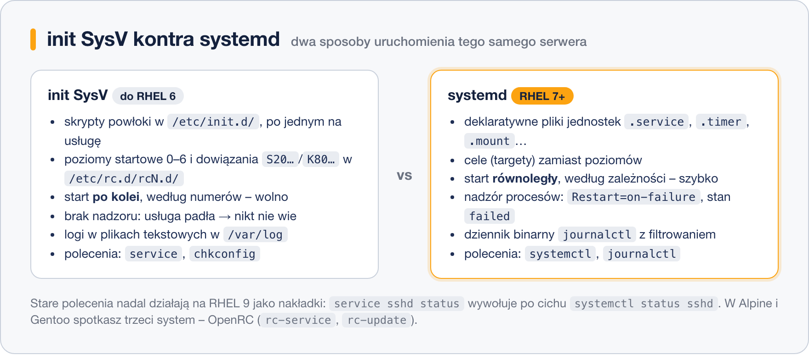

# init SysV a systemd

> **W tej lekcji:** poznasz historyczny init SysV – skrypty startowe, poziomy, `service` i `chkconfig` – zrozumiesz, dlaczego systemd go zastąpił, i nauczysz się tłumaczyć stare polecenia na nowe. Na koniec krótki rzut oka na OpenRC.

## Po co mi to?

Trafisz na nie prędzej, niż myślisz: dziesięcioletni serwer z RHEL 6, poradnik z 2012 roku każący wpisać `chkconfig httpd on`, skrypt instalacyjny starej aplikacji wrzucający plik do `/etc/init.d`, pytanie rekrutacyjne „czym różni się runlevel od targetu”. Administrator nie musi pisać skryptów SysV, ale musi je rozpoznać i wiedzieć, jak tę samą rzecz zrobić w systemd. A historia tej zmiany dobrze tłumaczy, czemu systemd wygląda tak, a nie inaczej.

## Jak to działa

### Świat przed systemd: init SysV

Przez trzydzieści lat pierwszym procesem uniksowych systemów był **init** w stylu Systemu V (stąd „SysV”, czytaj: „sys five”). Zasada była prosta:

- Każda usługa miała **skrypt powłoki** w `/etc/init.d/` (na RHEL właściwie `/etc/rc.d/init.d/`), przyjmujący argumenty `start`, `stop`, `status`, `restart`. Skrypt sam uruchamiał demona, zapisywał PID do pliku, kolorował komunikaty – każdy autor po swojemu, typowo 100–300 linii.
- O tym, co startuje na danym **poziomie startowym** (0–6), decydowały dowiązania w katalogach `/etc/rc.d/rc3.d/` itd.: `S85httpd` – start z priorytetem 85, `K15httpd` – zatrzymanie. Init wykonywał je **po kolei, według numerów**.
- Administrator zarządzał tym przez `service nazwa start` i `chkconfig nazwa on` (na Debianie `update-rc.d`).

Słabości, które z czasem urosły do rangi problemu:

- **Start sekwencyjny** – usługi wstawały jedna po drugiej, nawet jeśli mogły równolegle; rozruch trwał długo.
- **Brak nadzoru** – init uruchamiał skrypt i zapominał o sprawie. Demon padł w nocy? Nikt go nie podniósł, nikt nie odnotował.
- **Kruche skrypty** – każdy inny, pełne powtarzanego kodu, zależności opisane w komentarzach, których init nie egzekwował.
- **Status bywał kłamstwem** – opierał się na pliku PID, który potrafił zostać po padłym procesie.

### systemd

W 2010 roku Lennart Poettering i Kay Sievers rozpoczęli projekt **systemd**. Zamiast skryptów – deklaratywne pliki jednostek („co uruchomić”), zamiast kolejności według numerów – **graf zależności i start równoległy**, zamiast braku nadzoru – śledzenie procesów w grupach kontrolnych (cgroups), restart po awarii i wiarygodny status, zamiast rozproszonych logów – **dziennik binarny** czytany przez `journalctl`. Do tego timery, obsługa montowań, gniazd i wiele więcej – co zresztą bywało i bywa przedmiotem krytyki („systemd robi za dużo”). Dystrybucje przechodziły na systemd falami: Fedora 15 (2011), RHEL 7 (2014), Debian 8 i Ubuntu 15.04 (2015). Dziś to standard niemal wszędzie.



### Tłumacz poleceń

| Zadanie | init SysV (RHEL 6) | systemd (RHEL 7+) |
|---|---|---|
| uruchom usługę | `service httpd start` | `systemctl start httpd` |
| zatrzymaj | `service httpd stop` | `systemctl stop httpd` |
| restart / przeładowanie | `service httpd restart` / `reload` | `systemctl restart` / `reload httpd` |
| stan usługi | `service httpd status` | `systemctl status httpd` |
| autostart włącz | `chkconfig httpd on` | `systemctl enable httpd` |
| autostart wyłącz | `chkconfig httpd off` | `systemctl disable httpd` |
| lista autostartów | `chkconfig --list` | `systemctl list-unit-files --type=service` |
| domyślny poziom/cel | edycja `/etc/inittab` | `systemctl set-default multi-user.target` |
| zmiana poziomu/celu | `init 3`, `telinit 3` | `systemctl isolate multi-user.target` |
| bieżący poziom | `runlevel` | `systemctl get-default`, `runlevel` nadal działa |

Na RHEL 9/10 stare polecenia istnieją jako **nakładki zgodności**: `service sshd status` wypisze przekierowanie i wywoła `systemctl status sshd`; skrypt wrzucony do `/etc/init.d` zostanie opakowany w automatycznie wygenerowaną jednostkę. Działa to zaskakująco dobrze, ale nowe rzeczy rób już w systemd.

### OpenRC – trzeci gracz

Nie każda dystrybucja wybrała systemd. **OpenRC** – rozwinięcie idei SysV o zależności, nadzór i częściową równoległość, przy zachowaniu skryptów powłoki – jest natywnym initem **Alpine Linux** (popularnego w kontenerach) i **Gentoo**. Spotkasz go, gdy wejdziesz po `docker exec` do kontenera z Alpine albo postawisz lekką maszynę wirtualną.

| Zadanie | OpenRC | odpowiednik systemd |
|---|---|---|
| uruchom usługę | `rc-service sshd start` | `systemctl start sshd` |
| stan | `rc-service sshd status` | `systemctl status sshd` |
| autostart | `rc-update add sshd default` | `systemctl enable sshd` |
| koniec autostartu | `rc-update del sshd default` | `systemctl disable sshd` |
| lista | `rc-status` | `systemctl list-units` |

Słowo `default` w `rc-update` to nazwa poziomu (ang. runlevel) OpenRC – odpowiednik celu systemd.

## W praktyce

```bash
# czym naprawdę jest init na naszej maszynie
ls -l /sbin/init
```

```text
lrwxrwxrwx. 1 root root 22 05-16 2024 /sbin/init -> ../lib/systemd/systemd
```

```bash
# nakładka zgodności w akcji
sudo service sshd status | head -3
```

```text
Redirecting to /bin/systemctl status sshd.service
● sshd.service - OpenSSH server daemon
     Active: active (running) since Thu 2026-03-12 09:41:02 CET; 3h ago
```

```bash
# co zostało z katalogu init.d na RHEL 9
ls /etc/rc.d/init.d/
cat /etc/rc.d/init.d/README | head -5
```

```text
README
This directory is no longer used for storing init scripts;
services are managed by systemd...
```

```bash
# PID 1 i jego potomkowie – systemd jako przodek wszystkiego
ps -p 1 -o pid,comm
pstree -p | head -5
```

## Najczęstsze błędy i pułapki

- **Ślepe kopiowanie starych poradników.** `chkconfig` i `service` na RHEL 9 zadziałają przez nakładki, ale np. edycja `/etc/inittab` już nie – plik jest martwy. Tłumacz polecenia według tabeli.
- **Wrzucanie skryptu init.d od dostawcy „bo zawsze działało”.** Generator zgodności go opakuje, ale bez `Restart=`, bez zależności i z gorszą diagnostyką. Pięciominutowa przeróbka na plik `.service` ([poprzednia lekcja](5.%20Własna%20usługa%20systemd.md)) zwraca się natychmiast.
- **`/etc/rc.local`.** Na RHEL 9 wymaga ręcznego nadania praw wykonywania i bywa źródłem „magicznych” konfiguracji, o których nikt nie pamięta. Zamiast niego – własna jednostka.
- **Założenie, że wszędzie jest systemd.** W kontenerze Alpine `systemctl` nie istnieje. Rozpoznanie: `ps -p 1` – `systemd`, `init` czy `openrc-init`.

## Podsumowanie

- init SysV: skrypty w `/etc/init.d`, poziomy 0–6, start sekwencyjny, brak nadzoru, `service` + `chkconfig`.
- systemd (RHEL od wersji 7): jednostki, cele, start równoległy według zależności, nadzór z restartem, `journalctl`.
- Stare polecenia działają na RHEL 9/10 jako nakładki – ale pisz już w systemd.
- OpenRC (Alpine, Gentoo): `rc-service` i `rc-update`.
