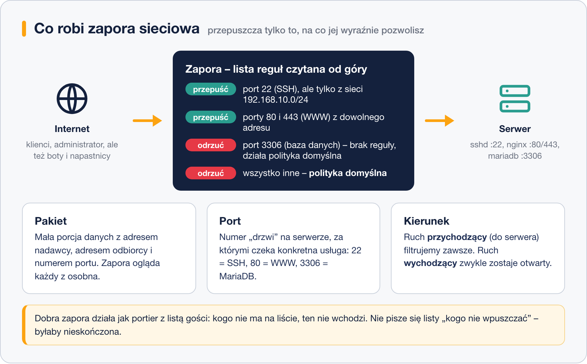
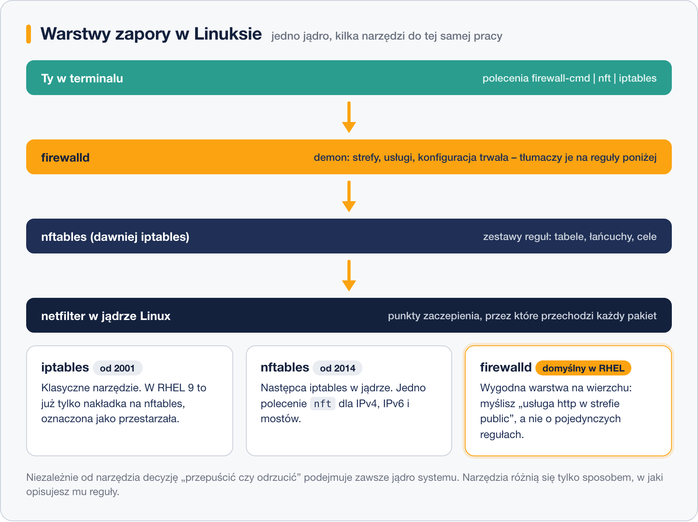

# Czym jest zapora sieciowa

> **W tej lekcji:** zrozumiesz, co właściwie robi zapora sieciowa (ang. firewall), czym jest pakiet, port i kierunek ruchu oraz jak mają się do siebie narzędzia iptables, nftables i firewalld.

## Po co mi to?

Serwer podłączony do sieci jest jak budynek z setkami drzwi. Za każdymi drzwiami może czekać jakaś usługa: SSH, strona WWW, baza danych. Część z nich jest przeznaczona dla całego świata (strona WWW), część tylko dla Ciebie (SSH), a część nie powinna być dostępna z sieci w ogóle (baza danych, z której korzysta wyłącznie aplikacja na tym samym serwerze).

Zapora sieciowa to portier przy tych drzwiach. Dostaje od Ciebie listę: kogo i dokąd wpuszczać. Wszystkich pozostałych zawraca. Bez niej każdy skaner internetowy — a takich skanów serwer z publicznym adresem dostaje tysiące dziennie — może zapukać do każdych drzwi i sprawdzić, które są otwarte.

## Jak to działa

### Pakiet, port, kierunek

Dane w sieci nie płyną ciągłym strumieniem. Są dzielone na małe porcje — **pakiety**. Każdy pakiet ma nagłówek, a w nim między innymi: adres IP nadawcy, adres IP odbiorcy, protokół (najczęściej TCP lub UDP) i numer **portu** docelowego. Port to liczba od 1 do 65535, która mówi, do której usługi na serwerze pakiet zmierza: 22 to SSH, 80 i 443 to WWW, 3306 to baza MariaDB.

Zapora ogląda każdy pakiet z osobna i na podstawie tych pól podejmuje decyzję: przepuścić czy odrzucić. Rozróżnia przy tym **kierunek ruchu**: pakiety **przychodzące** (ktoś łączy się z naszym serwerem) i **wychodzące** (nasz serwer łączy się ze światem). Na typowym serwerze filtrujemy ruch przychodzący, a wychodzący zostawiamy otwarty.



### Polityka domyślna: wszystko zabronione poza…

Dobrą zaporę konfiguruje się zawsze według zasady: **domyślnie wszystko zabronione, dozwolone tylko to, co wyraźnie wpisano na listę**. Nie da się napisać listy rzeczy zakazanych — byłaby nieskończona, a napastnik zawsze znajdzie coś, czego na niej nie ma. Lista rzeczy dozwolonych jest krótka i policzalna: na serwerze WWW to zwykle trzy pozycje (SSH, HTTP, HTTPS).

### netfilter i narzędzia nad nim

Samo filtrowanie pakietów odbywa się w **jądrze** systemu, w podsystemie o nazwie **netfilter**. To jądro widzi każdy pakiet wchodzący i wychodzący z karty sieciowej. My, administratorzy, tylko opisujemy jądru reguły — i do tego służą narzędzia, które powstawały jedno po drugim:



- **iptables** — klasyczne narzędzie, przez dwie dekady standard. Warto je znać, bo spotkasz je w starszych systemach i w niezliczonych poradnikach.
- **nftables** — następca iptables w jądrze, z jednym poleceniem `nft` zamiast czterech osobnych (`iptables`, `ip6tables`, `ebtables`, `arptables`).
- **firewalld** — demon, który jest domyślną zaporą w RHEL 9/10. Pozwala myśleć kategoriami „usługa http w strefie public” zamiast pojedynczych reguł, a pod spodem sam generuje reguły nftables.

> **Na Ubuntu/Debianie:** rolę wygodnej nakładki pełni `ufw` (Uncomplicated Firewall), ale fundament jest ten sam — netfilter w jądrze.

### Zapora na serwerze czy na routerze?

Zapora może stać w dwóch miejscach:

- **Na routerze (bramie sieci)** — filtruje ruch między całą siecią a internetem. Chroni wszystkie urządzenia naraz, ale nie widzi ruchu wewnątrz sieci lokalnej.
- **Na samym serwerze** — chroni tę jedną maszynę, także przed sąsiadami z tej samej sieci (np. zainfekowanym laptopem kolegi).

W praktyce stosuje się oba poziomy jednocześnie. W tym module zajmujemy się zaporą **na serwerze** — tą, którą konfigurujesz jako administrator Linuksa.

## W praktyce

Zanim zaczniesz konfigurować, sprawdź, co na Twoim systemie w ogóle działa:

```bash
# czy firewalld (domyślna zapora RHEL) jest uruchomiony
sudo firewall-cmd --state
```

```text
running
```

```bash
# które porty faktycznie nasłuchują na serwerze (czyli które "drzwi" istnieją)
sudo ss -tlnp
```

```text
State   Recv-Q  Send-Q  Local Address:Port  Process
LISTEN  0       128     0.0.0.0:22          users:(("sshd",pid=812,fd=3))
LISTEN  0       511     0.0.0.0:80          users:(("nginx",pid=1204,fd=6))
```

Polecenie `ss -tlnp` pokazuje usługi nasłuchujące na portach TCP. To dobra praktyka: zapora ma przepuszczać tylko to, co naprawdę świadomie uruchomiłeś.

## Najczęstsze błędy i pułapki

- **Mylenie zapory z usługą.** Otwarcie portu 80 w zaporze nie uruchamia serwera WWW — i odwrotnie: działający nginx nic nie przyjmie, jeśli zapora blokuje port. Zawsze sprawdzaj obie strony: `ss -tlnp` (usługa) i reguły zapory.
- **Polityka „wszystko dozwolone, blokuję wybrane”.** Taka lista zawsze ma dziury. Odwróć ją.
- **Zapominanie o SSH.** Jeśli konfigurujesz zaporę przez SSH i zablokujesz port 22, odcinasz samego siebie. O bezpiecznej kolejności reguł mówi lekcja o scenariuszu iptables.
- **Wiara, że zapora załatwia całe bezpieczeństwo.** Zapora nie pomoże, gdy luka jest w usłudze, którą sama przepuszcza (np. dziurawa aplikacja WWW na dozwolonym porcie 443). Zapora to jedna z warstw, nie całość.

## Podsumowanie

- Dane płyną w **pakietach**; każdy ma adres nadawcy, odbiorcy i numer **portu** wskazujący usługę.
- Zapora filtruje głównie ruch **przychodzący** według zasady: **wszystko zabronione poza tym, co jawnie dozwolone**.
- Filtrowaniem zajmuje się **netfilter w jądrze**; iptables, nftables i firewalld to tylko narzędzia do opisywania mu reguł.
- W RHEL 9/10 domyślnym narzędziem jest **firewalld**; iptables warto rozumieć, bo wciąż jest wszędzie w dokumentacji.
- Zapora na serwerze i zapora na routerze uzupełniają się — nie wybierasz jednej z nich.
