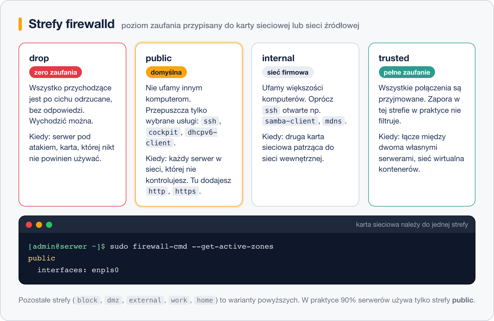
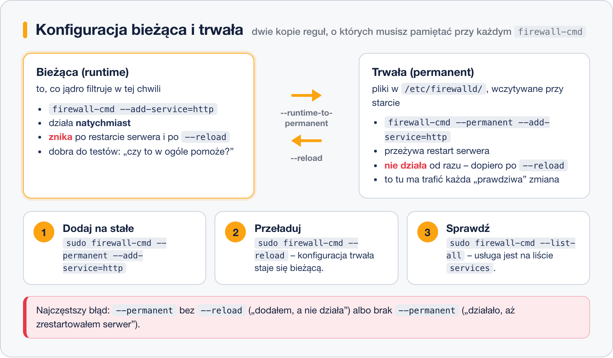

# firewalld

> **W tej lekcji:** opanujesz domyślną zaporę RHEL 9/10 — strefy, usługi i porty, różnicę między konfiguracją bieżącą a trwałą oraz kilka narzędzi na specjalne okazje: rich rules, własne usługi i tryb paniki.

## Po co mi to?

firewalld to zapora, którą zastaniesz na każdym świeżo zainstalowanym RHEL-u, Rocky czy AlmaLinuksie — uruchomioną i blokującą wszystko poza SSH. Zamiast układać pojedyncze reguły jak w iptables, mówisz jej rzeczy w rodzaju „w strefie public ma być dostępna usługa http”. Resztę — wygenerowanie reguł nftables, obsługę IPv4 i IPv6 naraz, wczytanie konfiguracji po restarcie — załatwia sama. Zmiany wprowadza w locie, bez zrywania istniejących połączeń.

## Jak to działa

### Strefy – poziomy zaufania

**Strefa** (ang. zone) to gotowy zestaw reguł wyrażający zaufanie do sieci. Każda karta sieciowa należy do dokładnie jednej strefy; serwer z dwiema kartami może np. trzymać kartę „internetową” w restrykcyjnej strefie `public`, a kartę do sieci wewnętrznej w łagodniejszej `internal`.



Na większości serwerów wystarcza domyślna strefa **public** — i to w niej będziemy pracować.

### Usługi i porty

Otwierać dostęp można na dwa sposoby:

- **Usługa** (ang. service) — nazwany zestaw portów, np. `http` = 80/tcp, `samba` = 445/tcp + 139/tcp. Czytelne i samodokumentujące się: `--list-all` pokaże „http”, a nie gołą liczbę.
- **Port** — gdy dla aplikacji nie ma gotowej usługi, otwierasz port wprost, np. `8080/tcp`.

Listę wszystkich zdefiniowanych usług zobaczysz przez `firewall-cmd --get-services` — jest ich kilkaset.

### Konfiguracja bieżąca i trwała

firewalld prowadzi **dwie** kopie konfiguracji i to jest źródło 90% pomyłek początkujących:



- Polecenie **bez** `--permanent` zmienia tylko konfigurację bieżącą: działa natychmiast, znika po restarcie.
- Polecenie **z** `--permanent` zapisuje zmianę w `/etc/firewalld/`, ale bieżącego filtrowania **nie zmienia** — trzeba jeszcze `--reload`.

## W praktyce

### Rozeznanie

```bash
# czy zapora działa
sudo firewall-cmd --state

# która strefa jest aktywna i jakie karty do niej należą
sudo firewall-cmd --get-active-zones

# pełna konfiguracja aktywnej strefy
sudo firewall-cmd --list-all
```

```text
public (active)
  target: default
  interfaces: enp1s0
  services: cockpit dhcpv6-client ssh
  ports:
  ...
```

### Otwieramy serwer WWW

```bash
# na stałe: usługi http i https w strefie domyślnej
sudo firewall-cmd --permanent --add-service=http
sudo firewall-cmd --permanent --add-service=https

# aktywacja konfiguracji trwałej
sudo firewall-cmd --reload

# kontrola
sudo firewall-cmd --list-services
```

```text
cockpit dhcpv6-client http https ssh
```

### Port bez gotowej usługi

```bash
# aplikacja słucha na 8080/tcp
sudo firewall-cmd --permanent --add-port=8080/tcp
sudo firewall-cmd --reload

sudo firewall-cmd --list-ports
```

```text
8080/tcp
```

### Sprzątanie

```bash
# usuwanie działa lustrzanie do dodawania
sudo firewall-cmd --permanent --remove-service=http
sudo firewall-cmd --permanent --remove-port=8080/tcp
sudo firewall-cmd --reload
```

Jeśli zmianę zrobioną „na próbę” bez `--permanent` chcesz zachować, nie przepisuj jej ręcznie:

```bash
# przepisuje całą konfigurację bieżącą do trwałej
sudo firewall-cmd --runtime-to-permanent
```

### Własna usługa

Definicje systemowe leżą w `/usr/lib/firewalld/services/`. Własne kładziemy w `/etc/firewalld/services/` — np. dla aplikacji na porcie 9000:

```bash
sudo tee /etc/firewalld/services/mojaaplikacja.xml > /dev/null <<'EOF'
<?xml version="1.0" encoding="utf-8"?>
<service>
  <short>Moja aplikacja</short>
  <description>Panel aplikacji firmowej na porcie 9000.</description>
  <port protocol="tcp" port="9000"/>
</service>
EOF

# firewalld musi przeczytać nowy plik, dopiero potem usługa istnieje
sudo firewall-cmd --reload
sudo firewall-cmd --permanent --add-service=mojaaplikacja
sudo firewall-cmd --reload
```

### Rich rules – gdy usługa i port to za mało

Reguły rozszerzone (ang. rich rules) pozwalają łączyć warunki. Najbardziej życiowy przykład: SSH dostępne tylko z sieci administracyjnej.

```bash
# 1) SSH przestaje być otwarte dla świata
sudo firewall-cmd --permanent --remove-service=ssh

# 2) ale sieć 192.168.10.0/24 może się łączyć
sudo firewall-cmd --permanent --add-rich-rule='rule family="ipv4" source address="192.168.10.0/24" service name="ssh" accept'

sudo firewall-cmd --reload
```

Uwaga: wykonuj to z maszyny, która jest w tej sieci — inaczej odetniesz sam siebie.

### Tryb paniki

Gdy serwer jest atakowany i potrzebujesz natychmiast odciąć **cały** ruch (łącznie z własną sesją SSH!):

```bash
sudo firewall-cmd --panic-on     # wszystko zablokowane
sudo firewall-cmd --query-panic  # kontrola stanu
sudo firewall-cmd --panic-off    # powrót do normalności
```

To narzędzie na prawdziwy pożar — używane z konsoli lokalnej, nie przez SSH.

> Istnieje też graficzna nakładka `firewall-config` (pakiet o tej samej nazwie) — przydatna na stacji roboczej z pulpitem; na serwerach królują `firewall-cmd` i Cockpit.

## Najczęstsze błędy i pułapki

- **`--permanent` bez `--reload`** — zmiana zapisana, ale nieaktywna: „dodałem usługę i nic”. Oraz odwrotnie: **bez `--permanent`** — działa, ale zniknie po restarcie serwera. Nawyk: zmiana trwała + `--reload` + `--list-all`.
- **Otwieranie portu zamiast sprawdzenia usługi.** Najpierw `--get-services | grep nazwa` — gotowa usługa jest czytelniejsza niż goły numer portu.
- **Dwie zapory naraz.** firewalld + własne reguły iptables/nftables obok siebie to nieprzewidywalny wynik. Wybierz jedno narzędzie.
- **Testowanie rich rules ograniczających SSH z sieci, której reguła nie obejmuje.** Zanim usuniesz usługę `ssh`, upewnij się, że Twój adres łapie się na regułę przepuszczającą.

## Podsumowanie

- firewalld to domyślna zapora RHEL 9/10; karta sieciowa należy do **strefy**, a strefa ma listę dozwolonych **usług** i **portów**.
- Zmiany: `--permanent` + `--reload`, kontrola przez `--list-all`.
- Zmiany „na próbę” rób bez `--permanent`, a udane utrwal `--runtime-to-permanent`.
- Własna usługa = plik XML w `/etc/firewalld/services/`; wyjątki po adresie źródłowym = rich rules.
- `--panic-on` odcina wszystko — tylko z konsoli lokalnej.

| Polecenie | Co robi |
|---|---|
| `firewall-cmd --state` | czy zapora działa |
| `firewall-cmd --get-active-zones` | aktywne strefy i ich karty |
| `firewall-cmd --list-all` | pełna konfiguracja strefy |
| `firewall-cmd --permanent --add-service=http` | dodaje usługę (trwale) |
| `firewall-cmd --permanent --add-port=8080/tcp` | otwiera port (trwale) |
| `firewall-cmd --permanent --remove-service=http` | usuwa usługę (trwale) |
| `firewall-cmd --reload` | aktywuje konfigurację trwałą |
| `firewall-cmd --runtime-to-permanent` | utrwala zmiany bieżące |
