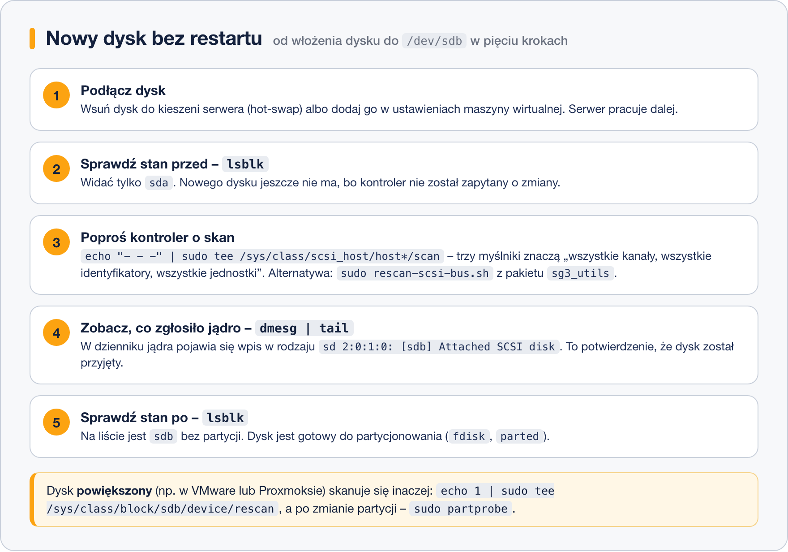

# Wykrywanie nowych dysków bez restartu

> **W tej lekcji:** nauczysz się dołożyć do działającego serwera nowy dysk (albo powiększyć istniejący) i sprawić, by Linux go zobaczył – bez wyłączania systemu.

## Po co mi to?

Serwer produkcyjny nie lubi restartów. Baza danych, strona WWW czy udział plikowy mają działać bez przerwy, a Ty i tak musisz czasem dołożyć miejsce na dane. Współczesny sprzęt i maszyny wirtualne pozwalają podłączyć dysk „na gorąco” – ale Linux nie zawsze zauważa to sam. Trzeba mu powiedzieć: „sprawdź, czy coś się zmieniło”.

W domowym komputerze wkładasz pendrive'a i po chwili jest. W serwerze z kontrolerem SCSI/SAS albo w maszynie wirtualnej, do której administrator dodał dysk w panelu, bywa inaczej – `lsblk` pokazuje to samo co przed chwilą. Ta lekcja uczy, co wtedy zrobić.

## Jak to działa

**Hot-swap** (albo *hot plug*, pol. wymiana na gorąco) to możliwość podłączania i odłączania urządzeń przy włączonym zasilaniu. Obsługują ją porty USB, dyski SATA i SAS w kieszeniach serwerowych, a także dyski wirtualne dodawane w VMware, Proxmoksie czy VirtualBoksie.

Po podłączeniu dysku muszą zadziałać trzy rzeczy:

1. **Kontroler** (karta, do której podpięty jest dysk) musi zauważyć nowe urządzenie.
2. **Jądro** musi je przyjąć, nadać mu nazwę (`sdb`) i utworzyć plik w `/dev`.
3. Jeśli zmieniła się **tablica partycji** (np. partycjonowałeś dysk innym narzędziem), jądro musi wczytać ją ponownie.

Pierwszy krok nie zawsze dzieje się sam. Dyski USB i VirtIO (`vda`) zwykle pojawiają się automatycznie. Dyski na kontrolerach SCSI/SAS – a tak najczęściej widzi je maszyna wirtualna – wymagają ręcznego skanu.



## W praktyce

### Scenariusz 1: nowy dysk

```bash
# stan przed – zapamiętaj, co widzisz
lsblk
```

```text
NAME   MAJ:MIN RM  SIZE RO TYPE MOUNTPOINTS
sda      8:0    0   40G  0 disk
├─sda1   8:1    0  600M  0 part /boot/efi
├─sda2   8:2    0    1G  0 part /boot
└─sda3   8:3    0 38,4G  0 part
sr0     11:0    1 1024M  0 rom
```

Teraz dodaj dysk: fizycznie w kieszeni serwera albo w ustawieniach maszyny wirtualnej (VirtualBox: Ustawienia → Pamięć → dodaj dysk twardy do kontrolera SATA; Proxmox: Sprzęt → Dodaj → Dysk twardy).

```bash
# poproś wszystkie kontrolery SCSI o ponowne przeszukanie magistrali
echo "- - -" | sudo tee /sys/class/scsi_host/host*/scan
```

Trzy myślniki to trzy „dowolne”: dowolny kanał, dowolny identyfikator urządzenia, dowolna jednostka logiczna. Gwiazdka w `host*` sprawia, że skan trafia do każdego kontrolera (`host0`, `host1`…). Polecenie `tee` jest potrzebne, bo `sudo echo "- - -" > plik` **nie zadziała** – przekierowanie `>` wykonuje Twoja powłoka bez uprawnień administratora.

```bash
# wygodniejsza alternatywa – skrypt z pakietu sg3_utils
sudo dnf install sg3_utils
sudo rescan-scsi-bus.sh
```

```text
Scanning SCSI subsystem for new devices
Scanning host 0 for  SCSI target IDs  0 1 2 3 4 5 6 7, all LUNs
 Scanning for device 0 0 1 0 ...
NEW: Host: scsi0 Channel: 00 Id: 01 Lun: 00
      Vendor: ATA      Model: QEMU HARDDISK    Rev: 2.5+
      Type:   Direct-Access                    ANSI SCSI revision: 05
1 new or changed device(s) found.
```

```bash
# co na to jądro – ostatnie wpisy dziennika jądra
sudo dmesg | tail
```

```text
[ 1842.113507] scsi 0:0:1:0: Direct-Access     ATA      QEMU HARDDISK    2.5+ PQ: 0 ANSI: 5
[ 1842.115891] sd 0:0:1:0: Attached scsi generic sg1 type 0
[ 1842.116402] sd 0:0:1:0: [sdb] 20971520 512-byte logical blocks: (10.7 GB/10.0 GiB)
[ 1842.116640] sd 0:0:1:0: [sdb] Write Protect is off
[ 1842.118220] sd 0:0:1:0: [sdb] Attached SCSI disk
```

Wpis `[sdb] Attached SCSI disk` to potwierdzenie: nowy dysk dostał nazwę `sdb` i jest gotowy. Zamiast `dmesg` możesz użyć `sudo journalctl -k -n 20` – to ten sam dziennik jądra.

```bash
# stan po
lsblk
```

```text
NAME   MAJ:MIN RM  SIZE RO TYPE MOUNTPOINTS
sda      8:0    0   40G  0 disk
…
sdb      8:16   0   10G  0 disk
```

Dysk `sdb` jest, nie ma na nim partycji. Następny krok to partycjonowanie (lekcja 5) albo oddanie całego dysku pod LVM (moduł 10).

### Scenariusz 2: powiększony dysk

W maszynie wirtualnej częściej niż dokładać dysk, powiększa się istniejący (np. z 10 GB do 20 GB w panelu). Linux pamięta stary rozmiar, dopóki nie każesz mu sprawdzić ponownie:

```bash
# odśwież rozmiar konkretnego dysku (tu: sdb)
echo 1 | sudo tee /sys/class/block/sdb/device/rescan
lsblk /dev/sdb
```

```text
NAME MAJ:MIN RM SIZE RO TYPE MOUNTPOINTS
sdb    8:16   0  20G  0 disk
```

Dysk urósł, ale partycje i systemy plików na nim – nie. Trzeba je powiększyć osobno (partycję np. w `parted`, system plików poleceniem `xfs_growfs` – zob. moduł 10 i 11).

### Scenariusz 3: zmieniona tablica partycji

Po utworzeniu partycji `fdisk` sam prosi jądro o ponowne wczytanie tablicy. Czasem się to nie udaje – zwykle dlatego, że jakaś partycja tego dysku jest zamontowana:

```text
Re-reading the partition table failed.: Device or resource busy
The kernel still uses the old table. The new table will be used at the next reboot or after you run partprobe(8) or partx(8).
```

```bash
# poproś jądro o ponowne wczytanie tablic partycji (bez argumentu – wszystkich dysków)
sudo partprobe /dev/sdb
lsblk /dev/sdb
```

`partprobe` jest w pakiecie `parted`, który na RHEL 9/10 jest instalowany domyślnie.

## Najczęstsze błędy i pułapki

- **`sudo echo "- - -" > /sys/class/scsi_host/host0/scan` kończy się błędem „Permission denied”.** `sudo` podnosi uprawnienia tylko dla `echo`, a zapis do pliku robi Twoja powłoka. Użyj `| sudo tee`.
- **Dysk dodany, skan zrobiony, a `lsblk` nic nie pokazuje.** Sprawdź `sudo dmesg | tail` – może kontroler w VM wymaga wyłączenia maszyny (starsze typy kontrolerów IDE nie obsługują hot-swap). W VirtualBoksie dysk musi wisieć na kontrolerze SATA lub SCSI, nie IDE.
- **Dysk powiększony, ale `df -h` nadal pokazuje stary rozmiar.** To normalne – powiększyłeś dysk, nie system plików. Każda warstwa (dysk → partycja → LVM → system plików) rośnie osobno.
- **Wyjmowanie dysku bez przygotowania.** Przed fizycznym wyjęciem odmontuj systemy plików i (dla pewności) `echo 1 | sudo tee /sys/block/sdb/device/delete`. Wyciągnięcie zamontowanego dysku może uszkodzić dane.

## Podsumowanie

- Po podłączeniu dysku na gorąco Linux nie zawsze zauważa go sam – trzeba przeskanować kontrolery.
- Zawsze porównuj `lsblk` przed i po oraz zaglądaj do `dmesg`.
- Powiększony dysk odświeżasz przez `…/device/rescan`, a zmienioną tablicę partycji przez `partprobe`.

| Polecenie | Do czego |
|---|---|
| `echo "- - -" \| sudo tee /sys/class/scsi_host/host*/scan` | wykrycie nowych dysków na kontrolerach SCSI/SAS |
| `sudo rescan-scsi-bus.sh` | to samo, wygodniej (pakiet `sg3_utils`) |
| `echo 1 \| sudo tee /sys/class/block/sdb/device/rescan` | odświeżenie rozmiaru powiększonego dysku |
| `sudo partprobe /dev/sdb` | ponowne wczytanie tablicy partycji |
| `sudo dmesg \| tail` lub `sudo journalctl -k -n 20` | co jądro mówi o nowym sprzęcie |

## Zobacz też

- [1. Dyski w Linuksie – katalog dev i nazwy urządzeń](1.%20Dyski%20w%20Linuksie%20–%20katalog%20dev%20i%20nazwy%20urządzeń.md)
- [5. fdisk](5.%20fdisk.md) – co zrobić z nowym dyskiem
- [Moduł 10 – Woluminy logiczne LVM](../10.%20Woluminy%20logiczne%20LVM/0.%20O%20module.md) – powiększanie miejsca bez przestoju
