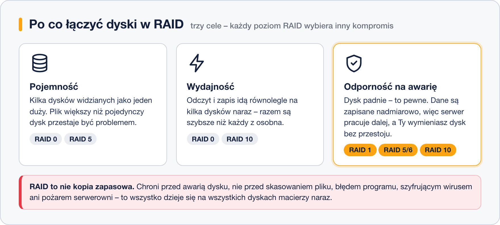

# RAID – po co łączyć dyski

> **W tej lekcji:** zrozumiesz, jaki problem rozwiązuje RAID, jakie trzy cele można osiągnąć łącząc dyski, czym różni się RAID sprzętowy od programowego – i dlaczego RAID nie zastępuje kopii zapasowej.

## Po co mi to?

Dysk twardy to część eksploatacyjna, jak klocki hamulcowe w samochodzie. Pytanie nie brzmi „czy padnie”, tylko „kiedy”. Producenci podają średni czas między awariami w setkach tysięcy godzin, ale w serwerowni z dziesiątkami dysków ktoś pada co kilka miesięcy. Jeśli na tym jednym dysku była baza klientów – firma staje.

Drugi problem to pojemność i szybkość: pojedynczy dysk ma swój limit rozmiaru i przepustowości. Duża baza danych albo kopie zapasowe całej firmy potrzebują więcej, niż da jeden nośnik.

Odpowiedzią na oba problemy jest **RAID** (ang. *Redundant Array of Independent Disks* – nadmiarowa macierz niezależnych dysków): kilka dysków fizycznych połączonych w jedno urządzenie logiczne, które system widzi jak zwykły, pojedynczy dysk.

## Jak to działa

### Trzy cele

Łącząc dyski, można zyskać trzy rzeczy – ale nie wszystkie naraz. Każdy poziom RAID (lekcja 9) to inny kompromis między nimi:



- **Pojemność** – dwa dyski po 1 TB widziane jako jeden 2 TB. Uwaga: 2 × 1 TB to nie to samo co 1 × 2 TB – bez połączenia w macierz nie zapiszesz pliku większego niż pojedynczy dysk.
- **Wydajność** – operacje rozkładają się równolegle na kilka dysków, więc odczyt i zapis są szybsze niż na jednym.
- **Odporność na awarię** (redundancja, ang. *redundancy* – nadmiarowość) – dane są przechowywane z zapasem (kopia lustrzana albo dane kontrolne), więc awaria dysku nie zatrzymuje serwera ani nie niszczy danych. Uszkodzony dysk wymieniasz, macierz odbudowuje zawartość i jedzie dalej.

Ceną redundancji jest zawsze pojemność: część miejsca zajmują kopie lub dane kontrolne.

### Gdzie powstaje RAID: sprzętowy, programowy, „fake RAID”

| Rodzaj | Kto liczy | Charakterystyka |
|---|---|---|
| **Sprzętowy** | dedykowany kontroler RAID (karta z własnym procesorem i pamięcią, np. w serwerach Dell/HP) | system widzi gotowy „dysk”; konfiguracja w BIOS-ie kontrolera; szybki, niezależny od OS, ale kosztuje i wiąże Cię z danym modelem kontrolera |
| **Programowy** | jądro Linuksa (moduł `md`, narzędzie `mdadm`) | darmowy, przenośny (dyski można przełożyć do innego serwera), wydajność współczesnych procesorów w zupełności wystarcza; tym zajmuje się lekcja 10 |
| **„Fake RAID”** | chipset płyty głównej + sterownik systemu | tryb „RAID” w BIOS-ie zwykłych płyt: tak naprawdę liczy procesor, a format danych jest zamknięty. Łączy wady obu światów – w Linuksie go unikaj, użyj `mdadm` |

Na serwerach spotkasz oba pełnoprawne warianty. W tym szkoleniu ćwiczymy RAID programowy, bo działa wszędzie – także w maszynie wirtualnej.

### RAID to nie kopia zapasowa

To zdanie warto zapamiętać dosłownie. RAID chroni przed **awarią dysku** – i tylko przed nią. Nie ochroni przed:

- skasowaniem pliku przez człowieka (`rm` wykonuje się na wszystkich dyskach macierzy naraz),
- błędem aplikacji, która nadpisze dane,
- oprogramowaniem szyfrującym dla okupu (ransomware),
- kradzieżą, pożarem ani zalaniem serwera,
- awarią samego kontrolera lub błędem administratora przy macierzy.

Kopia zapasowa to **osobna kopia danych, w innym miejscu, z historią wersji**. RAID zapewnia ciągłość pracy; kopia zapasowa – możliwość odzyskania danych. Potrzebujesz obu.

## W praktyce

Zanim zaczniesz budować macierze (lekcja 10), naucz się sprawdzać, czy serwer jakiejś używa:

```bash
# czy w systemie działają macierze programowe (md)
cat /proc/mdstat
```

```text
Personalities : [raid1]
md0 : active raid1 sdc[1] sdb[0]
      10475520 blocks super 1.2 [2/2] [UU]

unused devices: <none>
```

Jest macierz `md0` typu RAID 1 z dysków `sdb` i `sdc`; `[UU]` oznacza, że oba działają. Jeśli plik pokazuje tylko `unused devices: <none>` – RAID-u programowego nie ma.

```bash
# macierze widać też w lsblk – jako urządzenia typu raid1 pod dyskami składowymi
lsblk
```

```text
NAME   MAJ:MIN RM  SIZE RO TYPE  MOUNTPOINTS
sdb      8:16   0   10G  0 disk
└─md0    9:0    0   10G  0 raid1 /dane
sdc      8:32   0   10G  0 disk
└─md0    9:0    0   10G  0 raid1 /dane
```

RAID sprzętowy z poziomu systemu wygląda jak zwykły dysk (`sda`) – jego stan sprawdza się narzędziami producenta kontrolera (np. `perccli` dla Delli, `ssacli` dla HP).

## Najczęstsze błędy i pułapki

- **„Mamy RAID, kopie niepotrzebne.”** Najdroższy błąd w tej lekcji. RAID i backup odpowiadają na różne zagrożenia.
- **RAID 0 na dane produkcyjne.** Zero redundancji – awaria jednego dysku niszczy wszystko (szczegóły w lekcji 9). Litera „0” dobrze podsumowuje poziom ochrony.
- **Łączenie dysków różnej wielkości.** Macierz przyjmuje rozmiar najmniejszego dysku (razy liczba dysków wg poziomu) – reszta większych dysków się marnuje.
- **Włączanie trybu RAID w BIOS-ie zwykłej płyty.** To „fake RAID”. W Linuksie zostaw tryb AHCI i zbuduj macierz w `mdadm`.
- **Ignorowanie zdegradowanej macierzy.** Macierz po awarii jednego dysku dalej działa – i właśnie dlatego łatwo ją przeoczyć, aż padnie drugi dysk. Stan trzeba monitorować (lekcja 10).

## Podsumowanie

- RAID łączy dyski fizyczne w jedno urządzenie logiczne, by zyskać pojemność, wydajność lub odporność na awarię.
- Redundancja kosztuje pojemność – każdy poziom RAID to inny kompromis.
- RAID sprzętowy = kontroler, programowy = `mdadm` w Linuksie; „fake RAID” płyt głównych omijaj.
- Stan macierzy programowych: `cat /proc/mdstat`.
- RAID chroni przed awarią dysku. Przed wszystkim innym chroni kopia zapasowa.

## Zobacz też

- [9. Poziomy RAID](9.%20Poziomy%20RAID.md) – RAID 0, 1, 5, 6, 10 w szczegółach
- [10. RAID programowy w praktyce – mdadm](10.%20RAID%20programowy%20w%20praktyce%20–%20mdadm.md)
- [Moduł 10 – Woluminy logiczne LVM](../10.%20Woluminy%20logiczne%20LVM/0.%20O%20module.md) – elastyczny podział przestrzeni (często łączony z RAID)
