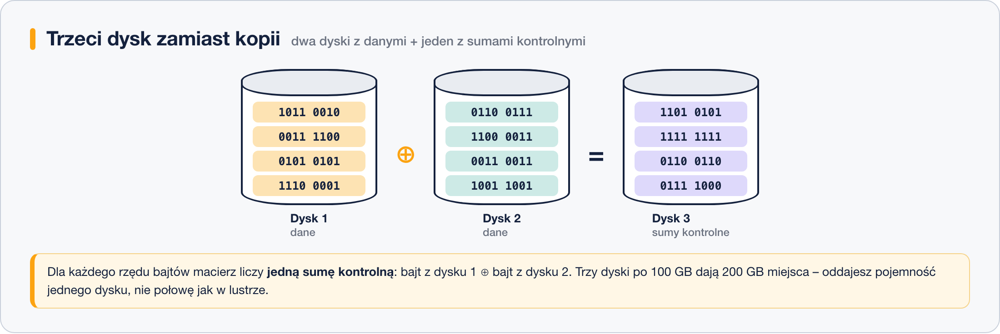
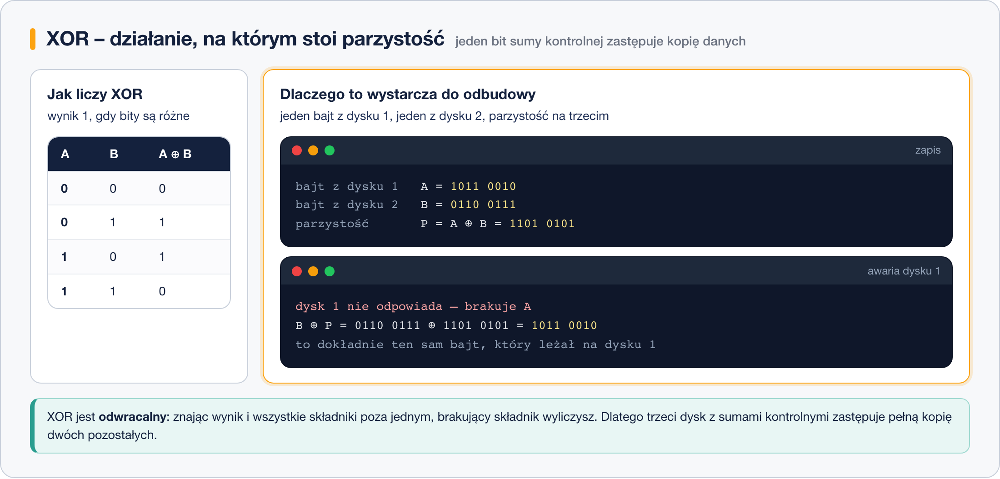
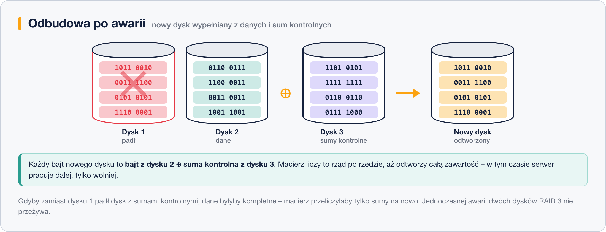
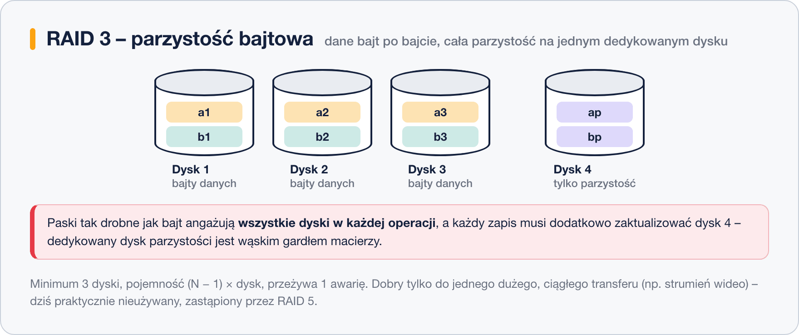

# RAID 3 – parzystość na poziomie bajtów

> **W tej lekcji:** zrozumiesz **parzystość** – pomysł, dzięki któremu jeden dodatkowy dysk chroni dane całej macierzy. Poznasz operację XOR i prześledzisz ją krok po kroku: jak powstaje suma kontrolna i jak macierz odtwarza z niej zawartość dysku, który padł. To fundament dla RAID 4, 5 i 6.

Wróćmy na chwilę do [RAID 0](9.%20RAID%200%20–%20istota%20działania.md): dwa dyski po 100 GB, dane cięte na kawałki i rozłożone na oba. Dostajesz pełne 200 GB i podwójną szybkość – ale awaria **jednego** dysku kasuje wszystko, bo połowa każdego pliku leży na tym drugim.

[RAID 1](10.%20RAID%201%20–%20lustro.md) rozwiązuje to kopią: drugi dysk trzyma dokładnie to samo, co pierwszy. Bezpiecznie, tylko kosztuje połowę pojemności. RAID 3 zadaje pytanie: czy naprawdę trzeba kopiować dane, żeby umieć je odtworzyć? Okazuje się, że nie – wystarczy **jeden dysk z sumami kontrolnymi**.

## Jak to działa

### Trzeci dysk zamiast kopii

Do dwóch dysków z danymi dokładamy trzeci. Nie trafia na niego kopia – trafiają **sumy kontrolne**, czyli parzystość (ang. *parity*) policzona z obu dysków danych:

Trzy dyski po 100 GB dają **200 GB** do użycia. Lustro z trzech dysków dałoby mniej, a przy pięciu dyskach różnica robi się dramatyczna: RAID z parzystością oddaje zawsze równowartość jednego dysku, lustro – zawsze połowę.

### XOR, czyli jak zapisać dwa dyski na jednym

Sztuczka siedzi w operacji **XOR** (⊕, „albo-albo”). XOR porównuje dwa bity i daje 1, gdy bity są **różne**, a 0, gdy są takie same:

Kluczowa jest jego **odwracalność**. Jeśli `A ⊕ B = P`, to równie dobrze `B ⊕ P = A` oraz `A ⊕ P = B`. Mając dowolne dwie z tych trzech wartości, wyliczysz trzecią – a dokładnie w takiej sytuacji jest macierz po awarii jednego dysku.

Macierz liczy XOR rząd po rzędzie: bajt z dysku 1 ⊕ bajt z dysku 2 = bajt zapisany na dysku z sumami kontrolnymi. Dla większej liczby dysków danych działa to tak samo – XOR-uje się wszystkie bajty z rzędu.

> **Uwaga:** to świadome uproszczenie na potrzeby zrozumienia samej koncepcji. Prawdziwy kontroler pracuje na całych blokach, trzyma bufory zapisu i pilnuje spójności parzystości po nagłej utracie zasilania – ale sama idea jest dokładnie taka, jak wyżej.

### Awaria i odbudowa

Pada dysk 1. Dane nie znikają: każdy jego bajt macierz wylicza z bajtu z dysku 2 i odpowiadającej mu sumy kontrolnej. Wkładasz nowy dysk, macierz przelicza rząd po rzędzie i zapisuje wynik:

Dwie rzeczy warto zapamiętać:

- Zanim nowy dysk się odbuduje, macierz pracuje **bez zabezpieczenia** – drugiej awarii już nie przeżyje.
- Gdyby padł dysk z sumami kontrolnymi, dane byłyby kompletne; macierz przeliczyłaby tylko parzystość na nowo.

### Co z tego robi akurat RAID 3

Parzystość jest wspólna dla RAID 3, 4, 5 i 6. RAID 3 ma dwie własne cechy:

- dane dzieli **bajt po bajcie** (RAID 4 i 5 robią to blokami),
- parzystość trzyma **zawsze na tym samym, dedykowanym dysku** (RAID 5 rozprasza ją po wszystkich).

Paski tak drobne jak bajt oznaczają, że **każda operacja angażuje wszystkie dyski naraz**: macierz świetnie radzi sobie z jednym dużym, ciągłym transferem (np. strumień wideo), ale fatalnie z wieloma małymi operacjami jednocześnie, bo nie da się ich rozdzielić między dyski. Do tego każdy zapis musi zaktualizować dysk parzystości – to on wyznacza tempo całej macierzy.

| Parametr | RAID 3 |
|---|---|
| Minimalna liczba dysków | 3 (2 danych + 1 parzystości) |
| Pojemność do użycia | (N − 1) × dysk |
| Ile awarii dysków przeżyje | 1 |
| Jednostka paskowania | bajt |
| Gdzie leży parzystość | na jednym dedykowanym dysku |

## Kiedy stosować

Praktycznie nigdy. Nisza, w której RAID 3 miał sens – pojedynczy, duży strumień danych, np. nieskompresowane wideo – została dawno przejęta przez RAID 5 i RAID 10 na szybszych dyskach. `mdadm` poziomu 3 nie obsługuje; nieliczne kontrolery sprzętowe już go nie oferują.

Zostaje za to pomysł: całą wiedzę o XOR i parzystości wykorzystasz przy [RAID 5](14.%20RAID%205%20–%20parzystość%20rozproszona.md) i [RAID 6](15.%20RAID%206%20–%20podwójna%20parzystość.md), które stawia się na serwerach do dziś.

## Podsumowanie

- Parzystość to suma kontrolna liczona operacją **XOR** z bajtów (lub bloków) z tego samego rzędu.
- XOR jest odwracalny: `A ⊕ B = P`, więc `B ⊕ P = A`. Dlatego jeden dysk z sumami kontrolnymi zastępuje kopię całej reszty.
- Macierz z parzystością oddaje równowartość **jednego** dysku, niezależnie od ich liczby – lustro oddaje połowę.
- Odbudowa po awarii to przeliczanie XOR rząd po rzędzie; do jej zakończenia macierz nie ma zabezpieczenia.
- RAID 3 = parzystość + paskowanie bajtowe + dedykowany dysk parzystości (wąskie gardło). Dziś poziom nieużywany, ale jego idea żyje w RAID 5 i 6.
