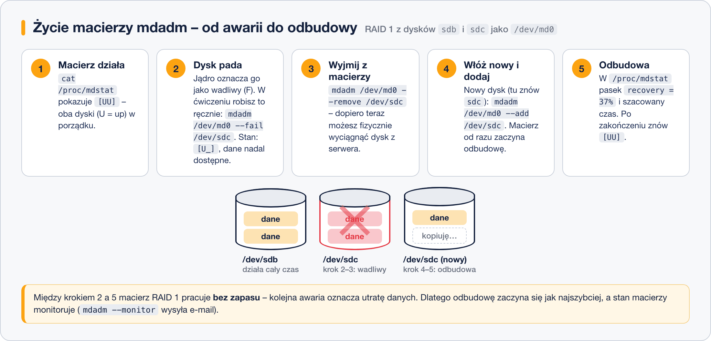

# RAID programowy w praktyce – mdadm

> **W tej lekcji:** zbudujesz macierz RAID 1 narzędziem `mdadm`, zasymulujesz awarię dysku, wymienisz go i odbudujesz macierz, a na końcu utrwalisz konfigurację, by przetrwała restart.

W Linuksie RAID programowy obsługuje moduł jądra `md` (ang. *multiple devices*), a steruje nim jedno narzędzie: **`mdadm`** (*md administration*). To pełnoprawny RAID produkcyjny: darmowy, niezależny od sprzętu, a dyski z macierzą można przenieść do innego serwera i macierz wstanie.

Najcenniejsza część tej lekcji to symulacja awarii. Lepiej pierwszy raz wymienić dysk w macierzy na maszynie ćwiczeniowej niż na produkcji o trzeciej w nocy.

## Jak to działa

`mdadm` składa macierz z **dysków lub partycji** i udostępnia ją jako nowe urządzenie blokowe `/dev/md0` (kolejne: `md1`, `md2`…). Z `md0` pracujesz jak ze zwykłym dyskiem: zakładasz system plików, montujesz, a nawet oddajesz pod LVM. Na każdym składniku macierzy `mdadm` zapisuje **superblok** – metryczkę z identyfikatorem macierzy, poziomem i kolejnością dysków. Dzięki niej jądro przy starcie samo rozpoznaje i składa macierze.

Cykl życia macierzy, który przećwiczymy:



## W praktyce

Scenariusz: RAID 1 z dwóch dodatkowych dysków `/dev/sdb` i `/dev/sdc` (po 10 GB). Upewnij się w `lsblk`, że oba są puste i niezamontowane.

### Budowa macierzy

```bash
# instalacja narzędzia (na minimalnej instalacji RHEL może go nie być)
sudo dnf install mdadm

# utworzenie macierzy RAID 1 o nazwie md0 z dwóch dysków
sudo mdadm --create /dev/md0 --level=1 --raid-devices=2 /dev/sdb /dev/sdc
```

```text
mdadm: Note: this array has metadata at the start and
    may not be suitable as a boot device. (…)
Continue creating array? y
mdadm: Defaulting to version 1.2 metadata
mdadm: array /dev/md0 started.
```

Opcje: `--level=1` to poziom RAID (0, 1, 5, 6, 10…), `--raid-devices=2` – liczba składników, dalej lista urządzeń. Ostrzeżenie o „boot device” możesz na dysku z danymi spokojnie potwierdzić.

```bash
# stan wszystkich macierzy – ten plik będziesz czytać najczęściej
cat /proc/mdstat
```

```text
Personalities : [raid1]
md0 : active raid1 sdc[1] sdb[0]
      10475520 blocks super 1.2 [2/2] [UU]
      [=========>...........]  resync = 48.1% (5041920/10475520) finish=0.4min speed=201677K/sec

unused devices: <none>
```

Świeża macierz najpierw się synchronizuje (`resync`) – wyrównuje zawartość dysków. Można jej używać już w trakcie. `[2/2] [UU]` czytaj: 2 z 2 urządzeń obecne, oba sprawne (U = *up*; `_` oznaczałoby brak).

```bash
# pełne informacje o macierzy
sudo mdadm --detail /dev/md0
```

```text
/dev/md0:
           Version : 1.2
     Creation Time : Sat Oct 18 10:21:33 2026
        Raid Level : raid1
        Array Size : 10475520 (9.99 GiB 10.73 GB)
      Raid Devices : 2
     Total Devices : 2
             State : clean
    Active Devices : 2
   Working Devices : 2
    Failed Devices : 0

    Number   Major   Minor   RaidDevice State
       0       8       16        0      active sync   /dev/sdb
       1       8       32        1      active sync   /dev/sdc
```

### System plików i montowanie

```bash
# macierz to zwykłe urządzenie blokowe – zakładamy system plików i montujemy
sudo mkfs.xfs /dev/md0
sudo mkdir /dane
sudo mount /dev/md0 /dane
df -h /dane
```

```text
Filesystem      Size  Used Avail Use% Mounted on
/dev/md0         10G  104M  9,9G   2% /dane
```

Żeby montowanie przetrwało restart, dodaj wpis do `/etc/fstab` – najlepiej po UUID systemu plików (`sudo blkid /dev/md0`). Szczegóły fstab znajdziesz w module 11.

### Utrwalenie konfiguracji macierzy

```bash
# zapisz opis macierzy do pliku konfiguracyjnego mdadm
sudo mdadm --detail --scan | sudo tee -a /etc/mdadm.conf
```

```text
ARRAY /dev/md0 metadata=1.2 name=serwer:0 UUID=d41caf82:97d3f2a1:0b5c6e88:12ab34cd
```

Jądro zwykle złoży macierz i bez tego pliku (superbloki wystarczą), ale wpis w `/etc/mdadm.conf` gwarantuje stałą nazwę `md0` – bez niego po restarcie macierz potrafi dostać nazwę w rodzaju `md127`. Zauważ `tee -a` (dopisywanie) zamiast `>>` – przekierowanie nie zadziała z `sudo`, o czym była mowa w lekcji 2.

### Symulacja awarii i wymiana dysku

```bash
# oznacz dysk sdc jako uszkodzony (symulacja awarii)
sudo mdadm /dev/md0 --fail /dev/sdc
cat /proc/mdstat
```

```text
md0 : active raid1 sdc[1](F) sdb[0]
      10475520 blocks super 1.2 [2/1] [U_]
```

`(F)` = *faulty*, `[2/1] [U_]` – macierz **zdegradowana**: działa, dane są dostępne, ale bez zapasu. Pliki w `/dane` cały czas można czytać i zapisywać – na tym polega sens RAID 1.

```bash
# usuń uszkodzony dysk z macierzy (dopiero teraz można by go fizycznie wyjąć)
sudo mdadm /dev/md0 --remove /dev/sdc
```

W prawdziwym serwerze teraz wymieniasz dysk w kieszeni. W ćwiczeniu ten sam `sdc` posłuży za „nowy” dysk:

```bash
# dodaj nowy dysk – odbudowa rusza automatycznie
sudo mdadm /dev/md0 --add /dev/sdc
cat /proc/mdstat
```

```text
md0 : active raid1 sdc[2] sdb[0]
      10475520 blocks super 1.2 [2/1] [U_]
      [======>..............]  recovery = 31.5% (3305088/10475520) finish=0.5min speed=200318K/sec
```

`recovery` to odbudowa – kopiowanie danych z `sdb` na nowy składnik. Po jej zakończeniu stan wraca do `[2/2] [UU]`. W produkcji między `--fail` a końcem odbudowy macierz nie ma żadnego zapasu, dlatego stan warto monitorować automatycznie: usługa `mdmonitor` (część pakietu mdadm) wyśle e-mail, jeśli w `/etc/mdadm.conf` ustawisz `MAILADDR root`.

### Rozbiórka macierzy (gdy chcesz posprzątać)

```bash
# odmontuj, zatrzymaj macierz i wyczyść superbloki dysków
sudo umount /dane
sudo mdadm --stop /dev/md0
sudo mdadm --zero-superblock /dev/sdb /dev/sdc
```

Bez `--zero-superblock` jądro przy następnym starcie znajdzie superbloki i złoży macierz ponownie. Usuń też wpis z `/etc/mdadm.conf` i z `/etc/fstab`.

## Najczęstsze błędy i pułapki

- **Budowanie macierzy z dysku z danymi.** `--create` nadpisuje początek urządzeń. `mdadm` ostrzeże (`appears to contain an ext4 filesystem…`), ale potwierdzenie `y` kasuje dostęp do starych danych.
- **Brak wpisu w `/etc/mdadm.conf`.** Po restarcie macierz działa, ale jako `md127` – a Twój wpis w fstab wskazuje `md0` i system staje w trybie awaryjnym. Dlatego: `--detail --scan` do pliku, a w fstab UUID.
- **Fizyczne wyjęcie dysku przed `--remove`.** Kolejność to zawsze `--fail` → `--remove` → wymiana → `--add`.
- **Zignorowanie `[U_]`.** Zdegradowana macierz nie boli, więc łatwo o niej zapomnieć – do czasu drugiej awarii. Skonfiguruj `mdmonitor` albo przynajmniej sprawdzaj `/proc/mdstat`.
- **Mylenie `--remove` z usunięciem macierzy.** `--remove` wyjmuje jeden składnik; całą macierz zatrzymuje `--stop`, a ślady po niej kasuje `--zero-superblock`.

## Podsumowanie

- `mdadm --create /dev/md0 --level=X --raid-devices=N urządzenia…` buduje macierz; dalej traktujesz `md0` jak zwykły dysk.
- Stan macierzy: `cat /proc/mdstat` (`[UU]` dobrze, `[U_]` degradacja) i `mdadm --detail`.
- Wymiana dysku: `--fail` → `--remove` → `--add` → automatyczna odbudowa.
- Po zbudowaniu: `mdadm --detail --scan >> /etc/mdadm.conf` (przez `sudo tee -a`) i wpis w fstab po UUID.

| Polecenie | Działanie |
|---|---|
| `sudo mdadm --create /dev/md0 --level=1 --raid-devices=2 /dev/sdb /dev/sdc` | utworzenie macierzy |
| `cat /proc/mdstat` | szybki stan wszystkich macierzy |
| `sudo mdadm --detail /dev/md0` | szczegóły macierzy |
| `sudo mdadm /dev/md0 --fail/--remove/--add /dev/sdX` | obsługa awarii i wymiany |
| `sudo mdadm --detail --scan \| sudo tee -a /etc/mdadm.conf` | utrwalenie konfiguracji |
| `sudo mdadm --stop /dev/md0` + `--zero-superblock` | rozbiórka macierzy |
