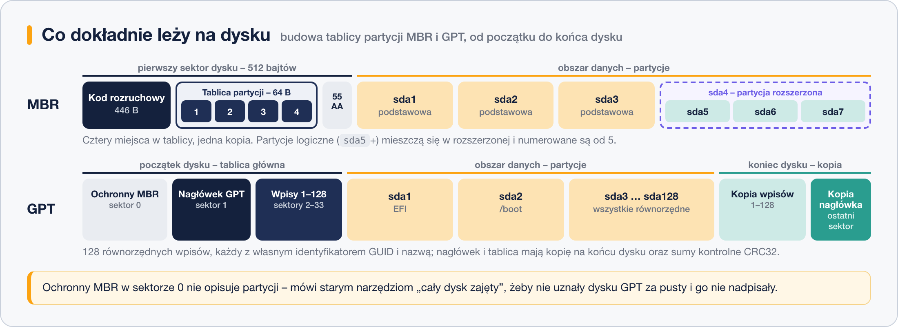
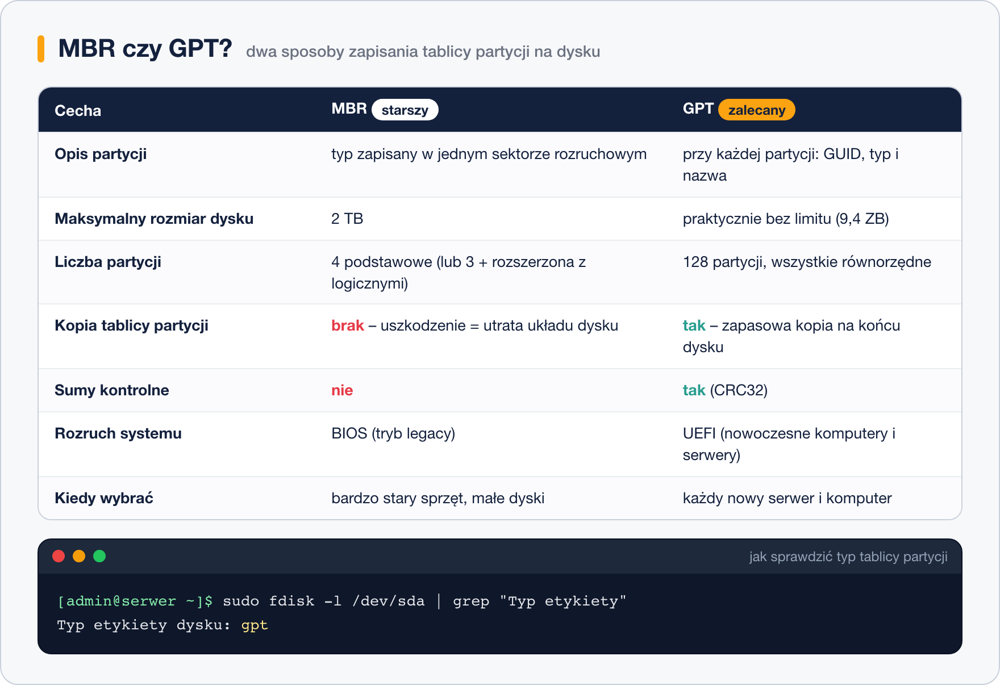

# Tablice partycji – MBR i GPT

> **W tej lekcji:** zrozumiesz, po co dysk ma tablicę partycji, czym różnią się MBR i GPT, co to ma wspólnego z BIOS-em i UEFI oraz jak sprawdzić, co ma Twój dysk.

**Tablica partycji** to niewielki obszar na początku dysku, w którym zapisany jest jego podział na partycje – w ustalonym formacie, żeby każdy system operacyjny mógł go odczytać. Formaty są dwa: starszy MBR i nowszy GPT.

Z wyborem między nimi spotkasz się przy każdym nowym dysku: to pierwsze pytanie `fdisk`, `parted` i instalatora. Zła odpowiedź oznacza dysk 4 TB widziany jako 2 TB albo serwer, który nie chce wystartować.

## Jak to działa

### Partycja i tablica partycji

**Partycja** (ang. *partition*) to wydzielony, ciągły fragment dysku, który system traktuje jak osobny dysk. Na jednym dysku fizycznym możesz mieć osobną partycję na system, osobną na dane użytkowników, osobną na pamięć wymiany (swap). Dzięki temu zapełnienie `/home` nie zablokuje systemu, a przy reinstalacji dane zostają.

**Tablica partycji** to niewielki obszar na początku dysku z zapisem: „partycja 1 zaczyna się w sektorze 2048 i kończy w 1230847, typ: EFI; partycja 2…”. Są dwa formaty tego zapisu.

### MBR – stary format

**MBR** (ang. *Master Boot Record*, główny rekord rozruchowy) pochodzi z 1983 roku. Mieści się w **pierwszym sektorze dysku**, czyli w 512 bajtach, podzielonych tak:

- **446 bajtów** – kod rozruchowy, czyli pierwszy fragment programu uruchamiającego system,
- **64 bajty** – właściwa tablica partycji: cztery wpisy po 16 bajtów, każdy opisuje jedną partycję,
- **2 bajty** – sygnatura `0x55AA`, po której oprogramowanie układowe poznaje, że sektor jest poprawny.

Z tego podziału biorą się wszystkie ograniczenia MBR:

- maksymalny rozmiar dysku **2 TiB** (przy sektorach 512 B) – większy dysk będzie widziany tylko do tej granicy,
- 4 partycje podstawowe; więcej tylko przez sztuczkę z partycją rozszerzoną (lekcja 4),
- jedna kopia tablicy – uszkodzony pierwszy sektor to utrata układu całego dysku,
- brak sum kontrolnych.

W narzędziach linuksowych MBR nazywa się też **„dos”** (`Disklabel type: dos` w `fdisk`, `msdos` w `parted`). To ta sama rzecz.

### GPT – nowoczesny format

**GPT** (ang. *GUID Partition Table*) powstał razem z UEFI. Tablica zajmuje kilkadziesiąt sektorów na początku dysku, a jej **kopia zapasowa** leży na końcu. Każda partycja ma własny unikalny identyfikator (GUID) i nazwę. Ograniczenia praktycznie nie istnieją: dyski do zettabajtów, domyślnie 128 partycji, sumy kontrolne CRC32 wykrywają uszkodzenia.

Pierwszy sektor dysku GPT nadal zawiera tzw. **ochronny MBR** – zapis „cały dysk zajęty”, dzięki któremu stare narzędzia nie uznają dysku za pusty i go nie nadpiszą.

### Budowa obu tablic obok siebie

Najłatwiej zobaczyć różnicę, układając oba formaty na osi dysku – od pierwszego sektora po ostatni:



Co z tego schematu wynika w praktyce:

- **MBR trzyma wszystko w jednym sektorze.** Kod rozruchowy, cztery wpisy i sygnatura – razem 512 bajtów na samym początku dysku. Nie ma kopii: uszkodzenie tego jednego sektora to utrata informacji o układzie całego dysku.
- **Czwarty wpis zwykle idzie na partycję rozszerzoną.** To pojemnik, w którym dopiero mieszczą się partycje logiczne (`sda5`, `sda6`…). Stąd „dziura” w numeracji – szczegóły w następnej lekcji.
- **GPT zaczyna od ochronnego MBR.** Sektor 0 wygląda dla starych narzędzi jak zwykły MBR opisujący jeden wielki, zajęty obszar – właśnie po to, żeby niczego nie nadpisały.
- **Właściwa tablica GPT to nagłówek i 128 wpisów.** Każdy wpis ma identyfikator GUID, typ, nazwę i zakres sektorów; wszystkie partycje są równorzędne, bez podziału na podstawowe i logiczne.
- **Na końcu dysku leży pełna kopia.** Nagłówek i tablica wpisów są zapisane drugi raz, a sumy kontrolne CRC32 pozwalają wykryć uszkodzenie i odtworzyć tablicę z kopii.



### BIOS, UEFI i partycja EFI

Format tablicy wiąże się ze sposobem uruchamiania komputera:

- **BIOS** (tryb *legacy*) – stare oprogramowanie układowe płyty głównej. Szuka programu startowego w pierwszym sektorze dysku, czyli w MBR.
- **UEFI** – następca BIOS-u, standard na każdym nowym komputerze i serwerze. Szuka programu startowego w specjalnej partycji **EFI System Partition** (ESP) – małej (zwykle 200–600 MB) partycji z systemem plików FAT32, montowanej w Linuksie jako `/boot/efi`. ESP wymaga tablicy GPT.

Stąd reguła: **nowy serwer = UEFI + GPT**. MBR ma sens tylko na bardzo starym sprzęcie, który nie zna UEFI. Dyski z danymi (nie systemowe) zawsze zakładaj jako GPT, niezależnie od trybu rozruchu.

Instalator RHEL/Rocky/AlmaLinux robi to sam: na maszynie z UEFI tworzy GPT z partycją EFI, `/boot` i resztą pod LVM.

## W praktyce

```bash
# czy system wystartował w trybie UEFI? Jeśli katalog istnieje – tak
ls /sys/firmware/efi
```

```text
config_table  efivars  fw_platform_size  fw_vendor  runtime  runtime-map  systab
```

Komunikat `No such file or directory` oznacza rozruch w trybie BIOS.

```bash
# jaki typ tablicy ma dysk systemowy
sudo fdisk -l /dev/sda | grep -i "disklabel"
```

```text
Disklabel type: gpt
```

> **Polskie ustawienia językowe:** jeśli serwer ma `LANG=pl_PL.UTF-8`, `fdisk` odpowie po polsku: `Typ etykiety dysku: gpt`. Wtedy szukaj `grep -i "etykiety"`. W przykładach używamy wersji angielskiej, bo tak najczęściej skonfigurowane są serwery.

```bash
# to samo dla wszystkich dysków naraz, w jednej tabelce
lsblk -o NAME,SIZE,TYPE,PTTYPE,FSTYPE,MOUNTPOINTS
```

```text
NAME          SIZE TYPE PTTYPE FSTYPE      MOUNTPOINTS
sda            40G disk gpt
├─sda1        600M part gpt    vfat        /boot/efi
├─sda2          1G part gpt    xfs         /boot
└─sda3       38,4G part gpt    LVM2_member
  ├─rl-root  34,4G lvm         xfs         /
  └─rl-swap     4G lvm         swap        [SWAP]
sdb            10G disk
sdc            10G disk
```

Kolumna `PTTYPE` (ang. *partition table type*) jest pusta przy `sdb` i `sdc` – te dyski nie mają jeszcze żadnej tablicy partycji.

```bash
# wersja z parted – pokazuje też nazwy partycji GPT i flagi
sudo parted /dev/sda print
```

```text
Model: ATA QEMU HARDDISK (scsi)
Disk /dev/sda: 42,9GB
Sector size (logical/physical): 512B/512B
Partition Table: gpt
Disk Flags:

Number  Start   End     Size    File system  Name                  Flags
 1      1049kB  630MB   629MB   fat32        EFI System Partition  boot, esp
 2      630MB   1704MB  1074MB  xfs
 3      1704MB  42,9GB  41,2GB                                     lvm
```

Partycja 1 z flagami `boot, esp` to właśnie partycja EFI. Zakładanie nowej tablicy (`g` w `fdisk`, `mklabel gpt` w `parted`) ćwiczymy w lekcjach 5 i 6.

## Najczęstsze błędy i pułapki

- **Dysk 4 TB z tablicą MBR.** `fdisk` ostrzeże: *The size of this disk is 3,7 TiB. DOS partition table format cannot be used on drives for volumes larger than 2 TiB*. Załóż GPT.
- **Zmiana tablicy na dysku z danymi.** Nowa tablica (`g` lub `o` w `fdisk`, `mklabel` w `parted`) **kasuje spis wszystkich partycji**. Dane fizycznie zostają, ale system ich nie znajdzie. Nową tablicę zakłada się tylko na pustym dysku.
- **Skasowanie partycji EFI „bo jest mała i nie wiem, do czego”.** Serwer z UEFI bez niej nie wystartuje. Partycja `vfat` zamontowana jako `/boot/efi` jest nietykalna.
- **Mylenie MBR z partycją podstawową.** MBR to format tablicy; podstawowa/rozszerzona/logiczna to rodzaje partycji wewnątrz MBR (lekcja 4).

## Podsumowanie

- Tablica partycji to spis treści dysku: gdzie zaczyna się i kończy każda partycja.
- MBR (inaczej „dos”): do 2 TiB, 4 partycje, bez kopii zapasowej. GPT: bez praktycznych limitów, 128 partycji, kopia na końcu dysku, sumy kontrolne.
- UEFI startuje z partycji EFI (FAT32, `/boot/efi`) i wymaga GPT. BIOS startuje z MBR.
- Nowy dysk – zawsze GPT. MBR tylko ze świadomego powodu.

| Polecenie | Co pokazuje |
|---|---|
| `ls /sys/firmware/efi` | istnieje = system wystartował przez UEFI |
| `sudo fdisk -l /dev/sda \| grep -i disklabel` | typ tablicy partycji (`gpt` lub `dos`) |
| `lsblk -o NAME,SIZE,PTTYPE,FSTYPE` | typ tablicy dla wszystkich dysków |
| `sudo parted /dev/sda print` | tablica, partycje, nazwy i flagi |
