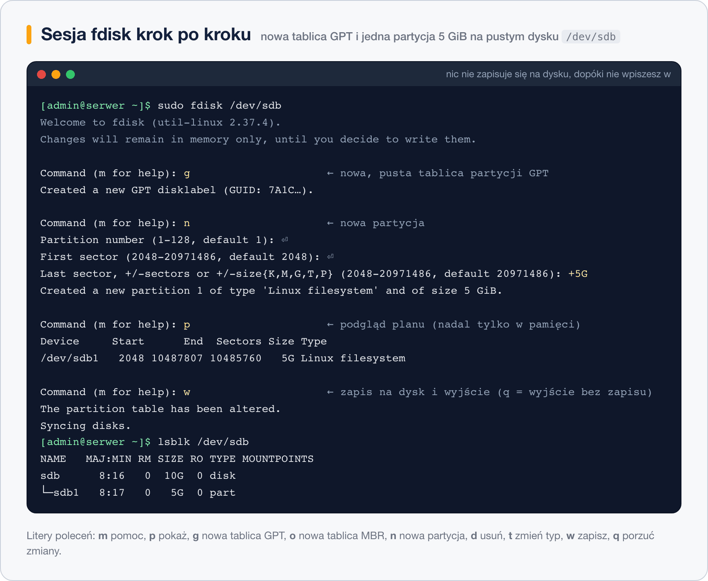

# fdisk

> **W tej lekcji:** przejdziesz pełny scenariusz partycjonowania dysku `/dev/sdb` narzędziem `fdisk`: od podglądu, przez utworzenie tablicy i partycji, po zapis i sprawdzenie efektu.

`fdisk` to podstawowe narzędzie do partycjonowania w każdej dystrybucji Linuksa. Jest zawsze pod ręką (pakiet `util-linux`, instalowany z systemem), działa w terminalu – także przez SSH na serwerze bez środowiska graficznego – i prowadzi Cię pytaniami. Gdy dokładasz dysk pod dane, LVM albo RAID, pierwszym krokiem jest zwykle właśnie sesja `fdisk`.

Dobra wiadomość dla początkującego: `fdisk` **niczego nie zapisuje na dysku**, dopóki świadomie nie wydasz polecenia zapisu. Do tego momentu wszystkie zmiany żyją tylko w pamięci i można je porzucić.

## Jak to działa

`fdisk` ma dwa oblicza:

- `fdisk -l` – tryb **podglądu**: wypisuje dyski i partycje, nic nie zmienia.
- `fdisk /dev/sdb` – tryb **interaktywny**: dialog, w którym pojedynczymi literami wydajesz polecenia.

Najważniejsze litery trybu interaktywnego:

| Litera | Działanie |
|---|---|
| `m` | pomoc – lista wszystkich poleceń |
| `p` | wypisz aktualny (planowany) układ partycji |
| `g` | załóż nową, pustą tablicę **GPT** |
| `o` | załóż nową, pustą tablicę **MBR** („dos”) |
| `n` | nowa partycja |
| `d` | usuń partycję |
| `t` | zmień typ partycji (lekcja 4) |
| `w` | **zapisz** zmiany na dysk i wyjdź |
| `q` | wyjdź **bez zapisywania** – wszystko, co zrobiłeś, znika |



## W praktyce

Scenariusz: świeży dysk `/dev/sdb` (10 GB) ma dostać tablicę GPT i dwie partycje – 5 GiB na dane i resztę pod przyszłe LVM.

### Krok 1: rozpoznanie

```bash
# co jest na dysku teraz – zawsze zaczynaj od podglądu
sudo fdisk -l /dev/sdb
```

```text
Disk /dev/sdb: 10 GiB, 10737418240 bytes, 20971520 sectors
Disk model: QEMU HARDDISK
Units: sectors of 1 * 512 = 512 bytes
Sector size (logical/physical): 512 bytes / 512 bytes
I/O size (minimum/optimal): 512 bytes / 512 bytes
```

Brak linii `Disklabel type` i listy partycji = dysk zupełnie pusty. Upewnij się dwa razy, że to właściwy dysk (rozmiar, model, `lsblk` – czy nic z niego nie jest zamontowane).

### Krok 2: tryb interaktywny i nowa tablica

```bash
sudo fdisk /dev/sdb
```

```text
Welcome to fdisk (util-linux 2.37.4).
Changes will remain in memory only, until you decide to write them.
Be careful before using the write command.

Device does not contain a recognized partition table.
Created a new DOS disklabel with disk identifier 0x1f6e9a3c.

Command (m for help): g
Created a new GPT disklabel (GUID: 1D6E0F6A-6BFA-4A3B-9C7E-52F0A1B2C3D4).
```

`fdisk` na pustym dysku proponuje MBR („DOS disklabel”) – ale tylko w pamięci. Litera `g` zamienia plan na GPT. Gdybyś potrzebował MBR (bardzo stary sprzęt), wpisałbyś `o`.

### Krok 3: pierwsza partycja (5 GiB)

```text
Command (m for help): n
Partition number (1-128, default 1): ⏎
First sector (2048-20971486, default 2048): ⏎
Last sector, +/-sectors or +/-size{K,M,G,T,P} (2048-20971486, default 20971486): +5G

Created a new partition 1 of type 'Linux filesystem' and of size 5 GiB.
```

Na dwa pierwsze pytania wystarczy Enter – domyślny numer i początek są dobre. Rozmiar podajesz wygodnie jako `+5G` (5 GiB od początku partycji), zamiast liczyć sektory.

### Krok 4: druga partycja (reszta dysku) i typ LVM

```text
Command (m for help): n
Partition number (2-128, default 2): ⏎
First sector (10487808-20971486, default 10487808): ⏎
Last sector, +/-sectors or +/-size{K,M,G,T,P} (10487808-20971486, default 20971486): ⏎

Created a new partition 2 of type 'Linux filesystem' and of size 5 GiB.

Command (m for help): t
Partition number (1,2, default 2): 2
Partition type or alias (type L to list all): lvm

Changed type of partition 'Linux filesystem' to 'Linux LVM'.
```

Enter przy ostatnim sektorze = „do końca dysku”. Litera `t` i alias `lvm` oznaczają partycję jako przeznaczoną pod LVM.

### Krok 5: kontrola planu i zapis

```text
Command (m for help): p
Disk /dev/sdb: 10 GiB, 10737418240 bytes, 20971520 sectors
Disklabel type: gpt

Device        Start      End  Sectors Size Type
/dev/sdb1      2048 10487807 10485760   5G Linux filesystem
/dev/sdb2  10487808 20971486 10483679   5G Linux LVM

Command (m for help): w
The partition table has been altered.
Calling ioctl() to re-read partition table.
Syncing disks.
```

`p` pokazuje plan – to ostatni moment na poprawki (`d` usuwa partycję) albo ucieczkę bez szkód (`q`). Dopiero `w` zapisuje tablicę na dysk. Po zapisie `fdisk` prosi jądro o ponowne wczytanie tablicy (to ten „ioctl”) i kończy pracę.

### Krok 6: weryfikacja

```bash
# czy jądro widzi nowe partycje
lsblk /dev/sdb
```

```text
NAME   MAJ:MIN RM SIZE RO TYPE MOUNTPOINTS
sdb      8:16   0  10G  0 disk
├─sdb1   8:17   0   5G  0 part
└─sdb2   8:18   0   5G  0 part
```

Jeśli partycji nie widać (zdarza się, gdy dysk był w użyciu), pomóż jądru:

```bash
# wymuś ponowne wczytanie tablicy partycji
sudo partprobe /dev/sdb
```

Partycje istnieją, ale są puste – żeby trzymać pliki, potrzebują systemu plików (`mkfs.xfs /dev/sdb1`) i zamontowania. To temat modułu 11.

## Najczęstsze błędy i pułapki

- **Praca na złym dysku.** `fdisk /dev/sda` zamiast `/dev/sdb` na serwerze z systemem na `sda` to przepis na katastrofę. Przed `w` zawsze `p` i chwila zastanowienia; w razie wątpliwości `q`.
- **Wyjście przez `w` „żeby zapisać pracę”.** Odruch z edytorów tekstu. W `fdisk` `w` = zmień dysk naprawdę. Jeśli tylko oglądałeś – wychodź przez `q`.
- **Zdziwienie, że po `w` nie ma żadnych plików.** Partycjonowanie nie tworzy systemu plików. `lsblk -f` pokaże pustą kolumnę FSTYPE, dopóki nie uruchomisz `mkfs`.
- **`Re-reading the partition table failed … Device or resource busy.`** Któraś partycja tego dysku jest zamontowana albo używana przez LVM/RAID. Odmontuj lub zwolnij, potem `sudo partprobe`.
- **Rozmiar `5G` zamiast `+5G`.** Bez plusa podajesz numer sektora końcowego, nie rozmiar. `fdisk` zwykle odrzuci taką wartość, ale nawyk `+rozmiar` chroni przed pomyłką.

## Podsumowanie

- `fdisk -l` ogląda, `fdisk /dev/sdX` zmienia – ale dopiero litera `w` zapisuje cokolwiek na dysk.
- Typowa sesja na nowym dysku: `g` (tablica GPT) → `n` (partycje) → ewentualnie `t` (typy) → `p` (kontrola) → `w`.
- `q` to bezpieczne wyjście bez śladu – korzystaj bez wahania.
- Po zapisie sprawdź `lsblk`; gdy partycji nie widać – `sudo partprobe`.

| Polecenie / litera | Działanie |
|---|---|
| `sudo fdisk -l` | wypisz wszystkie dyski i partycje |
| `sudo fdisk /dev/sdb` | tryb interaktywny dla dysku `sdb` |
| `m` / `p` | pomoc / pokaż układ |
| `g` / `o` | nowa tablica GPT / MBR |
| `n` / `d` / `t` | nowa partycja / usuń / zmień typ |
| `w` / `q` | zapisz i wyjdź / wyjdź bez zapisu |
| `sudo partprobe /dev/sdb` | odśwież tablicę w jądrze |
