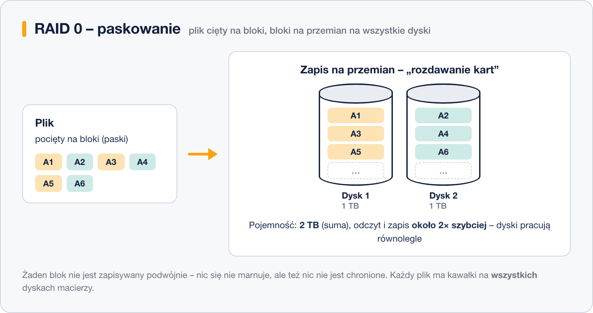
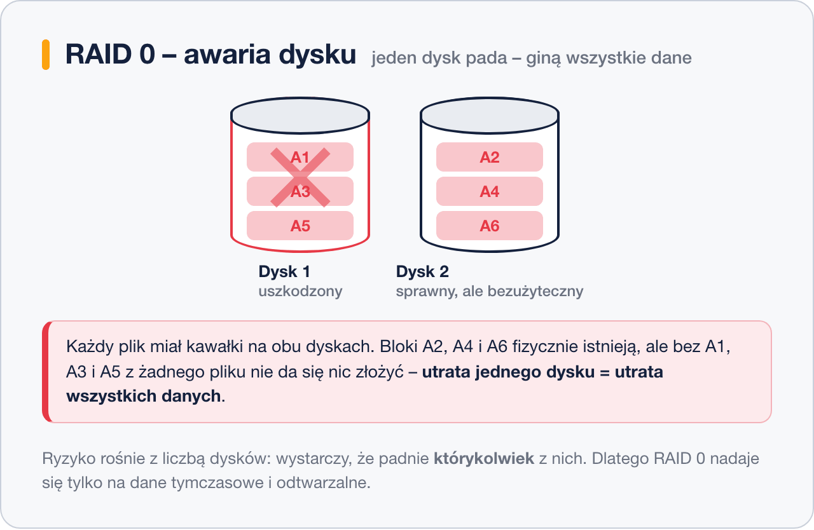

# RAID 0 – istota działania

> **W tej lekcji:** na przykładzie RAID 0 zobaczysz, jak naprawdę działa macierz – jak plik jest cięty na bloki i rozkładany na dyski, skąd bierze się szybkość i pojemność, i dlaczego awaria jednego dysku niszczy wszystkie dane.

RAID 0 to najprostszy poziom RAID i zarazem kwintesencja działania macierzy: czyste **paskowanie** (ang. *striping*), czyli rozkładanie danych na kilka dysków naraz, bez żadnej nadmiarowości.

Warto zrozumieć go dokładnie, bo paskowanie wraca w prawie wszystkich wyższych poziomach – RAID 5, 6 i 10 to różne sposoby dodania ochrony właśnie do pasków.

## Jak to działa

Macierz RAID 0 dzieli zapisywane dane na **bloki** stałej wielkości (zwykle 64–512 KiB) i zapisuje je **na przemian** na kolejnych dyskach:

1. Plik trafia do macierzy i zostaje pocięty na bloki: A1, A2, A3, A4, A5, A6…
2. Blok A1 ląduje na dysku 1, A2 na dysku 2, A3 znowu na dysku 1 i tak dalej – jak rozdawanie kart.
3. Przy odczycie dzieje się to samo w drugą stronę: oba dyski podają swoje bloki **jednocześnie**.

Stąd biorą się obie zalety:

- **Pojemność to suma dysków** (dokładnie: N × najmniejszy dysk) – żaden blok nie jest zapisywany podwójnie, więc nic się nie marnuje.
- **Szybkość rośnie niemal N-krotnie** – dyski pracują równolegle, każdy przenosi tylko część danych.

### Cena: awaria jednego dysku = utrata wszystkich danych

Każdy plik ma kawałki na **wszystkich** dyskach macierzy. Gdy którykolwiek dysk padnie, z każdego pliku zostają dziury – a pliku z dziurami nie da się odtworzyć, nawet jeśli połowa bloków leży na zupełnie sprawnym dysku:

Co gorsza, ryzyko rośnie z liczbą dysków: wystarczy, że padnie *którykolwiek* z nich. Macierz RAID 0 z czterech dysków jest w przybliżeniu cztery razy bardziej narażona na utratę danych niż pojedynczy dysk.

| Parametr | RAID 0 |
|---|---|
| Minimalna liczba dysków | 2 |
| Pojemność do użycia | N × dysk (100%) |
| Ile awarii dysków przeżyje | **0** |

## Kiedy stosować

Tylko tam, gdzie dane są tymczasowe albo łatwe do odtworzenia:

- przestrzeń robocza obróbki wideo i renderowania,
- katalogi tymczasowe i bufory podręczne (cache),
- dane pośrednie obliczeń, które można powtórzyć.

Nigdy na dane produkcyjne, dokumenty ani bazy danych – cyfra „0” w nazwie dobrze podsumowuje poziom ochrony.

## Podsumowanie

- RAID 0 tnie dane na bloki i rozkłada je na przemian na wszystkie dyski – to paskowanie, podstawowy mechanizm macierzy.
- Pojemność = suma dysków; odczyt i zapis prawie N-krotnie szybsze.
- Awaria jednego dysku = utrata wszystkich danych, a ryzyko rośnie z każdym kolejnym dyskiem.
- Zastosowanie: wyłącznie dane tymczasowe i odtwarzalne.
