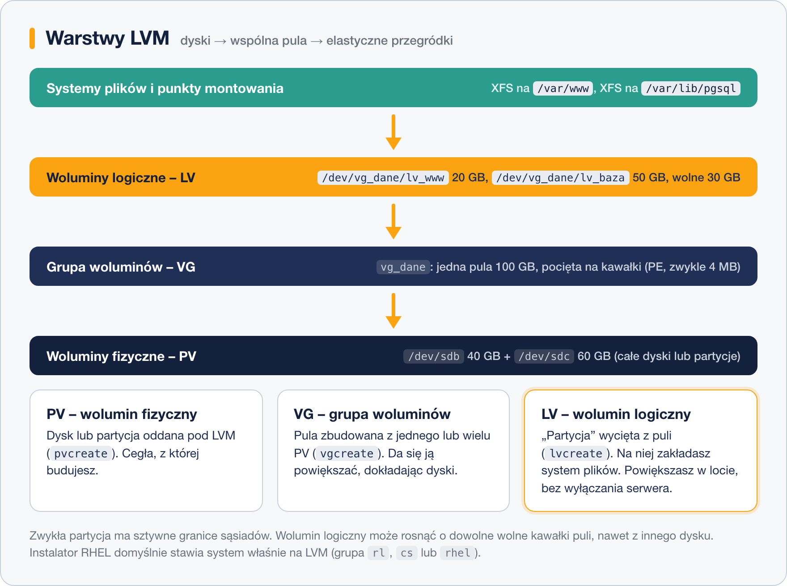

# Idea woluminów logicznych

> **W tej lekcji:** zrozumiesz, jaki problem rozwiązuje LVM i jak działają jego trzy warstwy: woluminy fizyczne (PV), grupa woluminów (VG) i woluminy logiczne (LV).

## Po co mi to?

Wyobraź sobie klasyczny scenariusz: serwer ma dysk podzielony na partycje – 20 GB na system, 20 GB na `/var` z bazą danych. Po roku baza urosła i `/var` jest pełny, a na partycji systemowej wolne 15 GB. I co teraz? Zwykłych partycji nie da się ot tak powiększyć – mają sztywne granice, a za `/var` leży już następna partycja. Zostaje żonglerka: kopiowanie danych, zmiana partycji z Live CD, przestój.

**LVM** (ang. *Logical Volume Manager* – menedżer woluminów logicznych) rozwiązuje ten problem, wstawiając między dyski a systemy plików warstwę pośrednią. Zamiast ciąć dysk na sztywne kawałki, wrzucasz całą przestrzeń do wspólnej **puli**, a z niej wycinasz elastyczne „przegródki”, które można powiększać w locie – bez odmontowywania, bez przestoju, nawet dokładając w międzyczasie nowy dysk do puli.

Nie jest to egzotyka: **domyślna instalacja RHEL, Rocky i AlmaLinux stawia system właśnie na LVM**. Na swojej maszynie szkoleniowej już go masz.

## Jak to działa

LVM układa przestrzeń dyskową w trzy warstwy:



- **PV – wolumin fizyczny** (ang. *physical volume*): dysk lub partycja oddana pod LVM poleceniem `pvcreate`. To cegły, z których budujesz. PV może być też macierz RAID `/dev/md0` (lekcja 3).
- **VG – grupa woluminów** (ang. *volume group*): pula zbudowana z jednego lub wielu PV (`vgcreate`). Grupa sumuje pojemność swoich PV i tnie ją na drobne, równe kawałki – **PE** (ang. *physical extent*, fizyczny zakres), domyślnie po 4 MiB. PE to „klocki”, którymi LVM żongluje; po stronie woluminu logicznego te same kawałki nazywają się LE (*logical extent*).
- **LV – wolumin logiczny** (ang. *logical volume*): „partycja” wycięta z puli (`lvcreate`). Składa się z dowolnych wolnych PE grupy – niekoniecznie sąsiednich, nawet z różnych dysków. Na LV zakładasz system plików i montujesz go jak każdą partycję.

Mnemotechnika: **dyski (PV) → pula (VG) → przegródki (LV)**.

Dzięki temu układowi:

- LV można **powiększyć** o dowolne wolne PE – od ręki, na działającym systemie;
- gdy w VG braknie miejsca, **dokładasz dysk** (`pvcreate` + `vgextend`) i pula rośnie;
- jeden dysk może nosić wiele LV, a jeden LV może leżeć na wielu dyskach;
- LV można przenosić między dyskami bez odmontowywania (`pvmove`), robić migawki i wiele więcej.

### Jak nazywają się woluminy

Każdy LV widać w systemie pod **dwiema równoważnymi ścieżkami**:

| Ścieżka | Przykład |
|---|---|
| `/dev/<grupa>/<wolumin>` | `/dev/vg_dane/lv_www` |
| `/dev/mapper/<grupa>-<wolumin>` | `/dev/mapper/vg_dane-lv_www` |

Obie to dowiązania do tego samego urządzenia (`dm-0`, `dm-1`… – od *device mapper*, mechanizmu jądra, na którym LVM jest zbudowany). Używaj tej, która Ci wygodniejsza; w wyjściu `df` czy `lsblk` zobaczysz zwykle wariant z `mapper` lub samą nazwę `grupa-wolumin`. Uwaga na drobiazg: w nazwie z `mapper` łącznik w nazwie grupy lub woluminu jest podwajany (`vg-dane` → `vg--dane`).

### LVM na maszynie szkoleniowej

Instalator RHEL tworzy grupę o nazwie zależnej od dystrybucji: `rhel` (RHEL), `rl` (Rocky), `almalinux` (Alma) lub `cs` (CentOS Stream), a w niej woluminy `root` i `swap` (czasem też `home`):

```bash
lsblk
```

```text
NAME        MAJ:MIN RM  SIZE RO TYPE MOUNTPOINTS
sda           8:0    0   40G  0 disk
├─sda1        8:1    0  600M  0 part /boot/efi
├─sda2        8:2    0    1G  0 part /boot
└─sda3        8:3    0 38,4G  0 part
  ├─rl-root 253:0    0 34,4G  0 lvm  /
  └─rl-swap 253:1    0    4G  0 lvm  [SWAP]
```

Czytając od dołu: partycja `sda3` jest PV, należy do grupy `rl`, z której wycięto LV `root` (zamontowany jako `/`) i `swap`. Poza LVM zostają tylko `/boot` i `/boot/efi` – program rozruchowy musi umieć je przeczytać zanim wstanie LVM.

## W praktyce

Obejrzyj LVM na swojej maszynie – trzy szybkie polecenia (szczegóły i tworzenie w następnej lekcji):

```bash
# woluminy fizyczne: który dysk/partycja, w której grupie, ile wolnego
sudo pvs
```

```text
  PV         VG Fmt  Attr PSize   PFree
  /dev/sda3  rl lvm2 a--  <38,41g    0
```

```bash
# grupy woluminów: ile PV, ile LV, rozmiar i wolne miejsce w puli
sudo vgs
```

```text
  VG #PV #LV #SN Attr   VSize   VFree
  rl   1   2   0 wz--n- <38,41g    0
```

```bash
# woluminy logiczne: nazwa, grupa, rozmiar
sudo lvs
```

```text
  LV   VG Attr       LSize   Pool Origin Data%  Meta%  Move Log Cpy%Sync Convert
  root rl -wi-ao---- <34,41g
  swap rl -wi-ao----   4,00g
```

`VFree 0` mówi, że cała pula jest rozdana – żeby powiększyć `root`, trzeba będzie najpierw dołożyć PV do grupy. Dokładnie to zrobisz w następnej lekcji.

## Najczęstsze błędy i pułapki

- **Mylenie kierunku warstw.** PV to nie „partycja LVM do montowania” – montuje się wyłącznie LV. Kolejność budowy jest zawsze ta sama: PV → VG → LV → system plików.
- **Szukanie LV w `fdisk -l`.** `fdisk` pokazuje dyski i partycje; woluminy logiczne zobaczysz w `lsblk`, `lvs` i `df`.
- **„LVM chroni dane jak RAID.”** Nie. Zwykły LVM nie dodaje żadnej nadmiarowości – awaria dysku z PE Twojego LV to utrata danych. O łączeniu LVM z RAID mówi lekcja 3.
- **Zdziwienie nazwą `/dev/mapper/rl-root`.** To ten sam wolumin co `/dev/rl/root` – dwie ścieżki, jedno urządzenie.

## Podsumowanie

- LVM to warstwa między dyskami a systemami plików: **PV (dyski) → VG (pula) → LV (przegródki)**.
- Pula jest cięta na kawałki PE (4 MiB); LV rośnie o dowolne wolne kawałki, nawet z innego dysku.
- Woluminy widać jako `/dev/grupa/wolumin` i `/dev/mapper/grupa-wolumin`.
- RHEL i pochodne domyślnie instalują się na LVM (grupa `rhel`/`rl`/`cs`), poza LVM zostaje `/boot`.
- Podgląd: `pvs`, `vgs`, `lvs`.

## Zobacz też

- [2. Tworzenie i zarządzanie LVM](2.%20Tworzenie%20i%20zarządzanie%20LVM.md) – pełny warsztat: od pvcreate po powiększanie
- [3. LVM a RAID – różnice i łączenie](3.%20LVM%20a%20RAID%20–%20różnice%20i%20łączenie.md)
- [Moduł 09, lekcja 1 – Dyski w Linuksie](../09.%20Zarządzanie%20dyskami/1.%20Dyski%20w%20Linuksie%20–%20katalog%20dev%20i%20nazwy%20urządzeń.md)
