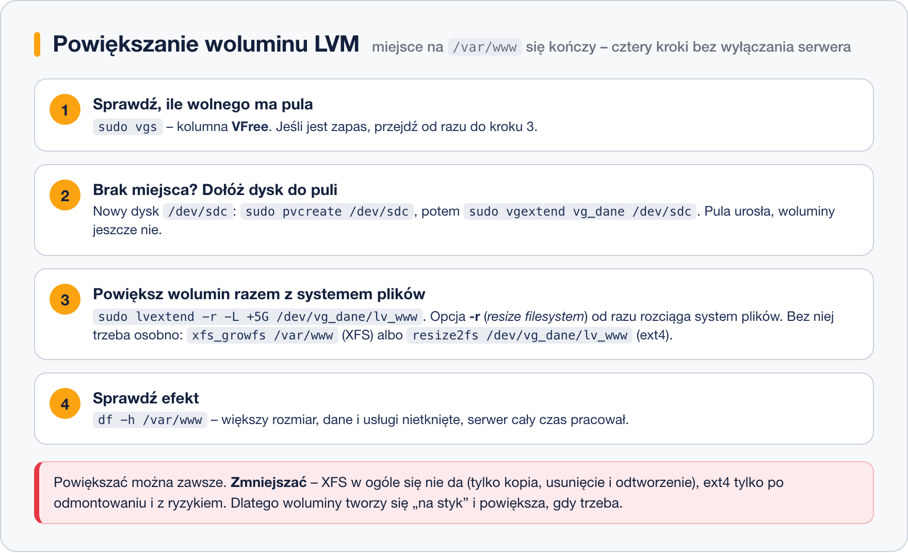

# Tworzenie i zarządzanie LVM

> **W tej lekcji:** przejdziesz cały warsztat LVM: utworzysz PV, VG i LV, założysz system plików, powiększysz wolumin na działającym serwerze, poznasz polecenia podglądu oraz kolejność usuwania. Na deser: migawki.

## Po co mi to?

To jedna z najbardziej „produkcyjnych” lekcji całego szkolenia. Powiększenie woluminu, na którym kończy się miejsce, to rutynowe zadanie administratora – a z LVM zajmuje dwie minuty i nie wymaga przestoju. Warunek: trzeba pewnie poruszać się po poleceniach `pv*`, `vg*` i `lv*`. Dobra wiadomość – ich nazwy są przewidywalne: przedrostek mówi, której warstwy dotyczą, a reszta co robią (`create`, `extend`, `remove`, `s`, `display`).

## Jak to działa

Budowa idzie zawsze z dołu do góry: **PV → VG → LV → system plików → montowanie**. Usuwanie – dokładnie odwrotnie. Powiększanie działa na każdej warstwie: dokładasz PV do VG, powiększasz LV o wolne miejsce z VG, a na końcu rozciągasz system plików.

Jedno rozróżnienie, które musisz znać zanim coś powiększysz: **wolumin logiczny i system plików to dwie osobne rzeczy**. `lvextend` powiększa „przegródkę”, ale system plików w środku nadal ma stary rozmiar – trzeba go rozciągnąć osobno (`xfs_growfs` dla XFS, `resize2fs` dla ext4) albo jednym ruchem z opcją `-r`, która robi obie rzeczy naraz.

## W praktyce

Scenariusz: dyski ćwiczeniowe `/dev/sdb` i `/dev/sdc` (po 10 GB). Zbudujemy grupę `vg_dane` i wolumin `lv_www` montowany w `/var/www`, a potem go powiększymy.

### Krok 1: woluminy fizyczne

```bash
# oznacz dyski jako woluminy fizyczne LVM (można też podać partycje, np. /dev/sdb1)
sudo pvcreate /dev/sdb /dev/sdc
```

```text
  Physical volume "/dev/sdb" successfully created.
  Physical volume "/dev/sdc" successfully created.
```

### Krok 2: grupa woluminów

```bash
# utwórz pulę vg_dane – na początek tylko z jednego dysku
sudo vgcreate vg_dane /dev/sdb
```

```text
  Volume group "vg_dane" successfully created
```

Drugi dysk (`sdc`) zostawiamy w zapasie – dołożymy go przy powiększaniu.

### Krok 3: wolumin logiczny

```bash
# wytnij z puli wolumin 5 GiB o nazwie lv_www
sudo lvcreate -L 5G -n lv_www vg_dane
```

```text
  Logical volume "lv_www" created.
```

Opcje: `-L` – rozmiar bezwzględny (`5G`, `500M`), `-n` – nazwa. Zamiast `-L` możesz użyć `-l` (małe L) z liczbą PE albo procentem, np. **`-l 100%FREE`** – „całe wolne miejsce grupy”. To częsty wybór przy jedynym woluminie w grupie.

### Krok 4: system plików i montowanie

```bash
# załóż system plików XFS i zamontuj wolumin
sudo mkfs.xfs /dev/vg_dane/lv_www
sudo mkdir -p /var/www
sudo mount /dev/vg_dane/lv_www /var/www
df -h /var/www
```

```text
Filesystem                     Size  Used Avail Use% Mounted on
/dev/mapper/vg_dane-lv_www     5,0G   68M  5,0G   2% /var/www
```

Trwałe montowanie to wpis w `/etc/fstab` (szczegóły w module 11); dla LVM bezpiecznie jest użyć ścieżki `/dev/mapper/vg_dane-lv_www` albo UUID z `blkid`.

### Podgląd: pvs/vgs/lvs i pvdisplay/vgdisplay/lvdisplay

Każda warstwa ma dwa polecenia podglądu: krótkie tabelki (`pvs`, `vgs`, `lvs`) i pełne wydruki (`pvdisplay`, `vgdisplay`, `lvdisplay`). Na co dzień wystarczają tabelki:

```bash
sudo vgs
```

```text
  VG      #PV #LV #SN Attr   VSize   VFree
  rl        1   2   0 wz--n- <38,41g     0
  vg_dane   1   1   0 wz--n- <10,00g <5,00g
```

Kolumna `VFree` to Twoje pole manewru. Wersji `display` używaj, gdy chcesz zobaczyć wszystko – np. rozmiar PE, identyfikatory UUID, mapowanie zakresów:

```bash
sudo vgdisplay vg_dane
```

```text
  --- Volume group ---
  VG Name               vg_dane
  VG Size               <10,00 GiB
  PE Size               4,00 MiB
  Total PE              2559
  Alloc PE / Size       1280 / 5,00 GiB
  Free  PE / Size       1279 / <5,00 GiB
```

### Krok 5: powiększanie – najważniejsza umiejętność



Miejsce w `/var/www` się kończy. Najpierw sprawdź pulę (`sudo vgs`) – mamy jeszcze ~5 GB wolnego, ale załóżmy, że chcemy więcej. Dokładamy przygotowany wcześniej dysk `sdc` do grupy:

```bash
# powiększ pulę o drugi dysk
sudo vgextend vg_dane /dev/sdc
```

```text
  Volume group "vg_dane" successfully extended
```

Teraz powiększ wolumin **razem z systemem plików** – opcja `-r` (ang. *resize filesystem*):

```bash
# dodaj 5 GiB do woluminu i od razu rozciągnij system plików
sudo lvextend -r -L +5G /dev/vg_dane/lv_www
```

```text
  Size of logical volume vg_dane/lv_www changed from 5,00 GiB to 10,00 GiB.
  Logical volume vg_dane/lv_www successfully resized.
meta-data=/dev/mapper/vg_dane-lv_www isize=512    agcount=4, agsize=327680 blks
…
data blocks changed from 1310720 to 2621440
```

Zwróć uwagę na **plus** w `+5G`: „dodaj 5 GiB”. Bez plusa (`-L 10G`) podajesz rozmiar docelowy. Obie formy są poprawne – plus jest bezpieczniejszy, bo nie wymaga pamiętania bieżącego rozmiaru.

```bash
df -h /var/www
```

```text
Filesystem                     Size  Used Avail Use% Mounted on
/dev/mapper/vg_dane-lv_www      10G   68M   10G   1% /var/www
```

Wszystko działo się na zamontowanym, używanym woluminie – zero przestoju.

Gdybyś pominął `-r`, system plików rozciągasz osobno – innym poleceniem dla każdego typu:

```bash
# XFS: podajesz PUNKT MONTOWANIA (wolumin musi być zamontowany)
sudo xfs_growfs /var/www

# ext4: podajesz URZĄDZENIE (działa też na zamontowanym)
sudo resize2fs /dev/vg_dane/lv_www
```

> **Zapamiętaj różnicę:** powiększać można oba systemy plików w locie, ale **zmniejszać – XFS nie potrafi wcale** (jedyna droga to kopia danych, usunięcie i odtworzenie woluminu), a ext4 tylko po odmontowaniu. Dlatego woluminy tworzy się raczej mniejsze i powiększa w miarę potrzeb – w drugą stronę drogi nie ma.

### Usuwanie – w odwrotnej kolejności

```bash
# 1. odmontuj, 2. usuń LV, 3. usuń VG, 4. wyczyść PV
sudo umount /var/www
sudo lvremove /dev/vg_dane/lv_www
sudo vgremove vg_dane
sudo pvremove /dev/sdb /dev/sdc
```

`lvremove` pyta o potwierdzenie i **bezpowrotnie kasuje dane** woluminu. Pamiętaj też o usunięciu wpisu z `/etc/fstab`, jeśli go dodałeś.

### Migawki w jednym akapicie

LVM potrafi zrobić **migawkę** (ang. *snapshot*) – zamrożony obraz woluminu z danej chwili: `sudo lvcreate -s -L 2G -n lv_www_przed /dev/vg_dane/lv_www`. Migawka zajmuje tylko tyle, ile danych zmieni się od jej utworzenia (tu: do 2 GiB), i służy np. do spójnej kopii zapasowej bazy albo jako bezpiecznik przed aktualizacją – w razie problemu przywracasz stan poleceniem `lvconvert --merge`. Pełna migawka to temat na osobne szkolenie; tu zapamiętaj, że istnieje i że pełna migawka (gdy zmieni się więcej danych niż jej rozmiar) staje się bezużyteczna.

## Najczęstsze błędy i pułapki

- **`lvextend` bez `-r` i bez `xfs_growfs`.** Wolumin większy, a `df` pokazuje po staremu – bo system plików nie urósł. Najczęstszy błąd początkujących. Używaj `-r`.
- **Próba zmniejszenia XFS.** `xfs_growfs` tylko powiększa; opcji „shrink” nie ma. Zanim oddasz komuś 50 GB „na chwilę”, pamiętaj, że odebrać się nie da.
- **`-L 5G` zamiast `-L +5G` przy powiększaniu.** Jeśli wolumin ma już 8 GB, `-L 5G` to próba *zmniejszenia* – LVM odmówi dla bezpieczeństwa, ale przeczytaj komunikat, zanim coś wymusisz.
- **`pvcreate` na złym dysku.** Jak każde narzędzie dyskowe: sprawdź `lsblk` dwa razy. LVM ostrzeże, jeśli widzi system plików, ale potwierdzenie `y` niszczy dostęp do danych.
- **Usuwanie warstw w złej kolejności.** `vgremove` nie przejdzie, póki w grupie są LV; `pvremove` – póki PV jest w grupie. Zawsze: umount → lvremove → vgremove → pvremove.

## Podsumowanie

- Budowa: `pvcreate` → `vgcreate` → `lvcreate -L/-l -n` → `mkfs.xfs` → `mount` (+ fstab).
- Powiększanie: (`pvcreate` + `vgextend` gdy brak miejsca w puli) → `lvextend -r -L +5G`.
- `-r` rozciąga system plików razem z woluminem; osobno robi to `xfs_growfs` (XFS, punkt montowania) lub `resize2fs` (ext4, urządzenie).
- XFS nie da się zmniejszyć – twórz mniejsze woluminy i powiększaj.
- Usuwanie w odwrotnej kolejności; podgląd: `pvs/vgs/lvs`, szczegóły: `*display`.

| Polecenie | Działanie |
|---|---|
| `sudo pvcreate /dev/sdb` | oznacz dysk/partycję jako PV |
| `sudo vgcreate vg_dane /dev/sdb` | utwórz grupę (pulę) |
| `sudo vgextend vg_dane /dev/sdc` | dołóż PV do grupy |
| `sudo lvcreate -L 5G -n lv_www vg_dane` | wolumin 5 GiB |
| `sudo lvcreate -l 100%FREE -n lv_www vg_dane` | wolumin z całego wolnego miejsca |
| `sudo lvextend -r -L +5G /dev/vg_dane/lv_www` | powiększ wolumin + system plików |
| `sudo pvs` / `vgs` / `lvs` | tabelki stanu warstw |
| `sudo lvremove` / `vgremove` / `pvremove` | usuwanie, od góry do dołu |
| `sudo lvcreate -s -L 2G -n nazwa /dev/vg/lv` | migawka woluminu |

## Zobacz też

- [1. Idea woluminów logicznych](1.%20Idea%20woluminów%20logicznych.md)
- [3. LVM a RAID – różnice i łączenie](3.%20LVM%20a%20RAID%20–%20różnice%20i%20łączenie.md)
- [Moduł 11 – System plików](../11.%20System%20plików/0.%20O%20module.md) – mkfs, mount i /etc/fstab
- [Moduł 09, lekcja 5 – fdisk](../09.%20Zarządzanie%20dyskami/5.%20fdisk.md) – partycje pod PV (typ Linux LVM)
