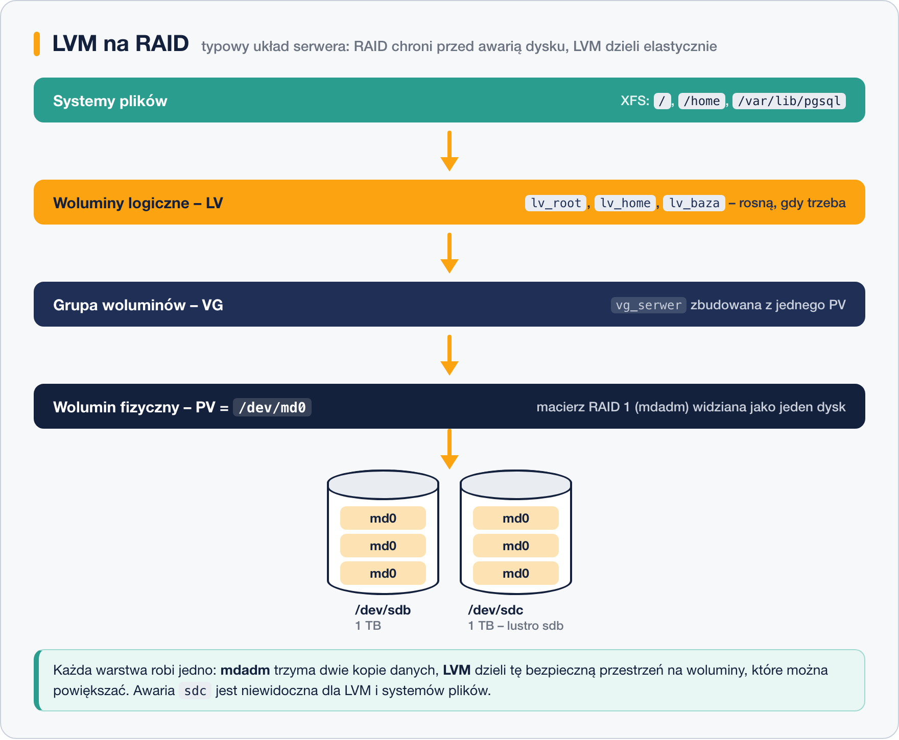

# LVM a RAID – różnice i łączenie

> **W tej lekcji:** uporządkujesz, co daje LVM, a co RAID, dlaczego to nie są konkurencyjne technologie – i jak wygląda typowy serwer, który używa obu naraz.

## Po co mi to?

LVM i RAID łatwo pomylić: oba „łączą dyski w coś logicznego”, oba dają urządzenie, na którym zakłada się system plików. Ale odpowiadają na zupełnie inne pytania. RAID pyta: *co się stanie, gdy dysk padnie?* LVM pyta: *jak wygodnie dzielić i zmieniać przestrzeń?* Pomylenie ról kończy się źle – na przykład serwerem na samym LVM, którego administrator był przekonany, że awaria dysku mu nie grozi.

## Jak to działa

### Co daje które

| | RAID (mdadm) | LVM |
|---|---|---|
| Główny cel | odporność na awarię dysku, wydajność | elastyczny podział przestrzeni |
| Awaria dysku | macierz (poza RAID 0) pracuje dalej | utrata danych z tego dysku |
| Powiększanie „partycji” w locie | nie – to nie jego rola | tak, `lvextend -r` bez przestoju |
| Dokładanie dysków do puli | rozbudowa macierzy jest możliwa, ale powolna i ograniczona | `vgextend` – natychmiast |
| Migawki | brak | `lvcreate -s` |
| Przenoszenie danych między dyskami w locie | nie | `pvmove` |
| Koszt pojemności | tak – kopie lub parzystość (poza RAID 0) | praktycznie zero narzutu |
| Warstwa | tuż nad dyskami fizycznymi | nad dyskami **lub nad RAID** |

Wniosek: **to nie jest wybór „albo–albo”**. Technologie się uzupełniają i na porządnym serwerze występują razem, każda na swoim piętrze.

### Typowy układ: LVM na RAID



Kolejność warstw jest zawsze ta sama: **dyski → mdadm → LVM → systemy plików**.

1. Dwa dyski łączysz w macierz RAID 1: `/dev/md0`. Od tej chwili awaria jednego dysku jest niewidoczna dla wszystkiego powyżej.
2. Macierz oddajesz pod LVM jako PV: `pvcreate /dev/md0`.
3. Budujesz grupę i woluminy jak w poprzedniej lekcji – z tą różnicą, że pula stoi na bezpiecznym fundamencie.

Zyskujesz jednocześnie: ochronę przed awarią (RAID), elastyczne powiększanie i migawki (LVM). Dokładnie tak wygląda wiele serwerów produkcyjnych: mdadm RAID 1 lub 10 na dole, na nim LVM, na woluminach XFS.

### LVM RAID – wzmianka

Nowoczesny LVM potrafi też robić RAID **samodzielnie**, bez mdadm – wolumin tworzony z nadmiarowością: `lvcreate --type raid1 -m 1 -L 10G -n lv_bezpieczny vg_dane` (opcja `-m 1` = jedna kopia lustrzana; są też `--type raid5`, `raid10` itd.). Pod spodem używa tego samego kodu jądra co mdadm, więc niezawodność jest porównywalna, a zaletą jest zarządzanie wszystkim jednym zestawem narzędzi. W praktyce produkcyjnej nadal częściej spotkasz klasyczny układ mdadm + LVM – jest starszy, lepiej udokumentowany i łatwiejszy w diagnostyce (`/proc/mdstat`). Zapamiętaj, że opcja istnieje; do ćwiczeń zostajemy przy mdadm.

## W praktyce

Pełny przebieg „bezpieczny serwer plików” na dyskach ćwiczeniowych (jeśli masz na nich macierz lub LVM z poprzednich lekcji, najpierw posprzątaj wg tamtych instrukcji):

```bash
# 1. macierz RAID 1 z dwóch dysków
sudo mdadm --create /dev/md0 --level=1 --raid-devices=2 /dev/sdb /dev/sdc
sudo mdadm --detail --scan | sudo tee -a /etc/mdadm.conf

# 2. macierz jako wolumin fizyczny LVM
sudo pvcreate /dev/md0

# 3. grupa i wolumin
sudo vgcreate vg_serwer /dev/md0
sudo lvcreate -l 100%FREE -n lv_dane vg_serwer

# 4. system plików i montowanie
sudo mkfs.xfs /dev/vg_serwer/lv_dane
sudo mkdir -p /srv/dane
sudo mount /dev/vg_serwer/lv_dane /srv/dane
```

Kontrola całego stosu jednym poleceniem:

```bash
lsblk
```

```text
NAME                     MAJ:MIN RM  SIZE RO TYPE  MOUNTPOINTS
sdb                        8:16   0   10G  0 disk
└─md0                      9:0    0   10G  0 raid1
  └─vg_serwer-lv_dane    253:2    0   10G  0 lvm   /srv/dane
sdc                        8:32   0   10G  0 disk
└─md0                      9:0    0   10G  0 raid1
  └─vg_serwer-lv_dane    253:2    0   10G  0 lvm   /srv/dane
```

Widzisz wszystkie piętra naraz: dwa dyski → `md0` → wolumin LVM → punkt montowania. Teraz przetestuj odporność tak jak w lekcji o mdadm (`--fail`, `--remove`, `--add`) – pliki w `/srv/dane` pozostają dostępne przez cały czas, a LVM niczego nie zauważa.

## Najczęstsze błędy i pułapki

- **„Mam LVM, więc dane są bezpieczne.”** Zwykły LVM nie dodaje żadnej nadmiarowości. Bezpieczeństwo zaczyna się od RAID pod spodem (albo `--type raid1`) – a kończy na kopii zapasowej, bo żadna z tych warstw nią nie jest.
- **Odwrócenie warstw (RAID z woluminów LVM).** Technicznie wykonalne, praktycznie bezsensowne i trudne w utrzymaniu. Fundament (RAID) zawsze pod spodem, elastyczność (LVM) na górze.
- **PV na dyskach macierzy zamiast na macierzy.** `pvcreate /dev/sdb /dev/sdc` + `vgcreate` to pula **bez ochrony** – to nie to samo co `pvcreate /dev/md0`. Sprawdzaj w `lsblk`, czy między dyskami a LVM jest piętro `raid1`.
- **Pominięcie `/etc/mdadm.conf`.** Po restarcie macierz może wstać jako `md127`; LVM ją znajdzie (szuka po superblokach), ale porządek i przewidywalność cierpią.

## Podsumowanie

- RAID = odporność na awarię i wydajność; LVM = elastyczny podział, powiększanie, migawki. To różne piętra, nie konkurenci.
- Typowy serwer: dyski → mdadm RAID 1/10 → PV → VG → LV → XFS.
- `pvcreate /dev/md0` – oddajesz pod LVM macierz, nie pojedyncze dyski.
- LVM potrafi sam robić RAID (`lvcreate --type raid1`), ale klasyka to mdadm + LVM.
- Ani RAID, ani LVM nie zastępują kopii zapasowej.

## Zobacz też

- [1. Idea woluminów logicznych](1.%20Idea%20woluminów%20logicznych.md)
- [2. Tworzenie i zarządzanie LVM](2.%20Tworzenie%20i%20zarządzanie%20LVM.md)
- [Moduł 09, lekcja 9 – Poziomy RAID](../09.%20Zarządzanie%20dyskami/9.%20Poziomy%20RAID.md)
- [Moduł 09, lekcja 10 – RAID programowy w praktyce – mdadm](../09.%20Zarządzanie%20dyskami/10.%20RAID%20programowy%20w%20praktyce%20–%20mdadm.md)
