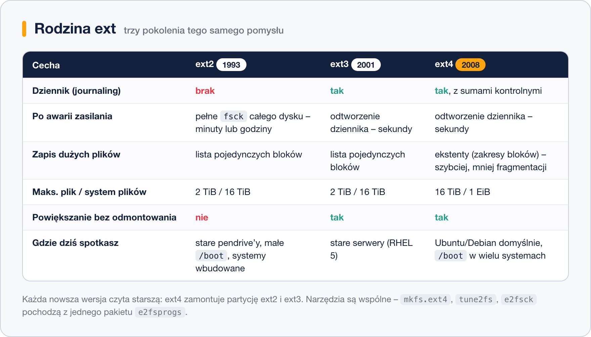

# Rodzina ext – ext2, ext3, ext4

> **W tej lekcji:** poznasz trzy pokolenia systemu plików ext, dowiesz się, co każde z nich wniosło, gdzie ext2 i ext4 nadal spotkasz oraz jak odczytać parametry i sprawdzić spójność partycji ext.

## Po co mi to?

ext4 to najczęściej spotykany system plików w świecie Linuksa: domyślny w Ubuntu, Debianie, na Raspberry Pi, w większości kontenerów i chmur. Nawet na RHEL, gdzie domyślny jest XFS, partycja `/boot` bywa na ext4, a pendrive czy stary serwer, który przejmiesz po poprzedniku, prawie na pewno są na ext. Trzeba umieć je rozpoznać, sprawdzić i naprawić.

Historia rodziny ext to też najprostszy sposób, żeby zrozumieć, **po co** w systemie plików jest dziennik i ekstenty – bo widać, jaki problem każda wersja rozwiązała.

## Jak to działa



### ext2 (1993) – prostota bez zabezpieczeń

*Second extended file system* był przez lata podstawowym systemem plików Linuksa. Ma wszystko, co opisała poprzednia lekcja: bloki, i-węzły, superblok z kopiami. Nie ma dziennika. Po każdym nieczystym wyłączeniu system przy starcie uruchamiał `fsck` na całej partycji – przy dyskach z lat 90. trwało to minuty, przy dzisiejszych terabajtach trwałoby godziny.

Dlaczego mimo to ext2 jeszcze żyje? Bo brak dziennika oznacza mniej zapisów. Na nośnikach o ograniczonej liczbie cykli zapisu (stare pendrive’y, karty SD w urządzeniach wbudowanych) i na malutkich partycjach `/boot`, których nikt nie modyfikuje poza aktualizacją jądra, to zaleta.

### ext3 (2001) – ten sam ext2 plus dziennik

ext3 to dosłownie ext2 z dodanym dziennikiem. Struktura na dysku jest zgodna w obie strony: partycję ext2 dało się zamienić w ext3 jednym poleceniem (`tune2fs -j`) bez utraty danych, a ext3 dało się zamontować jako ext2. Po awarii zasilania start trwał sekundy. ext3 był domyślny w RHEL 4 i 5, więc spotkasz go na bardzo starych maszynach.

Dziennik w ext3/ext4 ma trzy tryby pracy; domyślny `ordered` zapisuje do dziennika tylko metadane, ale pilnuje, by dane pliku trafiły na dysk **przed** jego metadanymi. To kompromis między szybkością a bezpieczeństwem, i dobrze go nie zmieniać.

### ext4 (2008) – ekstenty i duże rozmiary

ext4 (stabilny od jądra 2.6.28) zmienił sposób zapisu, gdzie leży plik. ext2/ext3 pamiętały listę **każdego pojedynczego bloku**: plik 1 GiB to 262 144 wpisów. ext4 używa **ekstentów** (ang. extent) – zapisuje „bloki od 10 000 do 272 143”, czyli jeden wpis zamiast ćwierć miliona. Pliki są mniej pofragmentowane, kasowanie dużych plików jest szybkie, a limity urosły: plik do 16 TiB, system plików do 1 EiB. Doszły też sumy kontrolne dziennika, znaczniki czasu z dokładnością do nanosekund i opóźniona alokacja (system decyduje o położeniu bloków dopiero, gdy naprawdę zapisuje na dysk).

Zgodność wsteczna została: ext4 zamontuje partycję ext3 i ext2. W drugą stronę – nie, bo ext3 nie rozumie ekstentów.

> **Na RHEL 9/10:** ext4 jest w pełni wspierany jako alternatywa dla XFS. Według dokumentacji Red Hat wspierany rozmiar systemu plików ext4 to 50 TiB (limit wsparcia, nie techniczny).

## W praktyce

Wszystkie narzędzia do ext pochodzą z jednego pakietu `e2fsprogs`, zainstalowanego domyślnie.

```bash
# zakładamy ext4 z etykietą na partycji ćwiczeniowej (kasuje jej zawartość!)
sudo mkfs.ext4 -L dane /dev/sdb1
```

```text
mke2fs 1.46.5 (30-Dec-2021)
Tworzenie systemu plików o 1310720 blokach (4k) i 327680 i-węzłach
UUID systemu plików: 1b2d7c0e-5a8f-4e3b-9c1a-6f0d2e8b7a11
…
Zapis superbloków i podsumowania systemu plików: wykonano
```

Zwróć uwagę: liczba i-węzłów (327 680) została ustalona teraz i nie zmieni się.

```bash
# wszystkie parametry systemu plików ext zapisane w superbloku
sudo tune2fs -l /dev/sdb1
```

```text
Filesystem volume name:   dane
Filesystem UUID:          1b2d7c0e-5a8f-4e3b-9c1a-6f0d2e8b7a11
Filesystem features:      has_journal ext_attr resize_inode dir_index filetype extent 64bit flex_bg sparse_super large_file huge_file dir_nlink extra_isize metadata_csum
Filesystem state:         clean
Inode count:              327680
Block count:              1310720
Block size:               4096
Mount count:              0
Maximum mount count:      -1
```

Linia `Filesystem features` zdradza pokolenie: `has_journal` odróżnia ext3 od ext2, `extent` – ext4 od ext3. `Filesystem state: clean` znaczy, że ostatnie odmontowanie było poprawne.

```bash
# zmiana etykiety bez formatowania
sudo tune2fs -L archiwum /dev/sdb1
# albo równoważnie
sudo e2label /dev/sdb1 archiwum
```

```bash
# sprawdzenie spójności – TYLKO na odmontowanej partycji; -f wymusza pełne sprawdzenie
sudo umount /dev/sdb1
sudo e2fsck -f /dev/sdb1
```

```text
e2fsck 1.46.5 (30-Dec-2021)
Przebieg 1: Sprawdzanie i-węzłów, bloków i rozmiarów
Przebieg 2: Sprawdzanie struktury katalogów
Przebieg 3: Sprawdzanie łączności katalogów
Przebieg 4: Sprawdzanie liczników odwołań
Przebieg 5: Sprawdzanie sumarycznych informacji o grupach
archiwum: 11/327680 plików (0.0% nieciągłych), 42065/1310720 bloków
```

Polecenie `fsck.ext4` to ten sam program co `e2fsck`. Jeśli `e2fsck` znajdzie pliki bez katalogu, odłoży je do `lost+found` w korzeniu tej partycji – stąd ten pusty katalog na każdej partycji ext.

```bash
# powiększenie ext4 po powiększeniu partycji – działa nawet na zamontowanym systemie
sudo resize2fs /dev/sdb1
```

## Najczęstsze błędy i pułapki

- **`e2fsck` na zamontowanej partycji.** Program ostrzega i pyta – odpowiedz „nie”. Naprawa działającego systemu plików może go zniszczyć. Partycję `/` sprawdza się z nośnika ratunkowego albo przez `touch /forcefsck` i restart.
- **Mylenie `mkfs.ext4` z `tune2fs`.** Pierwsze formatuje (kasuje), drugie zmienia parametry istniejącego systemu plików. Etykietę zmieniaj przez `tune2fs -L`, nie przez ponowne `mkfs`.
- **Formatowanie dysku zamiast partycji.** `mkfs.ext4 /dev/sdb` zakłada system plików na całym dysku, bez tablicy partycji. Zadziała, ale zaskoczy każdego, kto potem uruchomi `fdisk`. Formatuj `/dev/sdb1`.
- **Zabrakło i-węzłów na ext4.** Liczby i-węzłów nie da się zwiększyć – trzeba przenieść dane i założyć system plików ponownie z `mkfs.ext4 -N <liczba>` lub `-T news` (mniejsze pliki, więcej i-węzłów).

## Podsumowanie

- ext2 – bez dziennika, długi `fsck` po awarii; dziś tylko na `/boot` i nośnikach wymiennych.
- ext3 – ext2 z dziennikiem; zgodny w obie strony; stare serwery.
- ext4 – ekstenty zamiast listy bloków, duże limity, sumy kontrolne; domyślny w Ubuntu/Debianie, wspierany na RHEL.
- Każda nowsza wersja czyta starszą. Narzędzia są wspólne (`e2fsprogs`).

| Polecenie | Co robi |
|---|---|
| `mkfs.ext4 -L etykieta /dev/sdb1` | tworzy ext4 (kasuje dane) |
| `tune2fs -l /dev/sdb1` | wypisuje parametry z superbloku |
| `tune2fs -L nowa /dev/sdb1`, `e2label` | zmienia etykietę |
| `e2fsck -f /dev/sdb1` | sprawdza i naprawia odmontowany system plików |
| `resize2fs /dev/sdb1` | dopasowuje ext4 do nowego rozmiaru partycji |

## Zobacz też

- [Czym jest system plików](1.%20Czym%20jest%20system%20plików.md) – bloki, i-węzły, dziennik.
- [XFS – domyślny system plików RHEL](3.%20XFS%20–%20domyślny%20system%20plików%20RHEL.md) – odpowiedniki tych poleceń dla XFS.
- [Zarządzanie systemami plików](5.%20Zarządzanie%20systemami%20plików.md) – montowanie i odmontowywanie.
