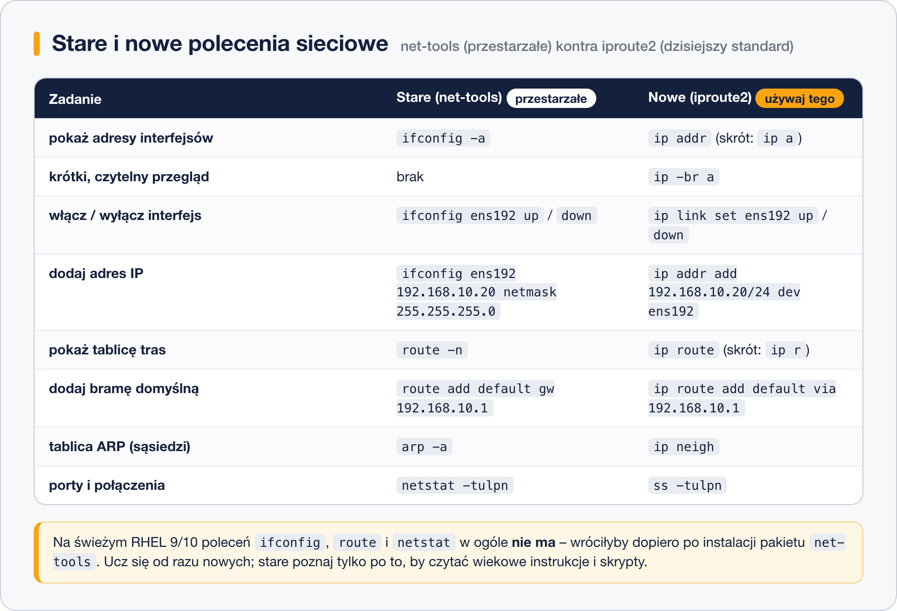

# Narzędzia wiersza poleceń – ip, ifconfig, route

> **W tej lekcji:** opanujesz polecenie `ip` – dzisiejszy standard przeglądania i doraźnej zmiany konfiguracji sieci – oraz dowiesz się, dlaczego `ifconfig` i `route` to przeszłość, którą warto umieć tylko przeczytać.

## Po co mi to?

Pierwsza czynność przy każdym problemie z siecią to „zobacz, co system w ogóle ma ustawione”.
Polecenie `ip` odpowiada na to w sekundę: jakie interfejsy, jakie adresy, którędy wychodzi ruch.
Potrafi też zmienić konfigurację **natychmiast** – co ratuje sytuację, gdy serwer po awarii
wstał bez adresu – ale o jednej właściwości musisz pamiętać od początku: te zmiany **znikają po
restarcie**. Trwałą konfiguracją zajmuje się NetworkManager (następna lekcja).

## Jak to działa

Polecenie `ip` pochodzi z pakietu **iproute2** i jest zbudowane z podpoleceń – „obiektów”,
którymi zarządza:

| Podpolecenie | Skrót | Czym zarządza |
|---|---|---|
| `ip address` | `ip a` | adresy IP na interfejsach |
| `ip link` | `ip l` | same interfejsy (włącz/wyłącz, stan, MAC) |
| `ip route` | `ip r` | tablica tras (routing) |
| `ip neigh` | `ip n` | sąsiedzi w sieci lokalnej (tablica ARP: IP ↔ MAC) |

Starszy zestaw – `ifconfig`, `route`, `netstat`, `arp` z pakietu **net-tools** – nie jest
rozwijany od lat i na świeżym RHEL 9/10 w ogóle nie jest zainstalowany. Spotkasz go jednak
w starych skryptach i poradnikach, dlatego warto znać odpowiedniki:



## W praktyce

### Przeglądanie

```bash
# pełne informacje o adresach wszystkich interfejsów
ip addr
```

```text
1: lo: <LOOPBACK,UP,LOWER_UP> mtu 65536 qdisc noqueue state UNKNOWN ...
    inet 127.0.0.1/8 scope host lo
2: ens192: <BROADCAST,MULTICAST,UP,LOWER_UP> mtu 1500 qdisc fq_codel state UP ...
    link/ether 00:0c:29:3a:1b:2c brd ff:ff:ff:ff:ff:ff
    inet 192.168.10.20/24 brd 192.168.10.255 scope global noprefixroute ens192
```

Jak to czytać: `state UP` – interfejs włączony i kabel „żyje”; `link/ether` – adres MAC;
`inet` – adres IPv4 z maską. `state DOWN` oznacza interfejs wyłączony, a `NO-CARRIER` – brak
kabla/sieci.

```bash
# wersja skrócona – najczęściej używane polecenie diagnostyczne
ip -br a
```

```text
lo               UNKNOWN        127.0.0.1/8 ::1/128
ens192           UP             192.168.10.20/24
```

`-br` (*brief*) mieści wszystko w jednej linii na interfejs. Analogicznie `ip -br link` pokazuje
krótko stan i MAC.

```bash
# tablica tras: którędy wychodzi ruch
ip route
```

```text
default via 192.168.10.1 dev ens192 proto static metric 100
192.168.10.0/24 dev ens192 proto kernel scope link src 192.168.10.20
```

```bash
# sąsiedzi wykryci w sieci lokalnej (odpowiednik arp -a)
ip neigh
```

```text
192.168.10.1 dev ens192 lladdr 70:4f:57:12:ab:cd REACHABLE
```

### Zmiany „na chwilę” (do restartu)

Poniższe polecenia działają natychmiast, ale nie zapisują się nigdzie – po restarcie systemu
(albo poleceniu `nmcli con up`) konfiguracja wraca do tej trwałej. To zaleta przy testach
i ratowaniu systemu, pułapka przy „konfigurowaniu serwera na stałe”.

```bash
# dodajemy drugi adres do interfejsu
sudo ip addr add 192.168.10.99/24 dev ens192
```

```bash
# usuwamy ten adres
sudo ip addr del 192.168.10.99/24 dev ens192
```

```bash
# wyłączamy i włączamy interfejs
sudo ip link set ens192 down
sudo ip link set ens192 up
```

Uwaga: jeśli pracujesz przez SSH, `ip link set … down` **zerwie Twoje połączenie**. Takie rzeczy
rób na konsoli maszyny (albo wiedz, jak wrócisz).

```bash
# trasa do konkretnej sieci przez wskazany router
sudo ip route add 10.0.50.0/24 via 192.168.10.254
```

```bash
# brama domyślna (gdyby jej zabrakło)
sudo ip route add default via 192.168.10.1
```

```bash
# usunięcie trasy
sudo ip route del 10.0.50.0/24
```

### Stare polecenia – gdybyś je spotkał

```bash
# net-tools trzeba najpierw doinstalować
sudo dnf install net-tools
```

```bash
# stary przegląd interfejsów i tras
ifconfig -a
route -n
```

W skryptach odziedziczonych po poprzednikach zobaczysz np.
`ifconfig eth0 192.168.0.10 netmask 255.255.255.0 up` – dziś napisałbyś
`ip addr add 192.168.0.10/24 dev eth0 && ip link set eth0 up`. Nowych skryptów na `ifconfig`
już się nie opiera.

## Najczęstsze błędy i pułapki

- **„Ustawiłem adres, po restarcie zniknął”.** To nie błąd – `ip` zmienia stan bieżący,
  nie konfigurację. Trwałe ustawienia: [lekcja 3](3.%20NetworkManager%20–%20nmcli,%20nmtui%20i%20narzędzia%20graficzne.md).
- **`ip addr add` dokłada adres, nie podmienia.** Interfejs może mieć kilka adresów naraz;
  stary trzeba usunąć przez `ip addr del`.
- **Wyłączenie interfejsu, przez który pracujesz.** Przez SSH = natychmiastowa utrata łączności.
- **`bash: ifconfig: command not found`.** Na RHEL 9/10 to normalne – używaj `ip`, a `net-tools`
  instaluj tylko dla zgodności ze starymi skryptami.
- **Mylenie `-br` z `brd`.** `ip -br a` to skrócony widok; `brd 192.168.10.255` w wyjściu to
  adres rozgłoszeniowy (*broadcast*) – „do wszystkich na ulicy”.

## Podsumowanie

- `ip` (pakiet iproute2) to standard: `ip a` – adresy, `ip -br a` – szybki przegląd,
  `ip route` – trasy, `ip neigh` – sąsiedzi.
- Zmiany przez `ip addr add/del`, `ip link set up/down`, `ip route add/del` działają od razu,
  ale **tylko do restartu**.
- `ifconfig`/`route`/`netstat` (net-tools) są przestarzałe i domyślnie nieobecne – znaj je
  biernie.

| Polecenie | Co robi |
|---|---|
| `ip -br a` | skrócony przegląd interfejsów i adresów |
| `ip addr` / `ip a` | pełne informacje o adresach |
| `ip route` / `ip r` | tablica tras |
| `ip neigh` | tablica sąsiadów (ARP) |
| `sudo ip addr add 192.168.10.99/24 dev ens192` | doraźnie dodaje adres |
| `sudo ip link set ens192 up` / `down` | włącza/wyłącza interfejs |
| `sudo ip route add default via 192.168.10.1` | doraźnie ustawia bramę |
| `ss -tulpn` | porty nasłuchujące (następca `netstat`; [lekcja 5](5.%20Testowanie%20i%20diagnostyka%20sieci.md)) |

## Zobacz też

- [1. Podstawy sieci dla administratora](1.%20Podstawy%20sieci%20dla%20administratora.md)
- [3. NetworkManager – nmcli, nmtui i narzędzia graficzne](3.%20NetworkManager%20–%20nmcli,%20nmtui%20i%20narzędzia%20graficzne.md) – konfiguracja trwała
- [5. Testowanie i diagnostyka sieci](5.%20Testowanie%20i%20diagnostyka%20sieci.md)
