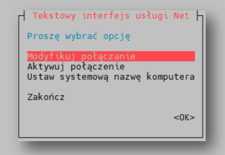
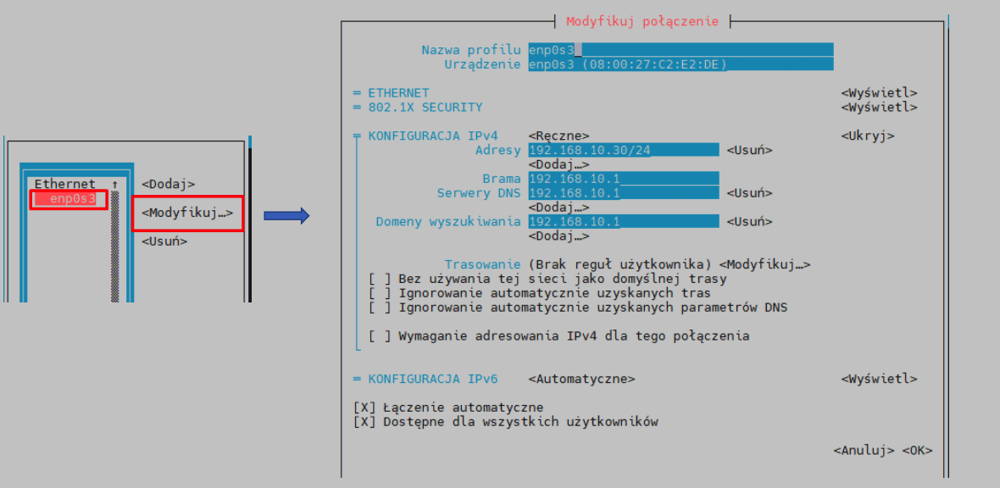
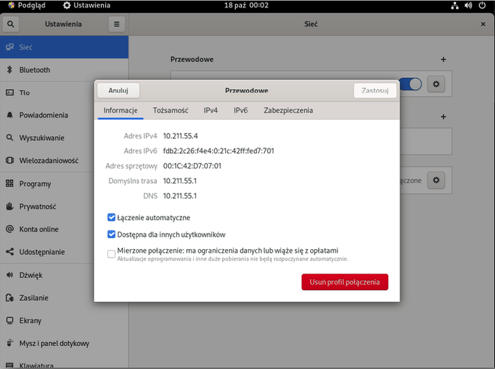
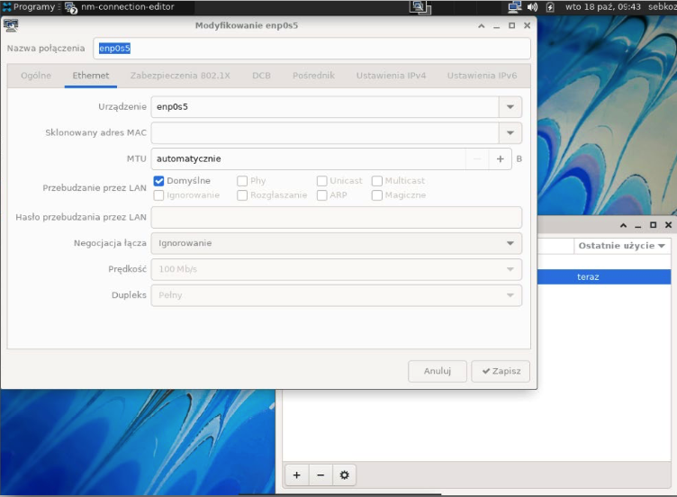

# NetworkManager – nmcli, nmtui i narzędzia graficzne

> **W tej lekcji:** poznasz NetworkManager – usługę, która na RHEL zarządza siecią na stałe – i trzy sposoby rozmowy z nią: polecenie `nmcli`, tekstowe okienka `nmtui` oraz ustawienia graficzne. Ustawisz serwerowi statyczny adres IP, bramę i DNS.

## Po co mi to?

W poprzedniej lekcji zmieniałeś konfigurację „na chwilę”. Serwer potrzebuje konfiguracji
**trwałej**: po restarcie adres, brama i DNS mają być dokładnie takie same. Na RHEL 9/10 (i
większości dzisiejszych dystrybucji) pilnuje tego **NetworkManager** – demon, który przechowuje
profile połączeń i ustawia je przy każdym starcie systemu. Wszystkie drogi – polecenie, okienka
tekstowe, ustawienia graficzne – prowadzą do tego samego mechanizmu, więc możesz wybrać tę,
która Ci odpowiada… a na serwerze bez grafiki i tak zostaje `nmcli` albo `nmtui`.

## Jak to działa

NetworkManager rozróżnia dwa pojęcia, które łatwo pomylić:

- **Urządzenie** (ang. *device*) – fizyczny interfejs, np. `ens192`.
- **Połączenie** (ang. *connection*) – **profil ustawień**: adres, brama, DNS, sposób
  uruchamiania. Profil jest przypisany do urządzenia; jedno urządzenie może mieć kilka profili
  (np. „biuro” i „serwerownia”), ale aktywny jest jeden naraz.

Zmiany robi się w dwóch krokach: **modyfikujesz profil** (zapis na dysk), a potem **podnosisz
połączenie** (zastosowanie ustawień). Sama modyfikacja niczego jeszcze nie zmienia w działającej
sieci.

## W praktyce

### Rozejrzyj się

```bash
# urządzenia i ich stan
nmcli device status
```

```text
DEVICE  TYPE      STATE      CONNECTION
ens192  ethernet  connected  ens192
lo      loopback  unmanaged  --
```

```bash
# profile połączeń
nmcli connection show
```

```text
NAME    UUID                                  TYPE      DEVICE
ens192  5fb06bd0-0bb0-7ffb-45f1-d6ed67dfccc2  ethernet  ens192
```

```bash
# szczegóły profilu (dużo wierszy; grep wybiera te o IPv4)
nmcli connection show ens192 | grep ipv4
```

```text
ipv4.method:        auto
ipv4.addresses:     --
ipv4.gateway:       --
ipv4.dns:           --
```

`ipv4.method: auto` oznacza DHCP.

### Statyczny adres przez nmcli

Ustawiamy serwerowi adres `192.168.10.20/24`, bramę `192.168.10.1` i dwa serwery DNS:

```bash
# modyfikujemy profil – to zapisuje ustawienia, ale jeszcze ich nie stosuje
sudo nmcli connection modify ens192 \
    ipv4.method manual \
    ipv4.addresses 192.168.10.20/24 \
    ipv4.gateway 192.168.10.1 \
    ipv4.dns "192.168.10.1 8.8.8.8"
```

```bash
# stosujemy: podnosimy połączenie z nowymi ustawieniami
sudo nmcli connection up ens192
```

```text
Connection successfully activated (D-Bus active path: /org/freedesktop/NetworkManager/ActiveConnection/3)
```

```bash
# kontrola
ip -br a
ip route
cat /etc/resolv.conf
```

Najważniejsze pary metoda/parametry:

| Polecenie | Znaczenie |
|---|---|
| `ipv4.method manual` | adres statyczny (wymaga `ipv4.addresses`) |
| `ipv4.method auto` | DHCP |
| `ipv4.dns "…"` | serwery DNS rozdzielone spacją, w cudzysłowie |
| `+ipv4.dns 1.1.1.1` | plusem **dodajesz** do listy zamiast ją nadpisywać |
| `ipv4.ignore-auto-dns yes` | przy DHCP: nie bierz DNS od serwera DHCP, użyj moich |
| `connection.autoconnect yes` | podnoś profil automatycznie przy starcie |

Powrót do DHCP:

```bash
sudo nmcli connection modify ens192 ipv4.method auto \
    ipv4.addresses "" ipv4.gateway "" ipv4.dns ""
sudo nmcli connection up ens192
```

> **Przez SSH:** `nmcli connection up` zrywa i zestawia połączenie na nowo – jeśli zmieniasz
> adres maszyny, na której właśnie siedzisz zdalnie, stracisz sesję i połączysz się już na nowy
> adres. Upewnij się najpierw, że nowy adres jest poprawny, albo pracuj na konsoli.

### nmtui – okienka w terminalu

**nmtui** (*NetworkManager Text User Interface*) to to samo, ale w formie tekstowych okienek –
wygodne, gdy wolisz formularz od parametrów. Działa też przez SSH.

```bash
sudo nmtui
```



1. Wybierz **Modyfikuj połączenie** i wskaż profil (np. `ens192`), potem **Modyfikuj…**.
2. W formularzu przy *KONFIGURACJA IPv4* zmień `<Automatyczne>` na `<Ręczne>`, kliknij
   **Wyświetl** i wpisz adres z maską (`192.168.10.20/24`), bramę i serwery DNS.



3. Zjedź na **OK**. Po powrocie do menu wejdź w **Aktywuj połączenie**, dezaktywuj i aktywuj
   profil – to odpowiednik `nmcli connection up`.

Po klawiaturze poruszasz się strzałkami i Tabem, zatwierdzasz Enterem, wychodzisz Esc.
W menu jest też **Ustaw systemową nazwę komputera** – odpowiednik `hostnamectl set-hostname`
(o nazwach w [lekcji 4](4.%20Pliki%20konfiguracyjne%20sieci.md)).

### Narzędzia graficzne

Na maszynie z pulpitem GNOME sieć ustawisz w **Ustawienia → Sieć**: przy połączeniu przewodowym
kliknij ikonę zębatki. Karta *Informacje* pokazuje bieżący adres IPv4/IPv6, MAC, bramę i DNS,
a karty *IPv4/IPv6* pozwalają przełączyć się z DHCP na adres ręczny – te same pola co w `nmtui`.



W lżejszych środowiskach graficznych (Xfce, MATE) do edycji profili służy program
**nm-connection-editor** (menu „Zaawansowana konfiguracja sieci” albo polecenie o tej nazwie).
Okno edycji połączenia ma zakładki Ethernet, Ustawienia IPv4/IPv6 itd.:



Wszystkie te narzędzia zapisują do tych samych profili NetworkManagera – możesz zacząć w GNOME,
a dokończyć w `nmcli`.

## Najczęstsze błędy i pułapki

- **`nmcli con mod` bez `nmcli con up`.** Ustawienia zapisane, ale niezastosowane – „zmieniłem,
  a nic się nie stało”.
- **`ipv4.method manual` bez adresu.** NetworkManager odmówi: statyczna konfiguracja wymaga
  `ipv4.addresses`. Ustawiaj oba parametry w jednym poleceniu.
- **Nadpisanie DNS zamiast dodania.** `ipv4.dns 1.1.1.1` zastępuje całą listę; `+ipv4.dns`
  dopisuje.
- **Ręczna edycja `/etc/resolv.conf`.** NetworkManager generuje ten plik i nadpisze Twoje
  zmiany – DNS ustawia się w profilu połączenia (szczegóły w
  [lekcji 4](4.%20Pliki%20konfiguracyjne%20sieci.md)).
- **Nazwa profilu ≠ nazwa urządzenia.** Profil może nazywać się np. `Wired connection 1` –
  w poleceniach używasz **nazwy profilu** (z `nmcli con show`), nie nazwy karty. Spacje ujmij
  w cudzysłów.

## Podsumowanie

- NetworkManager trzyma **profile połączeń** – to jest konfiguracja trwała, odtwarzana po
  restarcie.
- Schemat pracy: `nmcli connection modify …` (zapis) → `nmcli connection up …` (zastosowanie).
- Statyczny adres: `ipv4.method manual` + `ipv4.addresses` + `ipv4.gateway` + `ipv4.dns`;
  powrót do DHCP: `ipv4.method auto`.
- `nmtui` to te same ustawienia w tekstowych okienkach; GNOME i nm-connection-editor – w oknach
  graficznych. Wszystko zapisuje się w tych samych profilach.

| Polecenie | Co robi |
|---|---|
| `nmcli device status` | urządzenia i ich stan |
| `nmcli connection show` | lista profili |
| `nmcli connection show ens192` | szczegóły profilu |
| `sudo nmcli con mod ens192 ipv4.method manual ipv4.addresses 192.168.10.20/24 ipv4.gateway 192.168.10.1 ipv4.dns "192.168.10.1"` | statyczny adres |
| `sudo nmcli connection up ens192` | zastosowanie profilu |
| `sudo nmcli connection down ens192` | dezaktywacja profilu |
| `sudo nmtui` | konfiguracja w okienkach tekstowych |

## Zobacz też

- [2. Narzędzia wiersza poleceń – ip, ifconfig, route](2.%20Narzędzia%20wiersza%20poleceń%20–%20ip,%20ifconfig,%20route.md) – zmiany doraźne
- [4. Pliki konfiguracyjne sieci](4.%20Pliki%20konfiguracyjne%20sieci.md) – gdzie te profile leżą na dysku
- [Moduł 02. Środowiska graficzne](../../Dział%201%20-%20Wprowadzenie%20do%20systemu/02.%20Środowiska%20graficzne/0.%20O%20module.md)
