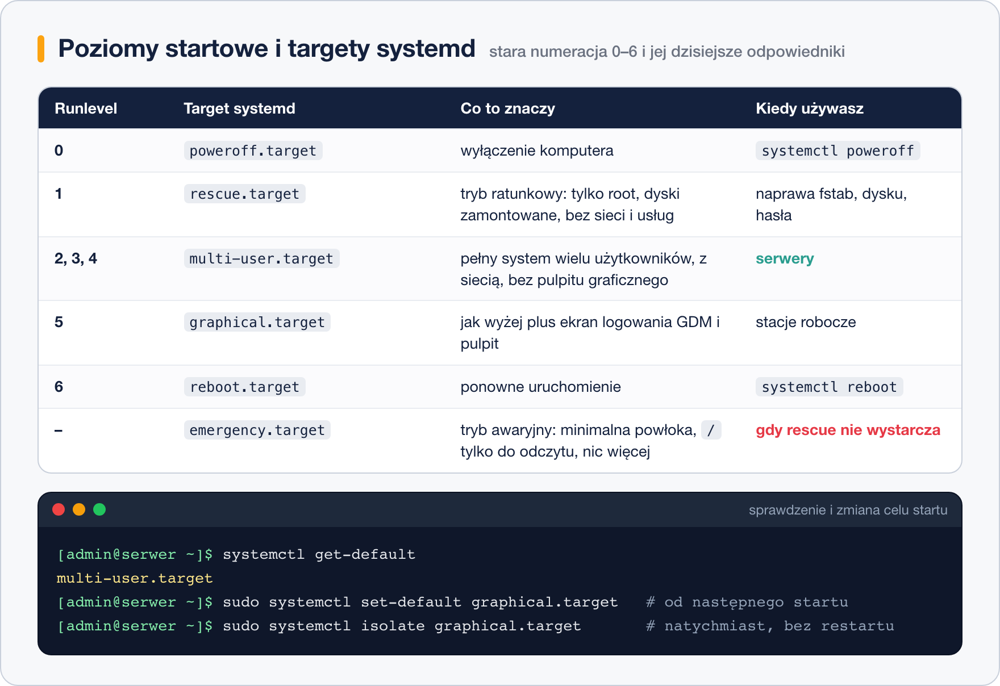

# Poziomy startowe – runlevels i targety systemd

> **W tej lekcji:** zrozumiesz, czym są cele (targety) systemd i jak odpowiadają historycznym poziomom startowym 0–6, nauczysz się sprawdzać i zmieniać domyślny cel, przełączać system w locie oraz wchodzić w tryb ratunkowy i awaryjny.

## Po co mi to?

Serwer nie potrzebuje pulpitu graficznego – zużywa on pamięć i zwiększa pole ataku. Stacja robocza odwrotnie: ma startować prosto do ekranu logowania GNOME. A gdy system jest uszkodzony, chcesz go uruchomić w trybie minimalnym, w którym nic nie przeszkadza w naprawie. Wszystkie te „poziomy pracy” systemd nazywa **celami** (ang. target). Starsza nazwa – **poziomy startowe** (ang. runlevels) – wciąż funkcjonuje w rozmowach, dokumentacji i pytaniach rekrutacyjnych, więc poznasz obie.

## Jak to działa

Cel to jednostka systemd typu `.target`, która sama nic nie uruchamia – jest **punktem zbiórki** dla grupy usług. `multi-user.target` „chce” (ang. wants) sieci, SSH, zapory i konsol logowania; `graphical.target` zawiera `multi-user.target` **plus** menedżera logowania GDM. Przy starcie systemd dąży do celu domyślnego, uruchamiając wszystko, czego ten cel wymaga.

W erze przed systemd (init SysV, lekcja 6) rolę celów pełniły poziomy startowe 0–6. systemd utrzymuje dla nich dowiązania zgodności – `runlevel3.target` wskazuje na `multi-user.target` – więc stare polecenia i nawyki nadal działają.



Dwa cele specjalne służą do naprawy:

- **`rescue.target`** (tryb ratunkowy, dawny poziom 1 / „single”): uruchamia podstawy systemu, montuje systemy plików z `fstab`, ale nie startuje usług ani sieci. Jedna powłoka roota. Tu naprawiasz uszkodzoną konfigurację usługi czy przepełniony dysk.
- **`emergency.target`** (tryb awaryjny): jeszcze mniej – tylko `/` zamontowany **w trybie tylko do odczytu**, żadnego `fstab`. Używany, gdy sam `fstab` jest zepsuty i rescue nie wstaje. W oba tryby trzeba podać hasło roota.

systemd przełącza się też do trybu awaryjnego **sam**, gdy przy starcie nie uda się zamontować systemu plików – to komunikat „You are in emergency mode”, który znasz z [lekcji o fstab](../11.%20System%20plików/7.%20Plik%20fstab.md).

## W praktyce

```bash
# jaki jest cel domyślny
systemctl get-default
```

```text
multi-user.target
```

```bash
# zmiana celu domyślnego – zadziała od następnego startu
sudo systemctl set-default graphical.target
```

```text
Removed "/etc/systemd/system/default.target".
Created symlink /etc/systemd/system/default.target → /usr/lib/systemd/system/graphical.target.
```

Jak widać, „domyślny cel” to po prostu dowiązanie symboliczne `default.target`.

```bash
# przełączenie W LOCIE, bez restartu: isolate zatrzymuje wszystko, czego nowy cel nie potrzebuje
sudo systemctl isolate multi-user.target   # wyłącza środowisko graficzne
sudo systemctl isolate graphical.target    # włącza je z powrotem
```

`isolate` na zdalnym serwerze bywa zdradliwe: izolacja do celu, który nie zawiera sieci (np. `rescue.target`), zerwie Twoje połączenie SSH.

```bash
# wejście w tryb ratunkowy (z konsoli, nie przez SSH!)
sudo systemctl rescue
# tryb awaryjny
sudo systemctl emergency
# powrót do normalnej pracy z trybu naprawczego
systemctl default
```

```bash
# lista celów aktywnych teraz i wszystkich dostępnych
systemctl list-units --type=target
systemctl list-unit-files --type=target
# co dany cel za sobą pociąga
systemctl list-dependencies multi-user.target | head
```

### Wybór celu na jeden start – z GRUB-a

Gdy system nie wstaje albo nie znasz hasła użytkownika z sudo, cel podajesz jako parametr jądra: w menu GRUB-a klawisz `e`, na końcu wiersza `linux` dopisz:

```text
systemd.unit=rescue.target      # tryb ratunkowy
systemd.unit=emergency.target   # tryb awaryjny
systemd.unit=multi-user.target  # pominięcie zepsutego pulpitu
```

i Ctrl+x. Działa na jeden start, niczego nie zapisuje. Zamiast pełnej składni zadziała też samo `1`, `3` lub `5` (numer poziomu) dopisane na końcu wiersza `linux`.

```bash
# historyczne polecenia nadal działają:
runlevel
```

```text
N 3
```

`N` oznacza „poprzedniego poziomu nie było”, `3` – obecny odpowiednik `multi-user.target`. Stare `init 3` czy `telinit 5` systemd też przyjmie i przetłumaczy na `isolate`.

## Najczęstsze błędy i pułapki

- **`isolate rescue.target` przez SSH.** Tryb ratunkowy nie ma sieci – odcinasz sobie dostęp. Tryby naprawcze tylko z konsoli (fizycznej, iLO/iDRAC, konsoli hypervisora).
- **Mylenie `set-default` z `isolate`.** `set-default` nic nie zmienia teraz (tylko od restartu); `isolate` zmienia teraz, ale nie na stałe. Na stałe i od razu = oba polecenia.
- **`graphical.target` bez zainstalowanego środowiska.** Na serwerze minimalnym ustawienie celu graficznego nic nie da – najpierw `dnf group install "Server with GUI"`. System bez GDM po prostu zostanie przy konsoli.
- **Oczekiwanie sieci i usług w rescue.** Tryb ratunkowy to powłoka i zamontowane dyski – nic więcej. Usługę uruchamiasz tam ręcznie, jeśli jej potrzebujesz.
- **Zapominanie hasła roota.** Oba tryby naprawcze go wymagają. Jeśli go nie znasz – `rd.break` z [lekcji o GRUB-ie](2.%20GRUB2%20–%20wprowadzenie%20i%20konfiguracja.md).

## Podsumowanie

- Cel (target) = punkt zbiórki usług; domyślny cel decyduje, do czego system startuje.
- Odpowiedniki: 0 `poweroff`, 1 `rescue`, 2–4 `multi-user`, 5 `graphical`, 6 `reboot`; dodatkowo `emergency`.
- `get-default` / `set-default` – ustawienie trwałe; `isolate` – zmiana natychmiastowa.
- Tryb ratunkowy: dyski są, usług i sieci nie ma. Tryb awaryjny: tylko `/` w trybie odczytu.
- Jednorazowo z GRUB-a: `systemd.unit=rescue.target` w wierszu `linux`.

| Polecenie | Co robi |
|---|---|
| `systemctl get-default` | pokazuje cel domyślny |
| `sudo systemctl set-default multi-user.target` | ustawia cel domyślny (od restartu) |
| `sudo systemctl isolate graphical.target` | przełącza cel natychmiast |
| `sudo systemctl rescue` / `emergency` | wejście w tryb naprawczy |
| `systemctl default` | powrót do celu domyślnego |
| `systemctl list-dependencies cel` | co wchodzi w skład celu |
| `runlevel` | bieżący poziom w starej notacji |

## Zobacz też

- [Etapy startu systemu](1.%20Etapy%20startu%20systemu.md) – miejsce celu w procesie startu.
- [GRUB2 – wprowadzenie i konfiguracja](2.%20GRUB2%20–%20wprowadzenie%20i%20konfiguracja.md) – klawisz `e` i parametry jądra.
- [init SysV a systemd](6.%20init%20SysV%20a%20systemd.md) – skąd wzięła się numeracja 0–6.
