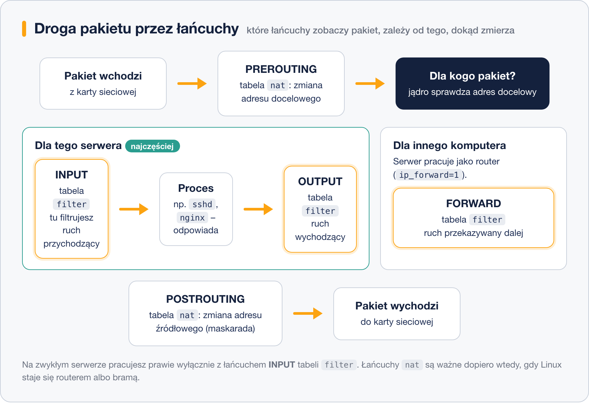

# iptables – tabele, łańcuchy i cele

> **W tej lekcji:** poznasz budowę zapory iptables — tabele, łańcuchy, cele — oraz dwie zasady, które decydują o wszystkim: kolejność reguł i śledzenie stanu połączeń.

## Po co mi to?

Nawet jeśli na co dzień będziesz używać firewalld, pod spodem i tak pracują reguły zbudowane z tych samych klocków: łańcuchów, dopasowań i celów. Znajomość iptables to jak znajomość silnika u kierowcy — nie musisz go składać codziennie, ale gdy coś nie działa, wiesz, gdzie zajrzeć. Poza tym ogromna część dokumentacji, poradników i starszych serwerów wciąż mówi językiem iptables.

> **Uwaga dla RHEL 9/10:** polecenie `iptables` istnieje, ale jest już tylko nakładką tłumaczącą reguły na nftables (wariant `iptables-nft`) i jest oznaczone jako przestarzałe. Składnia działa tak samo, więc wszystko z tej lekcji pozostaje aktualne.

## Jak to działa

### Tabele – do czego służy reguła

Reguły są pogrupowane w **tabele** według przeznaczenia:

| Tabela | Do czego | Jak często jej używasz |
|---|---|---|
| `filter` | przepuszczanie i blokowanie pakietów | praktycznie zawsze — to domyślna tabela |
| `nat` | zmiana adresów w pakietach (ang. Network Address Translation), np. udostępnianie internetu, przekierowanie portów | gdy serwer jest routerem lub bramą |
| `mangle` | modyfikacja pól nagłówka pakietu (np. TTL) | rzadko, zastosowania specjalne |

Istnieją jeszcze tabele `raw` i `security`, ale na szkoleniu i w typowej pracy ich nie dotkniesz.

### Łańcuchy – w którym miejscu drogi pakietu

Każda tabela zawiera **łańcuchy** (ang. chains) — listy reguł sprawdzane w konkretnym punkcie wędrówki pakietu przez system:



- **INPUT** — pakiety adresowane do tego serwera (ktoś łączy się z nami). Tu pracujesz najczęściej.
- **OUTPUT** — pakiety wysyłane przez ten serwer.
- **FORWARD** — pakiety przechodzące *przez* serwer do innego komputera (tylko gdy serwer jest routerem).

### Cele – co zrobić z dopasowanym pakietem

Gdy pakiet pasuje do reguły, wykonywany jest jej **cel** (ang. target):

| Cel | Co się dzieje | Co widzi nadawca |
|---|---|---|
| `ACCEPT` | pakiet przechodzi dalej | normalna odpowiedź usługi |
| `DROP` | pakiet znika bez śladu | długie czekanie i timeout — jakby serwer nie istniał |
| `REJECT` | pakiet odrzucony z odpowiedzią | natychmiastowy komunikat „connection refused” |
| `LOG` | pakiet zapisany do dziennika i sprawdzany dalej | nic — to cel niekończący, reguły poniżej dalej obowiązują |

Kiedy `DROP`, a kiedy `REJECT`? Wobec internetu zwykle `DROP` — nie zdradzamy nawet, że serwer istnieje. Wewnątrz własnej sieci bywa lepszy `REJECT` — użytkownik od razu wie, że dostęp jest zablokowany, zamiast czekać na timeout.

### Kolejność reguł i pierwsze dopasowanie

Najważniejsza zasada iptables: **reguły w łańcuchu są sprawdzane od góry do dołu i wygrywa pierwsza pasująca**. Dalsze reguły nie są już oglądane. Jeśli reguła blokująca całą sieć stoi nad regułą przepuszczającą jeden adres z tej sieci, ten adres nigdy nie zostanie przepuszczony. Gdy żadna reguła nie pasuje, decyduje **polityka domyślna** łańcucha (policy), widoczna w nagłówku listingu.

### Stan połączenia – conntrack

Jądro prowadzi tablicę śledzenia połączeń (**conntrack**). Dzięki niej reguła nie musi oceniać każdego pakietu w oderwaniu — może zapytać o **stan**:

- `NEW` — pakiet otwierający nowe połączenie,
- `ESTABLISHED` — pakiet należący do połączenia już nawiązanego,
- `RELATED` — pakiet powiązany z istniejącym połączeniem (np. komunikat błędu ICMP).

To zmienia wszystko: wystarczy jedna reguła „przepuść ESTABLISHED,RELATED” na górze łańcucha, a potem decydujesz już tylko o **nowych** połączeniach. Odpowiedzi na ruch, który sam zainicjowałeś, wracają bez dodatkowych reguł.

## W praktyce

```bash
# podgląd reguł tabeli filter: -n bez zamiany adresów na nazwy, -v z licznikami
sudo iptables -L -n -v
```

```text
Chain INPUT (policy ACCEPT 1024 packets, 80K bytes)
 pkts bytes target  prot opt in  out source     destination

Chain FORWARD (policy ACCEPT 0 packets, 0 bytes)
 pkts bytes target  prot opt in  out source     destination

Chain OUTPUT (policy ACCEPT 980 packets, 102K bytes)
 pkts bytes target  prot opt in  out source     destination
```

Pusty listing z polityką `ACCEPT` oznacza: zapora niczego nie blokuje. Liczniki `pkts`/`bytes` przy regułach to świetne narzędzie diagnostyczne — od razu widać, czy reguła w ogóle „łapie” jakiś ruch.

```bash
# inna tabela niż filter: opcja -t
sudo iptables -t nat -L -n
```

## Najczęstsze błędy i pułapki

- **Zapominanie, że wygrywa pierwsza reguła.** Wyjątki (ACCEPT dla konkretnego adresu) muszą stać **nad** regułami ogólnymi (DROP dla całej sieci).
- **Ocenianie pakietów bez stanu.** Bez reguły dla `ESTABLISHED` zablokujesz odpowiedzi na własne połączenia — objaw: „mogę wejść na serwer, ale serwer nie może nic pobrać”.
- **Mylenie DROP z REJECT.** `DROP` = cisza i timeout, `REJECT` = natychmiastowa odmowa. Przy diagnozowaniu problemów ta różnica mówi dużo o tym, co blokuje ruch.
- **Szukanie reguł tylko w tabeli `filter`.** Jeśli ruch znika, a `filter` jest czysty, zajrzyj do `nat` (`-t nat`) — może ktoś ustawił przekierowanie.

## Podsumowanie

- **Tabela** mówi, *po co* jest reguła (`filter` — blokowanie, `nat` — zmiana adresów).
- **Łańcuch** mówi, *gdzie na drodze pakietu* reguła działa (INPUT/OUTPUT/FORWARD).
- **Cel** mówi, *co zrobić*: ACCEPT, DROP, REJECT, LOG.
- Reguły czytane są **od góry, wygrywa pierwsze dopasowanie**; bez dopasowania decyduje polityka łańcucha.
- **conntrack** pozwala jednym ruchem przepuścić wszystkie odpowiedzi (`ESTABLISHED,RELATED`) i decydować tylko o nowych połączeniach.

| Polecenie | Co robi |
|---|---|
| `iptables -L -n -v` | pokazuje reguły tabeli filter z licznikami |
| `iptables -t nat -L -n` | pokazuje reguły tabeli nat |
| `iptables -L --line-numbers` | numeruje reguły (przyda się przy usuwaniu) |

## Zobacz też

- [1. Czym jest zapora sieciowa](1.%20Czym%20jest%20zapora%20sieciowa.md)
- [3. iptables – składnia i scenariusz](3.%20iptables%20–%20składnia%20i%20scenariusz.md)
