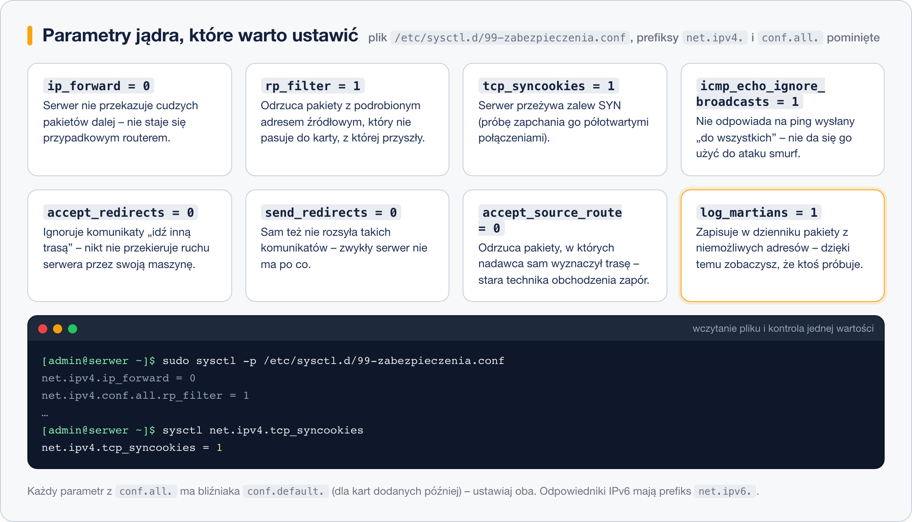

# Zabezpieczenia na poziomie jądra

> **W tej lekcji:** nauczysz się utwardzać zachowanie sieciowe samego jądra poleceniem `sysctl` i plikami w `/etc/sysctl.d/`, a także dowiesz się, gdzie zapora się kończy i co ją uzupełnia: SELinux, fail2ban i aktualizacje.

## Po co mi to?

Zapora decyduje, które pakiety wpuścić. Ale to, **jak jądro traktuje pakiety już wpuszczone** — czy przekazuje cudzy ruch dalej, czy wierzy w podrobione adresy, czy daje się zasypać półotwartymi połączeniami — regulują parametry jądra. To druga linia obrony: tania (kilka wpisów w pliku), działająca nawet wtedy, gdy ktoś namiesza w regułach zapory.

## Jak to działa

Jądro wystawia swoje parametry jako pliki w katalogu `/proc/sys/`. Parametr `net.ipv4.ip_forward` to naprawdę plik `/proc/sys/net/ipv4/ip_forward` — kropki w nazwie odpowiadają katalogom. Polecenie **`sysctl`** czyta i ustawia te wartości, a pliki `*.conf` w katalogu **`/etc/sysctl.d/`** utrwalają je przy starcie systemu.

Najważniejsze parametry sieciowe z krótkim „przed czym chroni”:



- `net.ipv4.ip_forward = 0` — serwer nie przekazuje cudzych pakietów między sieciami; nie stanie się nieświadomie routerem (ustaw `1` tylko na maszynie, która *ma* być routerem).
- `net.ipv4.conf.all.rp_filter = 1` — odrzuca pakiety z podrobionym (ang. spoofed) adresem źródłowym, który nie pasuje do trasy powrotnej.
- `net.ipv4.tcp_syncookies = 1` — chroni przed atakiem SYN flood, czyli zapchaniem serwera półotwartymi połączeniami.
- `net.ipv4.icmp_echo_ignore_broadcasts = 1` — ignoruje ping „do wszystkich”; serwer nie da się użyć jako wzmacniacz ataku smurf.
- `net.ipv4.conf.all.accept_redirects = 0` — nie przyjmuje komunikatów ICMP „idź inną trasą”, którymi można przekierować ruch serwera przez maszynę napastnika.
- `net.ipv4.conf.all.send_redirects = 0` — sam też takich komunikatów nie wysyła; zwykły serwer nie ma po co.
- `net.ipv4.conf.all.accept_source_route = 0` — odrzuca pakiety z trasą wyznaczoną przez nadawcę, starą techniką obchodzenia zapór.
- `net.ipv4.conf.all.log_martians = 1` — zapisuje w dzienniku pakiety z adresów „niemożliwych”; nic nie blokuje, ale daje widoczność prób.

Parametry `conf.all.*` mają bliźniaków `conf.default.*` (dziedziczonych przez karty sieciowe dodane później) — w pliku ustawiamy oba. Większość z tych wartości jest już w RHEL 9/10 domyślna, ale jawny wpis w pliku dokumentuje stan i chroni przed przypadkową zmianą.

## W praktyce

```bash
# podgląd jednej wartości
sysctl net.ipv4.ip_forward
```

```text
net.ipv4.ip_forward = 0
```

```bash
# wyszukiwanie parametrów po fragmencie nazwy
sudo sysctl -a | grep redirects
```

```bash
# zmiana "na żywo" - do restartu
sudo sysctl -w net.ipv4.conf.all.log_martians=1
```

Zmiany na stałe — własny plik w `/etc/sysctl.d/`:

```bash
sudo tee /etc/sysctl.d/99-zabezpieczenia.conf > /dev/null <<'EOF'
net.ipv4.ip_forward = 0
net.ipv4.conf.all.rp_filter = 1
net.ipv4.conf.default.rp_filter = 1
net.ipv4.tcp_syncookies = 1
net.ipv4.icmp_echo_ignore_broadcasts = 1
net.ipv4.conf.all.accept_redirects = 0
net.ipv4.conf.default.accept_redirects = 0
net.ipv4.conf.all.send_redirects = 0
net.ipv4.conf.default.send_redirects = 0
net.ipv4.conf.all.accept_source_route = 0
net.ipv4.conf.default.accept_source_route = 0
net.ipv4.conf.all.log_martians = 1
EOF

# wczytanie pliku bez restartu
sudo sysctl -p /etc/sysctl.d/99-zabezpieczenia.conf
```

```text
net.ipv4.ip_forward = 0
net.ipv4.conf.all.rp_filter = 1
...
```

Samo `sysctl -p` (bez argumentu) czyta tylko `/etc/sysctl.conf`; plik z `/etc/sysctl.d/` wskazujemy jawnie albo wczytujemy wszystko przez `sudo sysctl --system`.

## Co jeszcze oprócz zapory i sysctl

- **SELinux** — nawet gdy napastnik przejdzie przez zaporę i przejmie usługę, SELinux trzyma ją w ciasnym „pudełku” uprawnień. Nie wyłączaj go; jak z nim pracować, uczy [moduł 16. SELinux](../../Dział%204%20-%20Tematy%20dodatkowe/16.%20SELinux/0.%20O%20module.md).
- **fail2ban** — demon (z repozytorium EPEL: `sudo dnf install epel-release fail2ban`), który czyta dzienniki i po kilku nieudanych logowaniach automatycznie banuje adres w zaporze. Podstawowa obrona przed zgadywaniem haseł SSH.
- **Aktualizacje** — najważniejsze zabezpieczenie ze wszystkich. Zapora, sysctl i SELinux ograniczają skutki włamania; `sudo dnf upgrade` usuwa same dziury, przez które się włamuje. Serwer bez aktualizacji to kwestia czasu, nie szczęścia.

## Najczęstsze błędy i pułapki

- **Edycja wartości w `/proc/sys/` bez utrwalenia.** `sysctl -w` i wpis przez `echo` znikają po restarcie — na stałe tylko plik w `/etc/sysctl.d/`.
- **Plik zapisany, ale niewczytany.** Analogia do pułapki firewalld: plik w `/etc/sysctl.d/` zadziała dopiero po `sysctl -p <plik>`, `sysctl --system` albo restarcie.
- **Ustawianie tylko `conf.all.*`.** Karta sieciowa dodana później weźmie wartości z `conf.default.*` — ustawiaj parami.
- **Wyłączenie `ip_forward` na routerze/hoście wirtualizacji.** Maszyny wirtualne i kontenery przestaną mieć sieć. Zanim ustawisz `0`, upewnij się, czym jest ta maszyna.
- **Poleganie na sysctl zamiast na aktualizacjach.** Utwardzanie jądra nie załata dziurawej aplikacji.

## Podsumowanie

- Parametry jądra czytasz i ustawiasz przez `sysctl`; na stałe — plik w `/etc/sysctl.d/*.conf` + `sysctl --system`.
- Zestaw minimalny: `ip_forward=0`, `rp_filter=1`, `tcp_syncookies=1`, `icmp_echo_ignore_broadcasts=1`, `accept_redirects=0`, `send_redirects=0`, `accept_source_route=0`, `log_martians=1`.
- Warstwy bezpieczeństwa się sumują: zapora → sysctl → SELinux → fail2ban → **aktualizacje** (najważniejsze).

| Polecenie | Co robi |
|---|---|
| `sysctl net.ipv4.ip_forward` | pokazuje jedną wartość |
| `sysctl -a \| grep fraza` | szuka parametrów |
| `sysctl -w parametr=wartość` | zmiana do restartu |
| `sysctl -p /etc/sysctl.d/plik.conf` | wczytuje wskazany plik |
| `sysctl --system` | wczytuje wszystkie pliki konfiguracyjne |

## Zobacz też

- [4. firewalld](4.%20firewalld.md)
- [Moduł 16. SELinux](../../Dział%204%20-%20Tematy%20dodatkowe/16.%20SELinux/0.%20O%20module.md)
- [Moduł 18. Logi systemowe](../../Dział%204%20-%20Tematy%20dodatkowe/18.%20Logi%20systemowe/0.%20O%20module.md)
