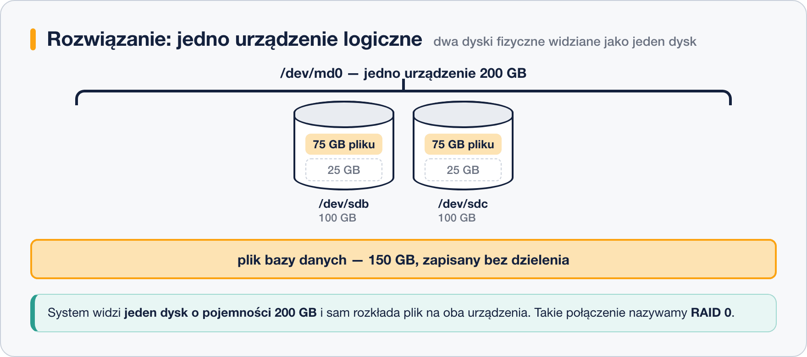

# RAID – po co łączyć dyski

> **W tej lekcji:** zrozumiesz, jaki problem rozwiązuje RAID, jakie trzy cele można osiągnąć łącząc dyski, czym różni się RAID sprzętowy od programowego – i dlaczego RAID nie zastępuje kopii zapasowej.

**RAID** (ang. *Redundant Array of Independent Disks* – nadmiarowa macierz niezależnych dysków) to technika łączenia kilku dysków fizycznych w jedno urządzenie logiczne, które system widzi jak zwykły, pojedynczy dysk. Administrator sięga po nią z dwóch powodów. Po pierwsze, dyski się psują: producenci podają średni czas między awariami w setkach tysięcy godzin, ale w serwerowni z dziesiątkami dysków jakiś pada co kilka miesięcy – a bez zabezpieczenia awaria dysku z bazą danych zatrzymuje firmę. Po drugie, pojedynczy dysk ma ograniczoną pojemność i przepustowość, a duża baza danych czy kopie zapasowe całej firmy potrzebują więcej.

Ta lekcja wyjaśnia, co RAID daje i gdzie powstaje. Poszczególne poziomy RAID – czyli konkretne sposoby rozkładania danych na dyski – poznasz w lekcjach 9–16, a budowę macierzy w Linuksie w lekcji 17.

## Jak to działa

### Skąd wziął się pomysł łączenia dysków

Jednym z zasobów serwera, którym zarządza administrator, jest pojemność dysku. Jeżeli dysk ma 100 GB, to suma wszystkich danych zapisanych na serwerze może wynieść najwyżej 100 GB.


Gdy miejsca zaczyna brakować, najprostszym rozwiązaniem jest dołożenie kolejnego dysku. Dane można wtedy rozłożyć pomiędzy oba, więc serwer pomieści 200 GB.


I tu pojawia się problem. Załóżmy, że mamy **jeden plik** o rozmiarze 150 GB — na przykład plik bazy danych albo obraz maszyny wirtualnej.


Wolnej przestrzeni mamy 200 GB, a mimo to tego pliku nie zapiszemy. Każdy dysk jest **osobnym urządzeniem** i przyjmie najwyżej 100 GB. Trzeba by podzielić plik na dwie części i pilnować obu osobno:


A co w przypadku, w którym pliku **nie da się** podzielić?

Rozwiązaniem jest połączenie dwóch dysków fizycznych w jedną całość — jako pewnego rodzaju twór logiczny. Fizycznie mamy nadal dwa urządzenia po 100 GB, ale system widzi **jedno urządzenie logiczne** o pojemności 200 GB i sam rozkłada na nie plik.



Warto sobie uświadomić, że **2 × 100 GB to nie to samo co 1 × 200 GB**. Dopiero połączenie dysków w macierz daje przestrzeń, w której mieści się plik większy niż pojedynczy dysk. Takie połączenie nazywamy **RAID 0** i zajmiemy się nim w następnej lekcji.

Jest jeszcze jedno zastrzeżenie: macierz zbudowana z dysków różnej wielkości liczy się z tym najmniejszym:


### Trzy cele

Łącząc dyski, można zyskać trzy rzeczy – ale nie wszystkie naraz. Każdy poziom RAID (lekcje 9–16) to inny kompromis między nimi:


- **Pojemność** – kilka dysków widzianych jako jeden duży, jak w przykładzie powyżej.
- **Wydajność** – operacje rozkładają się równolegle na kilka dysków, więc odczyt i zapis są szybsze niż na jednym.
- **Odporność na awarię** (redundancja, ang. *redundancy* – nadmiarowość) – dane są przechowywane z zapasem (kopia lustrzana albo dane kontrolne), więc awaria dysku nie zatrzymuje serwera ani nie niszczy danych. Uszkodzony dysk wymieniasz, macierz odbudowuje zawartość i jedzie dalej.

Ceną redundancji jest zawsze pojemność: część miejsca zajmują kopie lub dane kontrolne.

### Gdzie powstaje RAID: sprzętowy, programowy, „fake RAID”

| Rodzaj | Kto liczy | Charakterystyka |
|---|---|---|
| **Sprzętowy** | dedykowany kontroler RAID (karta z własnym procesorem i pamięcią, np. w serwerach Dell/HP) | system widzi gotowy „dysk”; konfiguracja w BIOS-ie kontrolera; szybki, niezależny od OS, ale kosztuje i wiąże Cię z danym modelem kontrolera |
| **Programowy** | jądro Linuksa (moduł `md`, narzędzie `mdadm`) | darmowy, przenośny (dyski można przełożyć do innego serwera), wydajność współczesnych procesorów w zupełności wystarcza; tym zajmuje się lekcja 17 |
| **„Fake RAID”** | chipset płyty głównej + sterownik systemu | tryb „RAID” w BIOS-ie zwykłych płyt: tak naprawdę liczy procesor, a format danych jest zamknięty. Łączy wady obu światów – w Linuksie go unikaj, użyj `mdadm` |

Na serwerach spotkasz oba pełnoprawne warianty. W tym szkoleniu ćwiczymy RAID programowy, bo działa wszędzie – także w maszynie wirtualnej.

### RAID to nie kopia zapasowa

To zdanie warto zapamiętać dosłownie. RAID chroni przed **awarią dysku** – i tylko przed nią. Nie ochroni przed:

- skasowaniem pliku przez człowieka (`rm` wykonuje się na wszystkich dyskach macierzy naraz),
- błędem aplikacji, która nadpisze dane,
- oprogramowaniem szyfrującym dla okupu (ransomware),
- kradzieżą, pożarem ani zalaniem serwera,
- awarią samego kontrolera lub błędem administratora przy macierzy.

Kopia zapasowa to **osobna kopia danych, w innym miejscu, z historią wersji**. RAID zapewnia ciągłość pracy; kopia zapasowa – możliwość odzyskania danych. Potrzebujesz obu.

## W praktyce

Zanim zaczniesz budować macierze (lekcja 17), naucz się sprawdzać, czy serwer jakiejś używa:

```bash
# czy w systemie działają macierze programowe (md)
cat /proc/mdstat
```

```text
Personalities : [raid1]
md0 : active raid1 sdc[1] sdb[0]
      10475520 blocks super 1.2 [2/2] [UU]

unused devices: <none>
```

Jest macierz `md0` typu RAID 1 z dysków `sdb` i `sdc`; `[UU]` oznacza, że oba działają. Jeśli plik pokazuje tylko `unused devices: <none>` – RAID-u programowego nie ma.

```bash
# macierze widać też w lsblk – jako urządzenia typu raid1 pod dyskami składowymi
lsblk
```

```text
NAME   MAJ:MIN RM  SIZE RO TYPE  MOUNTPOINTS
sdb      8:16   0   10G  0 disk
└─md0    9:0    0   10G  0 raid1 /dane
sdc      8:32   0   10G  0 disk
└─md0    9:0    0   10G  0 raid1 /dane
```

RAID sprzętowy z poziomu systemu wygląda jak zwykły dysk (`sda`) – jego stan sprawdza się narzędziami producenta kontrolera (np. `perccli` dla Delli, `ssacli` dla HP).

## Najczęstsze błędy i pułapki

- **„Mamy RAID, kopie niepotrzebne.”** Najdroższy błąd w tej lekcji. RAID i backup odpowiadają na różne zagrożenia.
- **RAID 0 na dane produkcyjne.** Zero redundancji – awaria jednego dysku niszczy wszystko (szczegóły w lekcji 9). Cyfra „0” dobrze podsumowuje poziom ochrony.
- **Łączenie dysków różnej wielkości.** Macierz przyjmuje rozmiar najmniejszego dysku (razy liczba dysków wg poziomu) – reszta większych dysków się marnuje.
- **Włączanie trybu RAID w BIOS-ie zwykłej płyty.** To „fake RAID”. W Linuksie zostaw tryb AHCI i zbuduj macierz w `mdadm`.
- **Ignorowanie zdegradowanej macierzy.** Macierz po awarii jednego dysku dalej działa – i właśnie dlatego łatwo ją przeoczyć, aż padnie drugi dysk. Stan trzeba monitorować (lekcja 17).

## Podsumowanie

- RAID łączy dyski fizyczne w jedno urządzenie logiczne, by zyskać pojemność, wydajność lub odporność na awarię.
- Redundancja kosztuje pojemność – każdy poziom RAID to inny kompromis.
- RAID sprzętowy = kontroler, programowy = `mdadm` w Linuksie; „fake RAID” płyt głównych omijaj.
- Stan macierzy programowych: `cat /proc/mdstat`.
- RAID chroni przed awarią dysku. Przed wszystkim innym chroni kopia zapasowa.
