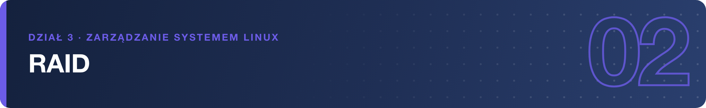
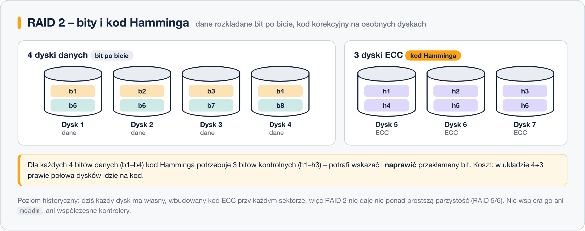

# RAID 2 – historyczny

> **W tej lekcji:** poznasz RAID 2 – pierwszy poziom z kodem korekcyjnym: paskowanie na poziomie pojedynczych bitów i osobne dyski na kod Hamminga. Dowiesz się też, dlaczego dziś nikt go nie używa.

RAID 2 to poziom czysto historyczny: dane rozkłada na dyski **bit po bicie**, a na dodatkowych, dedykowanych dyskach zapisuje **kod Hamminga** – kod korekcyjny ECC (ang. *error-correcting code*), który pozwala nie tylko wykryć, ale i naprawić przekłamany bit.

W praktyce nie spotkasz go nigdzie; poznajesz go, żeby rozumieć pełną numerację poziomów i wiedzieć, skąd wziął się pomysł danych kontrolnych rozwinięty później w RAID 5 i 6.

## Jak to działa

Zapisywane dane są dzielone na pojedyncze bity: pierwszy bit na dysk 1, drugi na dysk 2 i tak dalej. Dla każdej porcji bitów macierz wylicza bity kodu Hamminga i zapisuje je na **osobnych dyskach ECC**. W klasycznym układzie na 4 dyski danych przypadają aż 3 dyski kodu:

Kod Hamminga pozwala wskazać, **który** bit się przekłamał, i odtworzyć go w locie. Problem w tym, że wszystkie dyski muszą pracować idealnie równo (każda operacja dotyka każdego dysku), a koszt jest ogromny – w układzie 4+3 na kod oddajesz niemal połowę dysków.

| Parametr | RAID 2 |
|---|---|
| Minimalna liczba dysków | w praktyce 7 (4 danych + 3 ECC) |
| Pojemność do użycia | ~57% w układzie 4+3 |
| Ile awarii dysków przeżyje | 1 |

## Kiedy stosować

**Nigdy.** RAID 2 umarł śmiercią naturalną, bo jego główną funkcję przejął sam sprzęt: każdy współczesny dysk ma **własny, wbudowany kod ECC** przy każdym sektorze i sam wykrywa oraz naprawia przekłamania. Dokładanie drugiej warstwy korekcji na osobnych dyskach przestało mieć sens – wystarczy prostsza parzystość, która mówi „dysk padł, odtwórz dane” (RAID 5 i 6).

Żaden współczesny kontroler ani `mdadm` nie oferują RAID 2.

## Podsumowanie

- RAID 2 paskował dane na poziomie pojedynczych bitów i trzymał kod Hamminga na osobnych dyskach ECC.
- Kod Hamminga potrafi wskazać i naprawić przekłamany bit – ale dziś robi to wbudowana elektronika każdego dysku.
- Poziom czysto historyczny: nie wspiera go ani `mdadm`, ani współczesne kontrolery.
