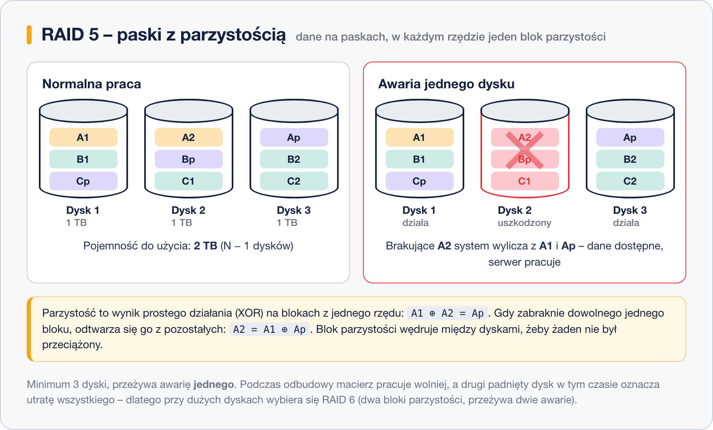

# RAID 5 – parzystość rozproszona

> **W tej lekcji:** poznasz RAID 5 – paski z parzystością rozłożoną na wszystkie dyski: jak XOR pozwala odtworzyć dane po awarii, ile miejsca zostaje do użycia i dlaczego odbudowa dużej macierzy to moment podwyższonego ryzyka.

RAID 5 to najpopularniejszy poziom z parzystością: dane idą paskami jak w RAID 0, ale w każdym „rzędzie” bloków jeden blok to **parzystość** – suma kontrolna pozwalająca odtworzyć zawartość dowolnego dysku po awarii. W odróżnieniu od RAID 3 i 4 blok parzystości **wędruje** – w każdym rzędzie leży na innym dysku, więc żaden dysk nie staje się wąskim gardłem.

Za ochronę oddajesz równowartość tylko jednego dysku – stąd popularność RAID 5 w serwerach plików.

## Jak to działa



Parzystość działa dokładnie tak, jak poznałeś ją przy [RAID 3](5.%20RAID%203%20–%20parzystość%20na%20poziomie%20bajtów.md): blok parzystości to **XOR** (⊕) bloków danych z tego samego rzędu, a ponieważ XOR jest odwracalny, brakujący blok wylicza się z pozostałych bloków i parzystości.

```text
Blok A1 na dysku 1:        0110
Blok A2 na dysku 2:        1010
Parzystość Ap = A1 ⊕ A2:   1100   ← zapisana na dysku 3

Awaria dysku 2:  A1 ⊕ Ap = 0110 ⊕ 1100 = 1010   ← to dokładnie A2
```

Tak samo macierz odtwarza każdy blok uszkodzonego dysku – z bloków ocalałych dysków i parzystości, w locie, podczas normalnej pracy. Serwer działa dalej, tylko wolniej (każdy odczyt z „dziury” wymaga przeliczenia).

Koszt zapisu: każdy zapis bloku wymaga też przeliczenia i zapisania parzystości jego rzędu, więc zapisy są wolniejsze niż w RAID 0 czy 10. Odczyty są szybkie.

| Parametr | RAID 5 |
|---|---|
| Minimalna liczba dysków | 3 |
| Pojemność do użycia | (N − 1) × dysk |
| Ile awarii dysków przeżyje | 1 |

### Odbudowa i jej ryzyko

Po wymianie uszkodzonego dysku macierz **odbudowuje** jego zawartość: czyta całe pozostałe dyski, wylicza XOR-em brakujące bloki i zapisuje je na nowym dysku. Przy współczesnych, wielkich dyskach trwa to godzinami lub dniami i mocno obciąża pozostałe dyski – często stare i z tej samej partii co ten, który właśnie padł.

Przez cały ten czas macierz nie ma już żadnego zapasu: **druga awaria podczas odbudowy oznacza utratę wszystkich danych**. Dlatego przy dyskach kilkuterabajtowych zamiast RAID 5 wybiera się dziś zwykle RAID 6, który przeżywa dwie awarie.

## Kiedy stosować

- serwery plików i archiwa – dużo miejsca z rozsądną ochroną,
- macierze z mniejszych dysków, gdzie odbudowa trwa krótko,
- tam, gdzie przeważają odczyty, a zapisy nie są krytyczne wydajnościowo.

Unikaj RAID 5 na bardzo dużych dyskach (8 TB i więcej) – policz czas odbudowy i ryzyko drugiej awarii.

## Podsumowanie

- RAID 5 = paski + jeden blok parzystości w każdym rzędzie, rozproszony po wszystkich dyskach.
- Parzystość to XOR: brakujący blok wylicza się z pozostałych i sumy kontrolnej.
- Pojemność (N − 1) × dysk, przeżywa jedną awarię; zapisy wolniejsze przez liczenie parzystości.
- Odbudowa dużej macierzy trwa długo i jest ryzykowna – przy dużych dyskach wybierz RAID 6.
