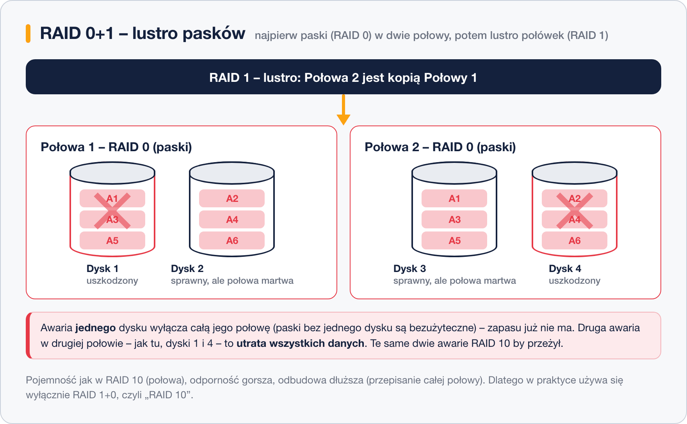
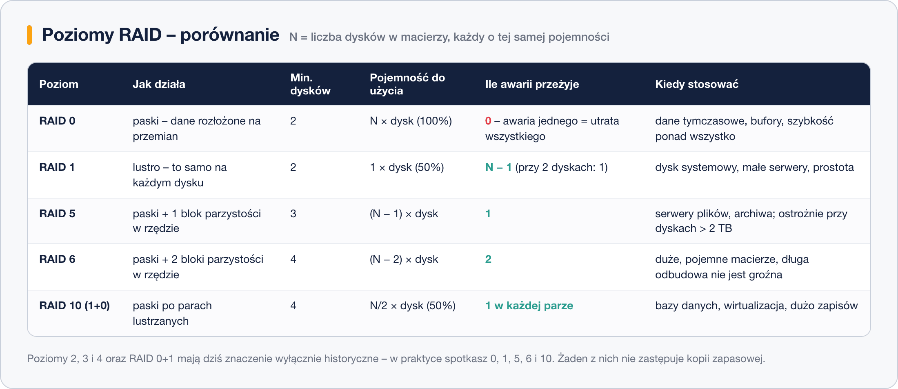

# RAID 0+1 i RAID 1+0

> **W tej lekcji:** poznasz macierze łączone – paski i lustra naraz: czym różni się RAID 0+1 od RAID 1+0 (10), dlaczego kolejność łączenia decyduje o odporności i który wariant stosuje się w praktyce.

Paski (RAID 0) i lustra (RAID 1) można **połączyć**: cztery dyski dają wtedy macierz szybką jak paski i odporną jak lustro. Są dwie kolejności takiego łączenia – **0+1** (lustro zbudowane z pasków) i **1+0** (paski zbudowane z luster) – i choć brzmią niemal identycznie, różnią się odpornością na awarie.

Pojemność w obu wariantach jest ta sama (połowa), ale w praktyce używa się wyłącznie 1+0 – to on kryje się pod handlową nazwą „RAID 10”.

## Jak to działa

### RAID 0+1 – lustro pasków

Dyski najpierw skleja się paskami w dwie duże „połowy” (każda to RAID 0), a potem te połowy lustrzy. Problem ujawnia się przy awarii: padnięcie **jednego** dysku unieruchamia całą jego połowę (to RAID 0 – bez jednego dyska jest bezużyteczna). Została jedna działająca połowa, czyli zero zapasu – a druga awaria w ocalałej połowie kończy się utratą danych:

### RAID 1+0 (RAID 10) – paski luster

Tu kolejność jest odwrotna: dyski najpierw łączy się w **pary lustrzane** (RAID 1), a dopiero po parach rozkłada paski. Awaria dysku dotyka tylko jego pary – para pracuje dalej na drugim dysku, a reszta macierzy w ogóle tego nie zauważa. Macierz przeżyje nawet awarię **po jednym dysku w każdej parze**:

### Dlaczego 1+0 wygrywa

Te same cztery dyski, ta sama pojemność – inna odporność:

| | RAID 0+1 | RAID 1+0 (10) |
|---|---|---|
| Kolejność łączenia | lustro z dwóch pasków | paski z par lustrzanych |
| Awaria 1 dysku | wyłącza całą połowę – **zero zapasu** | wyłącza pół pary – reszta chroniona |
| Awaria 2 dysków | przeżyje tylko, gdy oba z tej samej połowy | przeżyje zawsze, gdy w różnych parach |
| Odbudowa | przepisanie **całej połowy** macierzy | skopiowanie **jednego dysku** w parze |
| Stosowany dziś | nie | tak – jako „RAID 10” |

W RAID 0+1 po pierwszej awarii groźny jest już **każdy** dysk ocalałej połowy; w RAID 1+0 – tylko jeden konkretny dysk (bliźniak uszkodzonego). Do tego odbudowa 1+0 jest krótka i obciąża jeden dysk, a nie całą macierz.

| Parametr | RAID 1+0 (10) |
|---|---|
| Minimalna liczba dysków | 4 (parzysta liczba) |
| Pojemność do użycia | N/2 × dysk (50%) |
| Ile awarii dysków przeżyje | 1 w każdej parze (najgorszy przypadek: 1) |

## Kiedy stosować

RAID 10 to standardowy wybór „wydajność + bezpieczeństwo”: bazy danych, wirtualizacja, obciążenia z dużą liczbą zapisów. Zapis i odczyt są szybkie (bez liczenia parzystości), a odbudowa krótka. Cena: połowa pojemności. RAID 0+1 pozostaje ciekawostką – jeśli kontroler w ogóle go oferuje, wybierz 1+0.

### Porównanie poziomów na koniec serii

Zestawienie wszystkich poziomów, które spotkasz w praktyce:

## Podsumowanie

- 0+1 = lustro dwóch pasków; 1+0 = paski po parach lustrzanych. Pojemność ta sama – odporność nie.
- W 0+1 jedna awaria wyłącza całą połowę i zostawia macierz bez zapasu; w 1+0 ginie tylko pół pary.
- 1+0 przeżywa więcej scenariuszy podwójnej awarii i odbudowuje się szybciej – dlatego „RAID 10” zawsze oznacza 1+0.
- Zastosowanie RAID 10: bazy danych, wirtualizacja, dużo zapisów.
