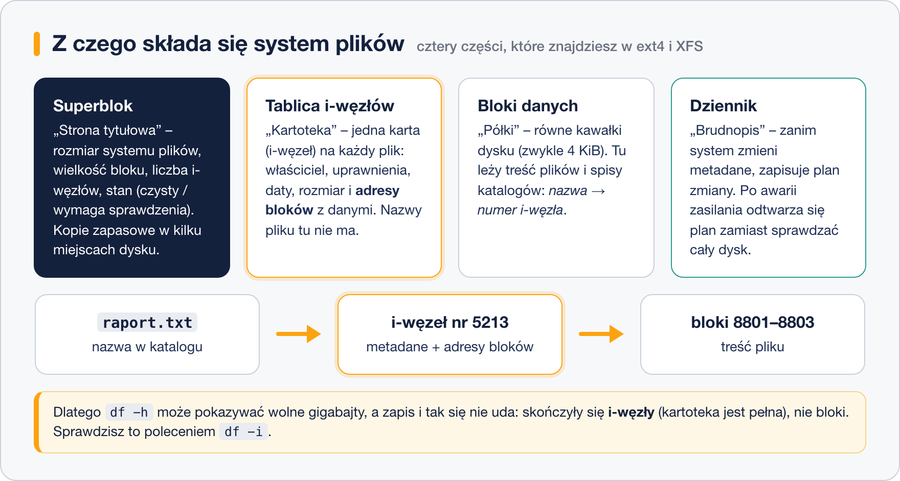

# Czym jest system plików

> **W tej lekcji:** zrozumiesz, co system plików robi z surową partycją, z jakich części się składa (blok, i-węzeł, superblok, dziennik) i dlaczego czasem „brakuje miejsca”, choć `df -h` pokazuje wolne gigabajty.

Dysk twardy albo partycja to z punktu widzenia komputera jeden długi ciąg ponumerowanych komórek po 512 lub 4096 bajtów. Nie ma tam pojęcia „plik”, „katalog”, „właściciel” ani „data modyfikacji”. Ewidencję – który kawałek dysku należy do którego pliku, jak się plik nazywa i kto może go czytać – prowadzi **system plików** (ang. file system). Dlatego po `mkfs` na zapisanej partycji dane fizycznie zostają, ale ewidencja jest nowa i pusta, więc dla systemu partycja jest „czysta”.

W Windows znasz to pod nazwami NTFS, FAT32 i exFAT. W Linuksie spotkasz przede wszystkim **XFS** (domyślny w RHEL) i **ext4** (domyślny w Ubuntu/Debianie). Działają na tej samej zasadzie, którą opisuje ta lekcja.

## Jak to działa



### Blok

System plików dzieli partycję na równe kawałki – **bloki**, zwykle po 4 KiB. Blok to najmniejsza porcja, jaką system przydziela plikowi. Plik o rozmiarze 1 bajta zajmuje cały blok, a plik 9 KiB – trzy bloki. Stąd różnica między „rozmiarem pliku” a „miejscem na dysku”, którą pokaże `du`.

### I-węzeł

Dla każdego pliku i katalogu system plików prowadzi jedną „kartę” – **i-węzeł** (ang. inode, od *index node*). Zapisuje w niej **metadane**: typ (plik, katalog, dowiązanie), właściciela i grupę, uprawnienia, trzy daty, rozmiar oraz listę adresów bloków z treścią. Czego tam nie ma? **Nazwy pliku.** Nazwa leży w katalogu, który jest po prostu specjalnym plikiem z listą par „nazwa → numer i-węzła”. Dlatego jeden plik może mieć kilka nazw (twarde dowiązania), a zmiana nazwy nie przenosi ani bajta danych.

Liczbę i-węzłów ustala się w chwili tworzenia systemu plików (w ext4 na stałe, w XFS dynamicznie). Każdy plik zużywa jeden i-węzeł, nawet pusty.

### Superblok

**Superblok** to strona tytułowa: rozmiar systemu plików, wielkość bloku, liczba i-węzłów, kiedy ostatnio montowany, czy był poprawnie odmontowany. Bez superbloku system plików jest nieczytelny, dlatego ext4 trzyma jego kopie w kilku miejscach partycji, a `fsck` potrafi z nich skorzystać.

### Dziennik

Zapis jednego pliku to kilka operacji: zajęcie bloków, aktualizacja i-węzła, dopisanie nazwy do katalogu, zmiana licznika wolnego miejsca. Jeśli prąd zniknie w połowie, ewidencja przestaje się zgadzać. Stare systemy plików (ext2, FAT) musiały wtedy sprawdzić **cały** dysk, co na dużej macierzy trwało godzinami.

**Dziennik** (ang. journal) rozwiązuje to tak: zanim system dotknie metadanych, zapisuje w dzienniku „zamierzam zrobić A, B, C”. Po awarii wystarczy przeczytać dziennik i dokończyć lub cofnąć niedokończone wpisy – kilka sekund. Systemy plików z dziennikiem nazywa się **księgującymi** (ang. journaling). Są nimi ext3, ext4, XFS, NTFS; nie są – ext2, FAT32, exFAT.

Ważne: dziennik chroni **spójność ewidencji**, nie treść pliku. Dokument, który zapisywałeś w chwili awarii, może być pusty lub ucięty – ale system plików będzie zdrowy i reszta plików na miejscu.

## W praktyce

```bash
# jakie systemy plików ma nasza maszyna i gdzie są zamontowane
lsblk -f
```

```text
NAME        FSTYPE  FSVER LABEL UUID                                 MOUNTPOINTS
sda
├─sda1      xfs                 7c3b9a1e-…                           /boot
└─sda2      LVM2_me…            Q2xk…
  ├─rl-root xfs                 d41c…                                /
  └─rl-swap swap                9f0e…                                [SWAP]
sdb
```

Kolumna `FSTYPE` mówi, jaki system plików jest na partycji. `sdb` nie ma żadnego – to nasz pusty dysk ćwiczeniowy.

```bash
# ile jest miejsca na blokach (to, co wszyscy sprawdzają)
df -h /
```

```text
System plików       rozm. użyte dost. %uż. zamont. na
/dev/mapper/rl-root   17G  2,1G   15G  13% /
```

```bash
# ile jest wolnych i-węzłów (to, o czym wszyscy zapominają)
df -i /
```

```text
System plików       iwęzły użyteI wolneI %uż. zamont. na
/dev/mapper/rl-root 8910848  48213 8862635  1% /
```

```bash
# numer i-węzła pliku i liczba twardych dowiązań
ls -li /etc/hostname
```

```text
34012034 -rw-r--r--. 1 root root 7 03-12 09:40 /etc/hostname
```

Pierwsza kolumna to numer i-węzła, trzecia – ile nazw wskazuje na tę kartę.

```bash
# pełne metadane z i-węzła
stat /etc/hostname
```

```text
  Plik: /etc/hostname
rozmiar: 7          bloków: 8        bloki I/O: 4096  zwykły plik
Urządzenie: 253,0   inode: 34012034  dowiązań: 1
Dostęp: (0644/-rw-r--r--)  Uid: (0/root)  Gid: (0/root)
Dostęp:      2026-03-12 09:40:11
Modyfikacja: 2026-03-12 09:40:11
Zmiana:      2026-03-12 09:40:11
```

### Scenariusz: „No space left on device”, a miejsce jest

Serwer przestaje zapisywać pliki. `df -h` pokazuje 40% zajętości. Sprawdzasz `df -i` – i-węzły użyte w 100%. Winowajcą jest zwykle katalog z milionami drobnych plików: kolejka poczty, sesje PHP, cache. Znajdziesz go tak:

```bash
# który katalog ma najwięcej plików (liczymy wpisy, nie bajty)
sudo find /var -xdev -type f | cut -d/ -f1-3 | sort | uniq -c | sort -rn | head
```

Skasowanie tych plików zwalnia i-węzły od razu. Rozmiaru tablicy i-węzłów w ext4 nie da się później zwiększyć – trzeba by założyć system plików od nowa z opcją `-N`.

## Najczęstsze błędy i pułapki

- **Mylenie partycji z systemem plików.** Partycja to przegroda na dysku (lekcja o `fdisk`), system plików to ewidencja w tej przegrodzie. Najpierw partycja, potem `mkfs`, dopiero potem pliki.
- **Patrzenie tylko na `df -h`.** Przy błędzie „No space left on device” sprawdź też `df -i`.
- **Skasowany plik, a miejsce nie wraca.** Jeśli jakiś proces trzyma plik otwarty, bloki pozostają zajęte do zamknięcia procesu. `sudo lsof +L1` pokaże takie pliki. Typowy przypadek: skasowany log działającej usługi.
- **Dziennik nie zastępuje kopii zapasowej.** Chroni strukturę po awarii zasilania, nie przed `rm -rf` ani przed uszkodzonym dyskiem.

## Podsumowanie

- System plików to ewidencja, która zamienia ciąg bloków na pliki, katalogi, uprawnienia i daty.
- Blok (zwykle 4 KiB) to najmniejsza porcja miejsca; i-węzeł to karta metadanych pliku; nazwa pliku leży w katalogu, nie w i-węźle.
- Superblok opisuje cały system plików; dziennik pozwala wstać po awarii w sekundy zamiast godzin.
- Miejsce może się skończyć na dwa sposoby: bloki (`df -h`) albo i-węzły (`df -i`).

| Polecenie | Co robi |
|---|---|
| `lsblk -f` | typ systemu plików, etykieta, UUID i punkt montowania każdej partycji |
| `df -h` | wolne miejsce na blokach, w jednostkach czytelnych dla człowieka |
| `df -i` | wolne i-węzły |
| `ls -li` | listing z numerami i-węzłów |
| `stat plik` | wszystkie metadane z i-węzła |
| `sudo lsof +L1` | skasowane pliki nadal trzymane przez procesy |
