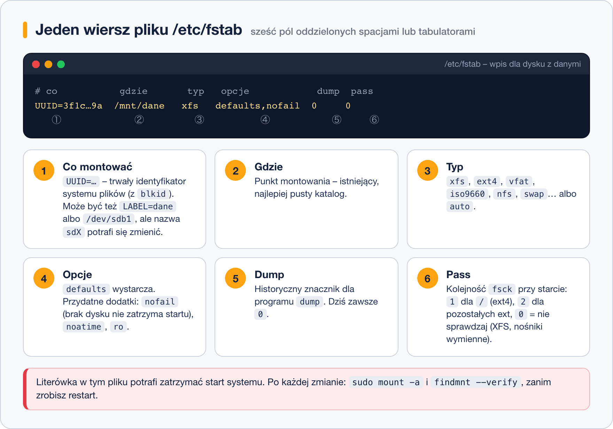

# Plik fstab

> **W tej lekcji:** nauczysz się dopisywać systemy plików do `/etc/fstab`, tak by montowały się same przy starcie, rozumieć każde z sześciu pól wiersza, testować wpis **przed** restartem i wyjść z trybu awaryjnego, gdy wpis okaże się błędny.

`mount` z poprzedniej lekcji działa do pierwszego restartu – serwer, który po każdym uruchomieniu wymaga ręcznego zamontowania dysku z bazą danych, po nocnej awarii zasilania wstanie bez bazy. Plik `/etc/fstab` (ang. *file system table*) to lista, którą system czyta przy starcie: „to zamontuj tu, z takimi opcjami”. Jest w nim też `/`, `/boot` i swap – instalator wpisał je za Ciebie.

Ten plik ma jedną cechę, o której trzeba wiedzieć od razu: **jedna literówka potrafi zatrzymać start systemu**. Dlatego połowa tej lekcji to sprawdzanie i naprawianie.

## Jak to działa

Każdy wiersz `/etc/fstab` opisuje jeden system plików w sześciu polach rozdzielonych spacjami lub tabulatorami. Wiersze zaczynające się od `#` to komentarze.



Tak wygląda `/etc/fstab` świeżo zainstalowanego Rocky Linuksa z dopisanym wierszem dla dysku z danymi:

```text
#
# /etc/fstab
# Created by anaconda on Thu Mar 12 09:38:02 2026
#
/dev/mapper/rl-root                       /          xfs   defaults        0 0
UUID=7c3b9a1e-2d4f-4a8b-b1c3-9e5f6a7d8c01 /boot      xfs   defaults        0 0
/dev/mapper/rl-swap                       none       swap  defaults        0 0
# dysk na dane (dodane 2026-03-12, anna)
UUID=3f1c7a2e-8b4d-4e21-9f0a-2c6d1b5e9a77 /mnt/dane  xfs   defaults,nofail 0 0
```

### Pole 1 – co montować

Najlepiej **`UUID=`** (z `blkid`). Nazwa `/dev/sdb1` zależy od kolejności wykrycia dysków przy starcie – po dołożeniu kontrolera albo przepięciu kabla dysk może zostać `sdc`, a wpis wskaże inną partycję. Woluminy LVM (`/dev/mapper/rl-root`) mają stałe nazwy, więc instalator zostawia je po nazwie. `LABEL=dane` też działa, ale etykiety mogą się powtórzyć.

### Pole 2 – gdzie

Punkt montowania. Katalog musi istnieć przed startem – `fstab` go nie utworzy. Dla swapu wpisuje się `none`.

### Pole 3 – typ

`xfs`, `ext4`, `vfat` (pendrive, partycja EFI), `iso9660`, `nfs`, `cifs`, `swap`. Wartość `auto` każe systemowi rozpoznać typ samodzielnie – przydatna dla nośników wymiennych.

### Pole 4 – opcje

Lista rozdzielona przecinkami, **bez spacji**. Najważniejsze:

| Opcja | Znaczenie |
|---|---|
| `defaults` | zestaw domyślny: `rw,suid,dev,exec,auto,nouser,async` – wystarcza w większości przypadków |
| `nofail` | jeśli urządzenia nie ma, start systemu idzie dalej. **Dodaj do każdego dysku, bez którego system może żyć** (dane, kopie, USB) |
| `noatime` | nie zapisuj czasu ostatniego odczytu – mniej zapisów, szybciej; bezpieczne dla większości usług |
| `ro` / `rw` | tylko odczyt / odczyt i zapis |
| `noexec` | zakaz uruchamiania programów z tego systemu plików (np. dla `/tmp`) |
| `noauto` | nie montuj przy starcie ani przy `mount -a`; tylko ręcznie `mount /mnt/usb` |
| `_netdev` | urządzenie sieciowe (iSCSI, NFS) – czekaj z montowaniem na sieć |
| `x-systemd.automount` | montuj dopiero przy pierwszym wejściu do katalogu |

### Pole 5 – dump

Znacznik dla archaicznego programu `dump`. Zawsze `0`.

### Pole 6 – pass

Kolejność sprawdzania `fsck` przy starcie: `1` dla `/` na ext4, `2` dla pozostałych systemów ext, `0` – nie sprawdzaj. Dla **XFS zawsze `0`** (XFS sprawdza dziennik sam, `fsck.xfs` nic nie robi). Dla nośników wymiennych i udziałów sieciowych – `0`.

### Co systemd robi z fstab

Na RHEL 7+ to nie `mount -a` montuje dyski przy starcie, lecz **systemd**. Generator `systemd-fstab-generator` zamienia każdy wiersz `fstab` w jednostkę `.mount` (np. `mnt-dane.mount`), która startuje w odpowiednim momencie i z zależnościami – NFS po sieci, `/` przed wszystkim. Z tego wynikają dwie praktyczne konsekwencje: po edycji `fstab` warto uruchomić `systemctl daemon-reload`, a brakujący dysk **bez `nofail`** zatrzyma start w trybie awaryjnym, bo systemd czeka na jednostkę, która nigdy nie wystartuje.

## W praktyce

### Dodanie wpisu – bezpieczna procedura

```bash
# 1. kopia zapasowa – zawsze
sudo cp /etc/fstab /etc/fstab.bak-$(date +%F)
```

```bash
# 2. UUID partycji (skopiuj, nie przepisuj ręcznie)
sudo blkid /dev/sdb1
```

```text
/dev/sdb1: LABEL="dane" UUID="3f1c7a2e-8b4d-4e21-9f0a-2c6d1b5e9a77" TYPE="xfs" …
```

```bash
# 3. punkt montowania musi istnieć
sudo mkdir -p /mnt/dane
```

```bash
# 4. dopisanie wiersza na końcu pliku (edytorem: sudo vim /etc/fstab)
echo 'UUID=3f1c7a2e-8b4d-4e21-9f0a-2c6d1b5e9a77 /mnt/dane xfs defaults,nofail 0 0' | sudo tee -a /etc/fstab
```

```bash
# 5. TEST bez restartu: montuje wszystko z fstab, czego jeszcze nie ma
sudo mount -a
# 6. sprawdzenie składni całego pliku
sudo findmnt --verify
```

```text
Success, no errors or warnings detected
```

`findmnt --verify` czyta `fstab` wiersz po wierszu i zgłasza nieistniejące UUID, błędne typy, literówki w opcjach i brakujące katalogi. Jeśli pokazuje błąd – popraw go **teraz**, póki system działa.

```bash
# 7. czy zamontowało się tam, gdzie trzeba
findmnt /mnt/dane
# 8. żeby systemd zobaczył zmianę od razu (inaczej ostrzeże w logach)
sudo systemctl daemon-reload
```

Dopiero po tych ośmiu krokach restart jest bezpieczny. Krok 5 i 6 to różnica między „działa” a „działa i wstanie po restarcie”.

### Przydatne warianty

```bash
# gdy wpis istnieje, wystarczy podać punkt montowania – reszta z fstab
sudo mount /mnt/dane
# wpis tylko do odczytu, np. archiwum
# UUID=… /mnt/archiwum xfs ro,nofail 0 0
# udział NFS z serwera plików
# 192.168.10.5:/export/dane /mnt/nfs nfs defaults,_netdev,nofail 0 0
```

### Gdy start się zatrzymał: tryb awaryjny

Objaw: zamiast ekranu logowania widzisz komunikat

```text
You are in emergency mode. After logging in, type "journalctl -xb" to view
system logs, "systemctl reboot" to reboot, "systemctl default" or "exit"
to boot into default mode.
Give root password for maintenance
(or press Control-D to continue):
```

Najczęstsza przyczyna: wiersz `fstab` wskazuje urządzenie, którego nie ma (odłączony dysk, zły UUID, literówka w ścieżce) i nie ma opcji `nofail`. Naprawa:

```bash
# hasło roota, potem: który mount zawiódł
journalctl -xb -p err | grep -i mount
# w trybie awaryjnym / bywa tylko do odczytu – odblokuj zapis
mount -o remount,rw /
# popraw lub zakomentuj (#) błędny wiersz
vi /etc/fstab
# sprawdź i wystartuj normalnie
findmnt --verify
systemctl daemon-reload
exit
```

Jeśli hasło roota jest nieznane albo zablokowane (jak domyślnie na Ubuntu), pozostaje nośnik ratunkowy albo parametr jądra `rd.break` opisany w module o procesie startu.

## Najczęstsze błędy i pułapki

- **Brak `nofail` przy dysku na dane.** Dysk padł, serwer nie wstaje, choć system i aplikacje są na innym dysku. `nofail` przy każdym systemie plików, który nie jest niezbędny do startu.
- **Restart bez `mount -a` i `findmnt --verify`.** Błąd ujawni się o 3 w nocy po awarii zasilania, kiedy nie będzie nikogo przy konsoli.
- **Spacja w opcjach** (`defaults, nofail`). Pole kończy się na spacji – `nofail` staje się polem 5, a `0` polem 6. `findmnt --verify` to wyłapie.
- **Ręcznie przepisany UUID** z jedną cyfrą pomyloną. Zawsze kopiuj z `blkid` albo użyj `blkid -s UUID -o value /dev/sdb1 | sudo tee -a /etc/fstab` i dopisz resztę.
- **Spacja w punkcie montowania** (`/mnt/moje dane`). W `fstab` zapisuje się ją jako `\040`. Lepiej unikać.
- **`pass` = 1 lub 2 dla XFS.** Nie zaszkodzi, ale nic nie daje; konwencja to `0`.

## Podsumowanie

- `/etc/fstab` to lista montowań wykonywanych przy starcie; systemd zamienia każdy wiersz w jednostkę `.mount`.
- Sześć pól: co (UUID) – gdzie – typ – opcje – dump (0) – pass (0 dla XFS, 1 dla `/` na ext4, 2 dla reszty ext).
- Używaj `UUID=`, nie `/dev/sdX`. Dodawaj `nofail` do dysków nieniezbędnych.
- Po edycji zawsze: `mount -a`, `findmnt --verify`, `systemctl daemon-reload`. Dopiero potem restart.
- Tryb awaryjny po błędzie: hasło roota, `remount,rw /`, popraw wiersz, `exit`.

| Polecenie | Co robi |
|---|---|
| `blkid /dev/sdb1` | UUID do wpisu |
| `sudo cp /etc/fstab /etc/fstab.bak` | kopia przed edycją |
| `sudo mount -a` | montuje wszystko z fstab – test wpisu |
| `sudo findmnt --verify` | sprawdza składnię i poprawność fstab |
| `findmnt /mnt/dane` | czy i jak zamontowane |
| `sudo systemctl daemon-reload` | odświeża jednostki `.mount` po edycji |
| `mount -o remount,rw /` | odblokowanie zapisu w trybie awaryjnym |
| `journalctl -xb -p err` | błędy z bieżącego startu |
