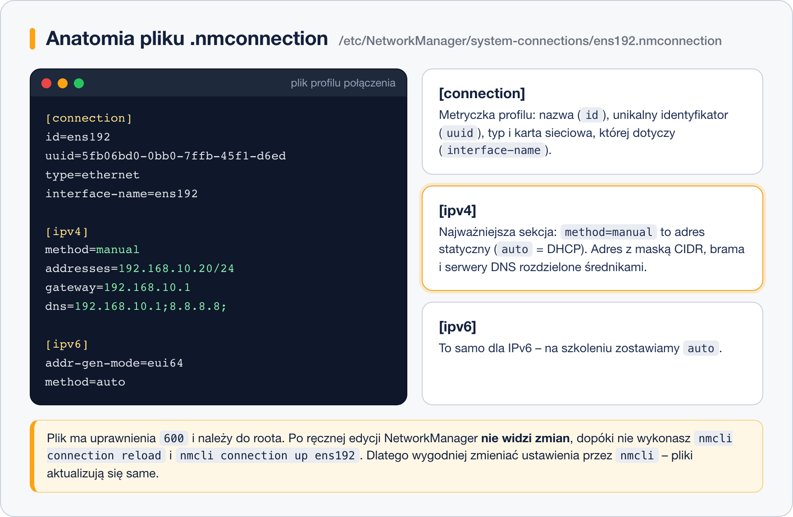

# Pliki konfiguracyjne sieci

> **W tej lekcji:** zajrzysz pod maskę NetworkManagera – do plików `.nmconnection`, w których naprawdę mieszkają profile połączeń – oraz poznasz pliki `/etc/hosts` i `/etc/resolv.conf`, nazwę komputera (`hostnamectl`) i los dawnych plików `ifcfg-*`.

Wszystko, co klikałeś i wpisywałeś w poprzedniej lekcji, ląduje w zwykłych plikach tekstowych.
Administrator musi wiedzieć, gdzie one są: żeby zdiagnozować dziwny problem, zrobić kopię
zapasową konfiguracji, porównać dwa serwery albo zrozumieć, czemu stary poradnik każe edytować
plik, którego już nie ma. Zasada pozostaje jednak w mocy: **do zmian używaj `nmcli`/`nmtui`** –
pliki edytuj ręcznie tylko wtedy, gdy wiesz, po co.

## Jak to działa

### Profile: /etc/NetworkManager/system-connections/

Na RHEL 9 i 10 każdy profil połączenia to plik
`/etc/NetworkManager/system-connections/NAZWA.nmconnection` w formacie **pliku kluczy**
(ang. *keyfile*) – sekcje w nawiasach kwadratowych, pod nimi pary `klucz=wartość`, jak w plikach
INI:



Najważniejsze sekcje:

| Sekcja | Co zawiera |
|---|---|
| `[connection]` | metryczka: `id` (nazwa profilu), `uuid`, `type=ethernet`, `interface-name` (karta) |
| `[ipv4]` | `method=manual` lub `auto`; przy `manual` – `addresses`, `gateway`, `dns` |
| `[ipv6]` | analogicznie dla IPv6 |

Plik należy do roota i ma uprawnienia `600` – może zawierać hasła (np. do Wi-Fi). Po ręcznej
edycji NetworkManager nie zauważy zmian, dopóki nie wykonasz:

```bash
sudo nmcli connection reload
sudo nmcli connection up ens192
```

### Dawniej: ifcfg-* i migracja

Przez lata konfiguracja sieci w RHEL mieszkała w plikach
`/etc/sysconfig/network-scripts/ifcfg-ens192` (format `IPADDR=…`, `GATEWAY=…`). RHEL 9 jeszcze
je czyta (przez wtyczkę zgodności), RHEL 10 już nie. Stare profile przeniesiesz jednym
poleceniem:

```bash
# przenosi profile ifcfg-* do formatu .nmconnection
sudo nmcli connection migrate
```

Jeśli w poradniku widzisz edycję `ifcfg-eth0` – wiedz, że czytasz instrukcję dla RHEL 7/8;
na dzisiejszym systemie odpowiada jej profil `.nmconnection` albo po prostu `nmcli con mod`.

### /etc/hosts – lokalna książka adresowa

Zanim system zapyta serwer DNS o nazwę, sprawdza plik `/etc/hosts` – lokalną listę
„nazwa → adres”:

```text
127.0.0.1   localhost localhost.localdomain
::1         localhost localhost.localdomain
192.168.10.20   serwer serwer.firma.local
192.168.10.30   baza
```

Dopisanie `192.168.10.30 baza` sprawia, że `ping baza` i `ssh baza` działają bez żadnego DNS –
wygodne w małym środowisku i na szkoleniu. Kolejność „najpierw pliki, potem DNS” ustala
`/etc/nsswitch.conf` (linia `hosts: files dns …`) – wystarczy wiedzieć, że ten plik istnieje
i o tym decyduje.

### /etc/resolv.conf – wygenerowany, nie edytuj

Lista serwerów DNS, z których korzysta system:

```text
# Generated by NetworkManager
search firma.local
nameserver 192.168.10.1
nameserver 8.8.8.8
```

Nagłówek mówi wszystko: plik **generuje NetworkManager** na podstawie profili połączeń
(`ipv4.dns`) i danych z DHCP. Ręczna edycja zostanie nadpisana przy najbliższym podniesieniu
połączenia. DNS zmieniasz tak, jak w lekcji 3: `nmcli con mod ens192 ipv4.dns …`.

### Nazwa komputera

```bash
# bieżąca nazwa i informacje o systemie
hostnamectl
```

```bash
# trwała zmiana nazwy (zapis do /etc/hostname)
sudo hostnamectl set-hostname serwer.firma.local
```

Nowa nazwa pojawi się w prompcie po ponownym zalogowaniu. Dobrą praktyką jest dopisanie jej też
do `/etc/hosts` przy adresie maszyny – niektóre programy chcą umieć ją rozwiązać.

## W praktyce

```bash
# gdzie leżą profile i jak wyglądają
sudo ls -l /etc/NetworkManager/system-connections/
```

```text
-rw-------. 1 root root 374 paź 19 10:02 ens192.nmconnection
```

```bash
# podgląd profilu
sudo cat /etc/NetworkManager/system-connections/ens192.nmconnection
```

```text
[connection]
id=ens192
uuid=5fb06bd0-0bb0-7ffb-45f1-d6ed67dfccc2
type=ethernet
interface-name=ens192

[ipv4]
method=manual
addresses=192.168.10.20/24
gateway=192.168.10.1
dns=192.168.10.1;8.8.8.8;

[ipv6]
addr-gen-mode=eui64
method=auto
```

Porównaj: to dokładnie te wartości, które ustawiłeś w lekcji 3 przez `nmcli con mod`.

```bash
# ćwiczenie z /etc/hosts – wpis i test
echo "192.168.10.20 serwer" | sudo tee -a /etc/hosts
ping -c 2 serwer
```

```bash
# kopia zapasowa całej konfiguracji sieci w jednym archiwum
sudo tar czf /root/siec-kopia.tar.gz \
    /etc/NetworkManager/system-connections/ /etc/hosts /etc/hostname
```

## Najczęstsze błędy i pułapki

- **Ręczna edycja `/etc/resolv.conf`.** Działa… do pierwszego `nmcli con up` albo restartu.
  DNS należy do profilu połączenia.
- **Edycja `.nmconnection` bez `nmcli connection reload`.** NetworkManager trzyma profil
  w pamięci i nadpisze Twój plik. Reload → up, dopiero wtedy zmiany żyją.
- **Szukanie `ifcfg-*` na RHEL 9/10.** Katalog `network-scripts` bywa pusty albo nie istnieje –
  to nie awaria, konfiguracja mieszka w `system-connections/`.
- **Literówka w `/etc/hosts`.** Zły adres przy nazwie powoduje, że cała maszyna „widzi” usługę
  pod złym adresem – a DNS jest niewinny. Przy dziwnych problemach z nazwami zaglądaj tu
  najpierw.
- **Luźne uprawnienia profilu.** NetworkManager ignoruje plik `.nmconnection` z uprawnieniami
  szerszymi niż `600` (ochrona haseł) – po ręcznym utworzeniu pliku ustaw `chmod 600`.

## Podsumowanie

- Profile NetworkManagera = pliki `/etc/NetworkManager/system-connections/*.nmconnection`
  (sekcje `[connection]`, `[ipv4]`, `[ipv6]`; uprawnienia `600`).
- Po ręcznej edycji: `nmcli connection reload` + `nmcli connection up`.
- Stare `ifcfg-*` przenosi `nmcli connection migrate`; RHEL 10 już ich nie czyta.
- `/etc/hosts` – lokalne mapowania nazw (sprawdzane przed DNS, o kolejności decyduje
  `/etc/nsswitch.conf`); `/etc/resolv.conf` – generowany przez NetworkManager, nie edytuj.
- Nazwa komputera: `hostnamectl set-hostname`.

| Plik / polecenie | Rola |
|---|---|
| `/etc/NetworkManager/system-connections/*.nmconnection` | trwałe profile połączeń |
| `sudo nmcli connection reload` | wczytanie ręcznie zmienionych plików |
| `sudo nmcli connection migrate` | migracja starych `ifcfg-*` |
| `/etc/hosts` | lokalna książka „nazwa → adres” |
| `/etc/resolv.conf` | aktualne serwery DNS (generowany) |
| `/etc/nsswitch.conf` | kolejność źródeł nazw (pliki przed DNS) |
| `sudo hostnamectl set-hostname nazwa` | trwała zmiana nazwy komputera |
