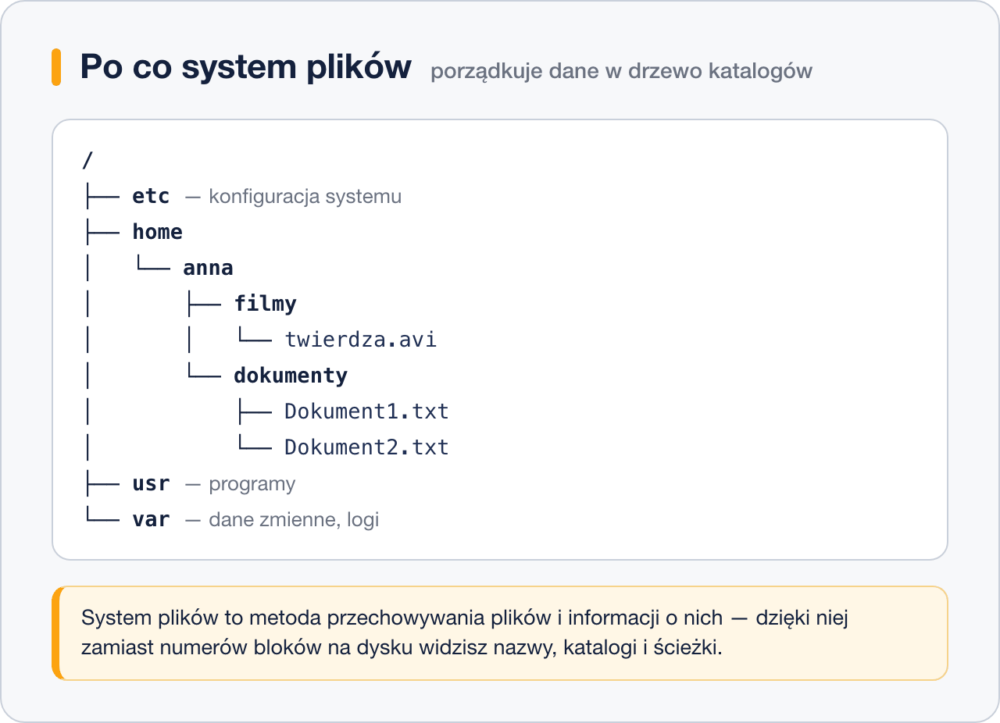
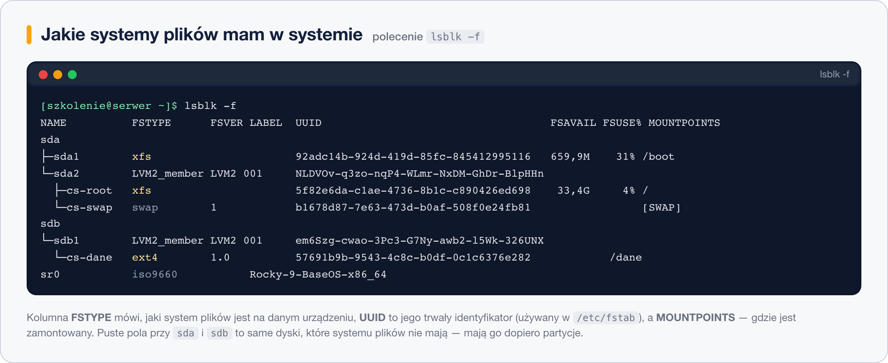

# Wprowadzenie

System plików – metoda przechowywania plików, zarządzania plikami, informacjami o tych plikach, tak by dostęp do plików i danych w nich zgromadzonych był łatwy dla użytkownika systemu; także: wolumin.  
Systemy plików stosuje się dla różnych nośników danych, takich jak dyski, dyskietki, a także w strumieniach danych, sieciach komputerowych, pamięciach. We współczesnych systemach operacyjnych bezpośrednie operowanie na danych nośnika pamięci zarezerwowane jest tylko dla systemu operacyjnego, aplikacje mają dostęp tylko do operacji na plikach i mają zabroniony bezpośredni dostęp do nośnika danych.

System plików możemy podejrzeć za pomocą polecenia *lsblk -f* :

