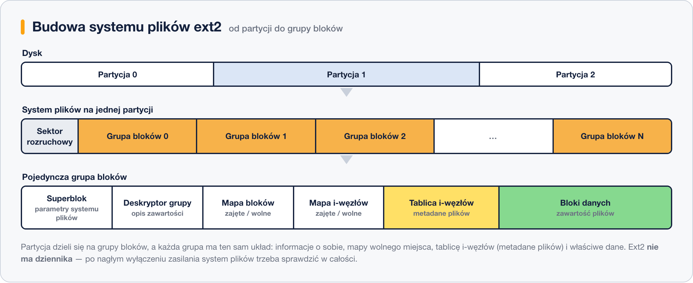

# System plików EXT2

System plików Ext2 (Second Extended File System) był popularnym systemem plików stosowanym w systemach Linux, chociaż został zastąpiony przez nowsze wersje, takie jak Ext3 i Ext4. Jest to system plików bez dziennika (journaling), co oznacza, że nie zapewnia mechanizmu do zapisywania zmian przed ich zatwierdzeniem na dysku. Poniżej znajduje się tabela przedstawiająca wady i zalety systemu plików Ext2:

| Wady                      | Zalety                                             |
|---------------------------|----------------------------------------------------|
| Brak dziennika (journal) | Prostota i wydajność                              |
| Dłuższy czas odtwarzania  | Niska złożoność struktury                          |
| Brak możliwości odzyskania danych w przypadku awarii | Kompatybilność wsteczna z starszymi systemami Linux |
| Brak wsparcia dla rozszerzania systemu plików podczas działania | Minimalna ilość zużywanej przestrzeni na metadane   |

