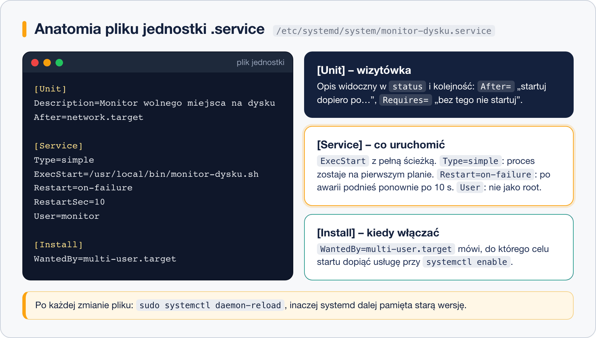

# Własna usługa systemd

> **W tej lekcji:** napiszesz od zera własną usługę systemd – skrypt plus plik jednostki w `/etc/systemd/system/` – zrozumiesz pola sekcji `[Unit]`, `[Service]` i `[Install]`, przetestujesz automatyczny restart po awarii i dowiesz się, kiedy zamiast crona użyć timera.

Prędzej czy później napiszesz skrypt, który ma działać ciągle albo wstawać z systemem: eksporter metryk, prosty serwis API, skrypt monitorujący miejsce na dysku. Amatorskie rozwiązania – `nohup`, `&` w `rc.local`, sesja `screen` – giną po restarcie i nikt ich nie pilnuje. Usługa systemd dostaje za darmo: autostart, automatyczne podnoszenie po awarii, logi w `journalctl`, start we właściwym momencie (po sieci) i standardowe `systemctl status`, które zrozumie każdy inny administrator.

## Jak to działa

Usługa składa się z dwóch plików: **programu** (skrypt, binarium) i **pliku jednostki** opisującego, jak go uruchamiać. Własne jednostki kładziesz w `/etc/systemd/system/` – katalog `/usr/lib/systemd/system/` należy do pakietów.



Plik jednostki to format INI: sekcje w nawiasach kwadratowych, pod nimi pola `Klucz=Wartość`.

### Sekcja [Unit] – wizytówka i zależności

| Pole | Znaczenie |
|---|---|
| `Description=` | jedno zdanie widoczne w `systemctl status` |
| `After=network.target` | kolejność: startuj **po** sieci (ale bez niej też wystartuje) |
| `Requires=` / `Wants=` | twarda / miękka zależność: tamta jednostka ma też wystartować |
| `Documentation=` | adres lub strona man |

`After=` ustala tylko kolejność; `Requires=`/`Wants=` – współistnienie. Zwykle łączy się oba: `Wants=network-online.target` + `After=network-online.target`.

### Sekcja [Service] – co i jak uruchomić

| Pole | Znaczenie |
|---|---|
| `Type=simple` | `ExecStart` to właściwy proces, działa na pierwszym planie (domyślne i najczęstsze) |
| `Type=oneshot` | proces robi swoje i kończy się (skrypty jednorazowe, często z timerem) |
| `Type=forking` | program sam przechodzi w tło jak klasyczny demon (starsze oprogramowanie) |
| `ExecStart=` | polecenie startowe – **pełna ścieżka** |
| `ExecReload=` | co wykonać przy `systemctl reload` (np. `/bin/kill -HUP $MAINPID`) |
| `Restart=on-failure` | podnoś po awarii (kod ≠ 0, sygnał); `always` – także po czystym wyjściu |
| `RestartSec=10` | odczekaj 10 s przed podniesieniem |
| `User=` / `Group=` | uruchom jako wskazany użytkownik, nie root |
| `Environment=KLUCZ=wartość` | zmienne środowiskowe |
| `WorkingDirectory=` | katalog roboczy procesu |

### Sekcja [Install] – kiedy włączać

`WantedBy=multi-user.target` mówi, do którego celu dopiąć usługę przy `systemctl enable`. Bez tej sekcji `enable` zgłosi błąd – usługę można będzie startować tylko ręcznie.

## W praktyce

Budujemy usługę, która co minutę zapisuje do dziennika zajętość dysku.

### Krok 1. Skrypt

```bash
# skrypty własne trzymamy w /usr/local/bin (patrz: lekcja o drzewie katalogów)
sudo tee /usr/local/bin/monitor-dysku.sh > /dev/null <<'EOF'
#!/bin/bash
# pętla bez końca: usługa typu simple ma działać stale
while true; do
    uzycie=$(df --output=pcent / | tail -1 | tr -dc '0-9')
    echo "Zajętość / : ${uzycie}%"
    if [ "$uzycie" -gt 90 ]; then
        echo "UWAGA: mało miejsca na /"
    fi
    sleep 60
done
EOF
sudo chmod +x /usr/local/bin/monitor-dysku.sh
```

Skrypt pisze na standardowe wyjście – systemd przechwyci je i odłoży do dziennika. Nie trzeba samemu zarządzać plikami logów.

### Krok 2. Plik jednostki

```bash
sudo tee /etc/systemd/system/monitor-dysku.service > /dev/null <<'EOF'
[Unit]
Description=Monitor wolnego miejsca na dysku
After=network.target

[Service]
Type=simple
ExecStart=/usr/local/bin/monitor-dysku.sh
Restart=on-failure
RestartSec=10

[Install]
WantedBy=multi-user.target
EOF
```

### Krok 3. Wczytanie i start

```bash
# systemd czyta pliki jednostek przy starcie – po każdej zmianie trzeba mu kazać przeczytać ponownie
sudo systemctl daemon-reload
sudo systemctl enable --now monitor-dysku
systemctl status monitor-dysku
```

```text
● monitor-dysku.service - Monitor wolnego miejsca na dysku
     Loaded: loaded (/etc/systemd/system/monitor-dysku.service; enabled; preset: disabled)
     Active: active (running) since Thu 2026-03-12 12:10:05 CET; 8s ago
   Main PID: 7420 (monitor-dysku.s)
…
mar 12 12:10:05 serwer monitor-dysku.sh[7420]: Zajętość / : 13%
```

```bash
# logi usługi na żywo
journalctl -u monitor-dysku -f
```

### Krok 4. Test automatycznego restartu

```bash
# zabijamy proces jak przy awarii
sudo pkill -f monitor-dysku.sh
sleep 12 && systemctl status monitor-dysku --no-pager | head -4
```

```text
● monitor-dysku.service - Monitor wolnego miejsca na dysku
     Active: active (running) since Thu 2026-03-12 12:14:21 CET; 2s ago
```

Usługa padła i po 10 sekundach (`RestartSec`) wstała sama – to jest różnica między usługą a skryptem w tle.

### Zmiany w istniejącej jednostce

Własny plik w `/etc/systemd/system/` edytujesz wprost (pamiętając o `daemon-reload`). Jednostkę **z pakietu** modyfikuje się nakładką, żeby aktualizacja jej nie nadpisała:

```bash
# otwiera edytor nakładki /etc/systemd/system/nginx.service.d/override.conf
sudo systemctl edit nginx
```

### Wzmianka: timer zamiast crona

Gdy skrypt ma działać **co jakiś czas**, a nie stale, zamiast pętli `while` tworzy się usługę `Type=oneshot` (bez `[Install]`) i obok plik `monitor-dysku.timer`:

```text
[Timer]
OnCalendar=*:0/15      # co 15 minut
Persistent=true        # nadrób, jeśli maszyna była wyłączona

[Install]
WantedBy=timers.target
```

Włącza się timer, nie usługę: `systemctl enable --now monitor-dysku.timer`, przegląd – `systemctl list-timers`. Zalety nad cronem: logi w `journalctl`, kontrola `systemctl status`, nadrabianie zaległych uruchomień. Klasycznego crona poznasz w [module 15](../../Dzia%C5%82%204%20-%20Tematy%20dodatkowe/1.%20Crontab/1.%20Harmonogram%20zada%C5%84%20%E2%80%93%20cron%20i%20crontab.md).

## Najczęstsze błędy i pułapki

- **Brak `daemon-reload` po edycji.** systemd używa starej wersji z pamięci i „zmiana nie działa”. Każda edycja pliku jednostki = `daemon-reload`.
- **Względna ścieżka albo `~` w `ExecStart`.** systemd nie używa Twojego `PATH` ani powłoki. Zawsze pełna ścieżka; potoki i przekierowania wymagają jawnego `/bin/bash -c '…'`.
- **Skrypt bez `chmod +x`** – status `failed` z kodem 203/EXEC. To samo, gdy SELinux nie pozwala wykonać pliku skopiowanego z katalogu domowego (`restorecon /usr/local/bin/skrypt.sh`).
- **`Type=simple` dla programu, który sam idzie w tło.** systemd uzna, że proces zakończył się natychmiast. Dla klasycznych demonów `Type=forking`, a najlepiej wyłączyć w programie tryb demona i zostać przy `simple`.
- **`Restart=always` przy skrypcie z błędem składni.** Usługa wpada w pętlę restartów; systemd w końcu ją wstrzyma (`start-limit-hit`). Po poprawce: `systemctl reset-failed monitor-dysku`.
- **Uruchamianie wszystkiego jako root.** Jeśli skrypt nie musi – dodaj `User=`.

## Podsumowanie

- Własna usługa = skrypt w `/usr/local/bin` + plik `.service` w `/etc/systemd/system/`.
- Trzy sekcje: `[Unit]` opis i zależności, `[Service]` sposób uruchomienia, `[Install]` cel dla `enable`.
- `Type=simple` + `Restart=on-failure` pokrywa większość przypadków.
- Po każdej zmianie pliku: `sudo systemctl daemon-reload`.
- Zadania cykliczne: jednostka `.timer` zamiast pętli i zamiast crona.

| Polecenie | Co robi |
|---|---|
| `sudo systemctl daemon-reload` | wczytuje zmienione pliki jednostek |
| `sudo systemctl enable --now nazwa` | autostart + start |
| `systemctl cat nazwa` | pokazuje plik jednostki z nakładkami |
| `sudo systemctl edit nazwa` | nakładka na jednostkę z pakietu |
| `systemd-analyze verify plik.service` | sprawdza składnię jednostki |
| `systemctl list-timers` | aktywne timery i następne uruchomienia |
| `sudo systemctl reset-failed nazwa` | kasuje licznik nieudanych startów |
