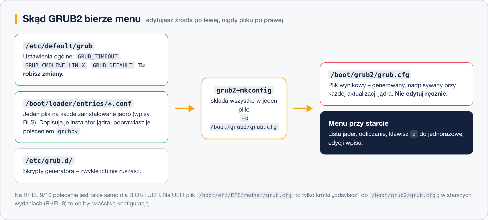
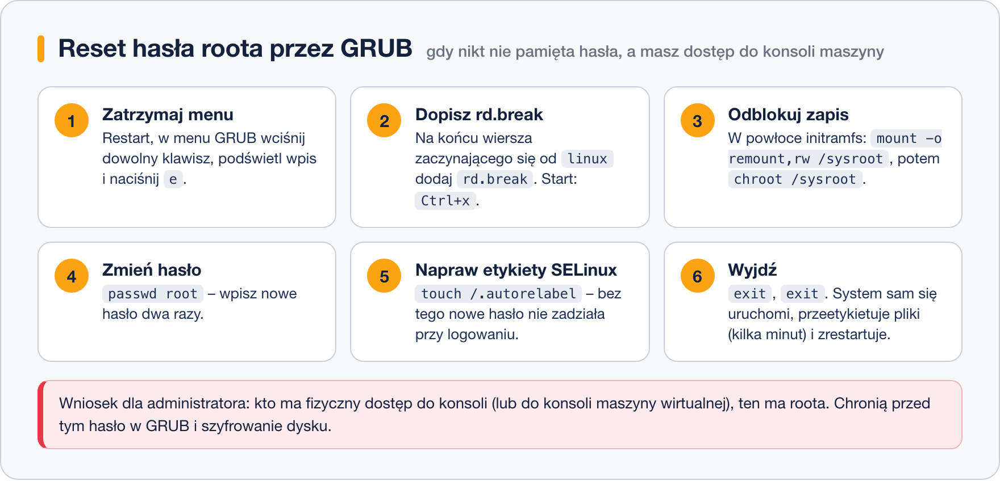

# GRUB2 – wprowadzenie i konfiguracja

> **W tej lekcji:** nauczysz się zmieniać ustawienia GRUB-a we właściwych plikach, generować konfigurację, wybierać domyślne jądro poleceniem `grubby`, jednorazowo edytować wpis klawiszem `e` oraz resetować hasło roota przez `rd.break`.

GRUB2 to pierwszy program „z Twojego dysku”, jaki uruchamia się po BIOS/UEFI; przez kilka sekund pokazuje menu wyboru systemu i jądra. To właśnie tu: wybierasz stare jądro, gdy nowe nie wstaje po aktualizacji; dopisujesz parametr jądra, żeby wejść w tryb ratunkowy; resetujesz hasło roota, którego nikt w firmie nie pamięta. Do tego dochodzi konfiguracja: wydłużenie czasu na wybór, parametry przekazywane jądru na stałe. Błędy w GRUB-ie kończą się maszyną, która nie startuje – dlatego trzeba wiedzieć, **który plik wolno edytować, a którego nie**.

## Jak to działa

GRUB2 czyta przy starcie jeden plik: `/boot/grub2/grub.cfg`. Ten plik jest jednak **generowany** – składa go polecenie `grub2-mkconfig` z trzech źródeł. Edycja `grub.cfg` ręcznie nie ma sensu: najbliższa aktualizacja jądra go nadpisze.



- **`/etc/default/grub`** – ustawienia ogólne. Najważniejsze zmienne:

| Zmienna | Znaczenie |
|---|---|
| `GRUB_TIMEOUT=5` | ile sekund menu czeka na wybór; `0` – start natychmiast, `-1` – czekaj w nieskończoność |
| `GRUB_DEFAULT=saved` | domyślna pozycja menu; `saved` współpracuje z `grub2-set-default` i `grubby` |
| `GRUB_CMDLINE_LINUX="…"` | parametry dopisywane do wiersza poleceń jądra każdego wpisu (np. `crashkernel=1G-4G:192M rhgb quiet`) |
| `GRUB_DISABLE_RECOVERY="true"` | bez dodatkowych wpisów „recovery” w menu |

- **`/boot/loader/entries/*.conf`** – na RHEL 9/10 każde zainstalowane jądro ma własny plik wpisu menu w standardzie **BLS** (ang. Boot Loader Specification). Pliki te tworzy instalator jądra; do ich hurtowej edycji służy `grubby`.
- **`/etc/grub.d/`** – skrypty generatora (szukanie innych systemów, motywy). Zwykle ich nie dotykasz.

Po każdej zmianie w `/etc/default/grub` generujesz konfigurację:

```bash
sudo grub2-mkconfig -o /boot/grub2/grub.cfg
```

Na RHEL 9/10 **to samo polecenie działa dla BIOS i UEFI** – konfiguracja zawsze leży w `/boot/grub2/grub.cfg`. Na maszynach UEFI plik `/boot/efi/EFI/redhat/grub.cfg` to tylko kilkulinijkowy „odsyłacz” wczytujący właściwą konfigurację (w RHEL 8 i starszych bywało odwrotnie – tam generowało się bezpośrednio do pliku na partycji EFI; uważaj na stare poradniki).

> **Na Ubuntu/Debianie:** katalog nazywa się `/boot/grub` (bez „2”), a polecenia `update-grub` i `grub-mkconfig` nie mają przedrostka `grub2-`.

## W praktyce

### Zmiana ustawień na stałe

```bash
# wydłużamy czas wyboru do 10 s
sudo sed -i 's/^GRUB_TIMEOUT=.*/GRUB_TIMEOUT=10/' /etc/default/grub
# przebudowa konfiguracji (zadziała na BIOS i UEFI)
sudo grub2-mkconfig -o /boot/grub2/grub.cfg
```

```text
Generating grub configuration file ...
Adding boot menu entry for UEFI Firmware Settings ...
done
```

### Zarządzanie wpisami jąder – grubby

```bash
# które jądro wystartuje domyślnie
sudo grubby --default-kernel
```

```text
/boot/vmlinuz-5.14.0-503.14.1.el9_5.x86_64
```

```bash
# wszystkie wpisy menu ze szczegółami
sudo grubby --info=ALL
```

```text
index=0
kernel="/boot/vmlinuz-5.14.0-503.14.1.el9_5.x86_64"
args="ro crashkernel=1G-4G:192M rhgb quiet"
root="/dev/mapper/rl-root"
initrd="/boot/initramfs-5.14.0-503.14.1.el9_5.x86_64.img"
title="Rocky Linux (5.14.0-503.14.1.el9_5.x86_64) 9.5 (Blue Onyx)"
index=1
kernel="/boot/vmlinuz-5.14.0-427.13.1.el9_4.x86_64"
…
```

```bash
# ustawienie starszego jądra jako domyślnego (np. gdy nowe sprawia problemy)
sudo grubby --set-default /boot/vmlinuz-5.14.0-427.13.1.el9_4.x86_64
# dopisanie lub usunięcie parametru jądra we wszystkich wpisach
sudo grubby --update-kernel=ALL --args="audit=1"
sudo grubby --update-kernel=ALL --remove-args="rhgb quiet"
```

`grubby` edytuje pliki BLS bezpośrednio – po nim **nie trzeba** uruchamiać `grub2-mkconfig`.

### Jednorazowa edycja wpisu – klawisz e

Przy starcie, gdy widzisz menu GRUB-a:

1. Strzałkami podświetl wpis i naciśnij **`e`** – otworzy się edytor wpisu.
2. Znajdź wiersz zaczynający się od `linux` i dopisz parametr na jego końcu, np. `systemd.unit=rescue.target` albo `3` (tryb tekstowy).
3. **Ctrl+x** (lub F10) uruchamia system z tą zmianą; **Esc** wraca do menu bez zmian.

Zmiana działa tylko na ten jeden start – nic nie zapisuje się na dysku. To bezpieczny sposób testowania parametrów.

### Reinstalacja GRUB-a (BIOS)

Gdy inny system nadpisał MBR (klasyka: doinstalowany Windows) albo sektor rozruchowy jest uszkodzony:

```bash
# tylko na maszynach BIOS; podajemy CAŁY dysk, nie partycję
sudo grub2-install /dev/sda
```

Na UEFI nie używa się `grub2-install` – GRUB jest tam pakietem (`grub2-efi-x64`), a wpis rozruchowy w pamięci płyty naprawia się przez `efibootmgr` lub reinstalację pakietu.

### Scenariusz: reset hasła roota



Wymagany jest dostęp do konsoli (fizycznej lub konsoli maszyny wirtualnej):

1. Restart; w menu GRUB-a naciśnij `e` na domyślnym wpisie.
2. Na końcu wiersza `linux` dopisz **`rd.break`** – zatrzyma to start w initramfs, zanim system przejdzie do właściwego dysku. Start: Ctrl+x.
3. Pojawi się powłoka `switch_root:/#`. Prawdziwy system jest podmontowany w `/sysroot`, tylko do odczytu:

```bash
mount -o remount,rw /sysroot
chroot /sysroot
```

4. Zmień hasło:

```bash
passwd root
```

5. **Krok, o którym wszyscy zapominają:** initramfs działa bez SELinuksa, więc zapisany plik `/etc/shadow` ma złą etykietę. Zleć pełne etykietowanie przy następnym starcie:

```bash
touch /.autorelabel
```

6. `exit`, `exit` – system wstanie, kilka minut poświęci na etykietowanie i zrestartuje się sam. Potem zalogujesz się nowym hasłem.

Wniosek dla bezpieczeństwa: kto ma konsolę, ten ma roota. Chronią przed tym hasło na edycję wpisów GRUB-a (`grub2-setpassword`) i szyfrowanie dysku.

## Najczęstsze błędy i pułapki

- **Edycja `/boot/grub2/grub.cfg` ręcznie.** Zniknie przy pierwszej aktualizacji jądra. Zmiany: `/etc/default/grub` + `grub2-mkconfig`, albo `grubby`.
- **Stare poradniki dla UEFI** każące generować do `/boot/efi/EFI/redhat/grub.cfg`. Na RHEL 9/10 nadpisałbyś w ten sposób plik-odsyłacz; zawsze `-o /boot/grub2/grub.cfg`.
- **`grub2-install` na UEFI** – zgłosi błąd lub namiesza we wpisach rozruchowych. Tylko BIOS.
- **Reset hasła bez `touch /.autorelabel`** – SELinux zablokuje odczyt `/etc/shadow` i logowanie nie zadziała mimo poprawnego hasła.
- **`GRUB_TIMEOUT=0` na serwerze.** Oszczędza 5 sekund, ale odbiera możliwość wyboru starego jądra, gdy nowe nie wstaje. Zostaw kilka sekund.

## Podsumowanie

- Konfigurację GRUB-a zmieniasz w `/etc/default/grub`, a generujesz `grub2-mkconfig -o /boot/grub2/grub.cfg` – na RHEL 9/10 ta sama ścieżka dla BIOS i UEFI.
- Wpisy jąder to pliki BLS w `/boot/loader/entries/`; zarządza nimi `grubby` (bez `grub2-mkconfig` po zmianach).
- Klawisz `e` w menu = jednorazowa edycja wpisu; Ctrl+x startuje.
- `rd.break` + `chroot /sysroot` + `passwd` + `touch /.autorelabel` = reset hasła roota.
- `grub2-install` tylko na BIOS i tylko na cały dysk.

| Polecenie | Co robi |
|---|---|
| `sudo vim /etc/default/grub` | edycja ustawień ogólnych |
| `sudo grub2-mkconfig -o /boot/grub2/grub.cfg` | przebudowa konfiguracji |
| `sudo grubby --default-kernel` | pokazuje domyślne jądro |
| `sudo grubby --set-default /boot/vmlinuz-…` | ustawia domyślne jądro |
| `sudo grubby --info=ALL` | wszystkie wpisy menu |
| `sudo grubby --update-kernel=ALL --args="…"` | dopisuje parametr jądra na stałe |
| `sudo grub2-install /dev/sda` | reinstalacja GRUB-a w MBR (BIOS) |
| `sudo grub2-setpassword` | hasło na edycję wpisów w menu |
