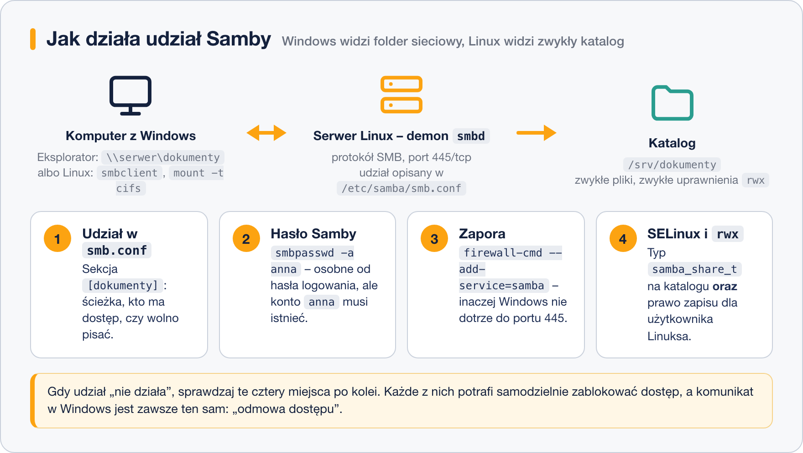

# Udostępnianie plików dla Windows – Samba

> **W tej lekcji:** skonfigurujesz od zera serwer Samba — od instalacji, przez plik `smb.conf` i hasła, po zaporę i SELinux — tak, aby katalog z Linuksa był widoczny w Windows jako zwykły folder sieciowy.

## Po co mi to?

W prawie każdej firmie obok serwerów Linux stoją komputery z Windows, a ich użytkownicy chcą po prostu wejść w „folder sieciowy” i zapisać plik. Protokołem folderów sieciowych w świecie Windows jest **SMB** (Server Message Block, starsza nazwa: CIFS). **Samba** to linuksowa implementacja tego protokołu — dzięki niej serwer Linux udaje serwer plików Windows tak dobrze, że użytkownicy nie widzą różnicy. To jedno z najczęstszych zastosowań Linuksa w sieciach mieszanych.

## Jak to działa

Za udostępnianie plików odpowiada demon **smbd**, nasłuchujący na porcie **445/tcp**. (W pakiecie jest też `nmbd` — obsługuje przestarzałe nazewnictwo NetBIOS/WINS; we współczesnych sieciach zwykle niepotrzebny.) Po stronie klienta jest Eksplorator Windows, a po stronie serwera — zwykły katalog z plikami:



Żeby udział działał, muszą zagrać **cztery** elementy: wpis w `smb.conf`, hasło Samby, zapora i SELinux + uprawnienia. Każdy z nich osobno potrafi zablokować dostęp — dlatego konfigurujemy je po kolei.

### Plik /etc/samba/smb.conf

Konfiguracja składa się z sekcji w nawiasach kwadratowych: `[global]` opisuje cały serwer, a każda następna sekcja to jeden **udział** (ang. share). Minimalna, sensowna konfiguracja:

```text
[global]
        workgroup = WORKGROUP
        server string = Serwer plikow %h
        security = user
        map to guest = never

[dokumenty]
        path = /srv/dokumenty
        comment = Dokumenty firmowe
        browsable = yes
        writable = yes
        valid users = anna, jan
```

Pole po polu:

| Pole | Znaczenie |
|---|---|
| `workgroup` | nazwa grupy roboczej Windows; `WORKGROUP` to domyślna w Windows |
| `server string` | opis serwera widoczny dla klientów (`%h` = nazwa hosta) |
| `security = user` | logowanie kontem i hasłem (jedyny rozsądny tryb) |
| `map to guest = never` | nieudane logowanie = odmowa, a nie wejście jako gość |
| `[dokumenty]` | nazwa udziału — to ją widać po `\\serwer\` |
| `path` | katalog na serwerze, który udostępniamy |
| `comment` | opis widoczny przy przeglądaniu serwera |
| `browsable = yes` | udział widać na liście po wejściu na `\\serwer` |
| `writable = yes` | można zapisywać (odpowiednik `read only = no`) |
| `valid users` | tylko te konta mają wstęp; bez tej linii — każdy użytkownik Samby |

### Hasła Samby

Samba trzyma **własną** bazę haseł (inny format skrótów niż `/etc/shadow`). Użytkownik musi istnieć w systemie, ale do Samby dodaje się go osobno poleceniem `smbpasswd -a`. Hasło do udziału może być inne niż hasło logowania do systemu.

## W praktyce

### 1. Instalacja i katalog

```bash
# serwer, narzędzia wspólne i klient do testów
sudo dnf install samba samba-common samba-client

# katalog udziału; grupa ksiegowosc będzie miała prawo zapisu
sudo mkdir -p /srv/dokumenty
sudo chgrp ksiegowosc /srv/dokumenty
sudo chmod 2775 /srv/dokumenty
```

### 2. Konfiguracja i kontrola składni

Edytujemy `/etc/samba/smb.conf` (konfigurację jak w sekcji wyżej), po czym **zawsze** sprawdzamy składnię:

```bash
testparm
```

```text
Load smb config files from /etc/samba/smb.conf
Loaded services file OK.
...
```

`Loaded services file OK.` oznacza, że plik się parsuje; `testparm` wypisze też ostrzeżenia o podejrzanych ustawieniach.

### 3. Użytkownicy i start usługi

```bash
# konto systemowe musi istnieć; -s /sbin/nologin: bez prawa logowania do powłoki
sudo useradd -s /sbin/nologin anna 2>/dev/null || true

# dodanie do bazy Samby + nadanie hasła SMB
sudo smbpasswd -a anna

# uruchamiamy i włączamy na stałe tylko smbd (nmbd zbędny we współczesnych sieciach)
sudo systemctl enable --now smb
```

### 4. Zapora

```bash
sudo firewall-cmd --permanent --add-service=samba
sudo firewall-cmd --reload
```

### 5. SELinux

Polityka pozwala Sambie serwować tylko pliki o typie `samba_share_t`:

```bash
sudo semanage fcontext -a -t samba_share_t "/srv/dokumenty(/.*)?"
sudo restorecon -Rv /srv/dokumenty
```

Alternatywa, gdy Samba ma udostępniać katalogi o różnych, już zajętych typach (np. katalogi domowe): boolean `samba_export_all_rw` — ale to pozwolenie „na wszystko”, więc traktuj je jako wyjście awaryjne, nie domyślne:

```bash
# tylko gdy naprawdę potrzebne:
sudo setsebool -P samba_export_all_rw on
```

### 6. Test połączenia

Z Windows: w Eksploratorze wpisz `\\serwer\dokumenty` (albo `\\192.168.10.5\dokumenty`), zaloguj się jako `anna` z hasłem SMB.

Z Linuksa — najpierw lista udziałów, potem sesja interaktywna:

```bash
# jakie udziały wystawia serwer (pyta o hasło użytkownika anna)
smbclient -L //serwer -U anna

# połączenie z udziałem; polecenia jak w kliencie ftp: ls, get, put
smbclient //serwer/dokumenty -U anna
```

```text
smb: \> ls
  .                     D        0  Sat Oct 18 13:02:11 2026
  raport.odt            A    24576  Sat Oct 18 13:05:43 2026
```

Udział można też zamontować na stałe jak zwykły system plików (pakiet `cifs-utils`):

```bash
sudo dnf install cifs-utils
sudo mkdir -p /mnt/dokumenty
sudo mount -t cifs //serwer/dokumenty /mnt/dokumenty -o username=anna
```

## Najczęstsze błędy i pułapki

- **Brak `smbpasswd -a`.** Konto systemowe istnieje, ale Samba go nie zna — logowanie zawsze odrzucone. Konto w systemie i wpis w bazie Samby to dwie osobne rzeczy.
- **Pominięty SELinux.** Udział widać, ale „odmowa dostępu” przy wejściu, a uprawnienia `rwx` są dobre. Sprawdź `ls -Zd /srv/dokumenty` — ma być `samba_share_t`.
- **Zapora.** Z samego serwera (`smbclient //localhost/...`) działa, z Windows nie — brak `--add-service=samba` (port 445).
- **Uprawnienia plikowe kontra `writable`.** `writable = yes` w `smb.conf` nie wystarczy — użytkownik musi mieć też zwykłe prawo zapisu (`rwx`) do katalogu. Samba nigdy nie da więcej, niż pozwala system plików.
- **Edycja bez `testparm`.** Literówka w `smb.conf` potrafi wyłączyć cały serwer plików. `testparm` przed każdym restartem usługi.

## Podsumowanie

- Samba = linuksowy serwer protokołu **SMB/CIFS**; demon `smbd`, port 445/tcp, konfiguracja w `/etc/samba/smb.conf` (sekcja `[global]` + sekcje udziałów).
- Użytkownik udziału: konto systemowe **plus** `smbpasswd -a` z osobnym hasłem SMB.
- Checklista działającego udziału: `smb.conf` + `testparm` → `smbpasswd` → `systemctl enable --now smb` → zapora (`samba`) → SELinux (`samba_share_t`) → uprawnienia `rwx`.
- Test z Linuksa: `smbclient -L //serwer -U anna`; montowanie: `mount -t cifs`.

| Polecenie | Co robi |
|---|---|
| `testparm` | sprawdza składnię smb.conf |
| `smbpasswd -a anna` | dodaje użytkownika do bazy Samby |
| `systemctl enable --now smb` | uruchamia serwer plików |
| `firewall-cmd --permanent --add-service=samba` | otwiera zaporę |
| `semanage fcontext … samba_share_t` + `restorecon -Rv` | etykiety SELinux |
| `smbclient -L //serwer -U anna` | listuje udziały |
| `mount -t cifs //serwer/udzial /mnt/x -o username=anna` | montuje udział |
