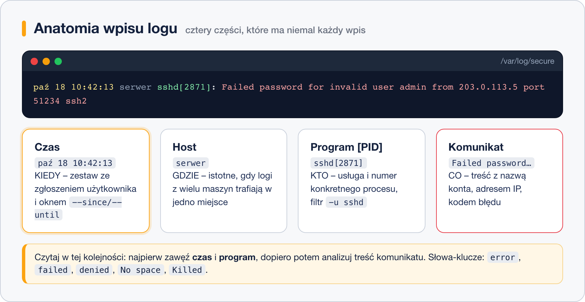

# Czytanie logów w praktyce

> **W tej lekcji:** poznasz prostą metodę czytania logów (czas → usługa → komunikat), nauczysz się
> filtrować i kolorować wpisy oraz rozpoznawać trzy najczęstsze sytuacje: nieudane logowanie SSH,
> pełny dysk i zabicie procesu przez brak pamięci.

Wiesz już, gdzie logi są. Teraz problem jest odwrotny: jest ich **za dużo** – serwer potrafi
wygenerować tysiące linii na godzinę. Logów nie czyta się więc od początku, tylko zadaje im
konkretne pytania; ta lekcja uczy, jak te pytania formułować i jak wygląda odpowiedź.

## Jak to działa

### Anatomia wpisu

Niemal każdy wpis w logu ma ten sam szkielet:



```text
paź 18 10:42:13 serwer sshd[2871]: Failed password for invalid user admin from 203.0.113.5 port 51234 ssh2
```

| Część | Przykład | Po co |
|---|---|---|
| czas | `paź 18 10:42:13` | **kiedy** – pozwala zestawić zdarzenie ze zgłoszeniem użytkownika |
| host | `serwer` | **gdzie** – ważne, gdy logi z wielu maszyn trafiają w jedno miejsce |
| program i PID | `sshd[2871]` | **kto** – która usługa i który konkretnie proces |
| komunikat | `Failed password for …` | **co** – treść, często z adresem IP, nazwą użytkownika, kodem błędu |

### Metoda: czas → usługa → komunikat

1. **Czas.** Ustal, kiedy problem wystąpił („nie mogę się zalogować od 10:40”). Ogranicz log do
   tego okna: `--since "10:30" --until "10:50"`.
2. **Usługa.** Pomyśl, kto mógł to zgłosić: logowanie → `sshd`; strona nie działa → `httpd`;
   dysk → jądro (`-k`). Filtruj `-u nazwa`.
3. **Komunikat.** Dopiero teraz czytaj treść. Szukaj słów: `error`, `failed`, `denied`, `timeout`,
   `No space`, `Killed`. Jeśli komunikatu nie rozumiesz, wklej go w wyszukiwarkę – dosłownie,
   bez numerów i nazw własnych.

Odwrotna kolejność (najpierw czytanie, potem filtrowanie) to najczęstszy powód, dla którego
„w logach nic nie ma”.

## W praktyce

### Filtrowanie

```bash
# krok 1 i 2 naraz: okno czasowe i jedna usługa
sudo journalctl -u sshd --since "10:30" --until "10:50"
```

```bash
# krok 3: szukanie słowa w treści – --grep przyjmuje wyrażenie regularne, -i ignoruje wielkość liter
sudo journalctl -u sshd --grep "Failed|Invalid" -i
```

```bash
# dokładniejszy czas (z milisekundami) – przydatne, gdy zdarzenia dzielą ułamki sekund
sudo journalctl -u httpd -o short-precise -n 20
```

```bash
# w plikach tekstowych tę samą rolę pełni grep; -n dodaje numer linii
sudo grep -n "Failed password" /var/log/secure
```

```bash
# ile nieudanych prób z każdego adresu IP – klasyczny jednolinijkowiec
sudo grep "Failed password" /var/log/secure | awk '{print $(NF-3)}' | sort | uniq -c | sort -rn | head
```

```text
     87 203.0.113.5
     12 198.51.100.77
```

### Podgląd na żywo i kolorowanie

```bash
# śledzenie usługi na żywo; w drugim oknie zrób test (np. zaloguj się złym hasłem)
sudo journalctl -fu sshd
```

Kolor pomaga zauważyć w strumieniu ważny wpis. Najprostszy sposób nie wymaga instalacji – `grep`
podświetla dopasowania, a `|$` na końcu wzorca sprawia, że linie bez dopasowania też przechodzą:

```bash
# Accepted/Failed/Invalid na kolorowo, reszta normalnie
sudo journalctl -fu sshd | grep --color=always -E "Accepted|Failed|Invalid user|$"
```

Gotowe narzędzia z repozytorium EPEL (włącz je najpierw: `sudo dnf install epel-release`):

| Narzędzie | Do czego | Przykład |
|---|---|---|
| `ccze` | koloruje strumień logu według typu wpisu | `sudo tail -f /var/log/messages \| ccze -A` |
| `lnav` | przeglądarka logów z kolorowaniem, filtrami i wyszukiwaniem | `sudo lnav /var/log/secure` |
| `grc` | koloruje wyjście wielu poleceń, także `tail` | `sudo grc tail -f /var/log/secure` |

Nazwy pakietów są takie same jak nazwy poleceń. Jeśli `dnf` ich nie znajdzie, to w Twojej wersji
EPEL ich brak – wtedy zostaje `grep --color`.

### Trzy typowe wpisy

**1. Nieudane logowanie SSH** (`/var/log/secure`, `journalctl -u sshd`):

```text
sshd[2871]: Failed password for invalid user admin from 203.0.113.5 port 51234 ssh2
sshd[2871]: Failed password for jan from 192.168.10.31 port 50102 ssh2
sshd[2902]: Accepted publickey for anna from 192.168.10.25 port 51822 ssh2
```

`invalid user` – takiego konta nie ma (zwykle automat z internetu zgaduje nazwy). Bez `invalid user` –
konto istnieje, ale hasło złe: albo użytkownik się pomylił, albo ktoś zgaduje jego hasło. Dziesiątki
prób z jednego adresu to sygnał, by ograniczyć dostęp (firewall, `fail2ban`).

**2. Pełny dysk** (`journalctl -p err`, `/var/log/messages`):

```text
rsyslogd: file '/var/log/messages': open error: No space left on device
httpd[1180]: (28)No space left on device: AH00646: Error writing to /var/log/httpd/access_log
```

Komunikat `No space left on device` pojawia się u wielu programów naraz. Potwierdzasz `df -h`,
sprawcę szukasz `du -sh /var/* | sort -h`. Uwaga: dysk może być „pełny” także wtedy, gdy skończą
się i-węzły (`df -i`) – miejsca jest dużo, a plików nie da się tworzyć.

**3. OOM killer** (ang. out of memory – brak pamięci; `journalctl -k`):

```text
kernel: Out of memory: Killed process 4211 (java) total-vm:8123456kB, anon-rss:3900120kB ...
```

Gdy zabraknie RAM i swapu, jądro zabija proces, który zużywa najwięcej pamięci. Usługa „sama się
wyłączyła” bez śladu w jej własnym logu – ślad jest w logu jądra. Rozwiązanie to więcej pamięci,
limit dla programu albo naprawa wycieku, nie restart w pętli.

## Najczęstsze błędy i pułapki

- **Czytanie od początku pliku.** `cat /var/log/messages` zalewa ekran; zaczynaj od `tail`, `-n`,
  `--since` albo `less` (w `less` szukasz `/słowo`, `G` przeskakuje na koniec, `F` śledzi na żywo).
- **Szukanie po polsku.** Komunikaty programów są po angielsku (`failed`, nie `błąd`), nawet gdy
  system ma polskie ustawienia regionalne.
- **Mylenie przyczyny ze skutkiem.** Pierwszy błąd w czasie jest zwykle przyczyną; kolejne to lawina
  skutków. Dlatego sortuj chronologicznie i patrz na **pierwszy** wpis po okresie spokoju.
- **Wielkość liter w `grep`.** `grep error` nie znajdzie `Error`. Dodaj `-i`.
- **Komunikat z `journalctl -x`** to opis ogólny, nie diagnoza. Czytaj go, ale nie zastępuj nim treści wpisu.

## Podsumowanie

- Każdy wpis to: czas, host, program[PID], komunikat. Najpierw zawęź czas i usługę, dopiero potem czytaj.
- `--grep`, `-o short-precise`, `grep -n`, `awk | sort | uniq -c` – zestaw do codziennej pracy.
- Kolor daj przez `grep --color` albo `ccze`/`lnav`/`grc` z EPEL.
- `invalid user`, `No space left on device`, `Out of memory: Killed process` – trzy komunikaty,
  które warto rozpoznawać z marszu.

| Zadanie | Polecenie |
|---|---|
| wpisy usługi w oknie czasu | `sudo journalctl -u sshd --since "10:30" --until "10:50"` |
| szukaj słowa w dzienniku | `sudo journalctl -u sshd --grep "Failed" -i` |
| dokładny czas | `sudo journalctl -o short-precise -n 20` |
| nieudane logowania wg adresu | `sudo grep "Failed password" /var/log/secure \| awk '{print $(NF-3)}' \| sort \| uniq -c \| sort -rn` |
| podgląd na żywo z kolorem | `sudo journalctl -fu sshd \| grep --color=always -E "Accepted\|Failed\|$"` |
| kto zabił proces | `sudo journalctl -k --grep "Out of memory"` |
