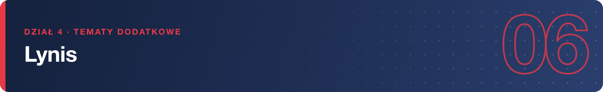
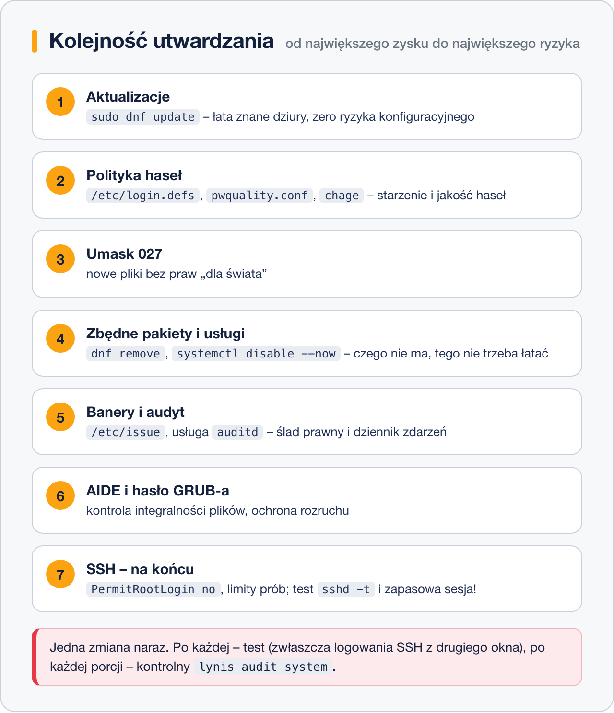

# Utwardzanie systemu krok po kroku

> **W tej lekcji:** przejdziesz przez najczęstsze zalecenia, jakie Lynis wystawia świeżemu systemowi
> RHEL, i wdrożysz je we właściwej kolejności – wiedząc, co każda zmiana robi i czym grozi.

## Po co mi to?

Audyt z poprzedniej lekcji zostawił Cię z listą kilkudziesięciu sugestii. Utwardzanie
(ang. hardening) to wdrażanie takich zaleceń: zamykanie furtek, których nie używasz, i dokręcanie
ustawień, które domyślnie są zbyt luźne. Robione z głową podnosi bezpieczeństwo prawie za darmo.
Robione na ślepo – potrafi odciąć Cię od serwera albo zepsuć aplikację.

> **Ostrzeżenie:** nie wdrażaj wszystkich zaleceń naraz. Zmieniaj jedną rzecz, testuj (zwłaszcza
> logowanie przez SSH w **drugim, otwartym** oknie!), dopiero potem następną. Na serwerze
> produkcyjnym każdą zmianę najpierw przećwicz na maszynie testowej.

## Jak to działa

Zalecenia Lynisa dla świeżego RHEL kręcą się wokół kilku obszarów. Sensowna kolejność: najpierw
to, co daje najwięcej przy najmniejszym ryzyku (aktualizacje, hasła), na końcu zmiany najłatwiejsze
do zepsucia (SSH) i narzędzia dodatkowe (AIDE).



## W praktyce

Poniżej 11 najczęstszych zaleceń z typowymi identyfikatorami testów Lynisa.

### 1. Aktualizacje (PKGS-7392)

Podatne pakiety to realne, znane dziury – to zalecenie wdrażasz zawsze i w pierwszej kolejności:

```bash
# instalujemy wszystkie dostępne poprawki
sudo dnf update
```

### 2. Starzenie haseł (AUTH-9286)

Domyślnie hasła nigdy nie wygasają. Limity dla **nowych** kont ustawia `/etc/login.defs`:

```bash
sudo vi /etc/login.defs
```

```text
PASS_MAX_DAYS   180
PASS_MIN_DAYS   1
PASS_WARN_AGE   7
```

Istniejącym kontom limity zmienia `chage`:

```bash
# te same wartości dla konta anna; chage -l anna pokazuje stan
sudo chage -M 180 -m 1 -W 7 anna
```

### 3. Minimalna długość i złożoność hasła (AUTH-9328 / pwquality)

```bash
# wymagania jakości haseł – plik czytany przez PAM przy zmianie hasła
sudo vi /etc/security/pwquality.conf
```

```text
minlen = 12
minclass = 3
```

`minclass = 3` wymaga znaków z co najmniej trzech klas (małe, wielkie, cyfry, znaki specjalne).

### 4. Domyślny umask (AUTH-9328)

`umask` decyduje, jakie uprawnienia dostają nowo tworzone pliki. Lynis zaleca `027` zamiast `022`
(grupa bez zapisu, pozostali bez żadnych praw) – zmiana w `/etc/login.defs`:

```text
UMASK           027
```

Po tej zmianie pliki tworzone przez użytkowników nie będą czytelne „dla świata”. Jeśli jakiś
proces publikuje pliki (np. serwer WWW), sprawdź, czy nadal ma do nich dostęp.

### 5. Zbędne pakiety i usługi (PKGS-7346, BOOT-5122)

Czego nie ma, tego nie trzeba łatać:

```bash
# co jest zainstalowane i co nasłuchuje w sieci
dnf repoquery --installed | wc -l
sudo ss -tulnp
systemctl list-unit-files --type=service --state=enabled
```

```bash
# usuwamy, czego serwer nie potrzebuje (przykład), i wyłączamy nieużywane usługi
sudo dnf remove cups
sudo systemctl disable --now bluetooth
```

### 6. Banery logowania (BANN-7126, BANN-7130)

Komunikat prawny „dostęp tylko dla uprawnionych” przed i po zalogowaniu. Treść wpisuje się do
`/etc/issue` (konsola), `/etc/issue.net` (SSH, po włączeniu `Banner /etc/issue.net` w konfiguracji
sshd) i `/etc/motd` (po zalogowaniu):

```bash
echo "Dostep wylacznie dla uprawnionych uzytkownikow. Aktywnosc jest rejestrowana." | sudo tee /etc/issue /etc/issue.net
```

### 7. Dziennik audytu (ACCT-9628)

`auditd` zapisuje zdarzenia bezpieczeństwa (logowania, zmiany uprawnień, dostęp do plików)
do `/var/log/audit/audit.log`. Na RHEL jest zwykle zainstalowany – upewnij się, że działa:

```bash
sudo dnf install audit
sudo systemctl enable --now auditd
```

### 8. AIDE – kontrola integralności plików (FINT-4350)

AIDE (Advanced Intrusion Detection Environment) robi „zdjęcie” plików systemowych i później
wykrywa każdą zmianę – np. podmieniony plik binarny:

```bash
sudo dnf install aide
# pierwsze zdjęcie systemu (trwa kilka minut), potem podstawiamy je jako bazę
sudo aide --init
sudo mv /var/lib/aide/aide.db.new.gz /var/lib/aide/aide.db.gz
```

```bash
# kolejne kontrole porównują stan z bazą
sudo aide --check
```

### 9. Ochrona GRUB-a hasłem (BOOT-5122)

Bez hasła każdy z fizycznym dostępem może wystartować system w trybie awaryjnym i ominąć logowanie.
Hasło na edycję wpisów rozruchowych ustawia:

```bash
sudo grub2-setpassword
```

(Ma sens na sprzęcie fizycznym; na maszynie wirtualnej w chmurze mniej.)

### 10. Utwardzenie SSH (SSH-7408) – na końcu i ostrożnie

Typowe sugestie Lynisa dla `/etc/ssh/sshd_config` (na RHEL 9/10 lepiej jako osobny plik
w `/etc/ssh/sshd_config.d/`):

```bash
sudo tee /etc/ssh/sshd_config.d/90-hardening.conf <<'EOF'
PermitRootLogin no
MaxAuthTries 3
AllowTcpForwarding no
X11Forwarding no
ClientAliveInterval 300
ClientAliveCountMax 2
EOF
```

```bash
# test składni, dopiero potem restart; sesji NIE zamykaj, zaloguj się testowo z drugiego okna
sudo sshd -t && sudo systemctl restart sshd
```

Zanim ustawisz `PermitRootLogin no`, upewnij się, że masz **działające konto z sudo**.
`AllowTcpForwarding no` zepsuje tunelowanie portów – jeśli go używasz, pomiń tę linię.

### 11. Audyt kontrolny

Po każdej porcji zmian uruchom Lynisa ponownie i porównaj wynik:

```bash
sudo lynis audit system --quick
sudo grep hardening_index /var/log/lynis-report.dat
```

## Najczęstsze błędy i pułapki

- **Restart sshd bez testu i bez zapasowej sesji.** Literówka w konfiguracji = brak dostępu do
  serwera. Zawsze `sshd -t`, zawsze druga otwarta sesja na czas zmian.
- **Wdrażanie zaleceń, które nie pasują do roli serwera.** Przykład: wyłączenie przekazywania
  portów w SSH na maszynie, przez którą tunelujesz połączenia.
- **Przesadna polityka haseł.** Hasło zmieniane co 30 dni i 20 znaków kończy się karteczkami
  na monitorach. Lepsze rozsądne limity plus klucze SSH.
- **AIDE bez aktualizacji bazy.** Po każdej legalnej zmianie (aktualizacji pakietów) kontrola
  zgłosi setki „naruszeń”. Po `dnf update` odśwież bazę: `sudo aide --update` i podmień plik bazy.
- **Brak notatek.** Zapisuj, co i kiedy zmieniłeś – przy pierwszej awarii będziesz wiedzieć,
  co odkręcić.

## Podsumowanie

- Utwardzaj po kolei: aktualizacje → hasła → umask → zbędne pakiety/usługi → banery → audyt →
  AIDE → GRUB → SSH (na końcu, najostrożniej).
- Jedna zmiana naraz, test po każdej, SSH zmieniaj przy otwartej zapasowej sesji.
- Nie każde zalecenie pasuje do każdego serwera – czytaj `lynis show details` i myśl o roli maszyny.
- Kontroluj postęp kolejnymi audytami: hardening index powinien rosnąć.

| Obszar | Plik / polecenie |
|---|---|
| aktualizacje | `sudo dnf update` |
| starzenie haseł | `/etc/login.defs`, `chage` |
| jakość haseł | `/etc/security/pwquality.conf` |
| umask | `UMASK 027` w `/etc/login.defs` |
| usługi | `systemctl disable --now …`, `sudo ss -tulnp` |
| banery | `/etc/issue`, `/etc/issue.net`, `/etc/motd` |
| audyt zdarzeń | `auditd`, `/var/log/audit/audit.log` |
| integralność plików | `aide --init` / `aide --check` |
| SSH | `/etc/ssh/sshd_config.d/`, `sshd -t` |
