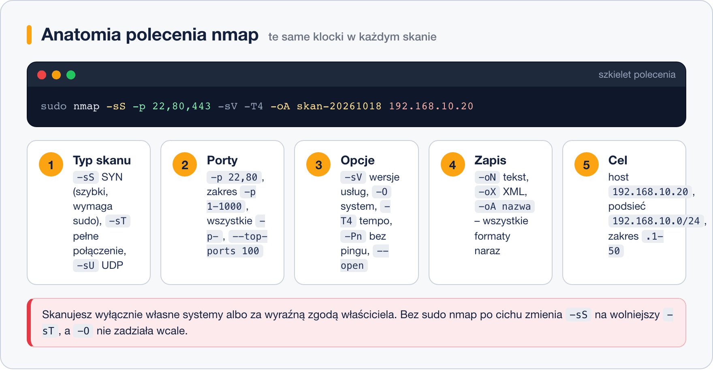

# Przełączniki i przykłady

> **W tej lekcji:** poznasz najważniejsze przełączniki nmap – typy skanów, wybór portów, wykrywanie
> wersji usług i systemu, zapis wyników – oraz gotowe recepty „co chcę sprawdzić → jakie polecenie”.

`nmap localhost` to dopiero początek. W praktyce zadajesz skanerowi konkretne pytania: „czy ktoś
w mojej sieci wystawił starą wersję OpenSSH?”, „które porty naprawdę są otwarte na wszystkich
65535?”, „co mój firewall przepuszcza?”. Każde pytanie to inna kombinacja przełączników –
ta lekcja daje Ci zestaw na co dzień.

Przypomnienie z poprzedniej lekcji: **wszystko poniżej wykonujesz tylko na własnych maszynach
i w sieci szkoleniowej.**

## Jak to działa

Polecenie nmap składa się zawsze z tych samych klocków:



### Typ skanu: `-sT` kontra `-sS`

- **`-sT` (TCP connect)** – nmap nawiązuje pełne połączenie, jak zwykły klient. Działa bez
  uprawnień roota, ale jest wolniejszy i zostawia wyraźny ślad w logach usług.
- **`-sS` (TCP SYN, „półotwarty”)** – nmap wysyła tylko pierwszy pakiet nawiązania połączenia
  i po odpowiedzi je zrywa. Szybszy, domyślny **gdy skanujesz z sudo**. Bez sudo nmap
  automatycznie spada do `-sT` – stąd praktyczna zasada: skanuj przez `sudo`.
- **`-sU`** – skan portów UDP (DNS 53, SNMP 161…). Dużo wolniejszy i częściej niejednoznaczny
  (`open|filtered`), bo UDP z natury nie potwierdza odbioru.

### Pozostałe klocki

| Przełącznik | Działanie |
|---|---|
| `-p 22`, `-p 80,443`, `-p 1-1000`, `-p-` | które porty (`-p-` = wszystkie 65535) |
| `--top-ports 100` | 100 najczęściej używanych portów |
| `-sV` | zbadaj **wersje usług** (co naprawdę nasłuchuje) |
| `-O` | zgadnij system operacyjny (wymaga sudo) |
| `-A` | wszystko naraz: `-sV`, `-O`, skrypty, traceroute – głośne i wolne |
| `-T0`–`-T5` | tempo skanu; `-T3` domyślne, `-T4` szybkie dla sieci lokalnej |
| `-Pn` | nie sprawdzaj pingiem, skanuj od razu (host „niby martwy”) |
| `-n` | bez zapytań DNS (szybciej) |
| `--open` | pokaż tylko otwarte porty |
| `--reason` | wyjaśnij, skąd wniosek o stanie portu |
| `-oN plik.txt` / `-oX plik.xml` | zapis wyniku: czytelny / XML (dla narzędzi); `-oA nazwa` – oba plus format grepowalny |

### Skrypty NSE

nmap ma wbudowany silnik skryptów (NSE – Nmap Scripting Engine): gotowe testy od pobierania
tytułu strony WWW po sprawdzanie znanych podatności. Przykład:

```bash
# uruchom zestaw skryptów szukających znanych podatności na usługach WWW
sudo nmap --script vuln -p 80,443 192.168.10.20
```

> **Zastrzeżenie:** skrypty `vuln` wysyłają do usług nietypowe żądania – potrafią zapełnić logi,
> wywołać alarmy, a w skrajnych wypadkach zdestabilizować starą usługę. Tym bardziej: tylko
> własne maszyny, najlepiej testowe, i świadomie. Wynik „brak podatności” też nie jest gwarancją –
> skrypty znają tylko część świata.

## W praktyce

Recepty „co chcę sprawdzić → polecenie”. Cele to maszyny w sieci szkoleniowej (`192.168.10.x`).

**1. Które maszyny działają w podsieci?**

```bash
sudo nmap -sn 192.168.10.0/24
```

**2. Jakie porty są otwarte na serwerze? (szybki rzut oka)**

```bash
sudo nmap 192.168.10.20
```

**3. Wszystkie 65535 portów TCP – pełna inwentaryzacja:**

```bash
# -T4 przyspiesza, -n pomija DNS; i tak potrwa kilka minut
sudo nmap -p- -T4 -n 192.168.10.20
```

**4. Co naprawdę nasłuchuje i w jakiej wersji?**

```bash
sudo nmap -sV -p 22,80,443 192.168.10.20
```

```text
PORT    STATE SERVICE  VERSION
22/tcp  open  ssh      OpenSSH 8.7 (protocol 2.0)
80/tcp  open  http     Apache httpd 2.4.62 ((Red Hat Enterprise Linux))
443/tcp open  https    Apache httpd 2.4.62 ((Red Hat Enterprise Linux))
```

**5. Czy w całej sieci ktoś wystawił SSH?**

```bash
sudo nmap -p 22 --open 192.168.10.0/24
```

**6. Jaki system operacyjny ma host?**

```bash
# zgadywanie po zachowaniu stosu TCP/IP; wynik to hipoteza, nie pewnik
sudo nmap -O 192.168.10.20
```

**7. Pełny profil jednej maszyny (przed oddaniem serwera do użytku):**

```bash
sudo nmap -A -T4 192.168.10.20
```

**8. Host nie odpowiada na ping, ale wiem, że działa:**

```bash
sudo nmap -Pn -p 3389 192.168.10.30
```

**9. Usługi UDP (DNS, SNMP, DHCP):**

```bash
sudo nmap -sU --top-ports 20 192.168.10.1
```

**10. Skan z zapisem do pliku – dokumentacja stanu sieci:**

```bash
# -oA tworzy skan.nmap (czytelny), skan.xml i skan.gnmap
sudo nmap -sV -T4 -oA skan-20261018 192.168.10.20
```

Zapisuj skany z datą w nazwie: porównanie dwóch plików (`diff`) natychmiast pokaże,
co się w sieci zmieniło od zeszłego miesiąca.

## Najczęstsze błędy i pułapki

- **Skan bez `sudo` i zdziwienie, że wolno.** Bez uprawnień nmap nie użyje `-sS` ani `-O`.
  Nawyk: `sudo nmap …`.
- **`-A` na wszystko.** Pełny profil całej podsieci trwa wieki i robi dużo szumu. `-A` to narzędzie
  do pojedynczych maszyn; do przeglądu sieci wystarczy `-sn` albo `-p` z listą portów.
- **Zaufanie do `-O` i `-sV` w 100%.** To heurystyki – traktuj jak dobrą wskazówkę, weryfikuj
  na maszynie (`cat /etc/os-release`, `ss -tulnp`).
- **Skan UDP „bo szybko sprawdzę”.** `-sU` na pełnym zakresie portów potrafi trwać godzinami.
  Ograniczaj do `--top-ports` albo konkretnych portów.
- **Brak zapisu wyników.** Skan bez `-oN`/`-oA` znika z ekranem. Przy inwentaryzacji zawsze zapisuj.

## Podsumowanie

- Szkielet polecenia: `sudo nmap [typ skanu] [-p porty] [opcje] [-o zapis] cel`.
- `-sS` (domyślny z sudo) jest szybki; `-sT` działa bez roota; `-sU` dla UDP – powoli.
- `-sV` mówi, **co naprawdę** nasłuchuje; kolumna SERVICE bez `-sV` to tylko zgadywanka.
- `--open`, `-n`, `-T4` – codzienne dodatki; `-Pn` gdy host ignoruje ping.
- Wyniki zapisuj (`-oA nazwa-z-datą`) i porównuj w czasie.

| Co chcę sprawdzić | Polecenie |
|---|---|
| kto żyje w sieci | `sudo nmap -sn 192.168.10.0/24` |
| otwarte porty hosta | `sudo nmap 192.168.10.20` |
| wszystkie porty TCP | `sudo nmap -p- -T4 -n 192.168.10.20` |
| wersje usług | `sudo nmap -sV 192.168.10.20` |
| SSH w całej sieci | `sudo nmap -p 22 --open 192.168.10.0/24` |
| system operacyjny | `sudo nmap -O 192.168.10.20` |
| pełny profil hosta | `sudo nmap -A -T4 192.168.10.20` |
| zapis wyników | `sudo nmap -sV -oA skan-data 192.168.10.20` |
