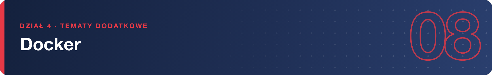
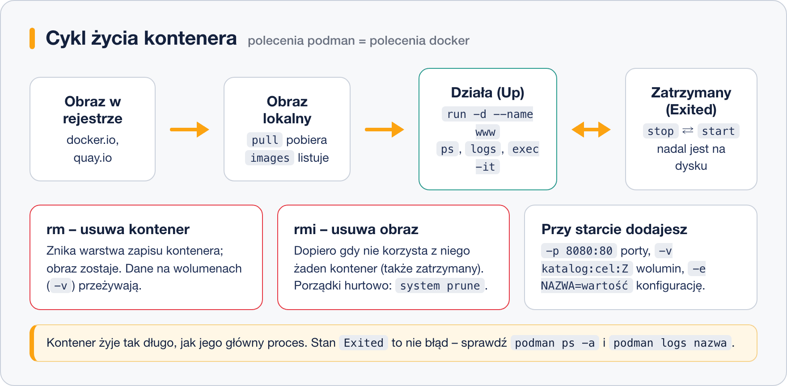

# Podstawowe polecenia

> **W tej lekcji:** opanujesz codzienny warsztat pracy z kontenerami: uruchamianie i zatrzymywanie,
> listowanie, logi, wchodzenie do środka, mapowanie portów, woluminy i zmienne środowiskowe.

Kontenerami zarządza się kilkunastoma poleceniami, które układają się w cykl życia: pobierz obraz →
uruchom kontener → obejrzyj, co robi → zatrzymaj → usuń. Polecenia poniżej piszemy jako `podman`,
ale z aliasem z poprzedniej lekcji identycznie działa `docker`.

## Jak to działa



Kluczowa obserwacja: **kontener żyje tak długo, jak jego główny proces**. Gdy proces się kończy
(albo go zatrzymasz), kontener przechodzi w stan `Exited` – nadal istnieje na dysku i można go
wystartować ponownie (`start`) albo usunąć (`rm`). Dopiero `rm` kasuje kontener, a `rmi` – obraz.

## W praktyce

### Obrazy: pobieranie i przeglądanie

```bash
# pobranie obrazu z rejestru (pełna nazwa = bez pytania o rejestr)
podman pull docker.io/library/nginx
```

```bash
# lokalna lista obrazów
podman images
```

```text
REPOSITORY               TAG     IMAGE ID      CREATED      SIZE
docker.io/library/nginx  latest  61395b4c586d  2 weeks ago  191 MB
```

### Kontenery: uruchamianie

```bash
# -d: w tle (detached), --name: własna nazwa zamiast losowej
podman run -d --name www docker.io/library/nginx
```

```bash
# tryb interaktywny: -i (wejście) + -t (terminal); exit kończy kontener
podman run -it --name probny docker.io/library/alpine sh
```

```bash
# --rm: posprzątaj po zakończeniu – do jednorazowych testów
podman run --rm docker.io/library/alpine cat /etc/os-release
```

### Listowanie, zatrzymywanie, usuwanie

```bash
podman ps          # tylko działające
podman ps -a       # wszystkie, także zatrzymane (Exited)
```

```text
CONTAINER ID  IMAGE                           COMMAND               STATUS         NAMES
3f1a2b3c4d5e  docker.io/library/nginx:latest  nginx -g daemon o...  Up 2 minutes   www
9a8b7c6d5e4f  docker.io/library/alpine:latest sh                    Exited (0)...  probny
```

```bash
podman stop www      # grzeczne zatrzymanie (SIGTERM, po 10 s SIGKILL)
podman start www     # ponowne uruchomienie istniejącego kontenera
podman restart www   # stop + start
```

```bash
podman rm probny     # usunięcie zatrzymanego kontenera
podman rm -f www     # wymuszenie: zatrzymaj i usuń jednym ruchem
podman rmi docker.io/library/alpine   # usunięcie obrazu (żaden kontener nie może go używać)
```

### Zaglądanie do środka: logi i exec

```bash
podman logs www           # co kontener wypisał (tu: dziennik dostępu nginx)
podman logs -f www        # śledzenie na żywo, Ctrl+C kończy podgląd
podman logs --tail 20 www # ostatnie 20 linii
```

```bash
# powłoka wewnątrz działającego kontenera – do diagnostyki
podman exec -it www bash
```

```text
root@3f1a2b3c4d5e:/# cat /etc/nginx/nginx.conf | head -3
user  nginx;
worker_processes  auto;
root@3f1a2b3c4d5e:/# exit
```

`exit` z `exec` **nie zatrzymuje** kontenera – zamykasz tylko dodatkową powłokę.

### Porty: `-p`

Kontener ma własną sieć; żeby usługa była widoczna z zewnątrz, mapujesz port gospodarza na port
kontenera w formie `-p gospodarz:kontener`:

```bash
# strona nginx (port 80 w kontenerze) dostępna na porcie 8080 maszyny
podman run -d --name www2 -p 8080:80 docker.io/library/nginx
curl http://localhost:8080
```

Porty poniżej 1024 wymagają w trybie rootless uprawnień roota – dlatego w ćwiczeniach używamy 8080.

### Woluminy: `-v`

System plików kontenera znika razem z nim. Dane, które mają przetrwać (baza danych, pliki strony),
trzymasz na **wolumenie** – katalogu gospodarza podpiętym do kontenera:

```bash
# katalog ~/dane-www z gospodarza widoczny w kontenerze jako /usr/share/nginx/html
mkdir ~/dane-www && echo "Moja strona" > ~/dane-www/index.html
podman run -d --name www3 -p 8081:80 -v ~/dane-www:/usr/share/nginx/html:Z docker.io/library/nginx
```

Przyrostek `:Z` jest ważny na RHEL: ustawia kontekst SELinux tak, by kontener mógł czytać katalog.
Bez niego zobaczysz błąd „Permission denied”, mimo poprawnych uprawnień.

### Zmienne środowiskowe: `-e`

Obrazy konfiguruje się zmiennymi środowiskowymi – np. hasło administratora bazy:

```bash
podman run -d --name baza -e POSTGRES_PASSWORD=tajnehaslo docker.io/library/postgres:16
```

Jakie zmienne obsługuje obraz, sprawdzasz w jego opisie w rejestrze (Docker Hub/Quay).

## Najczęstsze błędy i pułapki

- **`podman ps` „nie widzi” kontenera** – bo się zakończył. Sprawdź `podman ps -a` i `podman logs`:
  zwykle aplikacja padła przy starcie (np. brak wymaganej zmiennej `-e`).
- **Konflikt portu:** `bind: address already in use` – port gospodarza jest zajęty przez inną
  usługę lub inny kontener. Wybierz inny port po lewej stronie `-p`.
- **„Permission denied” na wolumenie mimo `chmod`** – to SELinux. Dodaj `:Z` do `-v`.
- **Zmiany zrobione przez `exec` znikają** po usunięciu kontenera. To zachowanie poprawne –
  trwałość zapewniają woluminy i własne obrazy.
- **`rmi` odmawia usunięcia obrazu** – korzysta z niego jakiś kontener (choćby zatrzymany).
  Najpierw `podman rm`, potem `rmi`.

## Podsumowanie

- Cykl życia: `pull` → `run` → (`stop`/`start`) → `rm`; obrazy sprząta `rmi`.
- Kontener żyje, dopóki żyje jego główny proces; `Exited` to nie błąd, tylko stan.
- Diagnostyka: `logs` (co wypisał) i `exec -it … bash` (zajrzyj do środka).
- `-p gospodarz:kontener` wystawia usługę, `-v katalog:cel:Z` daje trwałe dane, `-e` konfiguruje.

| Zadanie | Polecenie |
|---|---|
| pobierz obraz | `podman pull docker.io/library/nginx` |
| uruchom w tle z nazwą | `podman run -d --name www obraz` |
| uruchom interaktywnie | `podman run -it obraz sh` |
| lista kontenerów (wszystkich) | `podman ps -a` |
| logi na żywo | `podman logs -f www` |
| powłoka w kontenerze | `podman exec -it www bash` |
| port 8080 → 80 | `podman run -d -p 8080:80 obraz` |
| wolumen z SELinuksem | `-v ~/dane:/cel:Z` |
| zatrzymaj i usuń | `podman stop www && podman rm www` |
