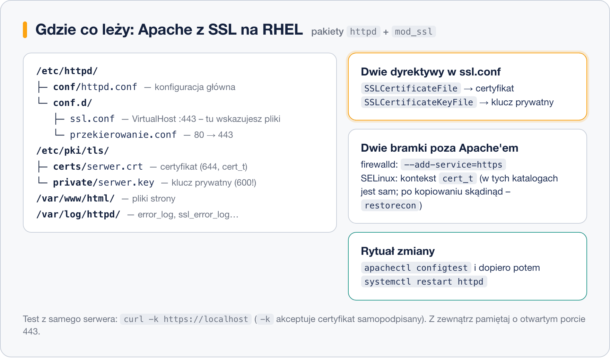

# Apache z HTTPS – certyfikat self-signed

> **W tej lekcji:** uruchomisz serwer Apache z HTTPS od zera: wygenerujesz certyfikat samopodpisany,
> skonfigurujesz `mod_ssl`, otworzysz firewall, dopilnujesz SELinuksa i włączysz przekierowanie
> z HTTP na HTTPS.

Certyfikat samopodpisany to idealne laboratorium: cała konfiguracja Apache'a wygląda identycznie
jak z certyfikatem komercyjnym, tylko podpis składasz sam. Gdy to przećwiczysz, podmiana na
certyfikat od CA (następna lekcja) będzie już tylko wymianą dwóch plików. Samopodpisane certyfikaty
spotkasz też w pracy: panele urządzeń, usługi wewnętrzne, środowiska testowe.

## Jak to działa

Na RHEL serwer Apache to pakiet `httpd`, a obsługę TLS dokłada moduł `mod_ssl`. Po jego instalacji
powstaje plik `/etc/httpd/conf.d/ssl.conf` z gotową sekcją `VirtualHost` dla portu 443 – wskazujesz
w niej dwa pliki: certyfikat i klucz prywatny. Konwencja miejsc na RHEL:



| Co | Gdzie |
|---|---|
| konfiguracja SSL | `/etc/httpd/conf.d/ssl.conf` |
| certyfikaty | `/etc/pki/tls/certs/` (kontekst SELinux `cert_t`) |
| klucze prywatne | `/etc/pki/tls/private/` (dostęp tylko dla roota) |
| strona | `/var/www/html/` |
| logi | `/var/log/httpd/` |

Do tego dwie bramki, o których początkujący zapominają: **firewalld** musi przepuszczać usługę
`https` (port 443), a pliki certyfikatów muszą mieć właściwy **kontekst SELinux** – jeśli trzymasz
je w katalogach z tabeli, konteksty ustawiają się same.

## W praktyce

### Krok 1: Apache z mod_ssl

```bash
# serwer WWW, moduł TLS i start usługi
sudo dnf install httpd mod_ssl
sudo systemctl enable --now httpd
```

```bash
# potwierdzenie, że moduł ssl jest załadowany
httpd -M | grep ssl
```

```text
 ssl_module (shared)
```

Testowa strona:

```bash
echo "<h1>Serwer szkoleniowy</h1>" | sudo tee /var/www/html/index.html
```

### Krok 2: certyfikat samopodpisany

Jedno polecenie `openssl` generuje od razu klucz prywatny i podpisany nim certyfikat:

```bash
# -x509: wystaw certyfikat (nie CSR), -nodes: klucz bez hasła (inaczej Apache pyta o nie przy każdym starcie),
# -days 365: rok ważności, -newkey rsa:2048: nowy klucz RSA
sudo openssl req -x509 -nodes -days 365 -newkey rsa:2048 \
  -keyout /etc/pki/tls/private/serwer.key \
  -out    /etc/pki/tls/certs/serwer.crt \
  -subj "/C=PL/O=Szkolenie/CN=serwer.example.com"
```

`CN` (Common Name) to nazwa, pod którą klienci będą wołać serwer. W `-subj` podajemy dane
nieinteraktywnie; bez tej opcji openssl zada serię pytań (kraj, organizacja…).

```bash
# klucz prywatny: tylko root może czytać
sudo chmod 600 /etc/pki/tls/private/serwer.key
sudo chmod 644 /etc/pki/tls/certs/serwer.crt
```

```bash
# kontrola kontekstów SELinux – w tych katalogach powinny być cert_t
ls -Z /etc/pki/tls/certs/serwer.crt /etc/pki/tls/private/serwer.key
```

```text
unconfined_u:object_r:cert_t:s0 /etc/pki/tls/certs/serwer.crt
unconfined_u:object_r:cert_t:s0 /etc/pki/tls/private/serwer.key
```

Gdyby pliki trafiły tam np. z katalogu domowego z błędnym kontekstem, naprawia go
`sudo restorecon -v /etc/pki/tls/certs/serwer.crt` (i analogicznie dla klucza).

### Krok 3: wskazanie plików w konfiguracji

```bash
sudo vi /etc/httpd/conf.d/ssl.conf
```

Znajdź i ustaw dwie dyrektywy (sekcja `<VirtualHost _default_:443>`):

```text
SSLCertificateFile    /etc/pki/tls/certs/serwer.crt
SSLCertificateKeyFile /etc/pki/tls/private/serwer.key
```

```bash
# test składni konfiguracji, dopiero potem restart
sudo apachectl configtest
sudo systemctl restart httpd
```

```text
Syntax OK
```

### Krok 4: firewall

```bash
# wpuszczamy HTTPS (i HTTP – do przekierowania w kroku 6)
sudo firewall-cmd --permanent --add-service=https --add-service=http
sudo firewall-cmd --reload
```

### Krok 5: test

```bash
# -k: zaakceptuj certyfikat, któremu curl nie ufa (samopodpisany) – do testów
curl -k https://localhost
```

```text
<h1>Serwer szkoleniowy</h1>
```

Bez `-k` zobaczysz błąd `self-signed certificate` – to **prawidłowe** zachowanie: nikt zaufany
nie potwierdził tożsamości serwera. Przeglądarka pokaże analogiczne ostrzeżenie z opcją
„przejdź mimo to”.

### Krok 6: przekierowanie 80 → 443

Użytkownicy wpisują adres bez `https://` – trafiają na port 80. Odeślij ich na szyfrowaną wersję:

```bash
sudo tee /etc/httpd/conf.d/przekierowanie.conf <<'EOF'
<VirtualHost *:80>
    ServerName serwer.example.com
    Redirect permanent / https://serwer.example.com/
</VirtualHost>
EOF
sudo apachectl configtest && sudo systemctl reload httpd
```

```bash
# -L każe curl podążać za przekierowaniem; nagłówek pokaże 301 → https
curl -kIL http://localhost
```

## Najczęstsze błędy i pułapki

- **Restart bez `configtest`.** Błąd w konfiguracji kładzie cały serwer. Nawyk:
  `apachectl configtest && systemctl restart httpd`.
- **Klucz z hasłem** (bez `-nodes`): Apache przy każdym starcie – także po restarcie serwera
  o 3 w nocy – czeka na wpisanie hasła i strona leży.
- **Strona działa lokalnie, z zewnątrz nie** – firewall. `curl` na samym serwerze omija firewalld;
  sprawdź `sudo firewall-cmd --list-services`.
- **`Permission denied` na pliku klucza w logu błędów** – złe uprawnienia albo kontekst SELinux
  (pliki kopiowane z `/root` czy `/home`). `chmod 600` + `restorecon -v`.
- **CN inny niż adres, którym wołasz serwer.** Certyfikat dla `serwer.example.com` otwierany przez
  `https://192.168.10.20` da dodatkowy błąd niezgodności nazwy – to nie usterka konfiguracji.

## Podsumowanie

- Komplet: `dnf install httpd mod_ssl` → `openssl req -x509 …` → dwie dyrektywy w `ssl.conf` →
  `configtest` → restart → firewall.
- Miejsca na pliki: certyfikat `/etc/pki/tls/certs/`, klucz `/etc/pki/tls/private/` (chmod 600) –
  tam konteksty SELinux (`cert_t`) są poprawne od ręki.
- Testuj `curl -k https://localhost`; ostrzeżenie o samopodpisaniu jest oczekiwane.
- Przekierowanie 80→443 to osobny `VirtualHost` z `Redirect permanent`.

| Zadanie | Polecenie |
|---|---|
| instalacja | `sudo dnf install httpd mod_ssl` |
| certyfikat self-signed | `sudo openssl req -x509 -nodes -days 365 -newkey rsa:2048 -keyout … -out … -subj "/CN=…"` |
| test konfiguracji | `sudo apachectl configtest` |
| firewall | `sudo firewall-cmd --permanent --add-service=https && sudo firewall-cmd --reload` |
| test strony | `curl -k https://localhost` |
| kontekst SELinux | `ls -Z plik`, `sudo restorecon -v plik` |
