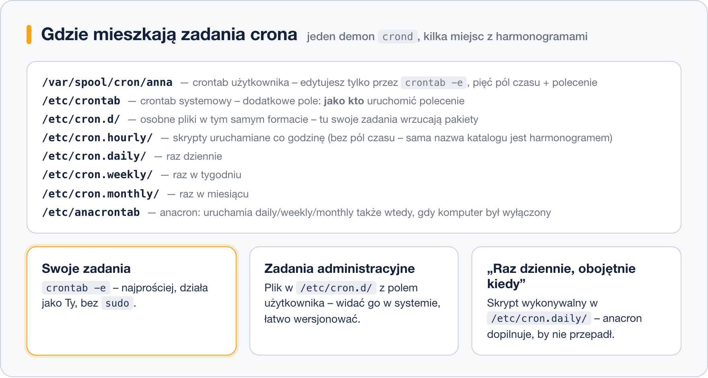

# Harmonogram zadań – cron i crontab

> **W tej lekcji:** nauczysz się zlecać systemowi samodzielne wykonywanie zadań o określonych porach — poznasz demona crond, polecenie `crontab`, systemowe katalogi crona i pułapki środowiska, w którym zadania są uruchamiane.

Kopia bazy o 2:00 w nocy, czyszczenie starych plików w niedzielę, raport wysyłany co poniedziałek rano — nikt nie będzie wstawał do tych zadań. W Linuksie wykonuje je **cron**: usługa, która od dziesięcioleci robi dokładnie jedno — uruchamia polecenia według harmonogramu. To odpowiednik Harmonogramu zadań z Windows, tyle że sterowany plikami tekstowymi.

## Jak to działa

Sercem mechanizmu jest demon **crond** — proces działający w tle od startu systemu. Co minutę sprawdza wszystkie harmonogramy i uruchamia to, czego czas właśnie nadszedł.

```bash
# czy demon pracuje
systemctl status crond
```

```text
● crond.service - Command Scheduler
     Active: active (running) since Mon 2026-10-12 08:11:40 CEST
```

Sam harmonogram — **crontab** (od ang. *cron table*, tablica crona) — to plik tekstowy, w którym każdy wiersz oznacza jedno zadanie: pięć pól czasu i polecenie. Składnią pól zajmuje się następna lekcja; tu ważne jest, **gdzie** te harmonogramy mieszkają:



- **Crontab użytkownika** — osobisty harmonogram każdego konta, przechowywany w `/var/spool/cron/`. Nie edytuje się go bezpośrednio, tylko przez polecenie `crontab`. Zadania działają z uprawnieniami właściciela.
- **`/etc/crontab` i katalog `/etc/cron.d/`** — harmonogramy systemowe. Mają jedno pole więcej: **nazwę użytkownika**, jako który polecenie ma się wykonać. Do `/etc/cron.d/` swoje pliki wrzucają pakiety (np. rotacja logów); to też dobre miejsce na zadania administracyjne, bo łatwo je wersjonować.
- **`/etc/cron.hourly|daily|weekly|monthly/`** — tu nie ma pól czasu: wrzucasz skrypt wykonywalny, a częstotliwość wynika z nazwy katalogu.
- **anacron** — pomocnik dla maszyn, które nie działają całą dobę. Zwykły cron po prostu przegapi zadanie, jeśli komputer był wyłączony o 2:00; anacron (konfiguracja w `/etc/anacrontab`) dopilnuje, by zadania daily/weekly/monthly wykonały się po włączeniu maszyny. Na serwerach działających non stop różnica jest niewidoczna.

### Środowisko zadań crona

Najwięcej frustracji początkujących bierze się stąd, że zadanie **działa w terminalu, a w cronie nie**. Powód: cron uruchamia polecenia w okrojonym środowisku:

- **Krótki PATH** — zwykle tylko `/usr/bin:/bin`. Polecenia z `/usr/sbin` czy `/usr/local/bin` trzeba podawać pełną ścieżką albo ustawić własny `PATH=` na początku crontaba.
- **Brak terminala i Twojego profilu** — nie wczytuje się `~/.bashrc`, nie ma zmiennych ustawianych przy logowaniu.
- **Wyjście nie trafia na ekran** — cron próbuje wysłać je lokalną pocztą do właściciela zadania. W praktyce lepiej przekierować je do pliku: `polecenie >> /var/log/moje.log 2>&1`.

### Gdzie szukać śladów

```bash
# dziennik demona crond: co i kiedy uruchomił
sudo journalctl -u crond --since today
```

```text
paź 18 02:00:01 serwer CROND[4211]: (anna) CMD (/usr/local/bin/kopia.sh)
```

Wpis `CMD (…)` oznacza, że cron zadanie **uruchomił** — jeśli mimo to nie ma efektów, problem leży w samym poleceniu (ścieżki, uprawnienia, środowisko).

## W praktyce

```bash
# edycja własnego harmonogramu (otworzy się edytor, domyślnie vi)
crontab -e

# podgląd własnego harmonogramu
crontab -l

# usunięcie CAŁEGO harmonogramu - bez pytania o potwierdzenie!
crontab -r

# administrator może obejrzeć/edytować crontab innego użytkownika
sudo crontab -u anna -l
sudo crontab -u anna -e
```

Przykładowy wpis dodany przez `crontab -e` (szczegóły składni w następnej lekcji):

```text
# kopia katalogu domowego codziennie o 2:30
30 2 * * * /usr/local/bin/kopia.sh >> /home/anna/kopia.log 2>&1
```

Dostępem do crona można sterować plikami `/etc/cron.allow` (lista uprawnionych) i `/etc/cron.deny` (lista zablokowanych) — na RHEL domyślnie istnieje pusty `cron.deny`, więc wszyscy mogą korzystać.

## Najczęstsze błędy i pułapki

- **`crontab -r` zamiast `crontab -e`.** Litery sąsiadują na klawiaturze, a `-r` kasuje cały harmonogram bez potwierdzenia. Rób kopię: `crontab -l > ~/crontab.kopia`.
- **Polecenie bez pełnej ścieżki.** W terminalu `moj-skrypt` działa, w cronie nie — bo PATH jest krótszy. Zawsze pełne ścieżki: `/usr/local/bin/moj-skrypt`.
- **Znak `%` w poleceniu.** Dla crona `%` oznacza nową linię — np. `date +%F` się wysypie. Trzeba go poprzedzić ukośnikiem: `date +\%F`.
- **Brak znaku nowej linii na końcu pliku.** Ostatni wiersz crontaba bez kończącego entera może zostać zignorowany. Edytor używany przez `crontab -e` zwykle o to dba — problem pojawia się przy generowaniu plików skryptami.
- **Edycja `/var/spool/cron/` bezpośrednio.** Omija kontrolę składni i powiadomienie demona. Zawsze przez `crontab -e`.

## Podsumowanie

- Demon **crond** co minutę sprawdza harmonogramy i uruchamia zaległe zadania; maszyny wyłączane na noc ratuje **anacron**.
- Własne zadania: `crontab -e` / `-l` / `-r` (ostrożnie!). Zadania systemowe: `/etc/crontab`, `/etc/cron.d/` (z polem użytkownika) oraz katalogi `cron.daily` itd.
- Cron ma okrojone środowisko: pełne ścieżki, własny `PATH=`, wyjście przekierowane do pliku.
- Diagnoza zawsze od `journalctl -u crond`.

| Polecenie | Co robi |
|---|---|
| `crontab -e` | edytuje Twój harmonogram |
| `crontab -l` | wyświetla Twój harmonogram |
| `crontab -r` | usuwa cały Twój harmonogram |
| `sudo crontab -u anna -l` | harmonogram innego użytkownika |
| `journalctl -u crond` | dziennik uruchomień |
