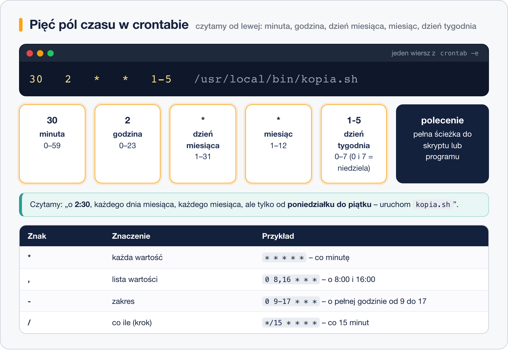

# Składnia czasu

> **W tej lekcji:** nauczysz się czytać i pisać pięć pól czasu crontaba, poznasz skróty typu `@daily` i zobaczysz, jak te same harmonogramy wyglądają w nowocześniejszych timerach systemd.

Pięć gwiazdek i polecenie — tak wygląda wpis crontaba. Cała sztuka to umieć powiedzieć w tych pięciu polach „w każdy piątek o 17:15” albo „co kwadrans w godzinach pracy”. Ta składnia jest niezmienna od dziesięcioleci i spotkasz ją wszędzie: w crontabach, w `/etc/cron.d/`, a nawet w narzędziach chmurowych i CI, które ją zapożyczyły.

## Jak to działa

Każdy wiersz harmonogramu zaczyna się od pięciu pól rozdzielonych spacjami:



Kolejno: **minuta** (0–59), **godzina** (0–23), **dzień miesiąca** (1–31), **miesiąc** (1–12), **dzień tygodnia** (0–7, gdzie 0 i 7 to niedziela). W polach można używać czterech znaków:

- `*` — każda wartość,
- `,` — lista: `1,15` = pierwszego i piętnastego,
- `-` — zakres: `9-17` = od 9 do 17 włącznie,
- `/` — krok: `*/10` = co 10.

Drobna pułapka logiczna: gdy wypełnisz **jednocześnie** dzień miesiąca i dzień tygodnia, cron wykona zadanie, gdy pasuje **którekolwiek** z nich (warunek „lub”, nie „i”).

### Przykłady z tłumaczeniem

| Wpis | Po polsku |
|---|---|
| `* * * * *` | co minutę |
| `*/15 * * * *` | co 15 minut |
| `0 * * * *` | o każdej pełnej godzinie |
| `30 2 * * *` | codziennie o 2:30 w nocy |
| `0 8 * * 1-5` | w dni robocze o 8:00 |
| `15 17 * * 5` | w każdy piątek o 17:15 |
| `0 3 1 * *` | pierwszego dnia każdego miesiąca o 3:00 |
| `0 0 1 1 *` | 1 stycznia o północy (raz w roku) |
| `*/10 8-16 * * 1-5` | co 10 minut między 8:00 a 16:59, pon–pt |
| `0 6,18 * * *` | codziennie o 6:00 i 18:00 |

### Skróty @

Zamiast pięciu pól można użyć skrótu:

| Skrót | Odpowiednik | Znaczenie |
|---|---|---|
| `@hourly` | `0 * * * *` | co godzinę |
| `@daily` / `@midnight` | `0 0 * * *` | codziennie o północy |
| `@weekly` | `0 0 * * 0` | co niedzielę o północy |
| `@monthly` | `0 0 1 * *` | pierwszego dnia miesiąca |
| `@yearly` / `@annually` | `0 0 1 1 *` | raz w roku |
| `@reboot` | — | raz, po starcie systemu |

`@reboot` nie ma odpowiednika w polach czasu i bywa bardzo wygodny: uruchomi np. prosty skrypt użytkownika bez pisania usługi systemd.

## W praktyce

```bash
crontab -e
```

```text
# własny PATH, żeby nie podawać ścieżek do standardowych narzędzi
PATH=/usr/local/bin:/usr/bin:/bin

# kopia bazy w dni robocze o 1:30, wyjście do logu
30 1 * * 1-5 /usr/local/bin/kopia-bazy.sh >> /var/log/kopia-bazy.log 2>&1

# czyszczenie starych plików tymczasowych co niedzielę o 4:00
0 4 * * 0 /usr/bin/find /srv/tmp -type f -mtime +14 -delete

# przypomnienie raz w miesiącu
@monthly /usr/bin/wall "Pierwszy dzień miesiąca - czas na przegląd kopii!"
```

Zanim zaufasz wpisowi, przeczytaj go na głos od lewej: „minuta 30, godzina 1, każdy dzień miesiąca, każdy miesiąc, dni 1–5”. Jeśli umiesz to powiedzieć po polsku — wpis jest dobry.

### Timery systemd – nowoczesna alternatywa

W systemach z systemd (czyli każdym RHEL 9/10) zadania cykliczne można definiować też jako **timery systemd**: para plików `.service` (co uruchomić) i `.timer` (kiedy). Dają rzeczy, których cron nie ma: logowanie w `journalctl`, zależności od innych usług, opcję `Persistent=true` (nadrabianie zaległości jak anacron) i czytelne `OnCalendar=Mon..Fri 01:30`. Wszystkie timery w systemie obejrzysz poleceniem:

```bash
systemctl list-timers
```

Dla własnych, prostych zadań crontab pozostaje najszybszym narzędziem; timery wybieraj tam, gdzie zadanie jest częścią większej układanki usług. Podstawy systemd znajdziesz w [module 13. Proces startu systemu](../../Dzia%C5%82%203%20-%20Zarz%C4%85dzanie%20systemem%20Linux/5.%20Proces%20startu%20systemu/1.%20Etapy%20startu%20systemu.md).

## Najczęstsze błędy i pułapki

- **`* 2 * * *` zamiast `0 2 * * *`.** Gwiazdka w polu minut oznacza „co minutę” — zadanie wykona się 60 razy między 2:00 a 2:59. Chcesz „o 2:00” — wpisz `0 2 * * *`.
- **Dzień miesiąca + dzień tygodnia naraz.** `0 9 13 * 5` to „13-tego LUB w piątek”, nie „w piątek 13-tego”.
- **Strefa czasowa.** crond używa czasu systemowego serwera — po zmianie strefy lub przy serwerze w UTC zadanie „o 2:00” wykona się o innej godzinie lokalnej, niż się spodziewasz. Sprawdź `timedatectl`.
- **Niewykonane zadania z nocy.** Jeśli maszyna była wyłączona, zwykły wpis crontaba przepada — użyj katalogu `/etc/cron.daily/` (pilnowanego przez anacron) albo timera z `Persistent=true`.

## Podsumowanie

- Pięć pól: minuta, godzina, dzień miesiąca, miesiąc, dzień tygodnia; znaki `*`, `,`, `-`, `/`.
- Czytaj wpisy na głos od lewej — to najlepszy test poprawności.
- Skróty `@daily`, `@weekly`, `@reboot` zastępują typowe kombinacje.
- Dzień miesiąca i dzień tygodnia łączą się jako „lub”.
- Nowoczesną alternatywą są timery systemd (`systemctl list-timers`) — z dziennikiem i nadrabianiem zaległości.
