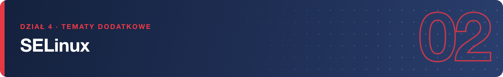
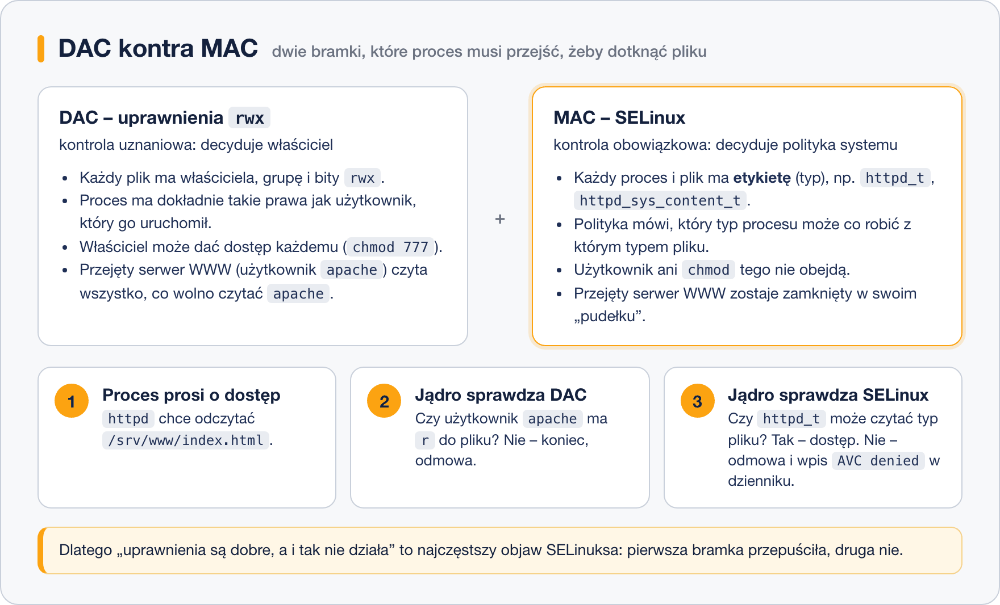

# Czym jest SELinux

> **W tej lekcji:** zrozumiesz, czym SELinux różni się od zwykłych uprawnień plikowych, czym są konteksty (etykiety) i polityka targeted — oraz dlaczego wyłączanie SELinuksa to zły nawyk.

Gdy napastnik znajdzie lukę w serwerze WWW i przejmie nad nim kontrolę, od tej chwili może robić wszystko, co wolno użytkownikowi `apache`: czytać pliki konfiguracyjne, grzebać w katalogach innych usług, próbować eskalacji. Zwykłe uprawnienia `rwx` go nie zatrzymają — serwer WWW przecież *legalnie* działa jako `apache`.

SELinux (Security-Enhanced Linux) to dodatkowa warstwa, która zatrzymuje właśnie taki scenariusz: trzyma każdą usługę w ciasnym „pudełku” i pozwala jej tylko na to, co z góry przewidziano. Przejęty serwer WWW może czytać strony WWW — i prawie nic więcej. W RHEL 9/10 SELinux jest włączony domyślnie i stanowi jeden z głównych powodów, dla których te systemy uchodzą za bezpieczne.

## Jak to działa

### DAC kontra MAC

Zwykłe uprawnienia (`rwx`, `chmod`, `chown`) to kontrola **uznaniowa** — DAC (ang. Discretionary Access Control): o dostępie decyduje właściciel pliku i może dać go każdemu. SELinux dodaje kontrolę **obowiązkową** — MAC (ang. Mandatory Access Control): o dostępie decyduje systemowa **polityka**, której nie obejdzie ani właściciel, ani `chmod 777`.

Obie bramki działają po kolei — żeby proces dostał się do pliku, muszą go przepuścić **obie**:



Obrazowo: DAC to zamek w drzwiach pokoju, który lokator może wymienić lub zostawić otwarty. MAC to regulamin budynku egzekwowany przez ochronę — nawet z kluczem nie wejdziesz tam, gdzie regulamin zabrania.

### Kontekst, czyli etykieta

SELinux opiera się na **kontekstach bezpieczeństwa** — etykietach przypiętych do każdego procesu i każdego pliku. Etykieta składa się z kilku pól, ale w codziennej pracy liczy się przedostatnie — **typ** (kończy się na `_t`):

```bash
# -Z dodaje kolumnę z kontekstem SELinux
ls -Z /var/www/html/index.html
```

```text
unconfined_u:object_r:httpd_sys_content_t:s0 /var/www/html/index.html
```

```bash
ps -Z -C httpd | head -2
```

```text
LABEL                               PID TTY   TIME     CMD
system_u:system_r:httpd_t:s0      21143 ?     00:00:01 httpd
```

Proces serwera WWW ma typ `httpd_t`, plik strony — `httpd_sys_content_t`. **Polityka** SELinuksa to ogromny zbiór reguł w stylu: „proces `httpd_t` może czytać pliki `httpd_sys_content_t`”. Czego reguła jawnie nie dozwala — jest zabronione, a próba kończy się odmową **AVC denied** zapisaną w dzienniku audytu.

### Polityka targeted

RHEL 9/10 używa polityki **targeted** (celowanej): w pudełkach SELinuksa siedzą **usługi sieciowe** — serwer WWW, bazy danych, SSH i dziesiątki innych — bo to one są wystawione na atak. Zwykli użytkownicy i procesy nieobjęte polityką działają jako typ `unconfined_t` (nieograniczony) i SELinux im nie przeszkadza. Dlatego na co dzień w ogóle nie zauważasz, że SELinux pracuje.

### Dlaczego nie wyłączać

W internecie pierwszą „poradą” na każdy problem bywa `setenforce 0` albo `SELINUX=disabled`. Nie rób tego:

- Wyłączasz zabezpieczenie **całego systemu**, bo jedna usługa ma źle ustawioną etykietę — to jak wymontowanie poduszek powietrznych, bo kontrolka się świeci.
- Niemal każdy problem z SELinuksem naprawia się jednym–dwoma poleceniami (`restorecon`, `setsebool`, `semanage`) — nauczysz się ich w następnej lekcji.
- System z trybu `disabled` wraca do `enforcing` boleśnie: wymaga ponownego etykietowania wszystkich plików i restartu.

## Najczęstsze błędy i pułapki

- **Diagnoza „to na pewno SELinux” bez dowodu.** Dowodem jest wpis AVC w dzienniku audytu — jak go znaleźć, pokazuje następna lekcja. Bez wpisu problem leży gdzie indziej (uprawnienia, zapora, konfiguracja usługi).
- **Mylenie SELinuksa z uprawnieniami.** `chmod 777` nie pomoże, gdy blokuje polityka — i odwrotnie: poprawna etykieta nie zastąpi brakującego `r` dla użytkownika.
- **Kopiowanie porad z wyłączaniem SELinuksa.** Stare poradniki (i duża część internetu) odruchowo każą go wyłączyć. Traktuj to jako sygnał, że poradnik jest przestarzały.

## Podsumowanie

- SELinux to kontrola obowiązkowa (MAC) **ponad** zwykłymi uprawnieniami (DAC) — obie bramki muszą przepuścić.
- Wszystko ma **etykietę**; w praktyce patrzysz na **typ** (`httpd_t`, `httpd_sys_content_t`), a polityka mówi, który typ procesu ma dostęp do którego typu pliku.
- RHEL 9/10 używa polityki **targeted** — pilnowane są głównie usługi sieciowe, użytkownicy pracują bez ograniczeń.
- Odmowa = wpis **AVC denied** w dzienniku audytu.
- Nie wyłączamy SELinuksa — naprawiamy etykiety i booleany (następna lekcja).

| Polecenie | Co robi |
|---|---|
| `ls -Z plik` | pokazuje kontekst pliku |
| `ps -Z -C httpd` | pokazuje kontekst procesów |
| `id -Z` | pokazuje Twój własny kontekst |
