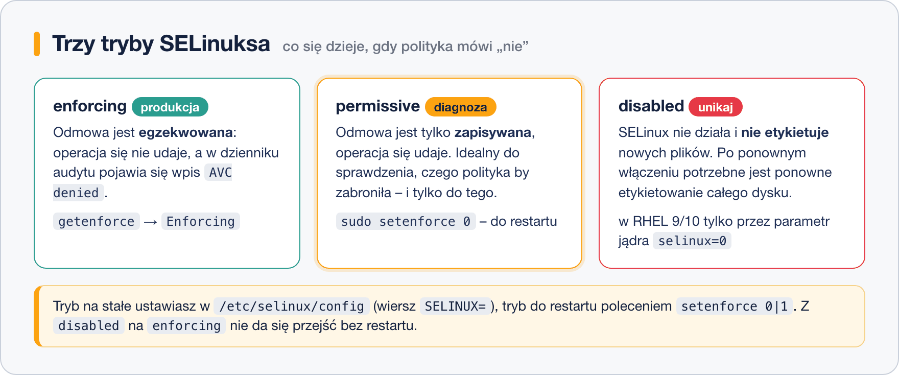
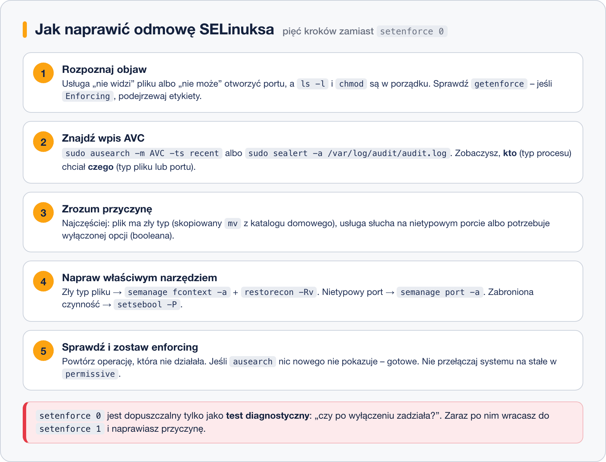

# Tryby pracy i diagnoza

> **W tej lekcji:** nauczysz się sprawdzać i przełączać tryby SELinuksa, czytać odmowy AVC i naprawiać najczęstsze problemy: złe etykiety plików, zablokowane booleany i nietypowe porty.

Prędzej czy później trafisz na usługę, która „nie działa, a wszystko jest dobrze ustawione” — bo blokuje ją SELinux. Ta lekcja pokazuje, jak szybko sprawdzić: *czy to SELinux? co dokładnie zablokował? jak to naprawić bez wyłączania ochrony?* — zamiast wklejać `setenforce 0` z pierwszego wyniku wyszukiwarki.

## Jak to działa

### Trzy tryby



- **enforcing** — polityka jest egzekwowana: zabronione operacje się nie udają, każda odmowa trafia do dziennika audytu. Tak pracują serwery produkcyjne.
- **permissive** — odmowy są tylko rejestrowane, operacje się udają. Tryb diagnostyczny: „co by zostało zablokowane?”.
- **disabled** — SELinux nie działa i nie etykietuje nowych plików; powrót wymaga ponownego etykietowania systemu plików i restartu. W RHEL 9/10 wyłączenie możliwe jest wyłącznie parametrem jądra `selinux=0` — wpis w pliku konfiguracyjnym już nie wystarcza.

```bash
# bieżący tryb
getenforce
```

```text
Enforcing
```

```bash
# przełączenie na permissive do czasu restartu (i z powrotem: 1)
sudo setenforce 0
```

Tryb na stałe ustawia wiersz `SELINUX=` w pliku `/etc/selinux/config` (tam też `SELINUXTYPE=targeted` wskazuje używaną politykę). Zmiana w pliku działa od następnego restartu.

### Gdzie szukać odmów

Odmowy (AVC, ang. Access Vector Cache) trafiają do dziennika audytu `/var/log/audit/audit.log`. Czyta się je narzędziem `ausearch`:

```bash
# odmowy z ostatnich minut
sudo ausearch -m AVC -ts recent
```

```text
time->Sat Oct 18 12:40:11 2026
type=AVC msg=audit(1792406411.123:842): avc:  denied  { read } for pid=21143
comm="httpd" name="index.html" ... scontext=system_u:system_r:httpd_t:s0
tcontext=unconfined_u:object_r:user_home_t:s0 tclass=file permissive=0
```

Czytamy: proces `httpd` (typ `httpd_t`) chciał **czytać** (`{ read }`) plik `index.html` o typie `user_home_t` — i dostał odmowę. Typ `user_home_t` zdradza przyczynę: plik przyniesiono z katalogu domowego.

Czytelniejsze tłumaczenia odmów na ludzki język (wraz z proponowaną naprawą) daje **`sealert`** z pakietu `setroubleshoot-server`:

```bash
sudo dnf install setroubleshoot-server
sudo sealert -a /var/log/audit/audit.log
```

### Ścieżka naprawy



### Typowy scenariusz: strona WWW w nietypowym katalogu

Chcesz serwować stronę z `/srv/strona` zamiast `/var/www/html`. Serwer zwraca „403 Forbidden”, a uprawnienia `rwx` są poprawne — bo katalog nie ma typu, który wolno czytać procesowi `httpd_t`. Naprawa to **nauczenie polityki** nowej ścieżki i odtworzenie etykiet:

```bash
# narzędzie semanage jest w pakiecie policycoreutils-python-utils
sudo dnf install policycoreutils-python-utils

# 1. rejestrujemy regułę: wszystko pod /srv/strona ma mieć typ treści WWW
sudo semanage fcontext -a -t httpd_sys_content_t "/srv/strona(/.*)?"

# 2. nakładamy etykiety zgodnie z regułami (R - rekursywnie, v - pokazuj zmiany)
sudo restorecon -Rv /srv/strona
```

```text
Relabeled /srv/strona from unconfined_u:object_r:var_t:s0
                        to unconfined_u:object_r:httpd_sys_content_t:s0
```

Kolejność jest ważna: `semanage fcontext` tylko zapisuje regułę w polityce, a dopiero `restorecon` zmienia etykiety na dysku. Za to duet ten jest **trwały** — przetrwa restart i ponowne etykietowanie systemu.

### Booleany – przełączniki w polityce

Polityka ma setki gotowych przełączników (ang. booleans) włączających przewidziane, ale domyślnie wyłączone zachowania:

```bash
# szukamy przełączników związanych z httpd
sudo getsebool -a | grep httpd | head -5
```

```text
httpd_can_connect_ftp --> off
httpd_can_network_connect --> off
httpd_can_network_connect_db --> off
...
```

```bash
# aplikacja WWW ma się łączyć z bazą danych na innym serwerze; -P = na stałe
sudo setsebool -P httpd_can_network_connect_db on
```

### Porty – gdy usługa słucha na nietypowym porcie

Polityka wie też, na których portach wolno słuchać każdemu typowi usługi. Przenosisz serwer WWW na port 8090? Dopisz port do polityki:

```bash
# jakie porty wolno zajmować serwerowi WWW
sudo semanage port -l | grep http_port_t
```

```text
http_port_t                    tcp      80, 81, 443, 488, 8008, 8009, 8443, 9000
```

```bash
# dodajemy port 8090 do typu http_port_t
sudo semanage port -a -t http_port_t -p tcp 8090
```

## Najczęstsze błędy i pułapki

- **`chcon` zamiast `semanage fcontext` + `restorecon`.** `chcon` zmienia etykietę „ręcznie”, ale polityka o tym nie wie — pełne ponowne etykietowanie cofnie zmianę. Trwale: zawsze przez `semanage`.
- **Przenoszenie plików przez `mv`.** `mv` zachowuje starą etykietę (np. `user_home_t` z katalogu domowego), `cp` nadaje etykietę katalogu docelowego. Po każdym `mv` do katalogów usług: `restorecon -Rv`.
- **Zostawianie systemu w permissive.** `setenforce 0` to test, nie rozwiązanie. Po diagnozie wróć: `setenforce 1`.
- **Brak narzędzi.** `semanage` i `sealert` nie są w minimalnej instalacji — pakiety `policycoreutils-python-utils` i `setroubleshoot-server`.
- **Szukanie AVC w `journalctl` i nieznalezienie niczego.** Odmowy audytu żyją w `/var/log/audit/audit.log` — czytaj je przez `ausearch -m AVC`.

## Podsumowanie

- Tryby: **enforcing** (produkcja), **permissive** (diagnoza), **disabled** (unikać); podgląd `getenforce`, do restartu `setenforce`, na stałe `/etc/selinux/config`.
- Diagnoza: `ausearch -m AVC -ts recent` lub `sealert -a`; w odmowie patrz na typ procesu i typ obiektu.
- Złe etykiety: `semanage fcontext -a -t TYP "ścieżka(/.*)?"` + `restorecon -Rv`.
- Zachowania przewidziane w polityce: `getsebool -a | grep usługa`, `setsebool -P nazwa on`.
- Nietypowe porty: `semanage port -a -t typ_portu -p tcp numer`.

| Polecenie | Co robi |
|---|---|
| `getenforce` / `setenforce 0\|1` | pokazuje / przełącza tryb (do restartu) |
| `ls -Z`, `ps -Z` | konteksty plików i procesów |
| `ausearch -m AVC -ts recent` | ostatnie odmowy |
| `sealert -a /var/log/audit/audit.log` | odmowy z tłumaczeniem i poradą |
| `semanage fcontext -a -t TYP "ścieżka(/.*)?"` | trwała reguła etykietowania |
| `restorecon -Rv katalog` | nakłada etykiety według polityki |
| `getsebool -a` / `setsebool -P` | podgląd / trwała zmiana booleanów |
| `semanage port -a -t TYP -p tcp NR` | dopuszcza nietypowy port |
